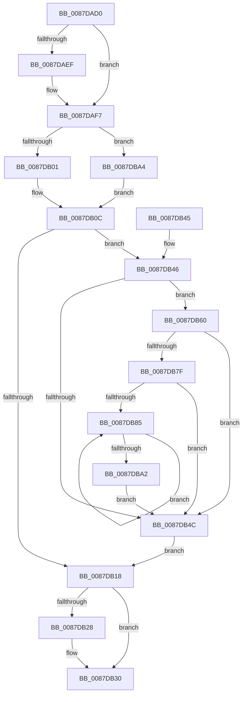

# PspLockJobChain

- RVA: `0x0087DAD0`–`0x0087DBAC` (길이 `220` bytes)
- VA: `0x000000014087DAD0`
- 실행 섹션: `PAGE`
- PDB 이름 있음: `예`; PDB Function 태그: `아니요`
- unwind 정보 RVA: `0x0007BF78`
- 디코드: `59`개 명령, `220/220` bytes 표시
- 미해석 바이트: `0` (있으면 어셈블리에 `.byte`로 보존)

> 이 문서는 커널 이미지의 기계어와 PDB 기호를 분석해 생성했습니다. 4번과 5번은 함수 원형과 자료형을 바이너리 사용 방식에서 추정한 C 해석이며 원본 소스 복구 결과는 아닙니다.

## 1. Dependencies

- 직접 호출 지점: **6**; 고유 호출 대상: **3**
- 직접 호출자로 확인된 함수: **5**
- RIP 상대 이미지 참조: **0**

### Outgoing calls
- `0x0087DB07` → [PspLockJobAssignment](PspLockJobAssignment_function_0087DC18.md) (function, `0x0087DC18`)
- `0x0087DB1E` → [ExAcquireResourceExclusiveLite](../../text/21/ExAcquireResourceExclusiveLite_function_00214E20.md) (function, `0x00214E20`)
- `0x0087DB2B` → [PspUnlockJobAssignment](PspUnlockJobAssignment_function_0087DBB4.md) (function, `0x0087DBB4`)
- `0x0087DB59` → [ExAcquireResourceExclusiveLite](../../text/21/ExAcquireResourceExclusiveLite_function_00214E20.md) (function, `0x00214E20`)
- `0x0087DB6D` → [ExAcquireResourceExclusiveLite](../../text/21/ExAcquireResourceExclusiveLite_function_00214E20.md) (function, `0x00214E20`)
- `0x0087DB97` → [ExAcquireResourceExclusiveLite](../../text/21/ExAcquireResourceExclusiveLite_function_00214E20.md) (function, `0x00214E20`)

### Direct callers
- [PspSetUILimitJobObject](../6F/PspSetUILimitJobObject_function_006FD218.md) at `0x006FD250`
- [PspLockJobsAndProcessExclusive](PspLockJobsAndProcessExclusive_function_0087D45C.md) at `0x0087D500`
- [PspImplicitAssignProcessToJob](PspImplicitAssignProcessToJob_function_0087D584.md) at `0x0087D5B4`
- [PspGetMemoryPartitionImplicit](PspGetMemoryPartitionImplicit_function_0087D888.md) at `0x0087D8BC`
- [NtSetInformationJobObject](../9F/NtSetInformationJobObject_function_009F84C0.md) at `0x009F9E81`

### Static image references
- 디코드된 RIP-relative 메모리 참조가 없습니다.

## 2. Other-region calls and transfers

- 다른 실행 섹션으로 향하는 call: **4**
  - `0x0087DB1E` → [ExAcquireResourceExclusiveLite](../../text/21/ExAcquireResourceExclusiveLite_function_00214E20.md) (`PAGE` → `.text`)
  - `0x0087DB59` → [ExAcquireResourceExclusiveLite](../../text/21/ExAcquireResourceExclusiveLite_function_00214E20.md) (`PAGE` → `.text`)
  - `0x0087DB6D` → [ExAcquireResourceExclusiveLite](../../text/21/ExAcquireResourceExclusiveLite_function_00214E20.md) (`PAGE` → `.text`)
  - `0x0087DB97` → [ExAcquireResourceExclusiveLite](../../text/21/ExAcquireResourceExclusiveLite_function_00214E20.md) (`PAGE` → `.text`)
- 별도 외부 분기/꼬리 이동을 확인하지 못했습니다.

## 3. Assembly (complete function range)

```asm
0087DAD0  48 89 5C 24 08                  mov qword ptr [rsp + 8], rbx
0087DAD5  48 89 6C 24 10                  mov qword ptr [rsp + 0x10], rbp
0087DADA  48 89 74 24 18                  mov qword ptr [rsp + 0x18], rsi
0087DADF  57                              push rdi
0087DAE0  48 83 EC 20                     sub rsp, 0x20
0087DAE4  48 8B DA                        mov rbx, rdx
0087DAE7  48 8B F9                        mov rdi, rcx
0087DAEA  48 85 D2                        test rdx, rdx
0087DAED  74 08                           je 0x14087daf7
0087DAEF  66 FF 8A E6 01 00 00            dec word ptr [rdx + 0x1e6]
0087DAF6  90                              nop
0087DAF7  41 F6 C0 01                     test r8b, 1
0087DAFB  0F 85 A3 00 00 00               jne 0x14087dba4
0087DB01  40 32 ED                        xor bpl, bpl
0087DB04  48 8B CB                        mov rcx, rbx
0087DB07  E8 0C 01 00 00                  call 0x14087dc18
0087DB0C  48 8B 87 38 05 00 00            mov rax, qword ptr [rdi + 0x538]
0087DB13  48 85 C0                        test rax, rax
0087DB16  75 2E                           jne 0x14087db46
0087DB18  48 8D 4F 38                     lea rcx, [rdi + 0x38]
0087DB1C  B2 01                           mov dl, 1
0087DB1E  E8 FD 72 99 FF                  call 0x140214e20
0087DB23  40 84 ED                        test bpl, bpl
0087DB26  75 08                           jne 0x14087db30
0087DB28  48 8B CB                        mov rcx, rbx
0087DB2B  E8 84 00 00 00                  call 0x14087dbb4
0087DB30  48 8B 5C 24 30                  mov rbx, qword ptr [rsp + 0x30]
0087DB35  48 8B 6C 24 38                  mov rbp, qword ptr [rsp + 0x38]
0087DB3A  48 8B 74 24 40                  mov rsi, qword ptr [rsp + 0x40]
0087DB3F  48 83 C4 20                     add rsp, 0x20
0087DB43  5F                              pop rdi
0087DB44  C3                              ret
0087DB45  CC                              int3
0087DB46  48 83 F8 01                     cmp rax, 1
0087DB4A  77 14                           ja 0x14087db60
0087DB4C  48 8B 8F 18 05 00 00            mov rcx, qword ptr [rdi + 0x518]
0087DB53  B2 01                           mov dl, 1
0087DB55  48 83 C1 38                     add rcx, 0x38
0087DB59  E8 C2 72 99 FF                  call 0x140214e20
0087DB5E  EB B8                           jmp 0x14087db18
0087DB60  48 8B 8F 20 05 00 00            mov rcx, qword ptr [rdi + 0x520]
0087DB67  B2 01                           mov dl, 1
0087DB69  48 83 C1 38                     add rcx, 0x38
0087DB6D  E8 AE 72 99 FF                  call 0x140214e20
0087DB72  48 8B B7 38 05 00 00            mov rsi, qword ptr [rdi + 0x538]
0087DB79  48 83 FE 02                     cmp rsi, 2
0087DB7D  76 CD                           jbe 0x14087db4c
0087DB7F  48 83 C6 FE                     add rsi, -2
0087DB83  74 C7                           je 0x14087db4c
0087DB85  48 8B 87 40 05 00 00            mov rax, qword ptr [rdi + 0x540]
0087DB8C  B2 01                           mov dl, 1
0087DB8E  48 8B 4C F0 F8                  mov rcx, qword ptr [rax + rsi*8 - 8]
0087DB93  48 83 C1 38                     add rcx, 0x38
0087DB97  E8 84 72 99 FF                  call 0x140214e20
0087DB9C  48 83 EE 01                     sub rsi, 1
0087DBA0  75 E3                           jne 0x14087db85
0087DBA2  EB A8                           jmp 0x14087db4c
0087DBA4  40 B5 01                        mov bpl, 1
0087DBA7  E9 60 FF FF FF                  jmp 0x14087db0c
```

## 4. C-style interpretation (structured pseudocode)

```c
__int64 __fastcall PspLockJobChain(__int64 a1, __int64 a2, unsigned __int8 a3)
{
    __int64 result;
    __int64 v_rbp;
    __int64 v_rsi;
    __int64 v_rsp;
    unsigned __int64 v_stack_p10;
    unsigned __int64 v_stack_p18;
    unsigned __int64 v_stack_p8;

    v_stack_p8 = v_rbx;
    v_stack_p10 = v_rbp;
    v_stack_p18 = v_rsi;
    v_rsp = (v_rsp) - (32);
    if (a2 != 0) {
    }
    if (((a3) & (1)) != 0) goto loc_0087DBA4;
    v_rbp = 0;
    result = PspLockJobAssignment(a2, a2, a3, a4);
loc_0087DB0C:
    if (*(unsigned __int64 *)(a1 + 1336) != 0) goto loc_0087DB46;
loc_0087DB18:
    result = ExAcquireResourceExclusiveLite(a1 + 56, 1, a3, a4);
    if (0 == 0) {
        a1 = a2;
        result = PspUnlockJobAssignment(a1, 1, a3, a4);
    }
    v_rsp = (v_rsp) + (32);
    return result;
loc_0087DB46:
    if (result > 1) goto loc_0087DB60;
loc_0087DB4C:
    a1 = (*(unsigned __int64 *)(a1 + 1304)) + (56);
    result = ExAcquireResourceExclusiveLite(a1, 1, a3, a4);
    goto loc_0087DB18;
loc_0087DB60:
    a1 = (*(unsigned __int64 *)(a1 + 1312)) + (56);
    result = ExAcquireResourceExclusiveLite(a1, 1, a3, a4);
    if ((*(unsigned __int64 *)(a1 + 1336)) <= 2) goto loc_0087DB4C;
    v_rsi = (*(unsigned __int64 *)(a1 + 1336)) + (-2);
    if (condition_is_equal) goto loc_0087DB4C;
loc_0087DB85:
    a1 = (*(unsigned __int64 *)(*(unsigned __int64 *)(a1 + 1344) + v_rsi * 8 - 8)) + (56);
    result = ExAcquireResourceExclusiveLite(a1, 1, a3, a4);
    v_rsi = (v_rsi) - (1);
    if (condition_is_not_equal) goto loc_0087DB85;
    goto loc_0087DB4C;
loc_0087DBA4:
    goto loc_0087DB0C;
}
```

## 5. (Beta) C Style

```c
int64_t PspLockJobChain(void *Arg1, int64_t Arg2, uint8_t Arg3)
{
    uint8_t *arg1 = (uint8_t *)Arg1;

    int64_t result;
    int64_t local_rbp;
    int64_t local_rsi;
    int64_t local_rsp;
    uint64_t v_stack_p10;
    uint64_t v_stack_p18;
    uint64_t v_stack_p8;

    v_stack_p8 = local_rbx;
    v_stack_p10 = local_rbp;
    v_stack_p18 = local_rsi;
    local_rsp = (local_rsp) - (32);
    if (Arg2 != 0) {
    }
    if (((Arg3) & (1)) != 0) goto loc_0087DBA4;
    local_rbp = 0;
    result = PspLockJobAssignment(Arg2, Arg2, Arg3, a4);
loc_0087DB0C:
    if (*(uint64_t *)(arg1 + 0x538) != 0) goto loc_0087DB46;
loc_0087DB18:
    result = ExAcquireResourceExclusiveLite(Arg1 + 56, 1, Arg3, a4);
    if (0 == 0) {
        Arg1 = Arg2;
        result = PspUnlockJobAssignment(Arg1, 1, Arg3, a4);
    }
    local_rsp = (local_rsp) + (32);
    return result;
loc_0087DB46:
    if (result > 1) goto loc_0087DB60;
loc_0087DB4C:
    Arg1 = (*(uint64_t *)(arg1 + 0x518)) + (56);
    result = ExAcquireResourceExclusiveLite(Arg1, 1, Arg3, a4);
    goto loc_0087DB18;
loc_0087DB60:
    Arg1 = (*(uint64_t *)(arg1 + 0x520)) + (56);
    result = ExAcquireResourceExclusiveLite(Arg1, 1, Arg3, a4);
    if ((*(uint64_t *)(arg1 + 0x538)) <= 2) goto loc_0087DB4C;
    local_rsi = (*(uint64_t *)(arg1 + 0x538)) + (-2);
    if (condition_is_equal) goto loc_0087DB4C;
loc_0087DB85:
    Arg1 = (*(uint64_t *)(*(uint64_t *)(arg1 + 0x540) + local_rsi * 8 - 0x8)) + (56);
    result = ExAcquireResourceExclusiveLite(Arg1, 1, Arg3, a4);
    local_rsi = (local_rsi) - (1);
    if (condition_is_not_equal) goto loc_0087DB85;
    goto loc_0087DB4C;
loc_0087DBA4:
    goto loc_0087DB0C;
}
```

### 관측된 메모리 오프셋

구조체 형식이 확인되지 않은 접근은 인자 기준의 오프셋으로만 기록했습니다.

| 기준 인자 | 오프셋 표현 | 폭 (bit) | 접근 |
|---|---:|---:|---|
| `Arg1` | `+ 0x38` | `64` | `R` |
| `Arg1` | `+ 0x518` | `64` | `R` |
| `Arg1` | `+ 0x520` | `64` | `R` |
| `Arg1` | `+ 0x538` | `64` | `R` |
| `Arg1` | `+ 0x540` | `64` | `R` |

## 6. Execution-region graph

[열기: 2D/3D 그래프와 함수 탐색 컨트롤 패널](../../../control-panel.html?section=page&rva=0x0087DAD0&view=graph)

- 2D 그래프는 위에서 아래로 흐르고, 3D 그래프는 빈 공간을 드래그해 회전합니다. Shift+드래그는 이동, 휠은 확대·축소, 함수 노드 선택은 대상 보고서 이동입니다.

### Static fallback


