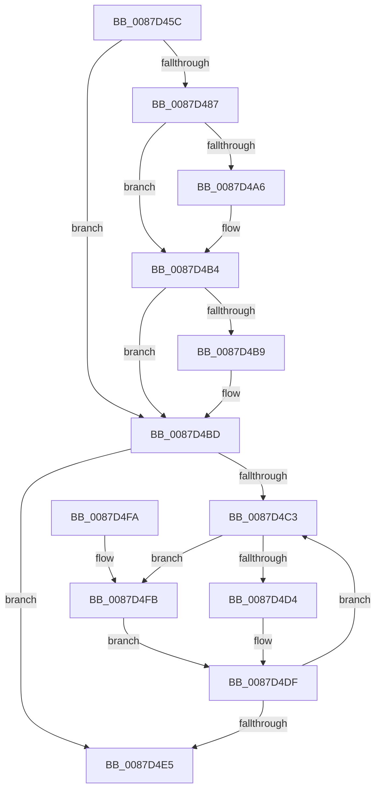

# PspLockJobsAndProcessExclusive

- RVA: `0x0087D45C`–`0x0087D507` (길이 `171` bytes)
- VA: `0x000000014087D45C`
- 실행 섹션: `PAGE`
- PDB 이름 있음: `예`; PDB Function 태그: `아니요`
- unwind 정보 RVA: `0x0007293C`
- 디코드: `52`개 명령, `171/171` bytes 표시
- 미해석 바이트: `0` (있으면 어셈블리에 `.byte`로 보존)

> 이 문서는 커널 이미지의 기계어와 PDB 기호를 분석해 생성했습니다. 4번과 5번은 함수 원형과 자료형을 바이너리 사용 방식에서 추정한 C 해석이며 원본 소스 복구 결과는 아닙니다.

## 1. Dependencies

- 직접 호출 지점: **4**; 고유 호출 대상: **4**
- 직접 호출자로 확인된 함수: **2**
- RIP 상대 이미지 참조: **0**

### Outgoing calls
- `0x0087D496` → [KeAbPreAcquire](../../text/21/KeAbPreAcquire_function_00210230.md) (function, `0x00210230`)
- `0x0087D4AF` → [ExfAcquirePushLockExclusiveEx](../../text/20/ExfAcquirePushLockExclusiveEx_function_0020FC90.md) (function, `0x0020FC90`)
- `0x0087D4DA` → [ExAcquireResourceExclusiveLite](../../text/21/ExAcquireResourceExclusiveLite_function_00214E20.md) (function, `0x00214E20`)
- `0x0087D500` → [PspLockJobChain](PspLockJobChain_function_0087DAD0.md) (function, `0x0087DAD0`)

### Direct callers
- [PspJobDelete](../../text/4B/PspJobDelete_function_004BF8F0.md) at `0x004BFB76`
- [PspAssignProcessToJob](../A2/PspAssignProcessToJob_function_00A23370.md) at `0x00A23478`

### Static image references
- 디코드된 RIP-relative 메모리 참조가 없습니다.

## 2. Other-region calls and transfers

- 다른 실행 섹션으로 향하는 call: **3**
  - `0x0087D496` → [KeAbPreAcquire](../../text/21/KeAbPreAcquire_function_00210230.md) (`PAGE` → `.text`)
  - `0x0087D4AF` → [ExfAcquirePushLockExclusiveEx](../../text/20/ExfAcquirePushLockExclusiveEx_function_0020FC90.md) (`PAGE` → `.text`)
  - `0x0087D4DA` → [ExAcquireResourceExclusiveLite](../../text/21/ExAcquireResourceExclusiveLite_function_00214E20.md) (`PAGE` → `.text`)
- 별도 외부 분기/꼬리 이동을 확인하지 못했습니다.

## 3. Assembly (complete function range)

```asm
0087D45C  48 89 5C 24 08                  mov qword ptr [rsp + 8], rbx
0087D461  48 89 6C 24 10                  mov qword ptr [rsp + 0x10], rbp
0087D466  48 89 74 24 18                  mov qword ptr [rsp + 0x18], rsi
0087D46B  57                              push rdi
0087D46C  48 83 EC 20                     sub rsp, 0x20
0087D470  66 41 FF 88 E6 01 00 00         dec word ptr [r8 + 0x1e6]
0087D478  41 8B E9                        mov ebp, r9d
0087D47B  83 E5 01                        and ebp, 1
0087D47E  48 8B F9                        mov rdi, rcx
0087D481  90                              nop
0087D482  48 85 D2                        test rdx, rdx
0087D485  74 36                           je 0x14087d4bd
0087D487  48 8D B2 C8 01 00 00            lea rsi, [rdx + 0x1c8]
0087D48E  45 33 C0                        xor r8d, r8d
0087D491  48 8B CE                        mov rcx, rsi
0087D494  33 D2                           xor edx, edx
0087D496  E8 95 2D 99 FF                  call 0x140210230
0087D49B  F0 48 0F BA 2E 00               lock bts qword ptr [rsi], 0
0087D4A1  48 8B D8                        mov rbx, rax
0087D4A4  73 0E                           jae 0x14087d4b4
0087D4A6  4C 8B C6                        mov r8, rsi
0087D4A9  48 8B D0                        mov rdx, rax
0087D4AC  48 8B CE                        mov rcx, rsi
0087D4AF  E8 DC 27 99 FF                  call 0x14020fc90
0087D4B4  48 85 DB                        test rbx, rbx
0087D4B7  74 04                           je 0x14087d4bd
0087D4B9  C6 43 0A 01                     mov byte ptr [rbx + 0xa], 1
0087D4BD  33 DB                           xor ebx, ebx
0087D4BF  39 1F                           cmp dword ptr [rdi], ebx
0087D4C1  76 22                           jbe 0x14087d4e5
0087D4C3  8B C3                           mov eax, ebx
0087D4C5  48 03 C0                        add rax, rax
0087D4C8  80 7C C7 10 00                  cmp byte ptr [rdi + rax*8 + 0x10], 0
0087D4CD  48 8B 4C C7 08                  mov rcx, qword ptr [rdi + rax*8 + 8]
0087D4D2  75 27                           jne 0x14087d4fb
0087D4D4  48 83 C1 38                     add rcx, 0x38
0087D4D8  B2 01                           mov dl, 1
0087D4DA  E8 41 79 99 FF                  call 0x140214e20
0087D4DF  FF C3                           inc ebx
0087D4E1  3B 1F                           cmp ebx, dword ptr [rdi]
0087D4E3  72 DE                           jb 0x14087d4c3
0087D4E5  48 8B 5C 24 30                  mov rbx, qword ptr [rsp + 0x30]
0087D4EA  48 8B 6C 24 38                  mov rbp, qword ptr [rsp + 0x38]
0087D4EF  48 8B 74 24 40                  mov rsi, qword ptr [rsp + 0x40]
0087D4F4  48 83 C4 20                     add rsp, 0x20
0087D4F8  5F                              pop rdi
0087D4F9  C3                              ret
0087D4FA  CC                              int3
0087D4FB  44 8B C5                        mov r8d, ebp
0087D4FE  33 D2                           xor edx, edx
0087D500  E8 CB 05 00 00                  call 0x14087dad0
0087D505  EB D8                           jmp 0x14087d4df
```

## 4. C-style interpretation (structured pseudocode)

```c
__int64 __fastcall PspLockJobsAndProcessExclusive(__int64 a1, __int64 a2, __int64 a3, int a4)
{
    __int64 result;
    __int64 v_rbp;
    __int64 v_rbx;
    __int64 v_rsp;
    unsigned __int64 v_stack_p10;
    unsigned __int64 v_stack_p18;
    unsigned __int64 v_stack_p8;

    v_stack_p8 = v_rbx;
    v_stack_p10 = v_rbp;
    v_stack_p18 = v_rsi;
    v_rsp = (v_rsp) - (32);
    v_rbp = (unsigned int)(((unsigned int)(a4)) & (1));
    if (a2 == 0) goto loc_0087D4BD;
    a3 = 0;
    a2 = 0;
    result = KeAbPreAcquire(a2 + 456, a2, a3, a4);
    if (!(condition_is_above_or_equal)) {
        a3 = a2 + 456;
        a2 = result;
        a1 = a2 + 456;
        result = ExfAcquirePushLockExclusiveEx(a1, a2, a3, a4);
    }
    if (result != 0) {
        *(unsigned __int8 *)(result + 10) = 1;
    }
    v_rbx = 0;
    if ((*(unsigned int *)(a1)) <= 0) goto loc_0087D4E5;
loc_0087D4C3:
    result = (0) + (0);
    if ((*(unsigned __int8 *)(a1 + result * 8 + 16)) != 0) goto loc_0087D4FB;
    a1 = (*(unsigned __int64 *)(a1 + result * 8 + 8)) + (56);
    result = ExAcquireResourceExclusiveLite(a1, 1, a3, a4);
loc_0087D4DF:
    v_rbx = (unsigned int)((v_rbx) + 1);
    if (((unsigned int)(v_rbx)) < (*(unsigned int *)(a1))) goto loc_0087D4C3;
loc_0087D4E5:
    v_rsp = (v_rsp) + (32);
    return result;
loc_0087D4FB:
    a2 = 0;
    result = PspLockJobChain(a1, a2, (unsigned int)((unsigned int)(v_stack_p10)), a4);
    goto loc_0087D4DF;
}
```

## 5. (Beta) C Style

```c
int64_t PspLockJobsAndProcessExclusive(void *Arg1, int64_t Arg2, void *Arg3, int32_t Arg4)
{
    uint8_t *arg1 = (uint8_t *)Arg1;
    uint8_t *arg3 = (uint8_t *)Arg3;

    int64_t result;
    int64_t local_rbp;
    int64_t local_rbx;
    int64_t local_rsp;
    uint64_t v_stack_p10;
    uint64_t v_stack_p18;
    uint64_t v_stack_p8;

    v_stack_p8 = local_rbx;
    v_stack_p10 = local_rbp;
    v_stack_p18 = local_rsi;
    local_rsp = (local_rsp) - (32);
    local_rbp = (uint32_t)(((uint32_t)(Arg4)) & (1));
    if (Arg2 == 0) goto loc_0087D4BD;
    Arg3 = 0;
    Arg2 = 0;
    result = KeAbPreAcquire(Arg2 + 456, Arg2, Arg3, Arg4);
    if (!(condition_is_above_or_equal)) {
        Arg3 = Arg2 + 456;
        Arg2 = result;
        Arg1 = Arg2 + 456;
        result = ExfAcquirePushLockExclusiveEx(Arg1, Arg2, Arg3, Arg4);
    }
    if (result != 0) {
        *(uint8_t *)(result + 0xA) = 1;
    }
    local_rbx = 0;
    if ((*(uint32_t *)(arg1)) <= 0) goto loc_0087D4E5;
loc_0087D4C3:
    result = (0) + (0);
    if ((*(uint8_t *)(arg1 + result * 8 + 0x10)) != 0) goto loc_0087D4FB;
    Arg1 = (*(uint64_t *)(arg1 + result * 8 + 0x8)) + (56);
    result = ExAcquireResourceExclusiveLite(Arg1, 1, Arg3, Arg4);
loc_0087D4DF:
    local_rbx = (uint32_t)((local_rbx) + 1);
    if (((uint32_t)(local_rbx)) < (*(uint32_t *)(arg1))) goto loc_0087D4C3;
loc_0087D4E5:
    local_rsp = (local_rsp) + (32);
    return result;
loc_0087D4FB:
    Arg2 = 0;
    result = PspLockJobChain(Arg1, Arg2, (uint32_t)((uint32_t)(v_stack_p10)), Arg4);
    goto loc_0087D4DF;
}
```

### 관측된 메모리 오프셋

구조체 형식이 확인되지 않은 접근은 인자 기준의 오프셋으로만 기록했습니다.

| 기준 인자 | 오프셋 표현 | 폭 (bit) | 접근 |
|---|---:|---:|---|
| `Arg1` | `+ 0x0` | `32` | `R` |
| `Arg1` | `+ 0x8 + rax*8` | `64` | `R` |
| `Arg1` | `+ 0x10 + rax*8` | `8` | `R` |
| `Arg3` | `+ 0x1E6` | `16` | `R/W` |

## 6. Execution-region graph

[열기: 2D/3D 그래프와 함수 탐색 컨트롤 패널](../../../control-panel.html?section=page&rva=0x0087D45C&view=graph)

- 2D 그래프는 위에서 아래로 흐르고, 3D 그래프는 빈 공간을 드래그해 회전합니다. Shift+드래그는 이동, 휠은 확대·축소, 함수 노드 선택은 대상 보고서 이동입니다.

### Static fallback


