# PspSetEffectiveJobLimits

- RVA: `0x0087E738`–`0x0087EA4A` (길이 `786` bytes)
- VA: `0x000000014087E738`
- 실행 섹션: `PAGE`
- PDB 이름 있음: `예`; PDB Function 태그: `예`
- unwind 정보 RVA: `0x0007C074`
- 디코드: `178`개 명령, `786/786` bytes 표시
- 미해석 바이트: `0` (있으면 어셈블리에 `.byte`로 보존)

> 이 문서는 커널 이미지의 기계어와 PDB 기호를 분석해 생성했습니다. 4번과 5번은 함수 원형과 자료형을 바이너리 사용 방식에서 추정한 C 해석이며 원본 소스 복구 결과는 아닙니다.

## 1. Dependencies

- 직접 호출 지점: **10**; 고유 호출 대상: **4**
- 직접 호출자로 확인된 함수: **2**
- RIP 상대 이미지 참조: **2**

### Outgoing calls
- `0x0087E777` → [memset](../../text/6C/memset_function_006C6C40.md) (function, `0x006C6C40`)
- `0x0087E78B` → [PspSetEffectiveLimit](PspSetEffectiveLimit_function_0087EA50.md) (function, `0x0087EA50`)
- `0x0087E7A6` → [PspSetEffectiveLimit](PspSetEffectiveLimit_function_0087EA50.md) (function, `0x0087EA50`)
- `0x0087E7BB` → [PspSetEffectiveLimit](PspSetEffectiveLimit_function_0087EA50.md) (function, `0x0087EA50`)
- `0x0087E7CB` → [PspSetEffectiveLimit](PspSetEffectiveLimit_function_0087EA50.md) (function, `0x0087EA50`)
- `0x0087E7DE` → [PspSetEffectiveLimit](PspSetEffectiveLimit_function_0087EA50.md) (function, `0x0087EA50`)
- `0x0087E821` → [PspSetEffectiveLimit](PspSetEffectiveLimit_function_0087EA50.md) (function, `0x0087EA50`)
- `0x0087E856` → [_security_check_cookie](../../text/6A/_security_check_cookie_function_006AC640.md) (function, `0x006AC640`)
- `0x0087E97F` → [KiCopyAffinityEx](../../text/2C/KiCopyAffinityEx_function_002CE860.md) (function, `0x002CE860`)
- `0x0087E9A5` → [memset](../../text/6C/memset_function_006C6C40.md) (function, `0x006C6C40`)

### Direct callers
- [PspEstablishJobHierarchy](PspEstablishJobHierarchy_function_0087E17C.md) at `0x0087E3B6`
- [PspSetJobLimitsJobPreCallback](PspSetJobLimitsJobPreCallback_function_0087E6C0.md) at `0x0087E6D0`

### Static image references
- `0x0087E74F` → RVA `0x00E0A740` (`.data`; read)
- `0x0087E9CE` → RVA `0x00B4AF50` (`PspPriorityClassRank`; read)

## 2. Other-region calls and transfers

- 다른 실행 섹션으로 향하는 call: **4**
  - `0x0087E777` → [memset](../../text/6C/memset_function_006C6C40.md) (`PAGE` → `.text`)
  - `0x0087E856` → [_security_check_cookie](../../text/6A/_security_check_cookie_function_006AC640.md) (`PAGE` → `.text`)
  - `0x0087E97F` → [KiCopyAffinityEx](../../text/2C/KiCopyAffinityEx_function_002CE860.md) (`PAGE` → `.text`)
  - `0x0087E9A5` → [memset](../../text/6C/memset_function_006C6C40.md) (`PAGE` → `.text`)
- call이 아닌 외부 분기/꼬리 이동: **5**
  - `0x0087E962` → [sub_00B18AF6](../B1/Unknown_function_00B18AF6.md) (`tail-transfer`)
  - `0x0087EA0F` → [sub_00B18AF6 + 0xA0](../B1/Unknown_function_00B18AF6.md) (`tail-transfer`)
  - `0x0087EA1E` → [sub_00B18AF6 + 0xA0](../B1/Unknown_function_00B18AF6.md) (`tail-transfer`)
  - `0x0087EA36` → [sub_00B18AF6 + 0xBA](../B1/Unknown_function_00B18AF6.md) (`tail-transfer`)
  - `0x0087EA45` → [sub_00B18AF6 + 0xBA](../B1/Unknown_function_00B18AF6.md) (`tail-transfer`)

## 3. Assembly (complete function range)

```asm
0087E738  48 89 5C 24 18                  mov qword ptr [rsp + 0x18], rbx
0087E73D  55                              push rbp
0087E73E  56                              push rsi
0087E73F  57                              push rdi
0087E740  41 54                           push r12
0087E742  41 55                           push r13
0087E744  41 56                           push r14
0087E746  41 57                           push r15
0087E748  48 81 EC 40 01 00 00            sub rsp, 0x140
0087E74F  48 8B 05 EA BF 58 00            mov rax, qword ptr [rip + 0x58bfea]
0087E756  48 33 C4                        xor rax, rsp
0087E759  48 89 84 24 30 01 00 00         mov qword ptr [rsp + 0x130], rax
0087E761  4C 8B F2                        mov r14, rdx
0087E764  48 8B F9                        mov rdi, rcx
0087E767  41 BD 00 01 00 00               mov r13d, 0x100
0087E76D  48 8D 4C 24 28                  lea rcx, [rsp + 0x28]
0087E772  45 8B C5                        mov r8d, r13d
0087E775  33 D2                           xor edx, edx
0087E777  E8 C4 84 E4 FF                  call 0x1406c6c40
0087E77C  48 8B B7 18 05 00 00            mov rsi, qword ptr [rdi + 0x518]
0087E783  49 8B D6                        mov rdx, r14
0087E786  B9 10 00 00 00                  mov ecx, 0x10
0087E78B  E8 C0 02 00 00                  call 0x14087ea50
0087E790  44 8D 61 F1                     lea r12d, [rcx - 0xf]
0087E794  44 8D 79 10                     lea r15d, [rcx + 0x10]
0087E798  84 C0                           test al, al
0087E79A  0F 85 BA 01 00 00               jne 0x14087e95a
0087E7A0  49 8B D6                        mov rdx, r14
0087E7A3  41 8B CF                        mov ecx, r15d
0087E7A6  E8 A5 02 00 00                  call 0x14087ea50
0087E7AB  84 C0                           test al, al
0087E7AD  0F 85 86 01 00 00               jne 0x14087e939
0087E7B3  49 8B D6                        mov rdx, r14
0087E7B6  B9 80 00 00 00                  mov ecx, 0x80
0087E7BB  E8 90 02 00 00                  call 0x14087ea50
0087E7C0  84 C0                           test al, al
0087E7C2  0F 85 21 01 00 00               jne 0x14087e8e9
0087E7C8  41 8B CC                        mov ecx, r12d
0087E7CB  E8 80 02 00 00                  call 0x14087ea50
0087E7D0  84 C0                           test al, al
0087E7D2  0F 85 9F 00 00 00               jne 0x14087e877
0087E7D8  49 8B D6                        mov rdx, r14
0087E7DB  41 8B CD                        mov ecx, r13d
0087E7DE  E8 6D 02 00 00                  call 0x14087ea50
0087E7E3  84 C0                           test al, al
0087E7E5  74 32                           je 0x14087e819
0087E7E7  48 85 F6                        test rsi, rsi
0087E7EA  0F 84 99 01 00 00               je 0x14087e989
0087E7F0  48 8B 8E F8 03 00 00            mov rcx, qword ptr [rsi + 0x3f8]
0087E7F7  48 8B 96 00 04 00 00            mov rdx, qword ptr [rsi + 0x400]
0087E7FE  44 85 AF 00 01 00 00            test dword ptr [rdi + 0x100], r13d
0087E805  0F 85 06 01 00 00               jne 0x14087e911
0087E80B  48 89 8F F8 03 00 00            mov qword ptr [rdi + 0x3f8], rcx
0087E812  48 89 97 00 04 00 00            mov qword ptr [rdi + 0x400], rdx
0087E819  49 8B D6                        mov rdx, r14
0087E81C  B9 02 00 00 00                  mov ecx, 2
0087E821  E8 2A 02 00 00                  call 0x14087ea50
0087E826  84 C0                           test al, al
0087E828  0F 85 82 00 00 00               jne 0x14087e8b0
0087E82E  8B 87 00 01 00 00               mov eax, dword ptr [rdi + 0x100]
0087E834  89 87 20 04 00 00               mov dword ptr [rdi + 0x420], eax
0087E83A  48 85 F6                        test rsi, rsi
0087E83D  74 0C                           je 0x14087e84b
0087E83F  0B 86 20 04 00 00               or eax, dword ptr [rsi + 0x420]
0087E845  89 87 20 04 00 00               mov dword ptr [rdi + 0x420], eax
0087E84B  48 8B 8C 24 30 01 00 00         mov rcx, qword ptr [rsp + 0x130]
0087E853  48 33 CC                        xor rcx, rsp
0087E856  E8 E5 DD E2 FF                  call 0x1406ac640
0087E85B  48 8B 9C 24 90 01 00 00         mov rbx, qword ptr [rsp + 0x190]
0087E863  48 81 C4 40 01 00 00            add rsp, 0x140
0087E86A  41 5F                           pop r15
0087E86C  41 5E                           pop r14
0087E86E  41 5D                           pop r13
0087E870  41 5C                           pop r12
0087E872  5F                              pop rdi
0087E873  5E                              pop rsi
0087E874  5D                              pop rbp
0087E875  C3                              ret
0087E876  CC                              int3
0087E877  48 85 F6                        test rsi, rsi
0087E87A  0F 84 3D 01 00 00               je 0x14087e9bd
0087E880  48 8B 96 E8 03 00 00            mov rdx, qword ptr [rsi + 0x3e8]
0087E887  48 8B 8E F0 03 00 00            mov rcx, qword ptr [rsi + 0x3f0]
0087E88E  8B 87 00 01 00 00               mov eax, dword ptr [rdi + 0x100]
0087E894  41 84 C4                        test r12b, al
0087E897  0F 85 68 01 00 00               jne 0x14087ea05
0087E89D  48 89 8F F0 03 00 00            mov qword ptr [rdi + 0x3f0], rcx
0087E8A4  48 89 97 E8 03 00 00            mov qword ptr [rdi + 0x3e8], rdx
0087E8AB  E9 28 FF FF FF                  jmp 0x14087e7d8
0087E8B0  48 85 F6                        test rsi, rsi
0087E8B3  0F 84 6A 01 00 00               je 0x14087ea23
0087E8B9  48 8B 86 E0 03 00 00            mov rax, qword ptr [rsi + 0x3e0]
0087E8C0  48 8B 96 08 04 00 00            mov rdx, qword ptr [rsi + 0x408]
0087E8C7  8B 8F 00 01 00 00               mov ecx, dword ptr [rdi + 0x100]
0087E8CD  F6 C1 02                        test cl, 2
0087E8D0  0F 85 56 01 00 00               jne 0x14087ea2c
0087E8D6  48 89 87 E0 03 00 00            mov qword ptr [rdi + 0x3e0], rax
0087E8DD  48 89 97 08 04 00 00            mov qword ptr [rdi + 0x408], rdx
0087E8E4  E9 45 FF FF FF                  jmp 0x14087e82e
0087E8E9  48 85 F6                        test rsi, rsi
0087E8EC  0F 84 C1 00 00 00               je 0x14087e9b3
0087E8F2  8B 8E 24 04 00 00               mov ecx, dword ptr [rsi + 0x424]
0087E8F8  8B 87 00 01 00 00               mov eax, dword ptr [rdi + 0x100]
0087E8FE  84 C0                           test al, al
0087E900  0F 88 E6 00 00 00               js 0x14087e9ec
0087E906  89 8F 24 04 00 00               mov dword ptr [rdi + 0x424], ecx
0087E90C  E9 B7 FE FF FF                  jmp 0x14087e7c8
0087E911  48 8B 87 B0 02 00 00            mov rax, qword ptr [rdi + 0x2b0]
0087E918  48 3B C1                        cmp rax, rcx
0087E91B  72 09                           jb 0x14087e926
0087E91D  48 85 C9                        test rcx, rcx
0087E920  0F 85 E5 FE FF FF               jne 0x14087e80b
0087E926  48 89 87 F8 03 00 00            mov qword ptr [rdi + 0x3f8], rax
0087E92D  48 89 BF 00 04 00 00            mov qword ptr [rdi + 0x400], rdi
0087E934  E9 E0 FE FF FF                  jmp 0x14087e819
0087E939  48 85 F6                        test rsi, rsi
0087E93C  74 71                           je 0x14087e9af
0087E93E  8A 96 4C 04 00 00               mov dl, byte ptr [rsi + 0x44c]
0087E944  8B 87 00 01 00 00               mov eax, dword ptr [rdi + 0x100]
0087E94A  41 84 C7                        test r15b, al
0087E94D  75 77                           jne 0x14087e9c6
0087E94F  88 97 4C 04 00 00               mov byte ptr [rdi + 0x44c], dl
0087E955  E9 59 FE FF FF                  jmp 0x14087e7b3
0087E95A  8B 87 00 01 00 00               mov eax, dword ptr [rdi + 0x100]
0087E960  84 C1                           test cl, al
0087E962  0F 85 8E A1 29 00               jne 0x140b18af6
0087E968  48 8D 8F D8 02 00 00            lea rcx, [rdi + 0x2d8]
0087E96F  48 85 F6                        test rsi, rsi
0087E972  74 1E                           je 0x14087e992
0087E974  4C 8D 86 D8 02 00 00            lea r8, [rsi + 0x2d8]
0087E97B  0F B7 51 02                     movzx edx, word ptr [rcx + 2]
0087E97F  E8 DC FE A4 FF                  call 0x1402ce860
0087E984  E9 17 FE FF FF                  jmp 0x14087e7a0
0087E989  33 C9                           xor ecx, ecx
0087E98B  33 D2                           xor edx, edx
0087E98D  E9 6C FE FF FF                  jmp 0x14087e7fe
0087E992  83 61 04 00                     and dword ptr [rcx + 4], 0
0087E996  4D 8B C5                        mov r8, r13
0087E999  C7 01 01 00 20 00               mov dword ptr [rcx], 0x200001
0087E99F  33 D2                           xor edx, edx
0087E9A1  48 83 C1 08                     add rcx, 8
0087E9A5  E8 96 82 E4 FF                  call 0x1406c6c40
0087E9AA  E9 F1 FD FF FF                  jmp 0x14087e7a0
0087E9AF  32 D2                           xor dl, dl
0087E9B1  EB 91                           jmp 0x14087e944
0087E9B3  B9 0A 00 00 00                  mov ecx, 0xa
0087E9B8  E9 3B FF FF FF                  jmp 0x14087e8f8
0087E9BD  33 D2                           xor edx, edx
0087E9BF  33 C9                           xor ecx, ecx
0087E9C1  E9 C8 FE FF FF                  jmp 0x14087e88e
0087E9C6  44 0F B6 87 4D 04 00 00         movzx r8d, byte ptr [rdi + 0x44d]
0087E9CE  4C 8D 0D 7B C5 2C 00            lea r9, [rip + 0x2cc57b]
0087E9D5  0F B6 CA                        movzx ecx, dl
0087E9D8  0F B6 D2                        movzx edx, dl
0087E9DB  43 8A 04 08                     mov al, byte ptr [r8 + r9]
0087E9DF  42 38 04 09                     cmp byte ptr [rcx + r9], al
0087E9E3  41 0F 43 D0                     cmovae edx, r8d
0087E9E7  E9 63 FF FF FF                  jmp 0x14087e94f
0087E9EC  8B 87 44 02 00 00               mov eax, dword ptr [rdi + 0x244]
0087E9F2  3B C1                           cmp eax, ecx
0087E9F4  0F 83 0C FF FF FF               jae 0x14087e906
0087E9FA  89 87 24 04 00 00               mov dword ptr [rdi + 0x424], eax
0087EA00  E9 C3 FD FF FF                  jmp 0x14087e7c8
0087EA05  48 8B 87 F8 00 00 00            mov rax, qword ptr [rdi + 0xf8]
0087EA0C  48 3B C1                        cmp rax, rcx
0087EA0F  0F 82 81 A1 29 00               jb 0x140b18b96
0087EA15  48 85 C9                        test rcx, rcx
0087EA18  0F 85 7F FE FF FF               jne 0x14087e89d
0087EA1E  E9 73 A1 29 00                  jmp 0x140b18b96
0087EA23  33 C0                           xor eax, eax
0087EA25  33 D2                           xor edx, edx
0087EA27  E9 9B FE FF FF                  jmp 0x14087e8c7
0087EA2C  48 8B 8F E0 00 00 00            mov rcx, qword ptr [rdi + 0xe0]
0087EA33  48 3B C8                        cmp rcx, rax
0087EA36  0F 8C 74 A1 29 00               jl 0x140b18bb0
0087EA3C  48 85 C0                        test rax, rax
0087EA3F  0F 85 91 FE FF FF               jne 0x14087e8d6
0087EA45  E9 66 A1 29 00                  jmp 0x140b18bb0
```

## 4. C-style interpretation (structured pseudocode)

```c
__int64 __fastcall PspSetEffectiveJobLimits(__int64 a1, __int64 a2)
{
    __int64 result;
    __int64 v_rsp;
    unsigned __int64 v_stack_m150;
    unsigned __int64 v_stack_m48;
    unsigned __int64 v_stack_p18;

    v_stack_p18 = v_rbx;
    v_rsp = (v_rsp) - (320);
    result = (*(unsigned __int64 *)(v_rip + 5816298)) ^ (v_rsp);
    v_stack_m48 = result;
    a2 = 0;
    result = memset(v_stack_m150, a2, 256, a4);
    result = PspSetEffectiveLimit(16, 0, 256, a4);
    if ((unsigned __int8)(result) != 0) goto loc_0087E95A;
loc_0087E7A0:
    result = PspSetEffectiveLimit((unsigned int)((unsigned int)(16 + 16)), 0, 256, a4);
    if ((unsigned __int8)(result) != 0) goto loc_0087E939;
loc_0087E7B3:
    result = PspSetEffectiveLimit(128, 0, 256, a4);
    if ((unsigned __int8)(result) != 0) goto loc_0087E8E9;
loc_0087E7C8:
    result = PspSetEffectiveLimit((unsigned int)((unsigned int)(16 - 15)), 0, 256, a4);
    if ((unsigned __int8)(result) != 0) goto loc_0087E877;
loc_0087E7D8:
    result = PspSetEffectiveLimit(256, 0, 256, a4);
    if ((unsigned __int8)(result) == 0) goto loc_0087E819;
    if (*(unsigned __int64 *)(a1 + 1304) == 0) goto loc_0087E989;
loc_0087E7FE:
    if (((*(unsigned int *)(a1 + 256)) & (256)) != 0) goto loc_0087E911;
loc_0087E80B:
    *(unsigned __int64 *)(a1 + 1016) = *(unsigned __int64 *)(*(unsigned __int64 *)(a1 + 1304) + 1016);
    *(unsigned __int64 *)(a1 + 1024) = *(unsigned __int64 *)(*(unsigned __int64 *)(a1 + 1304) + 1024);
loc_0087E819:
    result = PspSetEffectiveLimit(2, 0, 256, a4);
    if ((unsigned __int8)(result) != 0) goto loc_0087E8B0;
loc_0087E82E:
    *(unsigned int *)(a1 + 1056) = (unsigned int)((unsigned int)(*(unsigned int *)(a1 + 256)));
    result = (unsigned int)(*(unsigned int *)(a1 + 256));
    if (*(unsigned __int64 *)(a1 + 1304) != 0) {
        result = (unsigned int)(((unsigned int)(*(unsigned int *)(a1 + 256))) | (*(unsigned int *)(*(unsigned __int64 *)(a1 + 1304) + 1056)));
        *(unsigned int *)(a1 + 1056) = (unsigned int)(result);
    }
    a1 = (v_stack_m48) ^ (v_rsp);
    result = _security_check_cookie(a1, 0, 256, a4);
    v_rsp = (v_rsp) + (320);
    return result;
loc_0087E877:
    if (*(unsigned __int64 *)(a1 + 1304) == 0) goto loc_0087E9BD;
loc_0087E88E:
    if ((((unsigned __int8)(16 - 15)) & ((unsigned __int8)((unsigned int)(*(unsigned int *)(a1 + 256))))) != 0) goto loc_0087EA05;
loc_0087E89D:
    *(unsigned __int64 *)(a1 + 1008) = *(unsigned __int64 *)(*(unsigned __int64 *)(a1 + 1304) + 1008);
    *(unsigned __int64 *)(a1 + 1000) = *(unsigned __int64 *)(*(unsigned __int64 *)(a1 + 1304) + 1000);
    goto loc_0087E7D8;
loc_0087E8B0:
    if (*(unsigned __int64 *)(a1 + 1304) == 0) goto loc_0087EA23;
loc_0087E8C7:
    if ((((unsigned __int8)((unsigned int)(*(unsigned int *)(a1 + 256)))) & (2)) != 0) goto loc_0087EA2C;
loc_0087E8D6:
    *(unsigned __int64 *)(a1 + 992) = *(unsigned __int64 *)(*(unsigned __int64 *)(a1 + 1304) + 992);
    *(unsigned __int64 *)(a1 + 1032) = *(unsigned __int64 *)(*(unsigned __int64 *)(a1 + 1304) + 1032);
    goto loc_0087E82E;
loc_0087E8E9:
    if (*(unsigned __int64 *)(a1 + 1304) == 0) goto loc_0087E9B3;
loc_0087E8F8:
    if (sign_flag) goto loc_0087E9EC;
loc_0087E906:
    *(unsigned int *)(a1 + 1060) = (unsigned int)((unsigned int)(*(unsigned int *)(*(unsigned __int64 *)(a1 + 1304) + 1060)));
    goto loc_0087E7C8;
loc_0087E911:
    if ((*(unsigned __int64 *)(a1 + 688)) < ((unsigned int)(*(unsigned int *)(*(unsigned __int64 *)(a1 + 1304) + 1060)))) goto loc_0087E926;
    if ((unsigned int)(*(unsigned int *)(*(unsigned __int64 *)(a1 + 1304) + 1060)) != 0) goto loc_0087E80B;
loc_0087E926:
    *(unsigned __int64 *)(a1 + 1016) = *(unsigned __int64 *)(a1 + 688);
    *(unsigned __int64 *)(a1 + 1024) = a1;
    goto loc_0087E819;
loc_0087E939:
    if (*(unsigned __int64 *)(a1 + 1304) == 0) goto loc_0087E9AF;
loc_0087E944:
    if ((((unsigned __int8)(16 + 16)) & ((unsigned __int8)((unsigned int)(*(unsigned int *)(a1 + 256))))) != 0) goto loc_0087E9C6;
loc_0087E94F:
    *(unsigned __int8 *)(a1 + 1100) = (unsigned __int8)(*(unsigned __int8 *)(*(unsigned __int64 *)(a1 + 1304) + 1100));
    goto loc_0087E7B3;
loc_0087E95A:
    if (*(unsigned __int64 *)(a1 + 1304) == 0) goto loc_0087E992;
    result = KiCopyAffinityEx(a1 + 728, *(unsigned __int16 *)(a1 + 728 + 2), *(unsigned __int64 *)(a1 + 1304) + 728, a4);
    goto loc_0087E7A0;
loc_0087E989:
    a1 = 0;
    a2 = 0;
    goto loc_0087E7FE;
loc_0087E992:
    *(unsigned int *)(a1) = 0x200001ULL;
    a2 = 0;
    a1 = (a1) + (8);
    result = memset(a1, a2, 256, a4);
    goto loc_0087E7A0;
loc_0087E9AF:
    a2 = 0;
    goto loc_0087E944;
loc_0087E9B3:
    goto loc_0087E8F8;
loc_0087E9BD:
    a2 = 0;
    a1 = 0;
    goto loc_0087E88E;
loc_0087E9C6:
    a2 = 0;
    if ((*(unsigned __int8 *)(0 + v_rip + 2934139 * 1)) >= ((unsigned __int8)(*(unsigned __int8 *)(*(unsigned __int8 *)(a1 + 1101) + v_rip + 2934139 * 1)))) { a2 = (unsigned int)(*(unsigned __int8 *)(a1 + 1101)); }
    goto loc_0087E94F;
loc_0087E9EC:
    if (((unsigned int)((unsigned int)(*(unsigned int *)(a1 + 580)))) >= 0) goto loc_0087E906;
    *(unsigned int *)(a1 + 1060) = (unsigned int)((unsigned int)(*(unsigned int *)(a1 + 580)));
    goto loc_0087E7C8;
loc_0087EA05:
    if (0 != 0) goto loc_0087E89D;
loc_0087EA23:
    result = 0;
    a2 = 0;
    goto loc_0087E8C7;
loc_0087EA2C:
    if (0 != 0) goto loc_0087E8D6;
}
```

## 5. (Beta) C Style

```c
int64_t PspSetEffectiveJobLimits(void *Arg1, int64_t Arg2)
{
    uint8_t *arg1 = (uint8_t *)Arg1;

    int64_t result;
    int64_t local_rsp;
    uint64_t v_stack_m150;
    uint64_t v_stack_m48;
    uint64_t v_stack_p18;

    v_stack_p18 = local_rbx;
    local_rsp = (local_rsp) - (320);
    result = (*(uint64_t *)(v_rip + 0x58BFEA)) ^ (local_rsp);
    v_stack_m48 = result;
    Arg2 = 0;
    result = memset(v_stack_m150, Arg2, 256, a4);
    result = PspSetEffectiveLimit(16, 0, 256, a4);
    if ((uint8_t)(result) != 0) goto loc_0087E95A;
loc_0087E7A0:
    result = PspSetEffectiveLimit((uint32_t)((uint32_t)(16 + 16)), 0, 256, a4);
    if ((uint8_t)(result) != 0) goto loc_0087E939;
loc_0087E7B3:
    result = PspSetEffectiveLimit(128, 0, 256, a4);
    if ((uint8_t)(result) != 0) goto loc_0087E8E9;
loc_0087E7C8:
    result = PspSetEffectiveLimit((uint32_t)((uint32_t)(16 - 15)), 0, 256, a4);
    if ((uint8_t)(result) != 0) goto loc_0087E877;
loc_0087E7D8:
    result = PspSetEffectiveLimit(256, 0, 256, a4);
    if ((uint8_t)(result) == 0) goto loc_0087E819;
    if (*(uint64_t *)(arg1 + 0x518) == 0) goto loc_0087E989;
loc_0087E7FE:
    if (((*(uint32_t *)(arg1 + 0x100)) & (256)) != 0) goto loc_0087E911;
loc_0087E80B:
    *(uint64_t *)(arg1 + 0x3F8) = *(uint64_t *)(*(uint64_t *)(arg1 + 0x518) + 0x3F8);
    *(uint64_t *)(arg1 + 0x400) = *(uint64_t *)(*(uint64_t *)(arg1 + 0x518) + 0x400);
loc_0087E819:
    result = PspSetEffectiveLimit(2, 0, 256, a4);
    if ((uint8_t)(result) != 0) goto loc_0087E8B0;
loc_0087E82E:
    *(uint32_t *)(arg1 + 0x420) = (uint32_t)((uint32_t)(*(uint32_t *)(arg1 + 0x100)));
    result = (uint32_t)(*(uint32_t *)(arg1 + 0x100));
    if (*(uint64_t *)(arg1 + 0x518) != 0) {
        result = (uint32_t)(((uint32_t)(*(uint32_t *)(arg1 + 0x100))) | (*(uint32_t *)(*(uint64_t *)(arg1 + 0x518) + 0x420)));
        *(uint32_t *)(arg1 + 0x420) = (uint32_t)(result);
    }
    Arg1 = (v_stack_m48) ^ (local_rsp);
    result = _security_check_cookie(Arg1, 0, 256, a4);
    local_rsp = (local_rsp) + (320);
    return result;
loc_0087E877:
    if (*(uint64_t *)(arg1 + 0x518) == 0) goto loc_0087E9BD;
loc_0087E88E:
    if ((((uint8_t)(16 - 15)) & ((uint8_t)((uint32_t)(*(uint32_t *)(arg1 + 0x100))))) != 0) goto loc_0087EA05;
loc_0087E89D:
    *(uint64_t *)(arg1 + 0x3F0) = *(uint64_t *)(*(uint64_t *)(arg1 + 0x518) + 0x3F0);
    *(uint64_t *)(arg1 + 0x3E8) = *(uint64_t *)(*(uint64_t *)(arg1 + 0x518) + 0x3E8);
    goto loc_0087E7D8;
loc_0087E8B0:
    if (*(uint64_t *)(arg1 + 0x518) == 0) goto loc_0087EA23;
loc_0087E8C7:
    if ((((uint8_t)((uint32_t)(*(uint32_t *)(arg1 + 0x100)))) & (2)) != 0) goto loc_0087EA2C;
loc_0087E8D6:
    *(uint64_t *)(arg1 + 0x3E0) = *(uint64_t *)(*(uint64_t *)(arg1 + 0x518) + 0x3E0);
    *(uint64_t *)(arg1 + 0x408) = *(uint64_t *)(*(uint64_t *)(arg1 + 0x518) + 0x408);
    goto loc_0087E82E;
loc_0087E8E9:
    if (*(uint64_t *)(arg1 + 0x518) == 0) goto loc_0087E9B3;
loc_0087E8F8:
    if (sign_flag) goto loc_0087E9EC;
loc_0087E906:
    *(uint32_t *)(arg1 + 0x424) = (uint32_t)((uint32_t)(*(uint32_t *)(*(uint64_t *)(arg1 + 0x518) + 0x424)));
    goto loc_0087E7C8;
loc_0087E911:
    if ((*(uint64_t *)(arg1 + 0x2B0)) < ((uint32_t)(*(uint32_t *)(*(uint64_t *)(arg1 + 0x518) + 0x424)))) goto loc_0087E926;
    if ((uint32_t)(*(uint32_t *)(*(uint64_t *)(arg1 + 0x518) + 0x424)) != 0) goto loc_0087E80B;
loc_0087E926:
    *(uint64_t *)(arg1 + 0x3F8) = *(uint64_t *)(arg1 + 0x2B0);
    *(void **)(arg1 + 0x400) = Arg1;
    goto loc_0087E819;
loc_0087E939:
    if (*(uint64_t *)(arg1 + 0x518) == 0) goto loc_0087E9AF;
loc_0087E944:
    if ((((uint8_t)(16 + 16)) & ((uint8_t)((uint32_t)(*(uint32_t *)(arg1 + 0x100))))) != 0) goto loc_0087E9C6;
loc_0087E94F:
    *(uint8_t *)(arg1 + 0x44C) = (uint8_t)(*(uint8_t *)(*(uint64_t *)(arg1 + 0x518) + 0x44C));
    goto loc_0087E7B3;
loc_0087E95A:
    if (*(uint64_t *)(arg1 + 0x518) == 0) goto loc_0087E992;
    result = KiCopyAffinityEx(Arg1 + 728, *(uint16_t *)(arg1 + 0x2D8 + 0x2), *(uint64_t *)(arg1 + 0x518) + 728, a4);
    goto loc_0087E7A0;
loc_0087E989:
    Arg1 = 0;
    Arg2 = 0;
    goto loc_0087E7FE;
loc_0087E992:
    *(uint32_t *)(arg1) = 0x200001ULL;
    Arg2 = 0;
    Arg1 = (Arg1) + (8);
    result = memset(Arg1, Arg2, 256, a4);
    goto loc_0087E7A0;
loc_0087E9AF:
    Arg2 = 0;
    goto loc_0087E944;
loc_0087E9B3:
    goto loc_0087E8F8;
loc_0087E9BD:
    Arg2 = 0;
    Arg1 = 0;
    goto loc_0087E88E;
loc_0087E9C6:
    Arg2 = 0;
    if ((*(uint8_t *)(0 + v_rip + 0x2CC57B * 1)) >= ((uint8_t)(*(uint8_t *)(*(uint8_t *)(arg1 + 0x44D) + v_rip + 0x2CC57B * 1)))) { Arg2 = (uint32_t)(*(uint8_t *)(arg1 + 0x44D)); }
    goto loc_0087E94F;
loc_0087E9EC:
    if (((uint32_t)((uint32_t)(*(uint32_t *)(arg1 + 0x244)))) >= 0) goto loc_0087E906;
    *(uint32_t *)(arg1 + 0x424) = (uint32_t)((uint32_t)(*(uint32_t *)(arg1 + 0x244)));
    goto loc_0087E7C8;
loc_0087EA05:
    if (0 != 0) goto loc_0087E89D;
loc_0087EA23:
    result = 0;
    Arg2 = 0;
    goto loc_0087E8C7;
loc_0087EA2C:
    if (0 != 0) goto loc_0087E8D6;
}
```

### 관측된 메모리 오프셋

구조체 형식이 확인되지 않은 접근은 인자 기준의 오프셋으로만 기록했습니다.

| 기준 인자 | 오프셋 표현 | 폭 (bit) | 접근 |
|---|---:|---:|---|
| `Arg1` | `+ 0x0` | `32` | `W` |
| `Arg1` | `+ 0x2` | `16` | `R` |
| `Arg1` | `+ 0x4` | `32` | `R/W` |
| `Arg1` | `+ 0xE0` | `64` | `R` |
| `Arg1` | `+ 0xF8` | `64` | `R` |
| `Arg1` | `+ 0x100` | `32` | `R` |
| `Arg1` | `+ 0x244` | `32` | `R` |
| `Arg1` | `+ 0x2B0` | `64` | `R` |
| `Arg1` | `+ 0x2D8` | `64` | `R` |
| `Arg1` | `+ 0x3E0` | `64` | `W` |
| `Arg1` | `+ 0x3E8` | `64` | `W` |
| `Arg1` | `+ 0x3F0` | `64` | `W` |
| `Arg1` | `+ 0x3F8` | `64` | `W` |
| `Arg1` | `+ 0x400` | `64` | `W` |
| `Arg1` | `+ 0x408` | `64` | `W` |
| `Arg1` | `+ 0x420` | `32` | `W` |
| `Arg1` | `+ 0x424` | `32` | `W` |
| `Arg1` | `+ 0x44C` | `8` | `W` |
| `Arg1` | `+ 0x44D` | `8` | `R` |
| `Arg1` | `+ 0x518` | `64` | `R` |

## 6. Execution-region graph

[열기: 2D/3D 그래프와 함수 탐색 컨트롤 패널](../../../control-panel.html?section=page&rva=0x0087E738&view=graph)

- 2D 그래프는 위에서 아래로 흐르고, 3D 그래프는 빈 공간을 드래그해 회전합니다. Shift+드래그는 이동, 휠은 확대·축소, 함수 노드 선택은 대상 보고서 이동입니다.

### Static fallback

```mermaid
flowchart TD
  bb_0087E738[BB_0087E738]
  bb_0087E7A0[BB_0087E7A0]
  bb_0087E7B3[BB_0087E7B3]
  bb_0087E7C8[BB_0087E7C8]
  bb_0087E7D8[BB_0087E7D8]
  bb_0087E7E7[BB_0087E7E7]
  bb_0087E7F0[BB_0087E7F0]
  bb_0087E7FE[BB_0087E7FE]
  bb_0087E80B[BB_0087E80B]
  bb_0087E819[BB_0087E819]
  bb_0087E82E[BB_0087E82E]
  bb_0087E83F[BB_0087E83F]
  bb_0087E84B[BB_0087E84B]
  bb_0087E876[BB_0087E876]
  bb_0087E877[BB_0087E877]
  bb_0087E880[BB_0087E880]
  bb_0087E88E[BB_0087E88E]
  bb_0087E89D[BB_0087E89D]
  bb_0087E8B0[BB_0087E8B0]
  bb_0087E8B9[BB_0087E8B9]
  bb_0087E8C7[BB_0087E8C7]
  bb_0087E8D6[BB_0087E8D6]
  bb_0087E8E9[BB_0087E8E9]
  bb_0087E8F2[BB_0087E8F2]
  bb_0087E8F8[BB_0087E8F8]
  bb_0087E906[BB_0087E906]
  bb_0087E911[BB_0087E911]
  bb_0087E91D[BB_0087E91D]
  bb_0087E926[BB_0087E926]
  bb_0087E939[BB_0087E939]
  bb_0087E93E[BB_0087E93E]
  bb_0087E944[BB_0087E944]
  bb_0087E94F[BB_0087E94F]
  bb_0087E95A[BB_0087E95A]
  bb_0087E968[BB_0087E968]
  bb_0087E974[BB_0087E974]
  bb_0087E989[BB_0087E989]
  bb_0087E992[BB_0087E992]
  bb_0087E9AF[BB_0087E9AF]
  bb_0087E9B3[BB_0087E9B3]
  bb_0087E9BD[BB_0087E9BD]
  bb_0087E9C6[BB_0087E9C6]
  bb_0087E9EC[BB_0087E9EC]
  bb_0087E9FA[BB_0087E9FA]
  bb_0087EA05[BB_0087EA05]
  bb_0087EA15[BB_0087EA15]
  bb_0087EA1E[BB_0087EA1E]
  bb_0087EA23[BB_0087EA23]
  bb_0087EA2C[BB_0087EA2C]
  bb_0087EA3C[BB_0087EA3C]
  bb_0087EA45[BB_0087EA45]
  bb_0087E738 -->|branch| bb_0087E95A
  bb_0087E738 -->|fallthrough| bb_0087E7A0
  bb_0087E7A0 -->|branch| bb_0087E939
  bb_0087E7A0 -->|fallthrough| bb_0087E7B3
  bb_0087E7B3 -->|branch| bb_0087E8E9
  bb_0087E7B3 -->|fallthrough| bb_0087E7C8
  bb_0087E7C8 -->|branch| bb_0087E877
  bb_0087E7C8 -->|fallthrough| bb_0087E7D8
  bb_0087E7D8 -->|branch| bb_0087E819
  bb_0087E7D8 -->|fallthrough| bb_0087E7E7
  bb_0087E7E7 -->|branch| bb_0087E989
  bb_0087E7E7 -->|fallthrough| bb_0087E7F0
  bb_0087E7F0 -->|flow| bb_0087E7FE
  bb_0087E7FE -->|branch| bb_0087E911
  bb_0087E7FE -->|fallthrough| bb_0087E80B
  bb_0087E80B -->|flow| bb_0087E819
  bb_0087E819 -->|branch| bb_0087E8B0
  bb_0087E819 -->|fallthrough| bb_0087E82E
  bb_0087E82E -->|branch| bb_0087E84B
  bb_0087E82E -->|fallthrough| bb_0087E83F
  bb_0087E83F -->|flow| bb_0087E84B
  bb_0087E876 -->|flow| bb_0087E877
  bb_0087E877 -->|branch| bb_0087E9BD
  bb_0087E877 -->|fallthrough| bb_0087E880
  bb_0087E880 -->|flow| bb_0087E88E
  bb_0087E88E -->|branch| bb_0087EA05
  bb_0087E88E -->|fallthrough| bb_0087E89D
  bb_0087E89D -->|branch| bb_0087E7D8
  bb_0087E8B0 -->|branch| bb_0087EA23
  bb_0087E8B0 -->|fallthrough| bb_0087E8B9
  bb_0087E8B9 -->|flow| bb_0087E8C7
  bb_0087E8C7 -->|branch| bb_0087EA2C
  bb_0087E8C7 -->|fallthrough| bb_0087E8D6
  bb_0087E8D6 -->|branch| bb_0087E82E
  bb_0087E8E9 -->|branch| bb_0087E9B3
  bb_0087E8E9 -->|fallthrough| bb_0087E8F2
  bb_0087E8F2 -->|flow| bb_0087E8F8
  bb_0087E8F8 -->|branch| bb_0087E9EC
  bb_0087E8F8 -->|fallthrough| bb_0087E906
  bb_0087E906 -->|branch| bb_0087E7C8
  bb_0087E911 -->|branch| bb_0087E926
  bb_0087E911 -->|fallthrough| bb_0087E91D
  bb_0087E91D -->|branch| bb_0087E80B
  bb_0087E91D -->|fallthrough| bb_0087E926
  bb_0087E926 -->|branch| bb_0087E819
  bb_0087E939 -->|branch| bb_0087E9AF
  bb_0087E939 -->|fallthrough| bb_0087E93E
  bb_0087E93E -->|flow| bb_0087E944
  bb_0087E944 -->|branch| bb_0087E9C6
  bb_0087E944 -->|fallthrough| bb_0087E94F
  bb_0087E94F -->|branch| bb_0087E7B3
  bb_0087E95A -->|fallthrough| bb_0087E968
  bb_0087E968 -->|branch| bb_0087E992
  bb_0087E968 -->|fallthrough| bb_0087E974
  bb_0087E974 -->|branch| bb_0087E7A0
  bb_0087E989 -->|branch| bb_0087E7FE
  bb_0087E992 -->|branch| bb_0087E7A0
  bb_0087E9AF -->|branch| bb_0087E944
  bb_0087E9B3 -->|branch| bb_0087E8F8
  bb_0087E9BD -->|branch| bb_0087E88E
  bb_0087E9C6 -->|branch| bb_0087E94F
  bb_0087E9EC -->|branch| bb_0087E906
  bb_0087E9EC -->|fallthrough| bb_0087E9FA
  bb_0087E9FA -->|branch| bb_0087E7C8
  bb_0087EA05 -->|fallthrough| bb_0087EA15
  bb_0087EA15 -->|branch| bb_0087E89D
  bb_0087EA15 -->|fallthrough| bb_0087EA1E
  bb_0087EA23 -->|branch| bb_0087E8C7
  bb_0087EA2C -->|fallthrough| bb_0087EA3C
  bb_0087EA3C -->|branch| bb_0087E8D6
  bb_0087EA3C -->|fallthrough| bb_0087EA45
```


