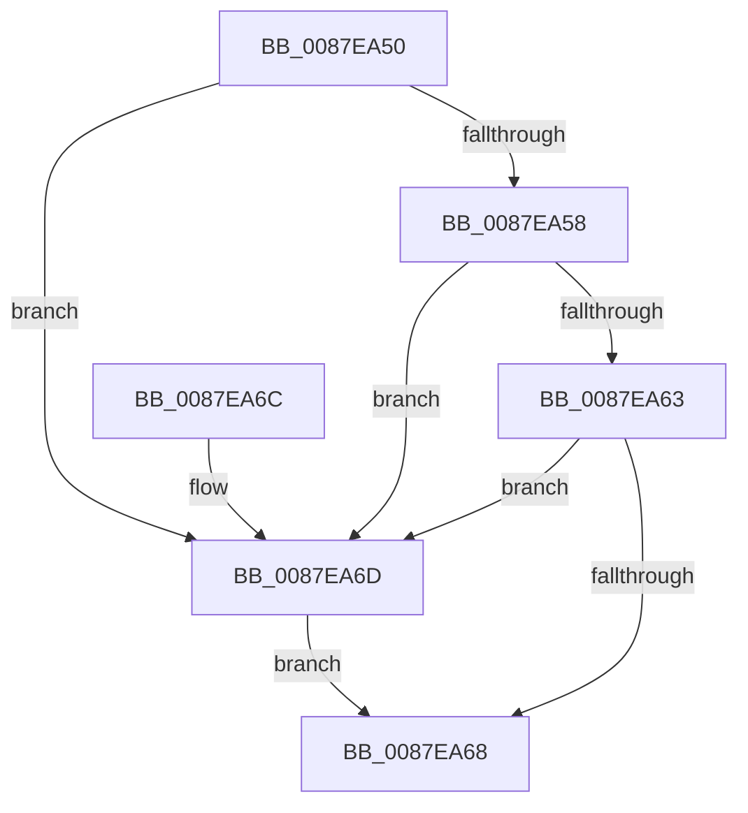

# PspSetEffectiveLimit

- RVA: `0x0087EA50`–`0x0087EA72` (길이 `34` bytes)
- VA: `0x000000014087EA50`
- 실행 섹션: `PAGE`
- PDB 이름 있음: `예`; PDB Function 태그: `아니요`
- unwind 정보 RVA: `0x000DB714`
- 디코드: `13`개 명령, `34/34` bytes 표시
- 미해석 바이트: `0` (있으면 어셈블리에 `.byte`로 보존)

> 이 문서는 커널 이미지의 기계어와 PDB 기호를 분석해 생성했습니다. 4번과 5번은 함수 원형과 자료형을 바이너리 사용 방식에서 추정한 C 해석이며 원본 소스 복구 결과는 아닙니다.

## 1. Dependencies

- 직접 호출 지점: **0**; 고유 호출 대상: **0**
- 직접 호출자로 확인된 함수: **1**
- RIP 상대 이미지 참조: **0**

### Outgoing calls
- 직접 디코드된 call 명령이 없습니다.

### Direct callers
- [PspSetEffectiveJobLimits](PspSetEffectiveJobLimits_function_0087E738.md) at `0x0087E78B`
- [PspSetEffectiveJobLimits](PspSetEffectiveJobLimits_function_0087E738.md) at `0x0087E7A6`
- [PspSetEffectiveJobLimits](PspSetEffectiveJobLimits_function_0087E738.md) at `0x0087E7BB`
- [PspSetEffectiveJobLimits](PspSetEffectiveJobLimits_function_0087E738.md) at `0x0087E7CB`
- [PspSetEffectiveJobLimits](PspSetEffectiveJobLimits_function_0087E738.md) at `0x0087E7DE`
- [PspSetEffectiveJobLimits](PspSetEffectiveJobLimits_function_0087E738.md) at `0x0087E821`

### Static image references
- 디코드된 RIP-relative 메모리 참조가 없습니다.

## 2. Other-region calls and transfers

- 다른 실행 섹션으로 향하는 call: **0**
- 별도 외부 분기/꼬리 이동을 확인하지 못했습니다.

## 3. Assembly (complete function range)

```asm
0087EA50  45 33 C9                        xor r9d, r9d
0087EA53  48 85 D2                        test rdx, rdx
0087EA56  74 15                           je 0x14087ea6d
0087EA58  48 8B 02                        mov rax, qword ptr [rdx]
0087EA5B  85 88 00 01 00 00               test dword ptr [rax + 0x100], ecx
0087EA61  75 0A                           jne 0x14087ea6d
0087EA63  85 4A 0C                        test dword ptr [rdx + 0xc], ecx
0087EA66  75 05                           jne 0x14087ea6d
0087EA68  41 8A C1                        mov al, r9b
0087EA6B  C3                              ret
0087EA6C  CC                              int3
0087EA6D  41 B1 01                        mov r9b, 1
0087EA70  EB F6                           jmp 0x14087ea68
```

## 4. C-style interpretation (structured pseudocode)

```c
__int64 __fastcall PspSetEffectiveLimit(__int64 a1, __int64 a2, __int64 a3, int a4)
{
    a4 = 0;
    if (a2 == 0) goto loc_0087EA6D;
    if (((*(unsigned int *)(*(unsigned __int64 *)(a2) + 256)) & ((unsigned int)(a1))) != 0) goto loc_0087EA6D;
    if (((*(unsigned int *)(a2 + 12)) & ((unsigned int)(a1))) != 0) goto loc_0087EA6D;
loc_0087EA68:
    return 0;
loc_0087EA6D:
    goto loc_0087EA68;
}
```

## 5. (Beta) C Style

```c
int64_t PspSetEffectiveLimit(int64_t Arg1, int64_t Arg2, int64_t Arg3, int32_t Arg4)
{
    Arg4 = 0;
    if (Arg2 == 0) goto loc_0087EA6D;
    if (((*(uint32_t *)(*(uint64_t *)(Arg2) + 0x100)) & ((uint32_t)(Arg1))) != 0) goto loc_0087EA6D;
    if (((*(uint32_t *)(Arg2 + 0xC)) & ((uint32_t)(Arg1))) != 0) goto loc_0087EA6D;
loc_0087EA68:
    return 0;
loc_0087EA6D:
    goto loc_0087EA68;
}
```

## 6. Execution-region graph

[열기: 2D/3D 그래프와 함수 탐색 컨트롤 패널](../../../control-panel.html?section=page&rva=0x0087EA50&view=graph)

- 2D 그래프는 위에서 아래로 흐르고, 3D 그래프는 빈 공간을 드래그해 회전합니다. Shift+드래그는 이동, 휠은 확대·축소, 함수 노드 선택은 대상 보고서 이동입니다.

### Static fallback


