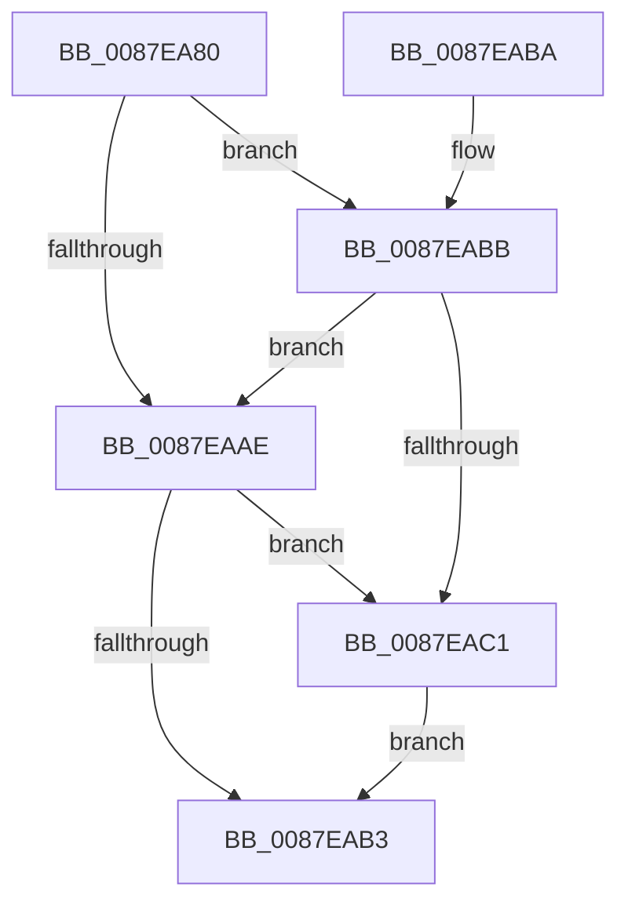

# PspSetJobBackgroundCountCallback

- RVA: `0x0087EA80`–`0x0087EACD` (길이 `77` bytes)
- VA: `0x000000014087EA80`
- 실행 섹션: `PAGE`
- PDB 이름 있음: `예`; PDB Function 태그: `아니요`
- unwind 정보 RVA: `0x0007A1AC`
- 디코드: `22`개 명령, `77/77` bytes 표시
- 미해석 바이트: `0` (있으면 어셈블리에 `.byte`로 보존)

> 이 문서는 커널 이미지의 기계어와 PDB 기호를 분석해 생성했습니다. 4번과 5번은 함수 원형과 자료형을 바이너리 사용 방식에서 추정한 C 해석이며 원본 소스 복구 결과는 아닙니다.

## 1. Dependencies

- 직접 호출 지점: **1**; 고유 호출 대상: **1**
- 직접 호출자로 확인된 함수: **0**
- RIP 상대 이미지 참조: **0**

### Outgoing calls
- `0x0087EAC6` → [PspUpdateJobEffectivePriorityLimits](PspUpdateJobEffectivePriorityLimits_function_0087EAD4.md) (function, `0x0087EAD4`)

### Direct callers
- 이 함수 시작 RVA로 연결되는 직접 call은 확인되지 않았습니다. 간접 호출은 완전히 역산할 수 없습니다.

### Static image references
- 디코드된 RIP-relative 메모리 참조가 없습니다.

## 2. Other-region calls and transfers

- 다른 실행 섹션으로 향하는 call: **0**
- 별도 외부 분기/꼬리 이동을 확인하지 못했습니다.

## 3. Assembly (complete function range)

```asm
0087EA80  48 83 EC 28                     sub rsp, 0x28
0087EA84  8B 81 30 04 00 00               mov eax, dword ptr [rcx + 0x430]
0087EA8A  44 8A 0A                        mov r9b, byte ptr [rdx]
0087EA8D  45 84 C9                        test r9b, r9b
0087EA90  44 8D 40 FF                     lea r8d, [rax - 1]
0087EA94  44 8D 50 01                     lea r10d, [rax + 1]
0087EA98  45 0F 44 D0                     cmove r10d, r8d
0087EA9C  44 89 91 30 04 00 00            mov dword ptr [rcx + 0x430], r10d
0087EAA3  8B 81 3C 04 00 00               mov eax, dword ptr [rcx + 0x43c]
0087EAA9  89 42 04                        mov dword ptr [rdx + 4], eax
0087EAAC  75 0D                           jne 0x14087eabb
0087EAAE  45 85 D2                        test r10d, r10d
0087EAB1  74 0E                           je 0x14087eac1
0087EAB3  33 C0                           xor eax, eax
0087EAB5  48 83 C4 28                     add rsp, 0x28
0087EAB9  C3                              ret
0087EABA  CC                              int3
0087EABB  41 83 FA 01                     cmp r10d, 1
0087EABF  75 ED                           jne 0x14087eaae
0087EAC1  BA 03 00 00 00                  mov edx, 3
0087EAC6  E8 09 00 00 00                  call 0x14087ead4
0087EACB  EB E6                           jmp 0x14087eab3
```

## 4. C-style interpretation (structured pseudocode)

```c
__int64 __fastcall PspSetJobBackgroundCountCallback(__int64 a1, __int64 a2)
{
    __int64 result;
    __int64 v_r10;
    __int64 v_rsp;

    v_rsp = (v_rsp) - (40);
    v_r10 = (unsigned int)(*(unsigned int *)(a1 + 1072)) + 1;
    if ((unsigned __int8)(*(unsigned __int8 *)(a2)) == 0) { v_r10 = (unsigned int)((unsigned int)(*(unsigned int *)(a1 + 1072)) - 1); }
    *(unsigned int *)(a1 + 1072) = (unsigned int)(v_r10);
    *(unsigned int *)(a2 + 4) = (unsigned int)((unsigned int)(*(unsigned int *)(a1 + 1084)));
    if ((unsigned __int8)(*(unsigned __int8 *)(a2)) != 0) goto loc_0087EABB;
loc_0087EAAE:
    if ((unsigned int)(v_r10) == 0) goto loc_0087EAC1;
loc_0087EAB3:
    result = 0;
    v_rsp = (v_rsp) + (40);
    return result;
loc_0087EABB:
    if (((unsigned int)(v_r10)) != 1) goto loc_0087EAAE;
loc_0087EAC1:
    result = PspUpdateJobEffectivePriorityLimits(a1, 3, (unsigned int)(*(unsigned int *)(a1 + 1072)) - 1, *(unsigned __int8 *)(a2));
    goto loc_0087EAB3;
}
```

## 5. (Beta) C Style

```c
int64_t PspSetJobBackgroundCountCallback(void *Arg1, void *Arg2)
{
    uint8_t *arg1 = (uint8_t *)Arg1;
    uint8_t *arg2 = (uint8_t *)Arg2;

    int64_t result;
    int64_t local_r10;
    int64_t local_rsp;

    local_rsp = (local_rsp) - (40);
    local_r10 = (uint32_t)(*(uint32_t *)(arg1 + 0x430)) + 1;
    if ((uint8_t)(*(uint8_t *)(arg2)) == 0) { local_r10 = (uint32_t)((uint32_t)(*(uint32_t *)(arg1 + 0x430)) - 1); }
    *(uint32_t *)(arg1 + 0x430) = (uint32_t)(local_r10);
    *(uint32_t *)(arg2 + 0x4) = (uint32_t)((uint32_t)(*(uint32_t *)(arg1 + 0x43C)));
    if ((uint8_t)(*(uint8_t *)(arg2)) != 0) goto loc_0087EABB;
loc_0087EAAE:
    if ((uint32_t)(local_r10) == 0) goto loc_0087EAC1;
loc_0087EAB3:
    result = 0;
    local_rsp = (local_rsp) + (40);
    return result;
loc_0087EABB:
    if (((uint32_t)(local_r10)) != 1) goto loc_0087EAAE;
loc_0087EAC1:
    result = PspUpdateJobEffectivePriorityLimits(Arg1, 3, (uint32_t)(*(uint32_t *)(arg1 + 0x430)) - 1, *(uint8_t *)(arg2));
    goto loc_0087EAB3;
}
```

### 관측된 메모리 오프셋

구조체 형식이 확인되지 않은 접근은 인자 기준의 오프셋으로만 기록했습니다.

| 기준 인자 | 오프셋 표현 | 폭 (bit) | 접근 |
|---|---:|---:|---|
| `Arg1` | `+ 0x430` | `32` | `R` |
| `Arg1` | `+ 0x430` | `32` | `W` |
| `Arg1` | `+ 0x43C` | `32` | `R` |
| `Arg2` | `+ 0x0` | `8` | `R` |
| `Arg2` | `+ 0x4` | `32` | `W` |

## 6. Execution-region graph

[열기: 2D/3D 그래프와 함수 탐색 컨트롤 패널](../../../control-panel.html?section=page&rva=0x0087EA80&view=graph)

- 2D 그래프는 위에서 아래로 흐르고, 3D 그래프는 빈 공간을 드래그해 회전합니다. Shift+드래그는 이동, 휠은 확대·축소, 함수 노드 선택은 대상 보고서 이동입니다.

### Static fallback


