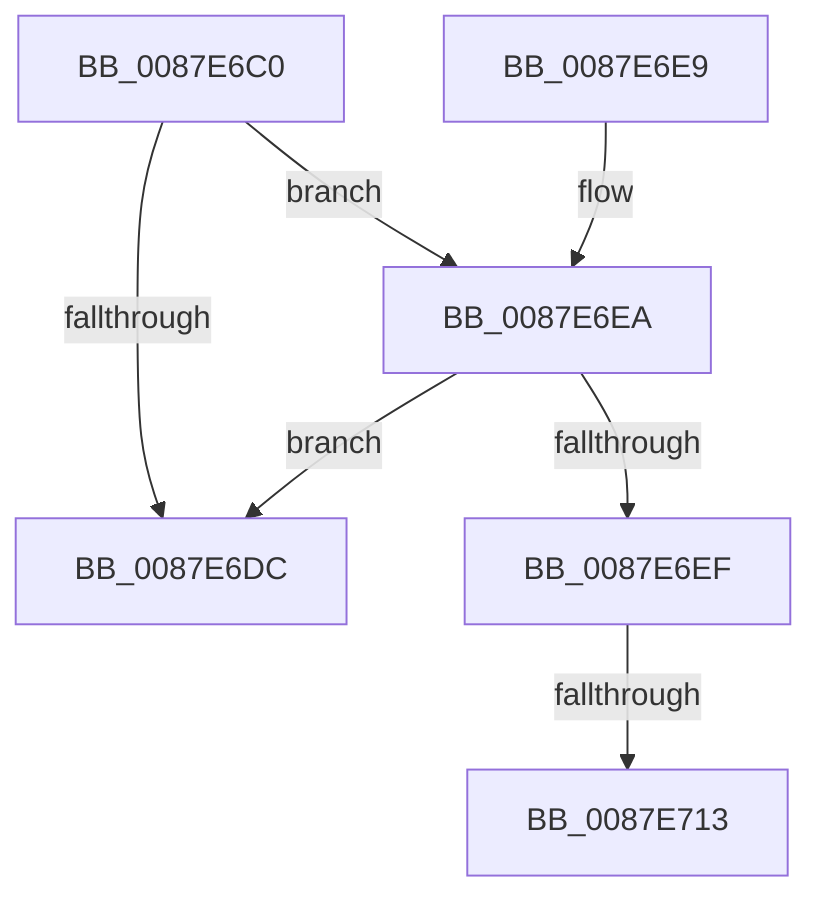

# PspSetJobLimitsJobPreCallback

- RVA: `0x0087E6C0`–`0x0087E72F` (길이 `111` bytes)
- VA: `0x000000014087E6C0`
- 실행 섹션: `PAGE`
- PDB 이름 있음: `예`; PDB Function 태그: `예`
- unwind 정보 RVA: `0x0007C054`
- 디코드: `30`개 명령, `111/111` bytes 표시
- 미해석 바이트: `0` (있으면 어셈블리에 `.byte`로 보존)

> 이 문서는 커널 이미지의 기계어와 PDB 기호를 분석해 생성했습니다. 4번과 5번은 함수 원형과 자료형을 바이너리 사용 방식에서 추정한 C 해석이며 원본 소스 복구 결과는 아닙니다.

## 1. Dependencies

- 직접 호출 지점: **3**; 고유 호출 대상: **3**
- 직접 호출자로 확인된 함수: **0**
- RIP 상대 이미지 참조: **2**

### Outgoing calls
- `0x0087E6D0` → [PspSetEffectiveJobLimits](PspSetEffectiveJobLimits_function_0087E738.md) (function, `0x0087E738`)
- `0x0087E6FB` → [KeAbPreAcquire](../../text/21/KeAbPreAcquire_function_00210230.md) (function, `0x00210230`)
- `0x0087E724` → [ExfAcquirePushLockExclusiveEx](../../text/20/ExfAcquirePushLockExclusiveEx_function_0020FC90.md) (function, `0x0020FC90`)

### Direct callers
- 이 함수 시작 RVA로 연결되는 직접 call은 확인되지 않았습니다. 간접 호출은 완전히 역산할 수 없습니다.

### Static image references
- `0x0087E6F2` → RVA `0x00FC70B0` (`ALMOSTRO`; read)
- `0x0087E700` → RVA `0x00FC70B0` (`ALMOSTRO`; read/write)

## 2. Other-region calls and transfers

- 다른 실행 섹션으로 향하는 call: **2**
  - `0x0087E6FB` → [KeAbPreAcquire](../../text/21/KeAbPreAcquire_function_00210230.md) (`PAGE` → `.text`)
  - `0x0087E724` → [ExfAcquirePushLockExclusiveEx](../../text/20/ExfAcquirePushLockExclusiveEx_function_0020FC90.md) (`PAGE` → `.text`)
- call이 아닌 외부 분기/꼬리 이동: **2**
  - `0x0087E70D` → [sub_00B18ADC](../B1/Unknown_function_00B18ADC.md) (`tail-transfer`)
  - `0x0087E72A` → [sub_00B18ADC](../B1/Unknown_function_00B18ADC.md) (`tail-transfer`)

## 3. Assembly (complete function range)

```asm
0087E6C0  48 89 5C 24 08                  mov qword ptr [rsp + 8], rbx
0087E6C5  57                              push rdi
0087E6C6  48 83 EC 20                     sub rsp, 0x20
0087E6CA  48 8B FA                        mov rdi, rdx
0087E6CD  48 8B D9                        mov rbx, rcx
0087E6D0  E8 63 00 00 00                  call 0x14087e738
0087E6D5  8B 47 08                        mov eax, dword ptr [rdi + 8]
0087E6D8  A8 01                           test al, 1
0087E6DA  74 0E                           je 0x14087e6ea
0087E6DC  48 8B 5C 24 30                  mov rbx, qword ptr [rsp + 0x30]
0087E6E1  33 C0                           xor eax, eax
0087E6E3  48 83 C4 20                     add rsp, 0x20
0087E6E7  5F                              pop rdi
0087E6E8  C3                              ret
0087E6E9  CC                              int3
0087E6EA  48 39 1F                        cmp qword ptr [rdi], rbx
0087E6ED  74 ED                           je 0x14087e6dc
0087E6EF  45 33 C0                        xor r8d, r8d
0087E6F2  48 8D 0D B7 89 74 00            lea rcx, [rip + 0x7489b7]
0087E6F9  33 D2                           xor edx, edx
0087E6FB  E8 30 1B 99 FF                  call 0x140210230
0087E700  F0 48 0F BA 2D A6 89 74 00 00   lock bts qword ptr [rip + 0x7489a6], 0
0087E70A  48 8B F8                        mov rdi, rax
0087E70D  0F 83 C9 A3 29 00               jae 0x140b18adc
0087E713  4C 8D 05 96 89 74 00            lea r8, [rip + 0x748996]
0087E71A  48 8B D0                        mov rdx, rax
0087E71D  48 8D 0D 8C 89 74 00            lea rcx, [rip + 0x74898c]
0087E724  E8 67 15 99 FF                  call 0x14020fc90
0087E729  90                              nop
0087E72A  E9 AD A3 29 00                  jmp 0x140b18adc
```

## 4. C-style interpretation (structured pseudocode)

```c
__int64 __fastcall PspSetJobLimitsJobPreCallback(__int64 a1, __int64 a2, int a3)
{
    __int64 result;
    __int64 v_rsp;
    unsigned __int64 v_stack_p8;

    v_stack_p8 = v_rbx;
    v_rsp = (v_rsp) - (32);
    result = PspSetEffectiveJobLimits(a1, a2, a3, a4);
    if ((((unsigned __int8)((unsigned int)(*(unsigned int *)(a2 + 8)))) & (1)) == 0) goto loc_0087E6EA;
loc_0087E6DC:
    result = 0;
    v_rsp = (v_rsp) + (32);
    return result;
loc_0087E6EA:
    if ((*(unsigned __int64 *)(a2)) == v_stack_p8) goto loc_0087E6DC;
    a3 = 0;
    a2 = 0;
    result = KeAbPreAcquire(v_rip + 7637431, a2, a3, a4);
    result = ExfAcquirePushLockExclusiveEx(v_rip + 7637388, result, v_rip + 7637398, a4);
}
```

## 5. (Beta) C Style

```c
int64_t PspSetJobLimitsJobPreCallback(int64_t Arg1, void *Arg2, int32_t Arg3)
{
    uint8_t *arg2 = (uint8_t *)Arg2;

    int64_t result;
    int64_t local_rsp;
    uint64_t v_stack_p8;

    v_stack_p8 = local_rbx;
    local_rsp = (local_rsp) - (32);
    result = PspSetEffectiveJobLimits(Arg1, Arg2, Arg3, a4);
    if ((((uint8_t)((uint32_t)(*(uint32_t *)(arg2 + 0x8)))) & (1)) == 0) goto loc_0087E6EA;
loc_0087E6DC:
    result = 0;
    local_rsp = (local_rsp) + (32);
    return result;
loc_0087E6EA:
    if ((*(uint64_t *)(arg2)) == v_stack_p8) goto loc_0087E6DC;
    Arg3 = 0;
    Arg2 = 0;
    result = KeAbPreAcquire(v_rip + 7637431, Arg2, Arg3, a4);
    result = ExfAcquirePushLockExclusiveEx(v_rip + 7637388, result, v_rip + 7637398, a4);
}
```

### 관측된 메모리 오프셋

구조체 형식이 확인되지 않은 접근은 인자 기준의 오프셋으로만 기록했습니다.

| 기준 인자 | 오프셋 표현 | 폭 (bit) | 접근 |
|---|---:|---:|---|
| `Arg2` | `+ 0x0` | `64` | `R` |
| `Arg2` | `+ 0x8` | `32` | `R` |

## 6. Execution-region graph

[열기: 2D/3D 그래프와 함수 탐색 컨트롤 패널](../../../control-panel.html?section=page&rva=0x0087E6C0&view=graph)

- 2D 그래프는 위에서 아래로 흐르고, 3D 그래프는 빈 공간을 드래그해 회전합니다. Shift+드래그는 이동, 휠은 확대·축소, 함수 노드 선택은 대상 보고서 이동입니다.

### Static fallback


