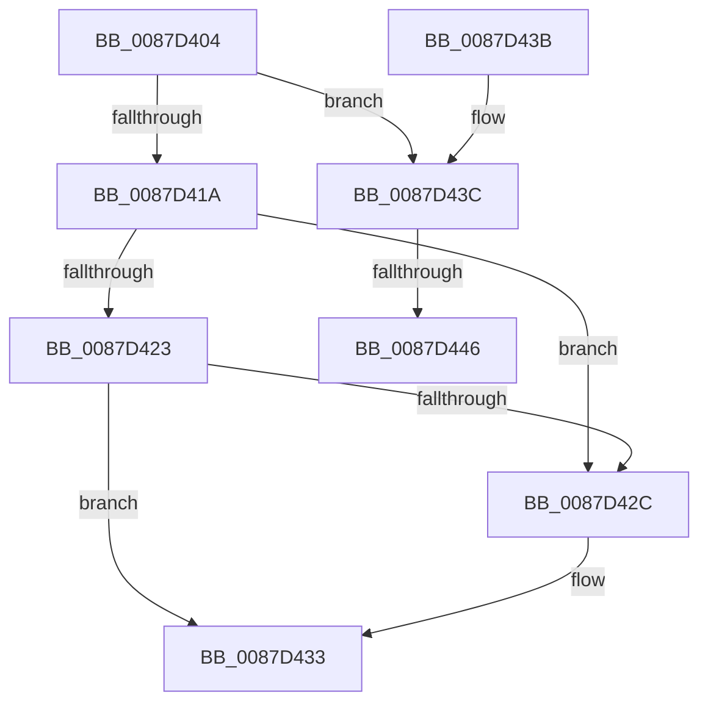

# PspUnlinkJobProcess

- RVA: `0x0087D404`–`0x0087D456` (길이 `82` bytes)
- VA: `0x000000014087D404`
- 실행 섹션: `PAGE`
- PDB 이름 있음: `예`; PDB Function 태그: `예`
- unwind 정보 RVA: `0x000DB714`
- 디코드: `22`개 명령, `82/82` bytes 표시
- 미해석 바이트: `0` (있으면 어셈블리에 `.byte`로 보존)

> 이 문서는 커널 이미지의 기계어와 PDB 기호를 분석해 생성했습니다. 4번과 5번은 함수 원형과 자료형을 바이너리 사용 방식에서 추정한 C 해석이며 원본 소스 복구 결과는 아닙니다.

## 1. Dependencies

- 직접 호출 지점: **0**; 고유 호출 대상: **0**
- 직접 호출자로 확인된 함수: **2**
- RIP 상대 이미지 참조: **0**

### Outgoing calls
- 직접 디코드된 call 명령이 없습니다.

### Direct callers
- [PspEstablishJobHierarchy](PspEstablishJobHierarchy_function_0087E17C.md) at `0x0087E2E9`
- [PspEstablishJobHierarchy](PspEstablishJobHierarchy_function_0087E17C.md) at `0x0087E50F`
- [PspRemoveProcessFromJobChain](../90/PspRemoveProcessFromJobChain_function_00907288.md) at `0x009074DB`

### Static image references
- 디코드된 RIP-relative 메모리 참조가 없습니다.

## 2. Other-region calls and transfers

- 다른 실행 섹션으로 향하는 call: **0**
- call이 아닌 외부 분기/꼬리 이동: **2**
  - `0x0087D440` → `0x00B18A18` (`tail-transfer`)
  - `0x0087D451` → `0x00B18A18` (`tail-transfer`)

## 3. Assembly (complete function range)

```asm
0087D404  4C 8D 89 28 05 00 00            lea r9, [rcx + 0x528]
0087D40B  4D 8B 01                        mov r8, qword ptr [r9]
0087D40E  48 8D 8A 58 03 00 00            lea rcx, [rdx + 0x358]
0087D415  4D 3B C1                        cmp r8, r9
0087D418  75 22                           jne 0x14087d43c
0087D41A  48 8B 11                        mov rdx, qword ptr [rcx]
0087D41D  48 39 4A 08                     cmp qword ptr [rdx + 8], rcx
0087D421  75 09                           jne 0x14087d42c
0087D423  48 8B 41 08                     mov rax, qword ptr [rcx + 8]
0087D427  48 39 08                        cmp qword ptr [rax], rcx
0087D42A  74 07                           je 0x14087d433
0087D42C  B9 03 00 00 00                  mov ecx, 3
0087D431  CD 29                           int 0x29
0087D433  48 89 10                        mov qword ptr [rax], rdx
0087D436  48 89 42 08                     mov qword ptr [rdx + 8], rax
0087D43A  C3                              ret
0087D43B  CC                              int3
0087D43C  49 39 48 10                     cmp qword ptr [r8 + 0x10], rcx
0087D440  0F 85 D2 B5 29 00               jne 0x140b18a18
0087D446  48 8B 82 60 03 00 00            mov rax, qword ptr [rdx + 0x360]
0087D44D  49 89 40 10                     mov qword ptr [r8 + 0x10], rax
0087D451  E9 C2 B5 29 00                  jmp 0x140b18a18
```

## 4. C-style interpretation (structured pseudocode)

```c
__int64 __fastcall PspUnlinkJobProcess(__int64 a1, __int64 a2)
{
    if ((*(unsigned __int64 *)(a1 + 1320)) != (a1 + 1320)) goto loc_0087D43C;
    if ((*(unsigned __int64 *)(*(unsigned __int64 *)(a2 + 856) + 8)) != (a2 + 856)) goto loc_0087D42C;
    if ((*(unsigned __int64 *)(*(unsigned __int64 *)(a2 + 856 + 8))) != (a2 + 856)) {
        a1 = 3;
    }
    *(unsigned __int64 *)(*(unsigned __int64 *)(a2 + 856 + 8)) = *(unsigned __int64 *)(a2 + 856);
    *(unsigned __int64 *)(*(unsigned __int64 *)(a2 + 856) + 8) = *(unsigned __int64 *)(a2 + 856 + 8);
    return *(unsigned __int64 *)(a2 + 856 + 8);
loc_0087D43C:
    *(unsigned __int64 *)(*(unsigned __int64 *)(a1 + 1320) + 16) = *(unsigned __int64 *)(*(unsigned __int64 *)(a2 + 856) + 864);
}
```

## 5. (Beta) C Style

```c
int64_t PspUnlinkJobProcess(void *Arg1, void *Arg2)
{
    uint8_t *arg1 = (uint8_t *)Arg1;
    uint8_t *arg2 = (uint8_t *)Arg2;

    if ((*(uint64_t *)(arg1 + 0x528)) != (Arg1 + 1320)) goto loc_0087D43C;
    if ((*(uint64_t *)(*(uint64_t *)(arg2 + 0x358) + 0x8)) != (Arg2 + 856)) goto loc_0087D42C;
    if ((*(uint64_t *)(*(uint64_t *)(arg2 + 0x358 + 0x8))) != (Arg2 + 856)) {
        Arg1 = 3;
    }
    *(uint64_t *)(*(uint64_t *)(arg2 + 0x358 + 0x8)) = *(uint64_t *)(arg2 + 0x358);
    *(uint64_t *)(*(uint64_t *)(arg2 + 0x358) + 0x8) = *(uint64_t *)(arg2 + 0x358 + 0x8);
    return *(uint64_t *)(arg2 + 0x358 + 0x8);
loc_0087D43C:
    *(uint64_t *)(*(uint64_t *)(arg1 + 0x528) + 0x10) = *(uint64_t *)(*(uint64_t *)(arg2 + 0x358) + 0x360);
}
```

### 관측된 메모리 오프셋

구조체 형식이 확인되지 않은 접근은 인자 기준의 오프셋으로만 기록했습니다.

| 기준 인자 | 오프셋 표현 | 폭 (bit) | 접근 |
|---|---:|---:|---|
| `Arg1` | `+ 0x0` | `64` | `R` |
| `Arg1` | `+ 0x528` | `64` | `R` |
| `Arg2` | `+ 0x0` | `64` | `R` |
| `Arg2` | `+ 0x8` | `64` | `R` |
| `Arg2` | `+ 0x358` | `64` | `R` |
| `Arg2` | `+ 0x360` | `64` | `R` |

## 6. Execution-region graph

[열기: 2D/3D 그래프와 함수 탐색 컨트롤 패널](../../../control-panel.html?section=page&rva=0x0087D404&view=graph)

- 2D 그래프는 위에서 아래로 흐르고, 3D 그래프는 빈 공간을 드래그해 회전합니다. Shift+드래그는 이동, 휠은 확대·축소, 함수 노드 선택은 대상 보고서 이동입니다.

### Static fallback


