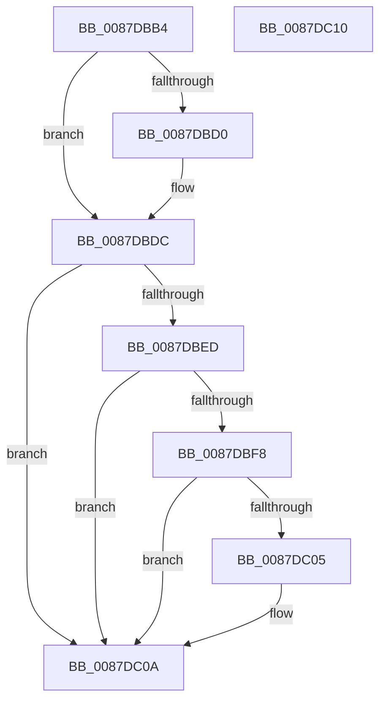

# PspUnlockJobAssignment

- RVA: `0x0087DBB4`–`0x0087DC11` (길이 `93` bytes)
- VA: `0x000000014087DBB4`
- 실행 섹션: `PAGE`
- PDB 이름 있음: `예`; PDB Function 태그: `아니요`
- unwind 정보 RVA: `0x0005CF00`
- 디코드: `26`개 명령, `93/93` bytes 표시
- 미해석 바이트: `0` (있으면 어셈블리에 `.byte`로 보존)

> 이 문서는 커널 이미지의 기계어와 PDB 기호를 분석해 생성했습니다. 4번과 5번은 함수 원형과 자료형을 바이너리 사용 방식에서 추정한 C 해석이며 원본 소스 복구 결과는 아닙니다.

## 1. Dependencies

- 직접 호출 지점: **3**; 고유 호출 대상: **3**
- 직접 호출자로 확인된 함수: **3**
- RIP 상대 이미지 참조: **2**

### Outgoing calls
- `0x0087DBD7` → [ExfTryToWakePushLock](../../text/26/ExfTryToWakePushLock_function_00265DD0.md) (function, `0x00265DD0`)
- `0x0087DBE3` → [KeAbPostRelease](../../text/2E/KeAbPostRelease_function_002E1600.md) (function, `0x002E1600`)
- `0x0087DC05` → [KiCheckForKernelApcDelivery](../../text/2E/KiCheckForKernelApcDelivery_function_002E2C80.md) (function, `0x002E2C80`)

### Direct callers
- [PspGetJobLockHierarchyForDeletion](PspGetJobLockHierarchyForDeletion_function_0087D510.md) at `0x0087D567`
- [PspLockJobChain](PspLockJobChain_function_0087DAD0.md) at `0x0087DB2B`
- [PspAssignProcessToJob](../A2/PspAssignProcessToJob_function_00A23370.md) at `0x00A237F1`
- [PspAssignProcessToJob](../A2/PspAssignProcessToJob_function_00A23370.md) at `0x00A238DB`

### Static image references
- `0x0087DBC1` → RVA `0x00FD9E88` (`PAGEDATA`; read/write)
- `0x0087DBD0` → RVA `0x00FD9E88` (`PAGEDATA`; read)

## 2. Other-region calls and transfers

- 다른 실행 섹션으로 향하는 call: **3**
  - `0x0087DBD7` → [ExfTryToWakePushLock](../../text/26/ExfTryToWakePushLock_function_00265DD0.md) (`PAGE` → `.text`)
  - `0x0087DBE3` → [KeAbPostRelease](../../text/2E/KeAbPostRelease_function_002E1600.md) (`PAGE` → `.text`)
  - `0x0087DC05` → [KiCheckForKernelApcDelivery](../../text/2E/KiCheckForKernelApcDelivery_function_002E2C80.md) (`PAGE` → `.text`)
- 별도 외부 분기/꼬리 이동을 확인하지 못했습니다.

## 3. Assembly (complete function range)

```asm
0087DBB4  40 53                           push rbx
0087DBB6  48 83 EC 20                     sub rsp, 0x20
0087DBBA  48 8B D9                        mov rbx, rcx
0087DBBD  48 83 C8 FF                     or rax, 0xffffffffffffffff
0087DBC1  F0 48 0F C1 05 BE C2 75 00      lock xadd qword ptr [rip + 0x75c2be], rax
0087DBCA  24 06                           and al, 6
0087DBCC  3C 02                           cmp al, 2
0087DBCE  75 0C                           jne 0x14087dbdc
0087DBD0  48 8D 0D B1 C2 75 00            lea rcx, [rip + 0x75c2b1]
0087DBD7  E8 F4 81 9E FF                  call 0x140265dd0
0087DBDC  48 8D 0D A5 C2 75 00            lea rcx, [rip + 0x75c2a5]
0087DBE3  E8 18 3A A6 FF                  call 0x1402e1600
0087DBE8  48 85 DB                        test rbx, rbx
0087DBEB  74 1D                           je 0x14087dc0a
0087DBED  90                              nop
0087DBEE  66 83 83 E6 01 00 00 01         add word ptr [rbx + 0x1e6], 1
0087DBF6  75 12                           jne 0x14087dc0a
0087DBF8  48 8D 83 98 00 00 00            lea rax, [rbx + 0x98]
0087DBFF  90                              nop
0087DC00  48 39 00                        cmp qword ptr [rax], rax
0087DC03  74 05                           je 0x14087dc0a
0087DC05  E8 76 50 A6 FF                  call 0x1402e2c80
0087DC0A  48 83 C4 20                     add rsp, 0x20
0087DC0E  5B                              pop rbx
0087DC0F  C3                              ret
0087DC10  CC                              int3
```

## 4. C-style interpretation (structured pseudocode)

```c
__int64 __fastcall PspUnlockJobAssignment(__int64 a1)
{
    __int64 result;
    __int64 v_rsp;

    v_rsp = (v_rsp) - (32);
    result = (result) | (-1);
    result = (unsigned __int8)((result) & (6));
    if (((unsigned __int8)(result)) == 2) {
        a1 = v_rip + 7717553;
        result = ExfTryToWakePushLock(a1, a2, a3, a4);
    }
    result = KeAbPostRelease(v_rip + 7717541, a2, a3, a4);
    if (a1 == 0) goto loc_0087DC0A;
    if (a1 != 0) goto loc_0087DC0A;
    result = a1 + 152;
    if ((*(unsigned __int64 *)(a1 + 152)) != (a1 + 152)) {
        result = KiCheckForKernelApcDelivery(v_rip + 7717541, a2, a3, a4);
    }
    v_rsp = (v_rsp) + (32);
    return result;
}
```

## 5. (Beta) C Style

```c
int64_t PspUnlockJobAssignment(int64_t Arg1)
{
    int64_t result;
    int64_t local_rsp;

    local_rsp = (local_rsp) - (32);
    result = (result) | (-1);
    result = (uint8_t)((result) & (6));
    if (((uint8_t)(result)) == 2) {
        Arg1 = v_rip + 7717553;
        result = ExfTryToWakePushLock(Arg1, a2, a3, a4);
    }
    result = KeAbPostRelease(v_rip + 7717541, a2, a3, a4);
    if (Arg1 == 0) goto loc_0087DC0A;
    if (Arg1 != 0) goto loc_0087DC0A;
    result = Arg1 + 152;
    if ((*(uint64_t *)(Arg1 + 0x98)) != (Arg1 + 152)) {
        result = KiCheckForKernelApcDelivery(v_rip + 7717541, a2, a3, a4);
    }
    local_rsp = (local_rsp) + (32);
    return result;
}
```

## 6. Execution-region graph

[열기: 2D/3D 그래프와 함수 탐색 컨트롤 패널](../../../control-panel.html?section=page&rva=0x0087DBB4&view=graph)

- 2D 그래프는 위에서 아래로 흐르고, 3D 그래프는 빈 공간을 드래그해 회전합니다. Shift+드래그는 이동, 휠은 확대·축소, 함수 노드 선택은 대상 보고서 이동입니다.

### Static fallback


