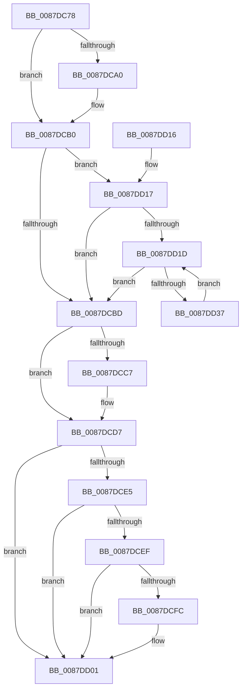

# PspUnlockJobChain

- RVA: `0x0087DC78`–`0x0087DD39` (길이 `193` bytes)
- VA: `0x000000014087DC78`
- 실행 섹션: `PAGE`
- PDB 이름 있음: `예`; PDB Function 태그: `아니요`
- unwind 정보 RVA: `0x0007BF90`
- 디코드: `49`개 명령, `193/193` bytes 표시
- 미해석 바이트: `0` (있으면 어셈블리에 `.byte`로 보존)

> 이 문서는 커널 이미지의 기계어와 PDB 기호를 분석해 생성했습니다. 4번과 5번은 함수 원형과 자료형을 바이너리 사용 방식에서 추정한 C 해석이며 원본 소스 복구 결과는 아닙니다.

## 1. Dependencies

- 직접 호출 지점: **5**; 고유 호출 대상: **2**
- 직접 호출자로 확인된 함수: **5**
- RIP 상대 이미지 참조: **0**

### Outgoing calls
- `0x0087DCAB` → [ExReleaseResourceLite](../../text/25/ExReleaseResourceLite_function_0025FA10.md) (function, `0x0025FA10`)
- `0x0087DCD2` → [ExReleaseResourceLite](../../text/25/ExReleaseResourceLite_function_0025FA10.md) (function, `0x0025FA10`)
- `0x0087DCDB` → [ExReleaseResourceLite](../../text/25/ExReleaseResourceLite_function_0025FA10.md) (function, `0x0025FA10`)
- `0x0087DCFC` → [KiCheckForKernelApcDelivery](../../text/2E/KiCheckForKernelApcDelivery_function_002E2C80.md) (function, `0x002E2C80`)
- `0x0087DD2D` → [ExReleaseResourceLite](../../text/25/ExReleaseResourceLite_function_0025FA10.md) (function, `0x0025FA10`)

### Direct callers
- [PspSetUILimitJobObject](../6F/PspSetUILimitJobObject_function_006FD218.md) at `0x006FD27A`
- [PspSetUILimitJobObject](../6F/PspSetUILimitJobObject_function_006FD218.md) at `0x006FD307`
- [PspImplicitAssignProcessToJob](PspImplicitAssignProcessToJob_function_0087D584.md) at `0x0087D608`
- [PspImplicitAssignProcessToJob](PspImplicitAssignProcessToJob_function_0087D584.md) at `0x0087D6C1`
- [PspUnlockJobsAndProcessExclusive](PspUnlockJobsAndProcessExclusive_function_0087D750.md) at `0x0087D78E`
- [PspGetMemoryPartitionImplicit](PspGetMemoryPartitionImplicit_function_0087D888.md) at `0x0087D8FC`
- [NtSetInformationJobObject](../9F/NtSetInformationJobObject_function_009F84C0.md) at `0x009FA10D`

### Static image references
- 디코드된 RIP-relative 메모리 참조가 없습니다.

## 2. Other-region calls and transfers

- 다른 실행 섹션으로 향하는 call: **5**
  - `0x0087DCAB` → [ExReleaseResourceLite](../../text/25/ExReleaseResourceLite_function_0025FA10.md) (`PAGE` → `.text`)
  - `0x0087DCD2` → [ExReleaseResourceLite](../../text/25/ExReleaseResourceLite_function_0025FA10.md) (`PAGE` → `.text`)
  - `0x0087DCDB` → [ExReleaseResourceLite](../../text/25/ExReleaseResourceLite_function_0025FA10.md) (`PAGE` → `.text`)
  - `0x0087DCFC` → [KiCheckForKernelApcDelivery](../../text/2E/KiCheckForKernelApcDelivery_function_002E2C80.md) (`PAGE` → `.text`)
  - `0x0087DD2D` → [ExReleaseResourceLite](../../text/25/ExReleaseResourceLite_function_0025FA10.md) (`PAGE` → `.text`)
- 별도 외부 분기/꼬리 이동을 확인하지 못했습니다.

## 3. Assembly (complete function range)

```asm
0087DC78  48 89 5C 24 08                  mov qword ptr [rsp + 8], rbx
0087DC7D  48 89 6C 24 10                  mov qword ptr [rsp + 0x10], rbp
0087DC82  48 89 74 24 18                  mov qword ptr [rsp + 0x18], rsi
0087DC87  57                              push rdi
0087DC88  48 83 EC 20                     sub rsp, 0x20
0087DC8C  BD 01 00 00 00                  mov ebp, 1
0087DC91  48 8B FA                        mov rdi, rdx
0087DC94  48 8B D9                        mov rbx, rcx
0087DC97  48 39 A9 38 05 00 00            cmp qword ptr [rcx + 0x538], rbp
0087DC9E  76 10                           jbe 0x14087dcb0
0087DCA0  48 8B 89 20 05 00 00            mov rcx, qword ptr [rcx + 0x520]
0087DCA7  48 83 C1 38                     add rcx, 0x38
0087DCAB  E8 60 1D 9E FF                  call 0x14025fa10
0087DCB0  48 8B B3 38 05 00 00            mov rsi, qword ptr [rbx + 0x538]
0087DCB7  48 83 FE 02                     cmp rsi, 2
0087DCBB  77 5A                           ja 0x14087dd17
0087DCBD  48 83 BB 38 05 00 00 00         cmp qword ptr [rbx + 0x538], 0
0087DCC5  76 10                           jbe 0x14087dcd7
0087DCC7  48 8B 8B 18 05 00 00            mov rcx, qword ptr [rbx + 0x518]
0087DCCE  48 83 C1 38                     add rcx, 0x38
0087DCD2  E8 39 1D 9E FF                  call 0x14025fa10
0087DCD7  48 8D 4B 38                     lea rcx, [rbx + 0x38]
0087DCDB  E8 30 1D 9E FF                  call 0x14025fa10
0087DCE0  48 85 FF                        test rdi, rdi
0087DCE3  74 1C                           je 0x14087dd01
0087DCE5  90                              nop
0087DCE6  66 01 AF E6 01 00 00            add word ptr [rdi + 0x1e6], bp
0087DCED  75 12                           jne 0x14087dd01
0087DCEF  48 8D 87 98 00 00 00            lea rax, [rdi + 0x98]
0087DCF6  90                              nop
0087DCF7  48 39 00                        cmp qword ptr [rax], rax
0087DCFA  74 05                           je 0x14087dd01
0087DCFC  E8 7F 4F A6 FF                  call 0x1402e2c80
0087DD01  48 8B 5C 24 30                  mov rbx, qword ptr [rsp + 0x30]
0087DD06  48 8B 6C 24 38                  mov rbp, qword ptr [rsp + 0x38]
0087DD0B  48 8B 74 24 40                  mov rsi, qword ptr [rsp + 0x40]
0087DD10  48 83 C4 20                     add rsp, 0x20
0087DD14  5F                              pop rdi
0087DD15  C3                              ret
0087DD16  CC                              int3
0087DD17  48 83 C6 FE                     add rsi, -2
0087DD1B  74 A0                           je 0x14087dcbd
0087DD1D  48 8B 83 40 05 00 00            mov rax, qword ptr [rbx + 0x540]
0087DD24  48 8B 4C F0 F8                  mov rcx, qword ptr [rax + rsi*8 - 8]
0087DD29  48 83 C1 38                     add rcx, 0x38
0087DD2D  E8 DE 1C 9E FF                  call 0x14025fa10
0087DD32  48 2B F5                        sub rsi, rbp
0087DD35  74 86                           je 0x14087dcbd
0087DD37  EB E4                           jmp 0x14087dd1d
```

## 4. C-style interpretation (structured pseudocode)

```c
__int64 __fastcall PspUnlockJobChain(__int64 a1, __int64 a2)
{
    __int64 result;
    __int64 v_rsi;
    __int64 v_rsp;
    unsigned __int64 v_stack_p10;
    unsigned __int64 v_stack_p18;
    unsigned __int64 v_stack_p8;

    v_stack_p8 = v_rbx;
    v_stack_p10 = v_rbp;
    v_stack_p18 = v_rsi;
    v_rsp = (v_rsp) - (32);
    if ((*(unsigned __int64 *)(a1 + 1336)) >= = 1) {
        a1 = *(unsigned __int64 *)(a1 + 1312);
        a1 = (a1) + (56);
        result = ExReleaseResourceLite(a1, a2, a3, a4);
    }
    if ((*(unsigned __int64 *)(a1 + 1336)) > 2) goto loc_0087DD17;
loc_0087DCBD:
    if ((*(unsigned __int64 *)(a1 + 1336)) >= = 0) {
        a1 = *(unsigned __int64 *)(a1 + 1304);
        a1 = (a1) + (56);
        result = ExReleaseResourceLite(a1, a2, a3, a4);
    }
    result = ExReleaseResourceLite(a1 + 56, a2, a3, a4);
    if (a2 == 0) goto loc_0087DD01;
    if (a2 != 0) goto loc_0087DD01;
    result = a2 + 152;
    if ((*(unsigned __int64 *)(a2 + 152)) != (a2 + 152)) {
        result = KiCheckForKernelApcDelivery(a1 + 56, a2, a3, a4);
    }
    v_rsp = (v_rsp) + (32);
    return result;
loc_0087DD17:
    v_rsi = (v_stack_p18) + (-2);
    if (condition_is_equal) goto loc_0087DCBD;
loc_0087DD1D:
    a1 = (*(unsigned __int64 *)(*(unsigned __int64 *)(v_stack_p8 + 1344) + v_rsi * 8 - 8)) + (56);
    result = ExReleaseResourceLite(a1, a2, a3, a4);
    v_rsi = (v_rsi) - (v_stack_p10);
    if (condition_is_equal) goto loc_0087DCBD;
    goto loc_0087DD1D;
}
```

## 5. (Beta) C Style

```c
int64_t PspUnlockJobChain(void *Arg1, int64_t Arg2)
{
    uint8_t *arg1 = (uint8_t *)Arg1;

    int64_t result;
    int64_t local_rsi;
    int64_t local_rsp;
    uint64_t v_stack_p10;
    uint64_t v_stack_p18;
    uint64_t v_stack_p8;

    v_stack_p8 = local_rbx;
    v_stack_p10 = local_rbp;
    v_stack_p18 = local_rsi;
    local_rsp = (local_rsp) - (32);
    if ((*(uint64_t *)(arg1 + 0x538)) >= = 1) {
        Arg1 = *(uint64_t *)(arg1 + 0x520);
        Arg1 = (Arg1) + (56);
        result = ExReleaseResourceLite(Arg1, Arg2, a3, a4);
    }
    if ((*(uint64_t *)(arg1 + 0x538)) > 2) goto loc_0087DD17;
loc_0087DCBD:
    if ((*(uint64_t *)(arg1 + 0x538)) >= = 0) {
        Arg1 = *(uint64_t *)(arg1 + 0x518);
        Arg1 = (Arg1) + (56);
        result = ExReleaseResourceLite(Arg1, Arg2, a3, a4);
    }
    result = ExReleaseResourceLite(Arg1 + 56, Arg2, a3, a4);
    if (Arg2 == 0) goto loc_0087DD01;
    if (Arg2 != 0) goto loc_0087DD01;
    result = Arg2 + 152;
    if ((*(uint64_t *)(Arg2 + 0x98)) != (Arg2 + 152)) {
        result = KiCheckForKernelApcDelivery(Arg1 + 56, Arg2, a3, a4);
    }
    local_rsp = (local_rsp) + (32);
    return result;
loc_0087DD17:
    local_rsi = (v_stack_p18) + (-2);
    if (condition_is_equal) goto loc_0087DCBD;
loc_0087DD1D:
    Arg1 = (*(uint64_t *)(*(uint64_t *)(v_stack_p8 + 0x540) + local_rsi * 8 - 0x8)) + (56);
    result = ExReleaseResourceLite(Arg1, Arg2, a3, a4);
    local_rsi = (local_rsi) - (v_stack_p10);
    if (condition_is_equal) goto loc_0087DCBD;
    goto loc_0087DD1D;
}
```

### 관측된 메모리 오프셋

구조체 형식이 확인되지 않은 접근은 인자 기준의 오프셋으로만 기록했습니다.

| 기준 인자 | 오프셋 표현 | 폭 (bit) | 접근 |
|---|---:|---:|---|
| `Arg1` | `+ 0x38` | `64` | `R` |
| `Arg1` | `+ 0x518` | `64` | `R` |
| `Arg1` | `+ 0x520` | `64` | `R` |
| `Arg1` | `+ 0x538` | `64` | `R` |
| `Arg1` | `+ 0x540` | `64` | `R` |

## 6. Execution-region graph

[열기: 2D/3D 그래프와 함수 탐색 컨트롤 패널](../../../control-panel.html?section=page&rva=0x0087DC78&view=graph)

- 2D 그래프는 위에서 아래로 흐르고, 3D 그래프는 빈 공간을 드래그해 회전합니다. Shift+드래그는 이동, 휠은 확대·축소, 함수 노드 선택은 대상 보고서 이동입니다.

### Static fallback


