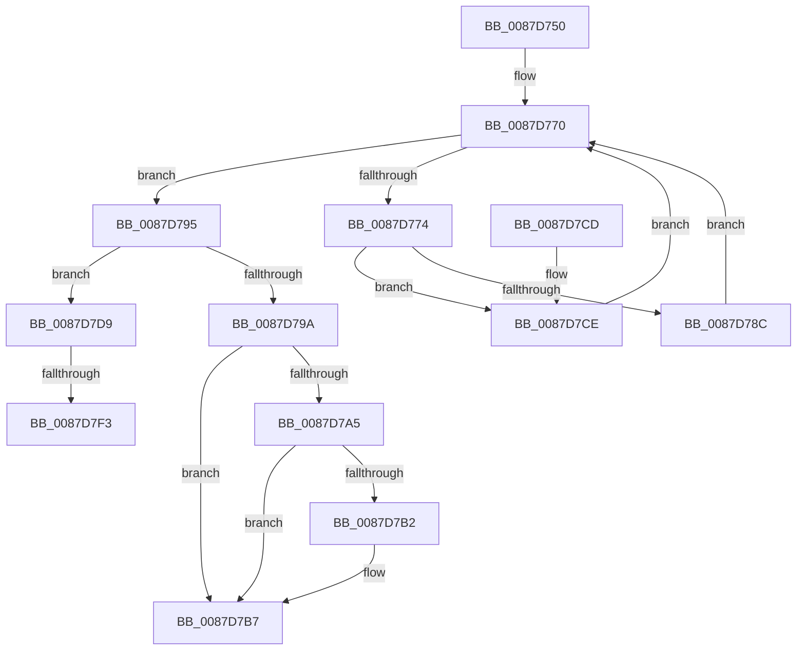

# PspUnlockJobsAndProcessExclusive

- RVA: `0x0087D750`–`0x0087D801` (길이 `177` bytes)
- VA: `0x000000014087D750`
- 실행 섹션: `PAGE`
- PDB 이름 있음: `예`; PDB Function 태그: `예`
- unwind 정보 RVA: `0x0007BF14`
- 디코드: `51`개 명령, `177/177` bytes 표시
- 미해석 바이트: `0` (있으면 어셈블리에 `.byte`로 보존)

> 이 문서는 커널 이미지의 기계어와 PDB 기호를 분석해 생성했습니다. 4번과 5번은 함수 원형과 자료형을 바이너리 사용 방식에서 추정한 C 해석이며 원본 소스 복구 결과는 아닙니다.

## 1. Dependencies

- 직접 호출 지점: **4**; 고유 호출 대상: **4**
- 직접 호출자로 확인된 함수: **2**
- RIP 상대 이미지 참조: **0**

### Outgoing calls
- `0x0087D78E` → [PspUnlockJobChain](PspUnlockJobChain_function_0087DC78.md) (function, `0x0087DC78`)
- `0x0087D7B2` → [KiCheckForKernelApcDelivery](../../text/2E/KiCheckForKernelApcDelivery_function_002E2C80.md) (function, `0x002E2C80`)
- `0x0087D7D2` → [ExReleaseResourceLite](../../text/25/ExReleaseResourceLite_function_0025FA10.md) (function, `0x0025FA10`)
- `0x0087D7F6` → [ExfTryToWakePushLock](../../text/26/ExfTryToWakePushLock_function_00265DD0.md) (function, `0x00265DD0`)

### Direct callers
- [PspJobDelete](../../text/4B/PspJobDelete_function_004BF8F0.md) at `0x004BFBD0`
- [PspAssignProcessToJob](../A2/PspAssignProcessToJob_function_00A23370.md) at `0x00A2376F`
- [PspAssignProcessToJob](../A2/PspAssignProcessToJob_function_00A23370.md) at `0x00A238CE`

### Static image references
- 디코드된 RIP-relative 메모리 참조가 없습니다.

## 2. Other-region calls and transfers

- 다른 실행 섹션으로 향하는 call: **3**
  - `0x0087D7B2` → [KiCheckForKernelApcDelivery](../../text/2E/KiCheckForKernelApcDelivery_function_002E2C80.md) (`PAGE` → `.text`)
  - `0x0087D7D2` → [ExReleaseResourceLite](../../text/25/ExReleaseResourceLite_function_0025FA10.md) (`PAGE` → `.text`)
  - `0x0087D7F6` → [ExfTryToWakePushLock](../../text/26/ExfTryToWakePushLock_function_00265DD0.md) (`PAGE` → `.text`)
- call이 아닌 외부 분기/꼬리 이동: **2**
  - `0x0087D7ED` → [sub_00B18A20](../B1/Unknown_function_00B18A20.md) (`tail-transfer`)
  - `0x0087D7FC` → [sub_00B18A20](../B1/Unknown_function_00B18A20.md) (`tail-transfer`)

## 3. Assembly (complete function range)

```asm
0087D750  48 89 5C 24 08                  mov qword ptr [rsp + 8], rbx
0087D755  48 89 74 24 10                  mov qword ptr [rsp + 0x10], rsi
0087D75A  48 89 7C 24 18                  mov qword ptr [rsp + 0x18], rdi
0087D75F  41 56                           push r14
0087D761  48 83 EC 20                     sub rsp, 0x20
0087D765  8B 19                           mov ebx, dword ptr [rcx]
0087D767  49 8B F8                        mov rdi, r8
0087D76A  48 8B F2                        mov rsi, rdx
0087D76D  4C 8B F1                        mov r14, rcx
0087D770  85 DB                           test ebx, ebx
0087D772  74 21                           je 0x14087d795
0087D774  8D 43 FF                        lea eax, [rbx - 1]
0087D777  44 8B C8                        mov r9d, eax
0087D77A  8B D8                           mov ebx, eax
0087D77C  4D 03 C9                        add r9, r9
0087D77F  43 80 7C CE 10 00               cmp byte ptr [r14 + r9*8 + 0x10], 0
0087D785  4B 8B 4C CE 08                  mov rcx, qword ptr [r14 + r9*8 + 8]
0087D78A  74 42                           je 0x14087d7ce
0087D78C  33 D2                           xor edx, edx
0087D78E  E8 E5 04 00 00                  call 0x14087dc78
0087D793  EB DB                           jmp 0x14087d770
0087D795  48 85 F6                        test rsi, rsi
0087D798  75 3F                           jne 0x14087d7d9
0087D79A  90                              nop
0087D79B  66 83 87 E6 01 00 00 01         add word ptr [rdi + 0x1e6], 1
0087D7A3  75 12                           jne 0x14087d7b7
0087D7A5  48 8D 87 98 00 00 00            lea rax, [rdi + 0x98]
0087D7AC  90                              nop
0087D7AD  48 39 00                        cmp qword ptr [rax], rax
0087D7B0  74 05                           je 0x14087d7b7
0087D7B2  E8 C9 54 A6 FF                  call 0x1402e2c80
0087D7B7  48 8B 5C 24 30                  mov rbx, qword ptr [rsp + 0x30]
0087D7BC  48 8B 74 24 38                  mov rsi, qword ptr [rsp + 0x38]
0087D7C1  48 8B 7C 24 40                  mov rdi, qword ptr [rsp + 0x40]
0087D7C6  48 83 C4 20                     add rsp, 0x20
0087D7CA  41 5E                           pop r14
0087D7CC  C3                              ret
0087D7CD  CC                              int3
0087D7CE  48 83 C1 38                     add rcx, 0x38
0087D7D2  E8 39 22 9E FF                  call 0x14025fa10
0087D7D7  EB 97                           jmp 0x14087d770
0087D7D9  48 8D 9E C8 01 00 00            lea rbx, [rsi + 0x1c8]
0087D7E0  48 83 C8 FF                     or rax, 0xffffffffffffffff
0087D7E4  F0 48 0F C1 03                  lock xadd qword ptr [rbx], rax
0087D7E9  24 06                           and al, 6
0087D7EB  3C 02                           cmp al, 2
0087D7ED  0F 85 2D B2 29 00               jne 0x140b18a20
0087D7F3  48 8B CB                        mov rcx, rbx
0087D7F6  E8 D5 85 9E FF                  call 0x140265dd0
0087D7FB  90                              nop
0087D7FC  E9 1F B2 29 00                  jmp 0x140b18a20
```

## 4. C-style interpretation (structured pseudocode)

```c
__int64 __fastcall PspUnlockJobsAndProcessExclusive(__int64 a1, __int64 a2, __int64 a3)
{
    __int64 result;
    __int64 v_rsp;
    unsigned __int64 v_stack_p10;
    unsigned __int64 v_stack_p18;
    unsigned __int64 v_stack_p8;

    v_stack_p8 = v_rbx;
    v_stack_p10 = v_rsi;
    v_stack_p18 = v_rdi;
    v_rsp = (v_rsp) - (32);
loc_0087D770:
    if ((unsigned int)((unsigned int)(*(unsigned int *)(a1))) == 0) goto loc_0087D795;
    a4 = ((unsigned int)((unsigned int)((unsigned int)(*(unsigned int *)(a1)) - 1))) + ((unsigned int)((unsigned int)((unsigned int)(*(unsigned int *)(a1)) - 1)));
    if ((*(unsigned __int8 *)(a1 + a4 * 8 + 16)) == 0) goto loc_0087D7CE;
    a2 = 0;
    result = PspUnlockJobChain(*(unsigned __int64 *)(a1 + a4 * 8 + 8), a2, a3, a4);
    goto loc_0087D770;
loc_0087D795:
    if (0 != 0) goto loc_0087D7D9;
    if (0 != 0) goto loc_0087D7B7;
    result = a3 + 152;
    if ((*(unsigned __int64 *)(a3 + 152)) != (a3 + 152)) {
        result = KiCheckForKernelApcDelivery(*(unsigned __int64 *)(a1 + a4 * 8 + 8), a2, a3, a4);
    }
    v_rsp = (v_rsp) + (32);
    return result;
loc_0087D7CE:
    a1 = (*(unsigned __int64 *)(a1 + a4 * 8 + 8)) + (56);
    result = ExReleaseResourceLite(a1, a2, a3, a4);
    goto loc_0087D770;
loc_0087D7D9:
    result = (result) | (-1);
    result = (unsigned __int8)((result) & (6));
    result = ExfTryToWakePushLock(v_stack_p10 + 456, a2, a3, a4);
}
```

## 5. (Beta) C Style

```c
int64_t PspUnlockJobsAndProcessExclusive(void *Arg1, int64_t Arg2, void *Arg3)
{
    uint8_t *arg1 = (uint8_t *)Arg1;
    uint8_t *arg3 = (uint8_t *)Arg3;

    int64_t result;
    int64_t local_rsp;
    uint64_t v_stack_p10;
    uint64_t v_stack_p18;
    uint64_t v_stack_p8;

    v_stack_p8 = local_rbx;
    v_stack_p10 = local_rsi;
    v_stack_p18 = local_rdi;
    local_rsp = (local_rsp) - (32);
loc_0087D770:
    if ((uint32_t)((uint32_t)(*(uint32_t *)(arg1))) == 0) goto loc_0087D795;
    a4 = ((uint32_t)((uint32_t)((uint32_t)(*(uint32_t *)(arg1)) - 1))) + ((uint32_t)((uint32_t)((uint32_t)(*(uint32_t *)(arg1)) - 1)));
    if ((*(uint8_t *)(arg1 + a4 * 8 + 0x10)) == 0) goto loc_0087D7CE;
    Arg2 = 0;
    result = PspUnlockJobChain(*(uint64_t *)(arg1 + a4 * 8 + 0x8), Arg2, Arg3, a4);
    goto loc_0087D770;
loc_0087D795:
    if (0 != 0) goto loc_0087D7D9;
    if (0 != 0) goto loc_0087D7B7;
    result = Arg3 + 152;
    if ((*(uint64_t *)(arg3 + 0x98)) != (Arg3 + 152)) {
        result = KiCheckForKernelApcDelivery(*(uint64_t *)(arg1 + a4 * 8 + 0x8), Arg2, Arg3, a4);
    }
    local_rsp = (local_rsp) + (32);
    return result;
loc_0087D7CE:
    Arg1 = (*(uint64_t *)(arg1 + a4 * 8 + 0x8)) + (56);
    result = ExReleaseResourceLite(Arg1, Arg2, Arg3, a4);
    goto loc_0087D770;
loc_0087D7D9:
    result = (result) | (-1);
    result = (uint8_t)((result) & (6));
    result = ExfTryToWakePushLock(v_stack_p10 + 456, Arg2, Arg3, a4);
}
```

### 관측된 메모리 오프셋

구조체 형식이 확인되지 않은 접근은 인자 기준의 오프셋으로만 기록했습니다.

| 기준 인자 | 오프셋 표현 | 폭 (bit) | 접근 |
|---|---:|---:|---|
| `Arg1` | `+ 0x0` | `32` | `R` |
| `Arg1` | `+ 0x8 + r9*8` | `64` | `R` |
| `Arg1` | `+ 0x10 + r9*8` | `8` | `R` |
| `Arg3` | `+ 0x0` | `64` | `R` |
| `Arg3` | `+ 0x98` | `64` | `R` |
| `Arg3` | `+ 0x1E6` | `16` | `R/W` |

## 6. Execution-region graph

[열기: 2D/3D 그래프와 함수 탐색 컨트롤 패널](../../../control-panel.html?section=page&rva=0x0087D750&view=graph)

- 2D 그래프는 위에서 아래로 흐르고, 3D 그래프는 빈 공간을 드래그해 회전합니다. Shift+드래그는 이동, 휠은 확대·축소, 함수 노드 선택은 대상 보고서 이동입니다.

### Static fallback


