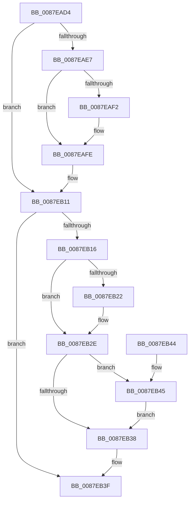

# PspUpdateJobEffectivePriorityLimits

- RVA: `0x0087EAD4`–`0x0087EB53` (길이 `127` bytes)
- VA: `0x000000014087EAD4`
- 실행 섹션: `PAGE`
- PDB 이름 있음: `예`; PDB Function 태그: `아니요`
- unwind 정보 RVA: `0x00064C74`
- 디코드: `34`개 명령, `127/127` bytes 표시
- 미해석 바이트: `0` (있으면 어셈블리에 `.byte`로 보존)

> 이 문서는 커널 이미지의 기계어와 PDB 기호를 분석해 생성했습니다. 4번과 5번은 함수 원형과 자료형을 바이너리 사용 방식에서 추정한 C 해석이며 원본 소스 복구 결과는 아닙니다.

## 1. Dependencies

- 직접 호출 지점: **1**; 고유 호출 대상: **1**
- 직접 호출자로 확인된 함수: **4**
- RIP 상대 이미지 참조: **0**

### Outgoing calls
- `0x0087EB45` → [Feature_Servicing_AutoBoostEtwEventingFixes__private_IsEnabledPreCheckWithReporting](../../text/22/Feature_Servicing_AutoBoostEtwEventingFixes__private_IsEnabledPreCheckWithReporting_function_00222FE0.md) (function, `0x00222FE0`)

### Direct callers
- [PspSetJobIoPriorityLimitPreCallback](../78/PspSetJobIoPriorityLimitPreCallback_function_00785550.md) at `0x00785561`
- [PspSetJobPagePriorityLimitPreCallback](../78/PspSetJobPagePriorityLimitPreCallback_function_00785710.md) at `0x00785719`
- [PspEstablishJobHierarchy](PspEstablishJobHierarchy_function_0087E17C.md) at `0x0087E40D`
- [PspSetJobBackgroundCountCallback](PspSetJobBackgroundCountCallback_function_0087EA80.md) at `0x0087EAC6`

### Static image references
- 디코드된 RIP-relative 메모리 참조가 없습니다.

## 2. Other-region calls and transfers

- 다른 실행 섹션으로 향하는 call: **1**
  - `0x0087EB45` → [Feature_Servicing_AutoBoostEtwEventingFixes__private_IsEnabledPreCheckWithReporting](../../text/22/Feature_Servicing_AutoBoostEtwEventingFixes__private_IsEnabledPreCheckWithReporting_function_00222FE0.md) (`PAGE` → `.text`)
- 별도 외부 분기/꼬리 이동을 확인하지 못했습니다.

## 3. Assembly (complete function range)

```asm
0087EAD4  48 83 EC 28                     sub rsp, 0x28
0087EAD8  4C 8B 89 18 05 00 00            mov r9, qword ptr [rcx + 0x518]
0087EADF  4C 8B C1                        mov r8, rcx
0087EAE2  F6 C2 01                        test dl, 1
0087EAE5  74 2A                           je 0x14087eb11
0087EAE7  8B 89 40 04 00 00               mov ecx, dword ptr [rcx + 0x440]
0087EAED  4D 85 C9                        test r9, r9
0087EAF0  74 0C                           je 0x14087eafe
0087EAF2  41 8B 81 3C 04 00 00            mov eax, dword ptr [r9 + 0x43c]
0087EAF9  3B C8                           cmp ecx, eax
0087EAFB  0F 43 C8                        cmovae ecx, eax
0087EAFE  33 C0                           xor eax, eax
0087EB00  41 39 80 30 04 00 00            cmp dword ptr [r8 + 0x430], eax
0087EB07  0F 46 C1                        cmovbe eax, ecx
0087EB0A  41 89 80 3C 04 00 00            mov dword ptr [r8 + 0x43c], eax
0087EB11  F6 C2 02                        test dl, 2
0087EB14  74 29                           je 0x14087eb3f
0087EB16  41 8B 88 48 04 00 00            mov ecx, dword ptr [r8 + 0x448]
0087EB1D  4D 85 C9                        test r9, r9
0087EB20  74 0C                           je 0x14087eb2e
0087EB22  41 8B 81 44 04 00 00            mov eax, dword ptr [r9 + 0x444]
0087EB29  3B C8                           cmp ecx, eax
0087EB2B  0F 43 C8                        cmovae ecx, eax
0087EB2E  41 83 B8 30 04 00 00 00         cmp dword ptr [r8 + 0x430], 0
0087EB36  77 0D                           ja 0x14087eb45
0087EB38  41 89 88 44 04 00 00            mov dword ptr [r8 + 0x444], ecx
0087EB3F  48 83 C4 28                     add rsp, 0x28
0087EB43  C3                              ret
0087EB44  CC                              int3
0087EB45  E8 96 44 9A FF                  call 0x140222fe0
0087EB4A  FF C0                           inc eax
0087EB4C  3B C8                           cmp ecx, eax
0087EB4E  0F 43 C8                        cmovae ecx, eax
0087EB51  EB E5                           jmp 0x14087eb38
```

## 4. C-style interpretation (structured pseudocode)

```c
__int64 __fastcall PspUpdateJobEffectivePriorityLimits(__int64 a1, unsigned __int8 a2)
{
    __int64 result;
    __int64 v_rsp;

    v_rsp = (v_rsp) - (40);
    if (((a2) & (1)) == 0) goto loc_0087EB11;
    if (*(unsigned __int64 *)(a1 + 1304) != 0) {
        result = *(unsigned int *)(*(unsigned __int64 *)(a1 + 1304) + 1084);
        a1 = (unsigned int)(*(unsigned int *)(a1 + 1088));
        if (((unsigned int)((unsigned int)(*(unsigned int *)(a1 + 1088)))) >= ((unsigned int)(result))) { a1 = (unsigned int)(result); }
    }
    result = 0;
    if ((*(unsigned int *)(a1 + 1072)) <= 0) { result = (unsigned int)(a1); }
    *(unsigned int *)(a1 + 1084) = (unsigned int)(result);
loc_0087EB11:
    if (((a2) & (2)) == 0) goto loc_0087EB3F;
    if (*(unsigned __int64 *)(a1 + 1304) != 0) {
        result = *(unsigned int *)(*(unsigned __int64 *)(a1 + 1304) + 1092);
        a1 = (unsigned int)(*(unsigned int *)(a1 + 1096));
        if (((unsigned int)((unsigned int)(*(unsigned int *)(a1 + 1096)))) >= ((unsigned int)(result))) { a1 = (unsigned int)(result); }
    }
    if ((*(unsigned int *)(a1 + 1072)) > 0) goto loc_0087EB45;
loc_0087EB38:
    *(unsigned int *)(a1 + 1092) = (unsigned int)(a1);
loc_0087EB3F:
    v_rsp = (v_rsp) + (40);
    return result;
loc_0087EB45:
    result = Feature_Servicing_AutoBoostEtwEventingFixes__private_IsEnabledPreCheckWithReporting(a1, a2, a1, *(unsigned __int64 *)(a1 + 1304));
    result = (unsigned int)((result) + 1);
    if (((unsigned int)(a1)) >= ((unsigned int)(result))) { a1 = (unsigned int)(result); }
    goto loc_0087EB38;
}
```

## 5. (Beta) C Style

```c
int64_t PspUpdateJobEffectivePriorityLimits(void *Arg1, uint8_t Arg2)
{
    uint8_t *arg1 = (uint8_t *)Arg1;

    int64_t result;
    int64_t local_rsp;

    local_rsp = (local_rsp) - (40);
    if (((Arg2) & (1)) == 0) goto loc_0087EB11;
    if (*(uint64_t *)(arg1 + 0x518) != 0) {
        result = *(uint32_t *)(*(uint64_t *)(arg1 + 0x518) + 0x43C);
        Arg1 = (uint32_t)(*(uint32_t *)(arg1 + 0x440));
        if (((uint32_t)((uint32_t)(*(uint32_t *)(arg1 + 0x440)))) >= ((uint32_t)(result))) { Arg1 = (uint32_t)(result); }
    }
    result = 0;
    if ((*(uint32_t *)(arg1 + 0x430)) <= 0) { result = (uint32_t)(Arg1); }
    *(uint32_t *)(arg1 + 0x43C) = (uint32_t)(result);
loc_0087EB11:
    if (((Arg2) & (2)) == 0) goto loc_0087EB3F;
    if (*(uint64_t *)(arg1 + 0x518) != 0) {
        result = *(uint32_t *)(*(uint64_t *)(arg1 + 0x518) + 0x444);
        Arg1 = (uint32_t)(*(uint32_t *)(arg1 + 0x448));
        if (((uint32_t)((uint32_t)(*(uint32_t *)(arg1 + 0x448)))) >= ((uint32_t)(result))) { Arg1 = (uint32_t)(result); }
    }
    if ((*(uint32_t *)(arg1 + 0x430)) > 0) goto loc_0087EB45;
loc_0087EB38:
    *(uint32_t *)(arg1 + 0x444) = (uint32_t)(Arg1);
loc_0087EB3F:
    local_rsp = (local_rsp) + (40);
    return result;
loc_0087EB45:
    result = Feature_Servicing_AutoBoostEtwEventingFixes__private_IsEnabledPreCheckWithReporting(Arg1, Arg2, Arg1, *(uint64_t *)(arg1 + 0x518));
    result = (uint32_t)((result) + 1);
    if (((uint32_t)(Arg1)) >= ((uint32_t)(result))) { Arg1 = (uint32_t)(result); }
    goto loc_0087EB38;
}
```

### 관측된 메모리 오프셋

구조체 형식이 확인되지 않은 접근은 인자 기준의 오프셋으로만 기록했습니다.

| 기준 인자 | 오프셋 표현 | 폭 (bit) | 접근 |
|---|---:|---:|---|
| `Arg1` | `+ 0x430` | `32` | `R` |
| `Arg1` | `+ 0x43C` | `32` | `W` |
| `Arg1` | `+ 0x440` | `32` | `R` |
| `Arg1` | `+ 0x448` | `32` | `R` |
| `Arg1` | `+ 0x518` | `64` | `R` |

## 6. Execution-region graph

[열기: 2D/3D 그래프와 함수 탐색 컨트롤 패널](../../../control-panel.html?section=page&rva=0x0087EAD4&view=graph)

- 2D 그래프는 위에서 아래로 흐르고, 3D 그래프는 빈 공간을 드래그해 회전합니다. Shift+드래그는 이동, 휠은 확대·축소, 함수 노드 선택은 대상 보고서 이동입니다.

### Static fallback


