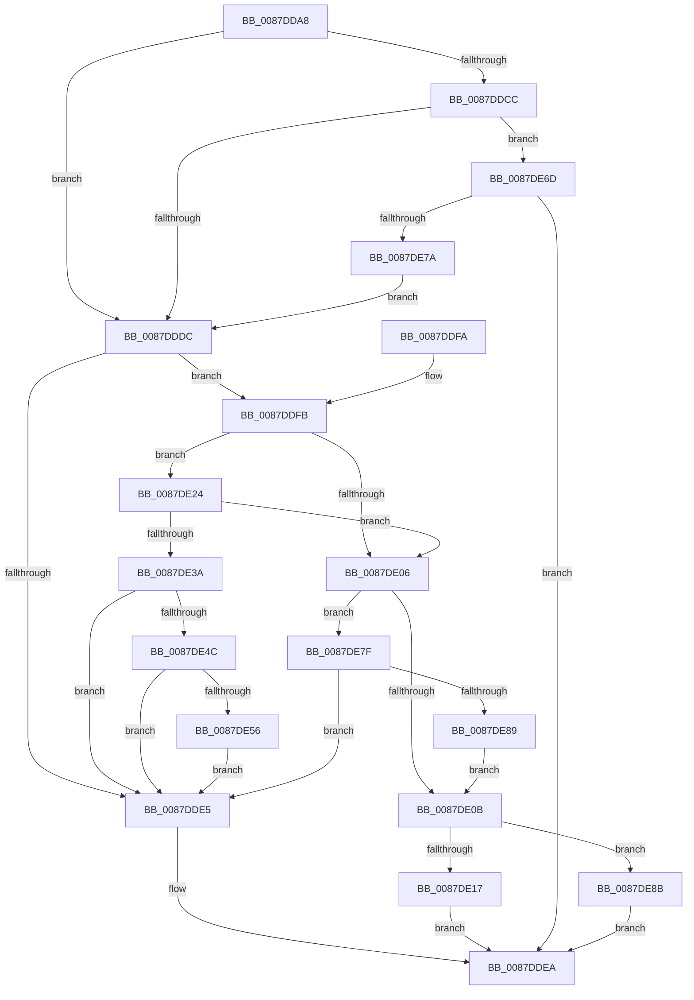

# PspValidateJobAssignmentProcessLimits

- RVA: `0x0087DDA8`–`0x0087DE95` (길이 `237` bytes)
- VA: `0x000000014087DDA8`
- 실행 섹션: `PAGE`
- PDB 이름 있음: `예`; PDB Function 태그: `아니요`
- unwind 정보 RVA: `0x0007BFA8`
- 디코드: `60`개 명령, `237/237` bytes 표시
- 미해석 바이트: `0` (있으면 어셈블리에 `.byte`로 보존)

> 이 문서는 커널 이미지의 기계어와 PDB 기호를 분석해 생성했습니다. 4번과 5번은 함수 원형과 자료형을 바이너리 사용 방식에서 추정한 C 해석이며 원본 소스 복구 결과는 아닙니다.

## 1. Dependencies

- 직접 호출 지점: **2**; 고유 호출 대상: **2**
- 직접 호출자로 확인된 함수: **1**
- RIP 상대 이미지 참조: **0**

### Outgoing calls
- `0x0087DE63` → [PspSendJobNotification](../../text/49/PspSendJobNotification_function_0049EC28.md) (function, `0x0049EC28`)
- `0x0087DE6D` → [PspCheckJobAccessState](../78/PspCheckJobAccessState_function_00784D94.md) (function, `0x00784D94`)

### Direct callers
- [PspValidateJobChainLimits](PspValidateJobChainLimits_function_0087DD40.md) at `0x0087DD76`

### Static image references
- 디코드된 RIP-relative 메모리 참조가 없습니다.

## 2. Other-region calls and transfers

- 다른 실행 섹션으로 향하는 call: **1**
  - `0x0087DE63` → [PspSendJobNotification](../../text/49/PspSendJobNotification_function_0049EC28.md) (`PAGE` → `.text`)
- 별도 외부 분기/꼬리 이동을 확인하지 못했습니다.

## 3. Assembly (complete function range)

```asm
0087DDA8  48 89 5C 24 08                  mov qword ptr [rsp + 8], rbx
0087DDAD  48 89 74 24 10                  mov qword ptr [rsp + 0x10], rsi
0087DDB2  57                              push rdi
0087DDB3  48 83 EC 20                     sub rsp, 0x20
0087DDB7  F7 82 F4 01 00 00 00 00 00 04   test dword ptr [rdx + 0x1f4], 0x4000000
0087DDC1  41 8B F0                        mov esi, r8d
0087DDC4  48 8B FA                        mov rdi, rdx
0087DDC7  48 8B D9                        mov rbx, rcx
0087DDCA  74 10                           je 0x14087dddc
0087DDCC  48 8B 89 10 02 00 00            mov rcx, qword ptr [rcx + 0x210]
0087DDD3  48 85 C9                        test rcx, rcx
0087DDD6  0F 85 91 00 00 00               jne 0x14087de6d
0087DDDC  83 BB B0 05 00 00 FF            cmp dword ptr [rbx + 0x5b0], -1
0087DDE3  75 16                           jne 0x14087ddfb
0087DDE5  B8 44 00 00 C0                  mov eax, 0xc0000044
0087DDEA  48 8B 5C 24 30                  mov rbx, qword ptr [rsp + 0x30]
0087DDEF  48 8B 74 24 38                  mov rsi, qword ptr [rsp + 0x38]
0087DDF4  48 83 C4 20                     add rsp, 0x20
0087DDF8  5F                              pop rdi
0087DDF9  C3                              ret
0087DDFA  CC                              int3
0087DDFB  8B 93 00 01 00 00               mov edx, dword ptr [rbx + 0x100]
0087DE01  F6 C2 08                        test dl, 8
0087DE04  75 1E                           jne 0x14087de24
0087DE06  F6 C2 04                        test dl, 4
0087DE09  75 74                           jne 0x14087de7f
0087DE0B  8B 83 10 06 00 00               mov eax, dword ptr [rbx + 0x610]
0087DE11  0F BA E0 1D                     bt eax, 0x1d
0087DE15  72 74                           jb 0x14087de8b
0087DE17  24 80                           and al, 0x80
0087DE19  F6 D8                           neg al
0087DE1B  1B C0                           sbb eax, eax
0087DE1D  25 0A 01 00 C0                  and eax, 0xc000010a
0087DE22  EB C6                           jmp 0x14087ddea
0087DE24  8B 8B D8 00 00 00               mov ecx, dword ptr [rbx + 0xd8]
0087DE2A  2B 8B B4 05 00 00               sub ecx, dword ptr [rbx + 0x5b4]
0087DE30  03 CE                           add ecx, esi
0087DE32  3B 8B 04 01 00 00               cmp ecx, dword ptr [rbx + 0x104]
0087DE38  76 CC                           jbe 0x14087de06
0087DE3A  F0 83 A7 F0 01 00 00 DF         lock and dword ptr [rdi + 0x1f0], 0xffffffdf
0087DE42  48 83 BB 28 02 00 00 00         cmp qword ptr [rbx + 0x228], 0
0087DE4A  74 99                           je 0x14087dde5
0087DE4C  8B 83 50 04 00 00               mov eax, dword ptr [rbx + 0x450]
0087DE52  A8 08                           test al, 8
0087DE54  74 8F                           je 0x14087dde5
0087DE56  45 33 C0                        xor r8d, r8d
0087DE59  41 B1 01                        mov r9b, 1
0087DE5C  48 8B CB                        mov rcx, rbx
0087DE5F  41 8D 50 03                     lea edx, [r8 + 3]
0087DE63  E8 C0 0D C2 FF                  call 0x14049ec28
0087DE68  E9 78 FF FF FF                  jmp 0x14087dde5
0087DE6D  E8 22 6F F0 FF                  call 0x140784d94
0087DE72  85 C0                           test eax, eax
0087DE74  0F 88 70 FF FF FF               js 0x14087ddea
0087DE7A  E9 5D FF FF FF                  jmp 0x14087dddc
0087DE7F  83 7B 04 00                     cmp dword ptr [rbx + 4], 0
0087DE83  0F 85 5C FF FF FF               jne 0x14087dde5
0087DE89  EB 80                           jmp 0x14087de0b
0087DE8B  B8 0D 00 00 C0                  mov eax, 0xc000000d
0087DE90  E9 55 FF FF FF                  jmp 0x14087ddea
```

## 4. C-style interpretation (structured pseudocode)

```c
__int64 __fastcall PspValidateJobAssignmentProcessLimits(__int64 a1, __int64 a2, int a3)
{
    __int64 result;
    __int64 v_rsp;
    unsigned __int64 v_stack_p10;
    unsigned __int64 v_stack_p8;

    v_stack_p8 = v_rbx;
    v_stack_p10 = v_rsi;
    v_rsp = (v_rsp) - (32);
    if (((*(unsigned int *)(a2 + 500)) & (0x4000000ULL)) == 0) goto loc_0087DDDC;
    if (*(unsigned __int64 *)(a1 + 528) != 0) goto loc_0087DE6D;
loc_0087DDDC:
    if ((*(unsigned int *)(a1 + 1456)) != -1) goto loc_0087DDFB;
loc_0087DDE5:
loc_0087DDEA:
    v_rsp = (v_rsp) + (32);
    return (unsigned int)(0xC0000044ULL);
loc_0087DDFB:
    if ((((unsigned __int8)((unsigned int)(*(unsigned int *)(v_stack_p8 + 256)))) & (8)) != 0) goto loc_0087DE24;
loc_0087DE06:
    if ((((unsigned __int8)((unsigned int)(*(unsigned int *)(v_stack_p8 + 256)))) & (4)) != 0) goto loc_0087DE7F;
loc_0087DE0B:
    if (condition_is_below) goto loc_0087DE8B;
    result = (unsigned __int8)(((unsigned int)(*(unsigned int *)(v_stack_p8 + 1552))) & (128));
    result = (unsigned __int8)(-(result));
    result = (unsigned int)((result) & (0xC000010AULL));
    goto loc_0087DDEA;
loc_0087DE24:
    a1 = (unsigned int)(((unsigned int)(*(unsigned int *)(v_stack_p8 + 216))) - (*(unsigned int *)(v_stack_p8 + 1460)));
    a1 = (unsigned int)((a1) + ((unsigned int)(v_stack_p10)));
    if (((unsigned int)(a1)) <= (*(unsigned int *)(v_stack_p8 + 260))) goto loc_0087DE06;
    if ((*(unsigned __int64 *)(v_stack_p8 + 552)) == 0) goto loc_0087DDE5;
    if ((((unsigned __int8)((unsigned int)(*(unsigned int *)(v_stack_p8 + 1104)))) & (8)) == 0) goto loc_0087DDE5;
    a3 = 0;
    result = PspSendJobNotification(v_stack_p8, a3 + 3, a3, 1);
    goto loc_0087DDE5;
loc_0087DE6D:
    result = PspCheckJobAccessState(v_stack_p8, a3 + 3, a3, 1);
    if (sign_flag) goto loc_0087DDEA;
    goto loc_0087DDDC;
loc_0087DE7F:
    if ((*(unsigned int *)(v_stack_p8 + 4)) != 0) goto loc_0087DDE5;
    goto loc_0087DE0B;
loc_0087DE8B:
    goto loc_0087DDEA;
}
```

## 5. (Beta) C Style

```c
int64_t PspValidateJobAssignmentProcessLimits(void *Arg1, void *Arg2, int32_t Arg3)
{
    uint8_t *arg1 = (uint8_t *)Arg1;
    uint8_t *arg2 = (uint8_t *)Arg2;

    int64_t result;
    int64_t local_rsp;
    uint64_t v_stack_p10;
    uint64_t v_stack_p8;

    v_stack_p8 = local_rbx;
    v_stack_p10 = local_rsi;
    local_rsp = (local_rsp) - (32);
    if (((*(uint32_t *)(arg2 + 0x1F4)) & (0x4000000ULL)) == 0) goto loc_0087DDDC;
    if (*(uint64_t *)(arg1 + 0x210) != 0) goto loc_0087DE6D;
loc_0087DDDC:
    if ((*(uint32_t *)(arg1 + 0x5B0)) != -1) goto loc_0087DDFB;
loc_0087DDE5:
loc_0087DDEA:
    local_rsp = (local_rsp) + (32);
    return (uint32_t)(0xC0000044ULL);
loc_0087DDFB:
    if ((((uint8_t)((uint32_t)(*(uint32_t *)(v_stack_p8 + 0x100)))) & (8)) != 0) goto loc_0087DE24;
loc_0087DE06:
    if ((((uint8_t)((uint32_t)(*(uint32_t *)(v_stack_p8 + 0x100)))) & (4)) != 0) goto loc_0087DE7F;
loc_0087DE0B:
    if (condition_is_below) goto loc_0087DE8B;
    result = (uint8_t)(((uint32_t)(*(uint32_t *)(v_stack_p8 + 0x610))) & (128));
    result = (uint8_t)(-(result));
    result = (uint32_t)((result) & (0xC000010AULL));
    goto loc_0087DDEA;
loc_0087DE24:
    Arg1 = (uint32_t)(((uint32_t)(*(uint32_t *)(v_stack_p8 + 0xD8))) - (*(uint32_t *)(v_stack_p8 + 0x5B4)));
    Arg1 = (uint32_t)((Arg1) + ((uint32_t)(v_stack_p10)));
    if (((uint32_t)(Arg1)) <= (*(uint32_t *)(v_stack_p8 + 0x104))) goto loc_0087DE06;
    if ((*(uint64_t *)(v_stack_p8 + 0x228)) == 0) goto loc_0087DDE5;
    if ((((uint8_t)((uint32_t)(*(uint32_t *)(v_stack_p8 + 0x450)))) & (8)) == 0) goto loc_0087DDE5;
    Arg3 = 0;
    result = PspSendJobNotification(v_stack_p8, Arg3 + 3, Arg3, 1);
    goto loc_0087DDE5;
loc_0087DE6D:
    result = PspCheckJobAccessState(v_stack_p8, Arg3 + 3, Arg3, 1);
    if (sign_flag) goto loc_0087DDEA;
    goto loc_0087DDDC;
loc_0087DE7F:
    if ((*(uint32_t *)(v_stack_p8 + 0x4)) != 0) goto loc_0087DDE5;
    goto loc_0087DE0B;
loc_0087DE8B:
    goto loc_0087DDEA;
}
```

### 관측된 메모리 오프셋

구조체 형식이 확인되지 않은 접근은 인자 기준의 오프셋으로만 기록했습니다.

| 기준 인자 | 오프셋 표현 | 폭 (bit) | 접근 |
|---|---:|---:|---|
| `Arg1` | `+ 0x4` | `32` | `R` |
| `Arg1` | `+ 0xD8` | `32` | `R` |
| `Arg1` | `+ 0x100` | `32` | `R` |
| `Arg1` | `+ 0x104` | `32` | `R` |
| `Arg1` | `+ 0x210` | `64` | `R` |
| `Arg1` | `+ 0x228` | `64` | `R` |
| `Arg1` | `+ 0x450` | `32` | `R` |
| `Arg1` | `+ 0x5B0` | `32` | `R` |
| `Arg1` | `+ 0x5B4` | `32` | `R` |
| `Arg1` | `+ 0x610` | `32` | `R` |
| `Arg2` | `+ 0x1F0` | `32` | `R/W` |
| `Arg2` | `+ 0x1F4` | `32` | `R` |

## 6. Execution-region graph

[열기: 2D/3D 그래프와 함수 탐색 컨트롤 패널](../../../control-panel.html?section=page&rva=0x0087DDA8&view=graph)

- 2D 그래프는 위에서 아래로 흐르고, 3D 그래프는 빈 공간을 드래그해 회전합니다. Shift+드래그는 이동, 휠은 확대·축소, 함수 노드 선택은 대상 보고서 이동입니다.

### Static fallback


