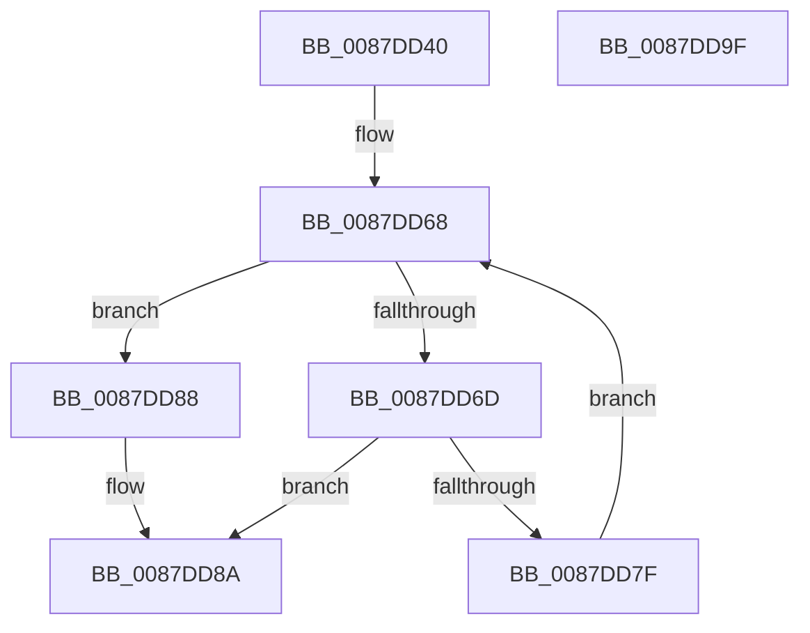

# PspValidateJobChainLimits

- RVA: `0x0087DD40`–`0x0087DDA0` (길이 `96` bytes)
- VA: `0x000000014087DD40`
- 실행 섹션: `PAGE`
- PDB 이름 있음: `예`; PDB Function 태그: `아니요`
- unwind 정보 RVA: `0x0005C954`
- 디코드: `30`개 명령, `96/96` bytes 표시
- 미해석 바이트: `0` (있으면 어셈블리에 `.byte`로 보존)

> 이 문서는 커널 이미지의 기계어와 PDB 기호를 분석해 생성했습니다. 4번과 5번은 함수 원형과 자료형을 바이너리 사용 방식에서 추정한 C 해석이며 원본 소스 복구 결과는 아닙니다.

## 1. Dependencies

- 직접 호출 지점: **1**; 고유 호출 대상: **1**
- 직접 호출자로 확인된 함수: **2**
- RIP 상대 이미지 참조: **0**

### Outgoing calls
- `0x0087DD76` → [PspValidateJobAssignmentProcessLimits](PspValidateJobAssignmentProcessLimits_function_0087DDA8.md) (function, `0x0087DDA8`)

### Direct callers
- [PspImplicitAssignProcessToJob](PspImplicitAssignProcessToJob_function_0087D584.md) at `0x0087D649`
- [PspAssignProcessToJob](../A2/PspAssignProcessToJob_function_00A23370.md) at `0x00A23640`

### Static image references
- 디코드된 RIP-relative 메모리 참조가 없습니다.

## 2. Other-region calls and transfers

- 다른 실행 섹션으로 향하는 call: **0**
- 별도 외부 분기/꼬리 이동을 확인하지 못했습니다.

## 3. Assembly (complete function range)

```asm
0087DD40  48 89 5C 24 08                  mov qword ptr [rsp + 8], rbx
0087DD45  48 89 6C 24 10                  mov qword ptr [rsp + 0x10], rbp
0087DD4A  48 89 74 24 18                  mov qword ptr [rsp + 0x18], rsi
0087DD4F  57                              push rdi
0087DD50  48 83 EC 20                     sub rsp, 0x20
0087DD54  41 8B F9                        mov edi, r9d
0087DD57  49 8B E8                        mov rbp, r8
0087DD5A  C1 EF 0F                        shr edi, 0xf
0087DD5D  48 8B F2                        mov rsi, rdx
0087DD60  F7 D7                           not edi
0087DD62  48 8B D9                        mov rbx, rcx
0087DD65  83 E7 01                        and edi, 1
0087DD68  48 3B DE                        cmp rbx, rsi
0087DD6B  74 1B                           je 0x14087dd88
0087DD6D  44 8B C7                        mov r8d, edi
0087DD70  48 8B D5                        mov rdx, rbp
0087DD73  48 8B CB                        mov rcx, rbx
0087DD76  E8 2D 00 00 00                  call 0x14087dda8
0087DD7B  85 C0                           test eax, eax
0087DD7D  78 0B                           js 0x14087dd8a
0087DD7F  48 8B 9B 18 05 00 00            mov rbx, qword ptr [rbx + 0x518]
0087DD86  EB E0                           jmp 0x14087dd68
0087DD88  33 C0                           xor eax, eax
0087DD8A  48 8B 5C 24 30                  mov rbx, qword ptr [rsp + 0x30]
0087DD8F  48 8B 6C 24 38                  mov rbp, qword ptr [rsp + 0x38]
0087DD94  48 8B 74 24 40                  mov rsi, qword ptr [rsp + 0x40]
0087DD99  48 83 C4 20                     add rsp, 0x20
0087DD9D  5F                              pop rdi
0087DD9E  C3                              ret
0087DD9F  CC                              int3
```

## 4. C-style interpretation (structured pseudocode)

```c
__int64 __fastcall PspValidateJobChainLimits(__int64 a1, __int64 a2, __int64 a3, int a4)
{
    __int64 result;
    __int64 v_rdi;
    __int64 v_rsp;
    unsigned __int64 v_stack_p10;
    unsigned __int64 v_stack_p18;
    unsigned __int64 v_stack_p8;

    v_stack_p8 = v_rbx;
    v_stack_p10 = v_rbp;
    v_stack_p18 = v_rsi;
    v_rsp = (v_rsp) - (32);
    v_rdi = (unsigned int)(((unsigned int)(a4)) >> (15));
    v_rdi = (unsigned int)(~(v_rdi));
    v_rdi = (unsigned int)((v_rdi) & (1));
loc_0087DD68:
    if (a1 == a2) goto loc_0087DD88;
    result = PspValidateJobAssignmentProcessLimits(a1, a3, (unsigned int)((unsigned int)(v_rdi)), a4);
    if (sign_flag) goto loc_0087DD8A;
    goto loc_0087DD68;
loc_0087DD88:
    result = 0;
loc_0087DD8A:
    v_rsp = (v_rsp) + (32);
    return result;
}
```

## 5. (Beta) C Style

```c
int64_t PspValidateJobChainLimits(int64_t Arg1, int64_t Arg2, int64_t Arg3, int32_t Arg4)
{
    int64_t result;
    int64_t local_rdi;
    int64_t local_rsp;
    uint64_t v_stack_p10;
    uint64_t v_stack_p18;
    uint64_t v_stack_p8;

    v_stack_p8 = local_rbx;
    v_stack_p10 = local_rbp;
    v_stack_p18 = local_rsi;
    local_rsp = (local_rsp) - (32);
    local_rdi = (uint32_t)(((uint32_t)(Arg4)) >> (15));
    local_rdi = (uint32_t)(~(local_rdi));
    local_rdi = (uint32_t)((local_rdi) & (1));
loc_0087DD68:
    if (Arg1 == Arg2) goto loc_0087DD88;
    result = PspValidateJobAssignmentProcessLimits(Arg1, Arg3, (uint32_t)((uint32_t)(local_rdi)), Arg4);
    if (sign_flag) goto loc_0087DD8A;
    goto loc_0087DD68;
loc_0087DD88:
    result = 0;
loc_0087DD8A:
    local_rsp = (local_rsp) + (32);
    return result;
}
```

## 6. Execution-region graph

[열기: 2D/3D 그래프와 함수 탐색 컨트롤 패널](../../../control-panel.html?section=page&rva=0x0087DD40&view=graph)

- 2D 그래프는 위에서 아래로 흐르고, 3D 그래프는 빈 공간을 드래그해 회전합니다. Shift+드래그는 이동, 휠은 확대·축소, 함수 노드 선택은 대상 보고서 이동입니다.

### Static fallback


