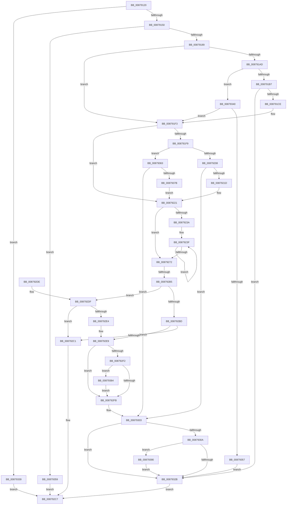

# RtlAcquirePrivilege

- RVA: `0x00879120`–`0x00879397` (길이 `631` bytes)
- VA: `0x0000000140879120`
- 실행 섹션: `PAGE`
- PDB 이름 있음: `예`; PDB Function 태그: `예`
- unwind 정보 RVA: `0x0006CCF8`
- 디코드: `166`개 명령, `631/631` bytes 표시
- 미해석 바이트: `0` (있으면 어셈블리에 `.byte`로 보존)

> 이 문서는 커널 이미지의 기계어와 PDB 기호를 분석해 생성했습니다. 4번과 5번은 함수 원형과 자료형을 바이너리 사용 방식에서 추정한 C 해석이며 원본 소스 복구 결과는 아닙니다.

## 1. Dependencies

- 직접 호출 지점: **12**; 고유 호출 대상: **8**
- 직접 호출자로 확인된 함수: **2**
- RIP 상대 이미지 참조: **0**

### Outgoing calls
- `0x00879178` → [ExAllocatePool2](../../poolcode/B8/ExAllocatePool2_function_00B820F0.md) (function, `0x00B820F0`)
- `0x008791BF` → [RtlpOpenThreadToken](../A7/RtlpOpenThreadToken_function_00A746F4.md) (function, `0x00A746F4`)
- `0x008791EE` → [ZwSetInformationThread](../../text/6A/ZwSetInformationThread_function_006AD270.md) (function, `0x006AD270`)
- `0x0087920E` → [RtlImpersonateSelfEx](RtlImpersonateSelfEx_function_008793A0.md) (function, `0x008793A0`)
- `0x0087929F` → [ZwAdjustPrivilegesToken](../../text/6A/ZwAdjustPrivilegesToken_function_006AD8F0.md) (function, `0x006AD8F0`)
- `0x008792FE` → [ZwClose](../../text/6A/ZwClose_function_006AD2B0.md) (function, `0x006AD2B0`)
- `0x0087931E` → [ZwSetInformationThread](../../text/6A/ZwSetInformationThread_function_006AD270.md) (function, `0x006AD270`)
- `0x00879330` → [ExFreePoolWithTag](../../poolcode/B8/ExFreePoolWithTag_function_00B82870.md) (function, `0x00B82870`)
- `0x00879348` → [RtlpOpenThreadToken](../A7/RtlpOpenThreadToken_function_00A746F4.md) (function, `0x00A746F4`)
- `0x00879370` → [ZwOpenProcessTokenEx](../../text/6A/ZwOpenProcessTokenEx_function_006AD6D0.md) (function, `0x006AD6D0`)
- `0x00879386` → [ExFreePoolWithTag](../../poolcode/B8/ExFreePoolWithTag_function_00B82870.md) (function, `0x00B82870`)
- `0x00879390` → [ZwClose](../../text/6A/ZwClose_function_006AD2B0.md) (function, `0x006AD2B0`)

### Direct callers
- [VhdiAutoAttachOneVhd](../83/VhdiAutoAttachOneVhd_function_0083BCD4.md) at `0x0083BDA7`
- [PspAllocateProcess](../A1/PspAllocateProcess_function_00A13B3C.md) at `0x00A14C89`

### Static image references
- 디코드된 RIP-relative 메모리 참조가 없습니다.

## 2. Other-region calls and transfers

- 다른 실행 섹션으로 향하는 call: **9**
  - `0x00879178` → [ExAllocatePool2](../../poolcode/B8/ExAllocatePool2_function_00B820F0.md) (`PAGE` → `POOLCODE`)
  - `0x008791EE` → [ZwSetInformationThread](../../text/6A/ZwSetInformationThread_function_006AD270.md) (`PAGE` → `.text`)
  - `0x0087929F` → [ZwAdjustPrivilegesToken](../../text/6A/ZwAdjustPrivilegesToken_function_006AD8F0.md) (`PAGE` → `.text`)
  - `0x008792FE` → [ZwClose](../../text/6A/ZwClose_function_006AD2B0.md) (`PAGE` → `.text`)
  - `0x0087931E` → [ZwSetInformationThread](../../text/6A/ZwSetInformationThread_function_006AD270.md) (`PAGE` → `.text`)
  - `0x00879330` → [ExFreePoolWithTag](../../poolcode/B8/ExFreePoolWithTag_function_00B82870.md) (`PAGE` → `POOLCODE`)
  - `0x00879370` → [ZwOpenProcessTokenEx](../../text/6A/ZwOpenProcessTokenEx_function_006AD6D0.md) (`PAGE` → `.text`)
  - `0x00879386` → [ExFreePoolWithTag](../../poolcode/B8/ExFreePoolWithTag_function_00B82870.md) (`PAGE` → `POOLCODE`)
  - `0x00879390` → [ZwClose](../../text/6A/ZwClose_function_006AD2B0.md) (`PAGE` → `.text`)
- call이 아닌 외부 분기/꼬리 이동: **1**
  - `0x008792AF` → [sub_00B17FC0](../B1/Unknown_function_00B17FC0.md) (`tail-transfer`)

## 3. Assembly (complete function range)

```asm
00879120  48 8B C4                        mov rax, rsp
00879123  48 89 58 08                     mov qword ptr [rax + 8], rbx
00879127  48 89 68 10                     mov qword ptr [rax + 0x10], rbp
0087912B  56                              push rsi
0087912C  57                              push rdi
0087912D  41 54                           push r12
0087912F  41 56                           push r14
00879131  41 57                           push r15
00879133  48 83 EC 40                     sub rsp, 0x40
00879137  83 60 18 00                     and dword ptr [rax + 0x18], 0
0087913B  4D 8B E1                        mov r12, r9
0087913E  8B EA                           mov ebp, edx
00879140  4C 8B F1                        mov r14, rcx
00879143  41 F7 C0 FC FF FF FF            test r8d, 0xfffffffc
0087914A  0F 85 E9 01 00 00               jne 0x140879339
00879150  41 8B F0                        mov esi, r8d
00879153  8D 4D FF                        lea ecx, [rbp - 1]
00879156  48 8D 49 5A                     lea rcx, [rcx + 0x5a]
0087915A  83 CE 01                        or esi, 1
0087915D  41 F6 C0 02                     test r8b, 2
00879161  48 8D 14 49                     lea rdx, [rcx + rcx*2]
00879165  B9 41 00 00 00                  mov ecx, 0x41
0087916A  41 0F 44 F0                     cmove esi, r8d
0087916E  48 C1 E2 02                     shl rdx, 2
00879172  41 B8 52 74 50 62               mov r8d, 0x62507452
00879178  E8 73 8F 30 00                  call 0x140b820f0
0087917D  48 8B D8                        mov rbx, rax
00879180  48 85 C0                        test rax, rax
00879183  0F 84 D0 01 00 00               je 0x140879359
00879189  48 83 20 00                     and qword ptr [rax], 0
0087918D  4C 8D 78 08                     lea r15, [rax + 8]
00879191  49 83 27 00                     and qword ptr [r15], 0
00879195  83 60 20 00                     and dword ptr [rax + 0x20], 0
00879199  65 48 8B 04 25 88 01 00 00      mov rax, qword ptr gs:[0x188]
008791A2  8B 88 A0 05 00 00               mov ecx, dword ptr [rax + 0x5a0]
008791A8  F6 C1 08                        test cl, 8
008791AB  74 46                           je 0x1408791f3
008791AD  40 F6 C6 01                     test sil, 1
008791B1  0F 84 89 01 00 00               je 0x140879340
008791B7  49 8B D7                        mov rdx, r15
008791BA  B9 04 00 00 00                  mov ecx, 4
008791BF  E8 30 B5 1F 00                  call 0x140a746f4
008791C4  8B F8                           mov edi, eax
008791C6  85 C0                           test eax, eax
008791C8  0F 88 5D 01 00 00               js 0x14087932b
008791CE  83 4B 20 01                     or dword ptr [rbx + 0x20], 1
008791D2  4C 8D 44 24 30                  lea r8, [rsp + 0x30]
008791D7  48 83 64 24 30 00               and qword ptr [rsp + 0x30], 0
008791DD  41 B9 08 00 00 00               mov r9d, 8
008791E3  48 C7 C1 FE FF FF FF            mov rcx, 0xfffffffffffffffe
008791EA  41 8D 51 FD                     lea edx, [r9 - 3]
008791EE  E8 7D 40 E3 FF                  call 0x1406ad270
008791F3  48 83 3B 00                     cmp qword ptr [rbx], 0
008791F7  75 28                           jne 0x140879221
008791F9  BA 28 00 00 00                  mov edx, 0x28
008791FE  40 F6 C6 02                     test sil, 2
00879202  0F 85 5B 01 00 00               jne 0x140879363
00879208  4C 8B C3                        mov r8, rbx
0087920B  8D 4A DB                        lea ecx, [rdx - 0x25]
0087920E  E8 8D 01 00 00                  call 0x1408793a0
00879213  8B F8                           mov edi, eax
00879215  85 C0                           test eax, eax
00879217  0F 88 E6 00 00 00               js 0x140879303
0087921D  83 4B 20 01                     or dword ptr [rbx + 0x20], 1
00879221  48 8D 83 28 04 00 00            lea rax, [rbx + 0x428]
00879228  48 89 43 18                     mov qword ptr [rbx + 0x18], rax
0087922C  48 8D 73 24                     lea rsi, [rbx + 0x24]
00879230  48 89 73 10                     mov qword ptr [rbx + 0x10], rsi
00879234  89 28                           mov dword ptr [rax], ebp
00879236  85 ED                           test ebp, ebp
00879238  74 38                           je 0x140879272
0087923A  33 D2                           xor edx, edx
0087923C  4C 8B C5                        mov r8, rbp
0087923F  41 8B 06                        mov eax, dword ptr [r14]
00879242  48 8D 52 0C                     lea rdx, [rdx + 0xc]
00879246  48 8B 4B 18                     mov rcx, qword ptr [rbx + 0x18]
0087924A  4D 8D 76 04                     lea r14, [r14 + 4]
0087924E  83 64 24 34 00                  and dword ptr [rsp + 0x34], 0
00879253  89 44 24 30                     mov dword ptr [rsp + 0x30], eax
00879257  48 8B 44 24 30                  mov rax, qword ptr [rsp + 0x30]
0087925C  48 89 44 0A F8                  mov qword ptr [rdx + rcx - 8], rax
00879261  48 8B 43 18                     mov rax, qword ptr [rbx + 0x18]
00879265  C7 04 02 02 00 00 00            mov dword ptr [rdx + rax], 2
0087926C  49 83 E8 01                     sub r8, 1
00879270  75 CD                           jne 0x14087923f
00879272  41 B9 00 04 00 00               mov r9d, 0x400
00879278  48 8D 84 24 80 00 00 00         lea rax, [rsp + 0x80]
00879280  44 89 8C 24 80 00 00 00         mov dword ptr [rsp + 0x80], r9d
00879288  33 D2                           xor edx, edx
0087928A  4C 8B 43 18                     mov r8, qword ptr [rbx + 0x18]
0087928E  48 8B 0B                        mov rcx, qword ptr [rbx]
00879291  48 89 44 24 28                  mov qword ptr [rsp + 0x28], rax
00879296  48 8B 43 10                     mov rax, qword ptr [rbx + 0x10]
0087929A  48 89 44 24 20                  mov qword ptr [rsp + 0x20], rax
0087929F  E8 4C 46 E3 FF                  call 0x1406ad8f0
008792A4  41 BE 23 00 00 C0               mov r14d, 0xc0000023
008792AA  8B F8                           mov edi, eax
008792AC  41 3B C6                        cmp eax, r14d
008792AF  0F 84 0B ED 29 00               je 0x140b17fc0
008792B5  81 FF 06 01 00 00               cmp edi, 0x106
008792BB  74 22                           je 0x1408792df
008792BD  85 FF                           test edi, edi
008792BF  78 28                           js 0x1408792e9
008792C1  49 89 1C 24                     mov qword ptr [r12], rbx
008792C5  33 C0                           xor eax, eax
008792C7  48 8B 5C 24 70                  mov rbx, qword ptr [rsp + 0x70]
008792CC  48 8B 6C 24 78                  mov rbp, qword ptr [rsp + 0x78]
008792D1  48 83 C4 40                     add rsp, 0x40
008792D5  41 5F                           pop r15
008792D7  41 5E                           pop r14
008792D9  41 5C                           pop r12
008792DB  5F                              pop rdi
008792DC  5E                              pop rsi
008792DD  C3                              ret
008792DE  CC                              int3
008792DF  83 FD 01                        cmp ebp, 1
008792E2  75 DD                           jne 0x1408792c1
008792E4  BF 61 00 00 C0                  mov edi, 0xc0000061
008792E9  48 8B 4B 10                     mov rcx, qword ptr [rbx + 0x10]
008792ED  48 85 C9                        test rcx, rcx
008792F0  74 09                           je 0x1408792fb
008792F2  48 3B CE                        cmp rcx, rsi
008792F5  0F 85 89 00 00 00               jne 0x140879384
008792FB  48 8B 0B                        mov rcx, qword ptr [rbx]
008792FE  E8 AD 3F E3 FF                  call 0x1406ad2b0
00879303  8B 43 20                        mov eax, dword ptr [rbx + 0x20]
00879306  A8 01                           test al, 1
00879308  74 21                           je 0x14087932b
0087930A  41 B9 08 00 00 00               mov r9d, 8
00879310  4D 8B C7                        mov r8, r15
00879313  48 C7 C1 FE FF FF FF            mov rcx, 0xfffffffffffffffe
0087931A  41 8D 51 FD                     lea edx, [r9 - 3]
0087931E  E8 4D 3F E3 FF                  call 0x1406ad270
00879323  49 8B 0F                        mov rcx, qword ptr [r15]
00879326  48 85 C9                        test rcx, rcx
00879329  75 65                           jne 0x140879390
0087932B  33 D2                           xor edx, edx
0087932D  48 8B CB                        mov rcx, rbx
00879330  E8 3B 95 30 00                  call 0x140b82870
00879335  8B C7                           mov eax, edi
00879337  EB 8E                           jmp 0x1408792c7
00879339  B8 0D 00 00 C0                  mov eax, 0xc000000d
0087933E  EB 87                           jmp 0x1408792c7
00879340  48 8B D3                        mov rdx, rbx
00879343  B9 28 00 00 00                  mov ecx, 0x28
00879348  E8 A7 B3 1F 00                  call 0x140a746f4
0087934D  8B F8                           mov edi, eax
0087934F  85 C0                           test eax, eax
00879351  0F 89 9C FE FF FF               jns 0x1408791f3
00879357  EB D2                           jmp 0x14087932b
00879359  B8 17 00 00 C0                  mov eax, 0xc0000017
0087935E  E9 64 FF FF FF                  jmp 0x1408792c7
00879363  4C 8B CB                        mov r9, rbx
00879366  41 B8 00 02 00 00               mov r8d, 0x200
0087936C  48 83 C9 FF                     or rcx, 0xffffffffffffffff
00879370  E8 5B 43 E3 FF                  call 0x1406ad6d0
00879375  8B F8                           mov edi, eax
00879377  85 C0                           test eax, eax
00879379  78 88                           js 0x140879303
0087937B  83 4B 20 02                     or dword ptr [rbx + 0x20], 2
0087937F  E9 9D FE FF FF                  jmp 0x140879221
00879384  33 D2                           xor edx, edx
00879386  E8 E5 94 30 00                  call 0x140b82870
0087938B  E9 6B FF FF FF                  jmp 0x1408792fb
00879390  E8 1B 3F E3 FF                  call 0x1406ad2b0
00879395  EB 94                           jmp 0x14087932b
```

## 4. C-style interpretation (structured pseudocode)

```c
__int64 __fastcall RtlAcquirePrivilege(__int64 a1, int a2, int a3, __int64 a4)
{
    __int64 result;
    __int64 v_rsi;
    __int64 v_rsp;
    unsigned int v_stack_m34;
    unsigned __int64 v_stack_m38;
    unsigned __int64 v_stack_m40;
    unsigned __int64 v_stack_m48;
    unsigned __int64 v_stack_p10;
    unsigned __int64 v_stack_p18;
    unsigned __int64 v_stack_p8;

    *(unsigned __int64 *)(v_rsp + 8) = v_rbx;
    *(unsigned __int64 *)(v_rsp + 16) = v_rbp;
    v_rsp = (v_rsp) - (64);
    if (((a3) & (0xFFFFFFFCULL)) != 0) goto loc_00879339;
    v_rsi = (unsigned int)(((unsigned int)(a3)) | (1));
    if ((((unsigned __int8)(a3)) & (2)) == 0) { v_rsi = a3; }
    a2 = ((unsigned int)(a2) - 1 + 90 + (unsigned int)(a2) - 1 + 90 * 2) << (2);
    result = ExAllocatePool2(65, a2, (unsigned int)(0x62507452ULL), a4);
    if (result == 0) goto loc_00879359;
    if ((((unsigned __int8)((unsigned int)(*(unsigned int *)(*(unsigned __int64 *)(gs_base + (0 + 392)) + 1440)))) & (8)) == 0) goto loc_008791F3;
    if ((((unsigned __int8)(v_rsi)) & (1)) == 0) goto loc_00879340;
    result = RtlpOpenThreadToken(4, result + 8, (unsigned int)(0x62507452ULL), a4);
    if (sign_flag) goto loc_0087932B;
    result = ZwSetInformationThread(-2, 8 - 3, v_stack_m38, 8);
loc_008791F3:
    if ((*(unsigned __int64 *)(result)) != 0) goto loc_00879221;
    if ((((unsigned __int8)(v_rsi)) & (2)) != 0) goto loc_00879363;
    result = RtlImpersonateSelfEx(40 - 37, 40, result, 8);
    if (sign_flag) goto loc_00879303;
loc_00879221:
    *(unsigned __int64 *)(result + 24) = result + 1064;
    *(unsigned __int64 *)(result + 16) = result + 36;
    *(unsigned int *)(result + 1064) = (unsigned int)((unsigned int)(a2));
    if ((unsigned int)((unsigned int)(a2)) == 0) goto loc_00879272;
    a2 = 0;
loc_0087923F:
    v_stack_m38 = (unsigned int)((unsigned int)(*(unsigned int *)(a1)));
    *(unsigned __int64 *)(a2 + 12 + *(unsigned __int64 *)(result + 24) * 1 - 8) = v_stack_m38;
    *(unsigned int *)(a2 + 12 + *(unsigned __int64 *)(result + 24) * 1) = 2;
    a3 = ((unsigned int)(a2)) - (1);
    if (condition_is_not_equal) goto loc_0087923F;
loc_00879272:
    v_stack_p18 = (unsigned int)((unsigned int)(0x400ULL));
    a2 = 0;
    v_stack_m40 = v_stack_p18;
    v_stack_m48 = *(unsigned __int64 *)(result + 16);
    result = ZwAdjustPrivilegesToken(*(unsigned __int64 *)(result), a2, *(unsigned __int64 *)(result + 24), (unsigned int)(0x400ULL));
    if (((unsigned int)((unsigned int)((unsigned int)(result)))) == 262) goto loc_008792DF;
    if (sign_flag) goto loc_008792E9;
loc_008792C1:
    *(unsigned __int64 *)(a4) = result;
    result = 0;
loc_008792C7:
    v_rsp = (v_rsp) + (64);
    return result;
loc_008792DF:
    if (((unsigned int)(v_stack_p10)) != 1) goto loc_008792C1;
loc_008792E9:
    if (*(unsigned __int64 *)(v_stack_p8 + 16) == 0) goto loc_008792FB;
    if ((*(unsigned __int64 *)(v_stack_p8 + 16)) != (result + 36)) goto loc_00879384;
loc_008792FB:
    result = ZwClose(*(unsigned __int64 *)(v_stack_p8), a2, *(unsigned __int64 *)(result + 24), (unsigned int)(0x400ULL));
loc_00879303:
    if ((((unsigned __int8)((unsigned int)(*(unsigned int *)(v_stack_p8 + 32)))) & (1)) == 0) goto loc_0087932B;
    result = ZwSetInformationThread(-2, 8 - 3, result + 8, 8);
    if (*(unsigned __int64 *)(result + 8) != 0) goto loc_00879390;
loc_0087932B:
    a2 = 0;
    result = ExFreePoolWithTag(v_stack_p8, a2, result + 8, 8);
    goto loc_008792C7;
loc_00879339:
    goto loc_008792C7;
loc_00879340:
    result = RtlpOpenThreadToken(40, v_stack_p8, result + 8, 8);
    if (!sign_flag) goto loc_008791F3;
    goto loc_0087932B;
loc_00879359:
    goto loc_008792C7;
loc_00879363:
    a1 = (40) | (-1);
    result = ZwOpenProcessTokenEx(a1, v_stack_p8, 512, v_stack_p8);
    if (sign_flag) goto loc_00879303;
    goto loc_00879221;
loc_00879384:
    a2 = 0;
    result = ExFreePoolWithTag(a1, a2, 512, v_stack_p8);
    goto loc_008792FB;
loc_00879390:
    result = ZwClose(a1, a2, 512, v_stack_p8);
    goto loc_0087932B;
}
```

## 5. (Beta) C Style

```c
int64_t RtlAcquirePrivilege(void *Arg1, void *Arg2, int32_t Arg3, void *Arg4)
{
    uint8_t *arg1 = (uint8_t *)Arg1;
    uint8_t *arg2 = (uint8_t *)Arg2;
    uint8_t *arg4 = (uint8_t *)Arg4;

    int64_t result;
    int64_t local_rsi;
    int64_t local_rsp;
    uint32_t v_stack_m34;
    uint64_t v_stack_m38;
    uint64_t v_stack_m40;
    uint64_t v_stack_m48;
    uint64_t v_stack_p10;
    uint64_t v_stack_p18;
    uint64_t v_stack_p8;

    *(uint64_t *)(local_rsp + 0x8) = local_rbx;
    *(uint64_t *)(local_rsp + 0x10) = local_rbp;
    local_rsp = (local_rsp) - (64);
    if (((Arg3) & (0xFFFFFFFCULL)) != 0) goto loc_00879339;
    local_rsi = (uint32_t)(((uint32_t)(Arg3)) | (1));
    if ((((uint8_t)(Arg3)) & (2)) == 0) { local_rsi = Arg3; }
    Arg2 = ((uint32_t)(Arg2) - 1 + 90 + (uint32_t)(Arg2) - 1 + 90 * 2) << (2);
    result = ExAllocatePool2(65, Arg2, (uint32_t)(0x62507452ULL), Arg4);
    if (result == 0) goto loc_00879359;
    if ((((uint8_t)((uint32_t)(*(uint32_t *)(*(uint64_t *)(gs_base + (0 + 0x188)) + 0x5A0)))) & (8)) == 0) goto loc_008791F3;
    if ((((uint8_t)(local_rsi)) & (1)) == 0) goto loc_00879340;
    result = RtlpOpenThreadToken(4, result + 8, (uint32_t)(0x62507452ULL), Arg4);
    if (sign_flag) goto loc_0087932B;
    result = ZwSetInformationThread(-2, 8 - 3, v_stack_m38, 8);
loc_008791F3:
    if ((*(uint64_t *)(result)) != 0) goto loc_00879221;
    if ((((uint8_t)(local_rsi)) & (2)) != 0) goto loc_00879363;
    result = RtlImpersonateSelfEx(40 - 37, 40, result, 8);
    if (sign_flag) goto loc_00879303;
loc_00879221:
    *(uint64_t *)(result + 0x18) = result + 1064;
    *(uint64_t *)(result + 0x10) = result + 36;
    *(uint32_t *)(result + 0x428) = (uint32_t)((uint32_t)(Arg2));
    if ((uint32_t)((uint32_t)(Arg2)) == 0) goto loc_00879272;
    Arg2 = 0;
loc_0087923F:
    v_stack_m38 = (uint32_t)((uint32_t)(*(uint32_t *)(arg1)));
    *(uint64_t *)(arg2 + 0xC + *(uint64_t *)(result + 0x18) * 1 - 0x8) = v_stack_m38;
    *(uint32_t *)(arg2 + 0xC + *(uint64_t *)(result + 0x18) * 1) = 2;
    Arg3 = ((uint32_t)(Arg2)) - (1);
    if (condition_is_not_equal) goto loc_0087923F;
loc_00879272:
    v_stack_p18 = (uint32_t)((uint32_t)(0x400ULL));
    Arg2 = 0;
    v_stack_m40 = v_stack_p18;
    v_stack_m48 = *(uint64_t *)(result + 0x10);
    result = ZwAdjustPrivilegesToken(*(uint64_t *)(result), Arg2, *(uint64_t *)(result + 0x18), (uint32_t)(0x400ULL));
    if (((uint32_t)((uint32_t)((uint32_t)(result)))) == 262) goto loc_008792DF;
    if (sign_flag) goto loc_008792E9;
loc_008792C1:
    *(uint64_t *)(arg4) = result;
    result = 0;
loc_008792C7:
    local_rsp = (local_rsp) + (64);
    return result;
loc_008792DF:
    if (((uint32_t)(v_stack_p10)) != 1) goto loc_008792C1;
loc_008792E9:
    if (*(uint64_t *)(v_stack_p8 + 0x10) == 0) goto loc_008792FB;
    if ((*(uint64_t *)(v_stack_p8 + 0x10)) != (result + 36)) goto loc_00879384;
loc_008792FB:
    result = ZwClose(*(uint64_t *)(v_stack_p8), Arg2, *(uint64_t *)(result + 0x18), (uint32_t)(0x400ULL));
loc_00879303:
    if ((((uint8_t)((uint32_t)(*(uint32_t *)(v_stack_p8 + 0x20)))) & (1)) == 0) goto loc_0087932B;
    result = ZwSetInformationThread(-2, 8 - 3, result + 8, 8);
    if (*(uint64_t *)(result + 0x8) != 0) goto loc_00879390;
loc_0087932B:
    Arg2 = 0;
    result = ExFreePoolWithTag(v_stack_p8, Arg2, result + 8, 8);
    goto loc_008792C7;
loc_00879339:
    goto loc_008792C7;
loc_00879340:
    result = RtlpOpenThreadToken(40, v_stack_p8, result + 8, 8);
    if (!sign_flag) goto loc_008791F3;
    goto loc_0087932B;
loc_00879359:
    goto loc_008792C7;
loc_00879363:
    Arg1 = (40) | (-1);
    result = ZwOpenProcessTokenEx(Arg1, v_stack_p8, 512, v_stack_p8);
    if (sign_flag) goto loc_00879303;
    goto loc_00879221;
loc_00879384:
    Arg2 = 0;
    result = ExFreePoolWithTag(Arg1, Arg2, 512, v_stack_p8);
    goto loc_008792FB;
loc_00879390:
    result = ZwClose(Arg1, Arg2, 512, v_stack_p8);
    goto loc_0087932B;
}
```

### 관측된 메모리 오프셋

구조체 형식이 확인되지 않은 접근은 인자 기준의 오프셋으로만 기록했습니다.

| 기준 인자 | 오프셋 표현 | 폭 (bit) | 접근 |
|---|---:|---:|---|
| `Arg1` | `+ 0x0` | `32` | `R` |
| `Arg1` | `+ 0x4` | `64` | `R` |
| `Arg2` | `- 0x1` | `32` | `R` |
| `Arg2` | `+ 0x0 + rcx*2` | `64` | `R` |
| `Arg2` | `+ 0x5A` | `64` | `R` |
| `Arg4` | `+ 0x0` | `64` | `W` |

## 6. Execution-region graph

[열기: 2D/3D 그래프와 함수 탐색 컨트롤 패널](../../../control-panel.html?section=page&rva=0x00879120&view=graph)

- 2D 그래프는 위에서 아래로 흐르고, 3D 그래프는 빈 공간을 드래그해 회전합니다. Shift+드래그는 이동, 휠은 확대·축소, 함수 노드 선택은 대상 보고서 이동입니다.

### Static fallback


