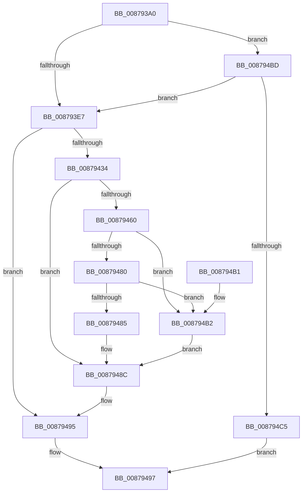

# RtlImpersonateSelfEx

- RVA: `0x008793A0`–`0x008794CC` (길이 `300` bytes)
- VA: `0x00000001408793A0`
- 실행 섹션: `PAGE`
- PDB 이름 있음: `예`; PDB Function 태그: `아니요`
- unwind 정보 RVA: `0x0006CD24`
- 디코드: `83`개 명령, `300/300` bytes 표시
- 미해석 바이트: `0` (있으면 어셈블리에 `.byte`로 보존)

> 이 문서는 커널 이미지의 기계어와 PDB 기호를 분석해 생성했습니다. 4번과 5번은 함수 원형과 자료형을 바이너리 사용 방식에서 추정한 C 해석이며 원본 소스 복구 결과는 아닙니다.

## 1. Dependencies

- 직접 호출 지점: **6**; 고유 호출 대상: **5**
- 직접 호출자로 확인된 함수: **3**
- RIP 상대 이미지 참조: **1**

### Outgoing calls
- `0x00879429` → [ZwOpenProcessTokenEx](../../text/6A/ZwOpenProcessTokenEx_function_006AD6D0.md) (function, `0x006AD6D0`)
- `0x00879455` → [ZwDuplicateToken](../../text/6A/ZwDuplicateToken_function_006AD910.md) (function, `0x006AD910`)
- `0x00879475` → [ZwSetInformationThread](../../text/6A/ZwSetInformationThread_function_006AD270.md) (function, `0x006AD270`)
- `0x00879490` → [ZwClose](../../text/6A/ZwClose_function_006AD2B0.md) (function, `0x006AD2B0`)
- `0x0087949E` → [_security_check_cookie](../../text/6A/_security_check_cookie_function_006AC640.md) (function, `0x006AC640`)
- `0x008794B6` → [ZwClose](../../text/6A/ZwClose_function_006AD2B0.md) (function, `0x006AD2B0`)

### Direct callers
- [CmpCmdHiveOpen](CmpCmdHiveOpen_function_00878404.md) at `0x00878580`
- [RtlAcquirePrivilege](RtlAcquirePrivilege_function_00879120.md) at `0x0087920E`
- [BiAcquirePrivilege](../A3/BiAcquirePrivilege_function_00A3D658.md) at `0x00A3D6CF`

### Static image references
- `0x008793B3` → RVA `0x00E0A740` (`.data`; read)

## 2. Other-region calls and transfers

- 다른 실행 섹션으로 향하는 call: **6**
  - `0x00879429` → [ZwOpenProcessTokenEx](../../text/6A/ZwOpenProcessTokenEx_function_006AD6D0.md) (`PAGE` → `.text`)
  - `0x00879455` → [ZwDuplicateToken](../../text/6A/ZwDuplicateToken_function_006AD910.md) (`PAGE` → `.text`)
  - `0x00879475` → [ZwSetInformationThread](../../text/6A/ZwSetInformationThread_function_006AD270.md) (`PAGE` → `.text`)
  - `0x00879490` → [ZwClose](../../text/6A/ZwClose_function_006AD2B0.md) (`PAGE` → `.text`)
  - `0x0087949E` → [_security_check_cookie](../../text/6A/_security_check_cookie_function_006AC640.md) (`PAGE` → `.text`)
  - `0x008794B6` → [ZwClose](../../text/6A/ZwClose_function_006AD2B0.md) (`PAGE` → `.text`)
- 별도 외부 분기/꼬리 이동을 확인하지 못했습니다.

## 3. Assembly (complete function range)

```asm
008793A0  40 55                           push rbp
008793A2  53                              push rbx
008793A3  56                              push rsi
008793A4  57                              push rdi
008793A5  41 56                           push r14
008793A7  48 8D 6C 24 C9                  lea rbp, [rsp - 0x37]
008793AC  48 81 EC 90 00 00 00            sub rsp, 0x90
008793B3  48 8B 05 86 13 59 00            mov rax, qword ptr [rip + 0x591386]
008793BA  48 33 C4                        xor rax, rsp
008793BD  48 89 45 27                     mov qword ptr [rbp + 0x27], rax
008793C1  45 33 F6                        xor r14d, r14d
008793C4  49 8B F8                        mov rdi, r8
008793C7  4C 89 75 DF                     mov qword ptr [rbp - 0x21], r14
008793CB  8B F2                           mov esi, edx
008793CD  4C 89 75 D7                     mov qword ptr [rbp - 0x29], r14
008793D1  44 89 75 EB                     mov dword ptr [rbp - 0x15], r14d
008793D5  44 89 75 03                     mov dword ptr [rbp + 3], r14d
008793D9  66 44 89 75 21                  mov word ptr [rbp + 0x21], r14w
008793DE  4D 85 C0                        test r8, r8
008793E1  0F 84 D6 00 00 00               je 0x1408794bd
008793E7  41 B8 00 02 00 00               mov r8d, 0x200
008793ED  89 4D 1B                        mov dword ptr [rbp + 0x1b], ecx
008793F0  48 8D 45 17                     lea rax, [rbp + 0x17]
008793F4  44 89 45 FF                     mov dword ptr [rbp - 1], r8d
008793F8  48 83 C9 FF                     or rcx, 0xffffffffffffffff
008793FC  48 89 45 0F                     mov qword ptr [rbp + 0xf], rax
00879400  4C 8D 4D DF                     lea r9, [rbp - 0x21]
00879404  C7 45 E7 30 00 00 00            mov dword ptr [rbp - 0x19], 0x30
0087940B  BA 02 00 00 00                  mov edx, 2
00879410  4C 89 75 EF                     mov qword ptr [rbp - 0x11], r14
00879414  4C 89 75 F7                     mov qword ptr [rbp - 9], r14
00879418  4C 89 75 07                     mov qword ptr [rbp + 7], r14
0087941C  C7 45 17 0C 00 00 00            mov dword ptr [rbp + 0x17], 0xc
00879423  66 C7 45 1F 01 00               mov word ptr [rbp + 0x1f], 1
00879429  E8 A2 42 E3 FF                  call 0x1406ad6d0
0087942E  8B D8                           mov ebx, eax
00879430  85 C0                           test eax, eax
00879432  78 61                           js 0x140879495
00879434  48 8B 4D DF                     mov rcx, qword ptr [rbp - 0x21]
00879438  48 8D 45 D7                     lea rax, [rbp - 0x29]
0087943C  48 89 44 24 28                  mov qword ptr [rsp + 0x28], rax
00879441  4C 8D 45 E7                     lea r8, [rbp - 0x19]
00879445  83 CE 04                        or esi, 4
00879448  C7 44 24 20 02 00 00 00         mov dword ptr [rsp + 0x20], 2
00879450  8B D6                           mov edx, esi
00879452  45 33 C9                        xor r9d, r9d
00879455  E8 B6 44 E3 FF                  call 0x1406ad910
0087945A  8B D8                           mov ebx, eax
0087945C  85 C0                           test eax, eax
0087945E  78 2C                           js 0x14087948c
00879460  41 B9 08 00 00 00               mov r9d, 8
00879466  4C 8D 45 D7                     lea r8, [rbp - 0x29]
0087946A  48 C7 C1 FE FF FF FF            mov rcx, 0xfffffffffffffffe
00879471  41 8D 51 FD                     lea edx, [r9 - 3]
00879475  E8 F6 3D E3 FF                  call 0x1406ad270
0087947A  8B D8                           mov ebx, eax
0087947C  85 C0                           test eax, eax
0087947E  78 32                           js 0x1408794b2
00879480  48 85 FF                        test rdi, rdi
00879483  74 2D                           je 0x1408794b2
00879485  48 8B 45 D7                     mov rax, qword ptr [rbp - 0x29]
00879489  48 89 07                        mov qword ptr [rdi], rax
0087948C  48 8B 4D DF                     mov rcx, qword ptr [rbp - 0x21]
00879490  E8 1B 3E E3 FF                  call 0x1406ad2b0
00879495  8B C3                           mov eax, ebx
00879497  48 8B 4D 27                     mov rcx, qword ptr [rbp + 0x27]
0087949B  48 33 CC                        xor rcx, rsp
0087949E  E8 9D 31 E3 FF                  call 0x1406ac640
008794A3  48 81 C4 90 00 00 00            add rsp, 0x90
008794AA  41 5E                           pop r14
008794AC  5F                              pop rdi
008794AD  5E                              pop rsi
008794AE  5B                              pop rbx
008794AF  5D                              pop rbp
008794B0  C3                              ret
008794B1  CC                              int3
008794B2  48 8B 4D D7                     mov rcx, qword ptr [rbp - 0x29]
008794B6  E8 F5 3D E3 FF                  call 0x1406ad2b0
008794BB  EB CF                           jmp 0x14087948c
008794BD  85 F6                           test esi, esi
008794BF  0F 84 22 FF FF FF               je 0x1408793e7
008794C5  B8 F0 00 00 C0                  mov eax, 0xc00000f0
008794CA  EB CB                           jmp 0x140879497
```

## 4. C-style interpretation (structured pseudocode)

```c
__int64 __fastcall RtlImpersonateSelfEx(__int64 a1, int a2, __int64 a3)
{
    __int64 result;
    __int64 v_r14;
    __int64 v_rsi;
    __int64 v_rsp;
    unsigned __int64 v_stack_m38;
    unsigned __int16 v_stack_m3E;
    unsigned __int16 v_stack_m40;
    unsigned int v_stack_m44;
    unsigned __int64 v_stack_m48;
    unsigned __int64 v_stack_m50;
    unsigned __int64 v_stack_m58;
    unsigned int v_stack_m5C;
    unsigned __int64 v_stack_m5F;
    unsigned int v_stack_m60;
    unsigned __int64 v_stack_m68;
    unsigned __int64 v_stack_m70;
    unsigned int v_stack_m74;
    unsigned int v_stack_m78;
    unsigned __int64 v_stack_m80;
    unsigned __int64 v_stack_m88;
    unsigned __int64 v_stack_m90;
    unsigned int v_stack_m98;

    v_rsp = (v_rsp) - (144);
    result = (*(unsigned __int64 *)(v_rip + 5837702)) ^ (v_rsp);
    v_stack_m38 = result;
    v_r14 = 0;
    v_stack_m80 = 0;
    v_stack_m88 = 0;
    v_stack_m74 = 0;
    v_stack_m5C = 0;
    v_stack_m3E = 0;
    if (a3 == 0) goto loc_008794BD;
loc_008793E7:
    v_stack_m44 = (unsigned int)(a1);
    v_stack_m60 = 512;
    a1 = (a1) | (-1);
    v_stack_m50 = v_stack_m48;
    v_stack_m78 = 48;
    v_stack_m70 = 0;
    v_stack_m68 = 0;
    v_stack_m58 = 0;
    v_stack_m48 = 12;
    v_stack_m40 = 1;
    result = ZwOpenProcessTokenEx(a1, 2, 512, v_stack_m80);
    if (sign_flag) goto loc_00879495;
    v_stack_m90 = v_stack_m88;
    v_rsi = (unsigned int)(((unsigned int)(a2)) | (4));
    v_stack_m98 = 2;
    a4 = 0;
    result = ZwDuplicateToken(v_stack_m80, (unsigned int)((unsigned int)(v_rsi)), v_stack_m78, a4);
    if (sign_flag) goto loc_0087948C;
    result = ZwSetInformationThread(-2, 8 - 3, v_stack_m88, 8);
    if (sign_flag) goto loc_008794B2;
    if (a3 == 0) goto loc_008794B2;
    *(unsigned __int64 *)(a3) = v_stack_m88;
loc_0087948C:
    result = ZwClose(v_stack_m80, 8 - 3, v_stack_m88, 8);
loc_00879495:
loc_00879497:
    a1 = (v_stack_m38) ^ (v_rsp);
    result = _security_check_cookie(a1, 8 - 3, v_stack_m88, 8);
    v_rsp = (v_rsp) + (144);
    return result;
loc_008794B2:
    result = ZwClose(v_stack_m88, 8 - 3, v_stack_m88, 8);
    goto loc_0087948C;
loc_008794BD:
    if ((unsigned int)(v_rsi) == 0) goto loc_008793E7;
    goto loc_00879497;
}
```

## 5. (Beta) C Style

```c
int64_t RtlImpersonateSelfEx(int64_t Arg1, int32_t Arg2, int64_t Arg3)
{
    int64_t result;
    int64_t local_r14;
    int64_t local_rsi;
    int64_t local_rsp;
    uint64_t v_stack_m38;
    uint16_t v_stack_m3E;
    uint16_t v_stack_m40;
    uint32_t v_stack_m44;
    uint64_t v_stack_m48;
    uint64_t v_stack_m50;
    uint64_t v_stack_m58;
    uint32_t v_stack_m5C;
    uint64_t v_stack_m5F;
    uint32_t v_stack_m60;
    uint64_t v_stack_m68;
    uint64_t v_stack_m70;
    uint32_t v_stack_m74;
    uint32_t v_stack_m78;
    uint64_t v_stack_m80;
    uint64_t v_stack_m88;
    uint64_t v_stack_m90;
    uint32_t v_stack_m98;

    local_rsp = (local_rsp) - (144);
    result = (*(uint64_t *)(v_rip + 0x591386)) ^ (local_rsp);
    v_stack_m38 = result;
    local_r14 = 0;
    v_stack_m80 = 0;
    v_stack_m88 = 0;
    v_stack_m74 = 0;
    v_stack_m5C = 0;
    v_stack_m3E = 0;
    if (Arg3 == 0) goto loc_008794BD;
loc_008793E7:
    v_stack_m44 = (uint32_t)(Arg1);
    v_stack_m60 = 512;
    Arg1 = (Arg1) | (-1);
    v_stack_m50 = v_stack_m48;
    v_stack_m78 = 48;
    v_stack_m70 = 0;
    v_stack_m68 = 0;
    v_stack_m58 = 0;
    v_stack_m48 = 12;
    v_stack_m40 = 1;
    result = ZwOpenProcessTokenEx(Arg1, 2, 512, v_stack_m80);
    if (sign_flag) goto loc_00879495;
    v_stack_m90 = v_stack_m88;
    local_rsi = (uint32_t)(((uint32_t)(Arg2)) | (4));
    v_stack_m98 = 2;
    a4 = 0;
    result = ZwDuplicateToken(v_stack_m80, (uint32_t)((uint32_t)(local_rsi)), v_stack_m78, a4);
    if (sign_flag) goto loc_0087948C;
    result = ZwSetInformationThread(-2, 8 - 3, v_stack_m88, 8);
    if (sign_flag) goto loc_008794B2;
    if (Arg3 == 0) goto loc_008794B2;
    *(uint64_t *)(Arg3) = v_stack_m88;
loc_0087948C:
    result = ZwClose(v_stack_m80, 8 - 3, v_stack_m88, 8);
loc_00879495:
loc_00879497:
    Arg1 = (v_stack_m38) ^ (local_rsp);
    result = _security_check_cookie(Arg1, 8 - 3, v_stack_m88, 8);
    local_rsp = (local_rsp) + (144);
    return result;
loc_008794B2:
    result = ZwClose(v_stack_m88, 8 - 3, v_stack_m88, 8);
    goto loc_0087948C;
loc_008794BD:
    if ((uint32_t)(local_rsi) == 0) goto loc_008793E7;
    goto loc_00879497;
}
```

## 6. Execution-region graph

[열기: 2D/3D 그래프와 함수 탐색 컨트롤 패널](../../../control-panel.html?section=page&rva=0x008793A0&view=graph)

- 2D 그래프는 위에서 아래로 흐르고, 3D 그래프는 빈 공간을 드래그해 회전합니다. Shift+드래그는 이동, 휠은 확대·축소, 함수 노드 선택은 대상 보고서 이동입니다.

### Static fallback


