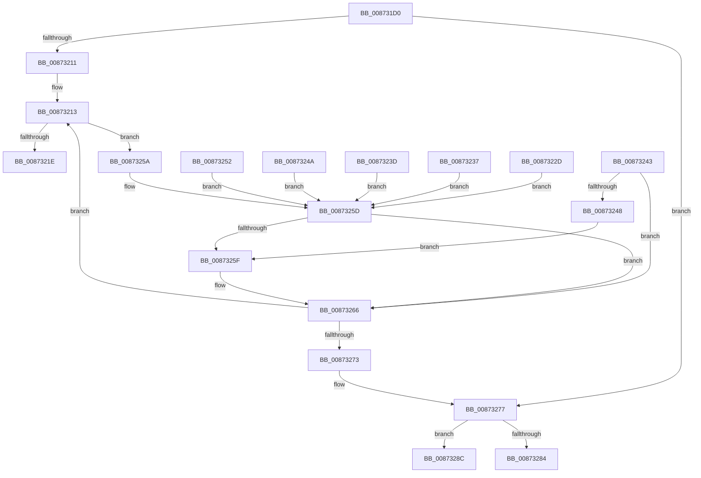

# RtlpFilterSacl

- RVA: `0x008731D0`–`0x00873296` (길이 `198` bytes)
- VA: `0x00000001408731D0`
- 실행 섹션: `PAGE`
- PDB 이름 있음: `예`; PDB Function 태그: `아니요`
- unwind 정보 RVA: `0x0006C69C`
- 디코드: `62`개 명령, `198/198` bytes 표시
- 미해석 바이트: `0` (있으면 어셈블리에 `.byte`로 보존)

> 이 문서는 커널 이미지의 기계어와 PDB 기호를 분석해 생성했습니다. 4번과 5번은 함수 원형과 자료형을 바이너리 사용 방식에서 추정한 C 해석이며 원본 소스 복구 결과는 아닙니다.

## 1. Dependencies

- 직접 호출 지점: **0**; 고유 호출 대상: **0**
- 직접 호출자로 확인된 함수: **1**
- RIP 상대 이미지 참조: **1**

### Outgoing calls
- 직접 디코드된 call 명령이 없습니다.

### Direct callers
- [SeQuerySecurityDescriptorInfo](SeQuerySecurityDescriptorInfo_function_00872820.md) at `0x00872B40`
- [SeQuerySecurityDescriptorInfo](SeQuerySecurityDescriptorInfo_function_00872820.md) at `0x00872BA3`

### Static image references
- `0x008731F3` → RVA `0x00000000` (`image boundary/outside`; read)

## 2. Other-region calls and transfers

- 다른 실행 섹션으로 향하는 call: **0**
- call이 아닌 외부 분기/꼬리 이동: **1**
  - `0x00873287` → [sub_00873361](Unknown_function_00873361.md) (`tail-transfer`)

## 3. Assembly (complete function range)

```asm
008731D0  48 89 5C 24 10                  mov qword ptr [rsp + 0x10], rbx
008731D5  48 89 74 24 18                  mov qword ptr [rsp + 0x18], rsi
008731DA  48 89 7C 24 20                  mov qword ptr [rsp + 0x20], rdi
008731DF  41 54                           push r12
008731E1  41 56                           push r14
008731E3  41 57                           push r15
008731E5  48 83 EC 20                     sub rsp, 0x20
008731E9  0F B7 41 04                     movzx eax, word ptr [rcx + 4]
008731ED  48 8D 59 08                     lea rbx, [rcx + 8]
008731F1  33 F6                           xor esi, esi
008731F3  4C 8D 25 06 CE 78 FF            lea r12, [rip - 0x8731fa]
008731FA  41 BA 08 00 00 00               mov r10d, 8
00873200  41 8B F9                        mov edi, r9d
00873203  4C 8B F2                        mov r14, rdx
00873206  4C 8B F9                        mov r15, rcx
00873209  45 8B CA                        mov r9d, r10d
0087320C  66 3B F0                        cmp si, ax
0087320F  73 66                           jae 0x140873277
00873211  8B D0                           mov edx, eax
00873213  0F B6 03                        movzx eax, byte ptr [rbx]
00873216  83 C0 FE                        add eax, -2
00873219  83 F8 15                        cmp eax, 0x15
0087321C  77 3C                           ja 0x14087325a
0087321E  48 98                           cdqe
00873220  41 8B 8C 84 7C 33 87 00         mov ecx, dword ptr [r12 + rax*4 + 0x87337c]
00873228  49 03 CC                        add rcx, r12
0087322B  FF E1                           jmp rcx
0087322D  CC                              int3
0087322E  CC                              int3
0087322F  CC                              int3
00873230  CC                              int3
00873231  40 F6 C7 20                     test dil, 0x20
00873235  EB 26                           jmp 0x14087325d
00873237  40 F6 C7 40                     test dil, 0x40
0087323B  EB 20                           jmp 0x14087325d
0087323D  40 F6 C7 10                     test dil, 0x10
00873241  EB 1A                           jmp 0x14087325d
00873243  40 84 FF                        test dil, dil
00873246  79 1E                           jns 0x140873266
00873248  EB 15                           jmp 0x14087325f
0087324A  F7 C7 00 01 00 00               test edi, 0x100
00873250  EB 0B                           jmp 0x14087325d
00873252  F7 C7 00 02 00 00               test edi, 0x200
00873258  EB 03                           jmp 0x14087325d
0087325A  41 84 FA                        test r10b, dil
0087325D  74 07                           je 0x140873266
0087325F  0F B7 43 02                     movzx eax, word ptr [rbx + 2]
00873263  44 03 C8                        add r9d, eax
00873266  0F B7 43 02                     movzx eax, word ptr [rbx + 2]
0087326A  48 03 D8                        add rbx, rax
0087326D  48 83 EA 01                     sub rdx, 1
00873271  75 A0                           jne 0x140873213
00873273  49 8D 5F 08                     lea rbx, [r15 + 8]
00873277  41 83 C1 03                     add r9d, 3
0087327B  41 83 E1 FC                     and r9d, 0xfffffffc
0087327F  45 39 08                        cmp dword ptr [r8], r9d
00873282  73 08                           jae 0x14087328c
00873284  45 89 08                        mov dword ptr [r8], r9d
00873287  E9 D5 00 00 00                  jmp 0x140873361
0087328C  49 8B 07                        mov rax, qword ptr [r15]
0087328F  49 89 06                        mov qword ptr [r14], rax
00873292  45 89 56 02                     mov dword ptr [r14 + 2], r10d
```

## 4. C-style interpretation (structured pseudocode)

```c
__int64 __fastcall RtlpFilterSacl(__int64 a1, __int64 a2, __int64 a3, int a4)
{
    __int64 result;
    __int64 v_rbx;
    __int64 v_rsi;
    __int64 v_rsp;
    unsigned __int64 v_stack_p10;
    unsigned __int64 v_stack_p18;
    unsigned __int64 v_stack_p20;

    v_stack_p10 = v_rbx;
    v_stack_p18 = v_rsi;
    v_stack_p20 = v_rdi;
    v_rsp = (v_rsp) - (32);
    v_rsi = 0;
    if (0 >= ((unsigned __int16)(*(unsigned __int16 *)(a1 + 4)))) goto loc_00873277;
loc_00873213:
    result = (unsigned int)((*(unsigned __int8 *)(a1 + 8)) + (-2));
    if (((unsigned int)(result)) > 21) goto loc_0087325A;
    a1 = ((unsigned int)(*(unsigned int *)(v_rip - 8860154 + result * 4 + 8860540))) + (v_rip - 8860154);
loc_0087325A:
loc_0087325D:
    if (((8) & ((unsigned __int8)((unsigned int)(a4)))) != 0) {
        result = *(unsigned __int16 *)(a1 + 8 + 2);
        a4 = (unsigned int)((8) + ((unsigned int)(result)));
    }
    v_rbx = (a1 + 8) + (*(unsigned __int16 *)(a1 + 8 + 2));
    a2 = ((unsigned int)((unsigned int)(*(unsigned __int16 *)(a1 + 4)))) - (1);
    if (condition_is_not_equal) goto loc_00873213;
loc_00873277:
    a4 = (unsigned int)((a4) + (3));
    a4 = (unsigned int)((a4) & (0xFFFFFFFCULL));
    if ((*(unsigned int *)(a3)) >= a4) goto loc_0087328C;
    *(unsigned int *)(a3) = a4;
loc_0087328C:
    *(unsigned __int64 *)(a2) = *(unsigned __int64 *)(a1);
    *(unsigned int *)(a2 + 2) = 8;
    return *(unsigned __int64 *)(a1);
}
```

## 5. (Beta) C Style

```c
int64_t RtlpFilterSacl(void *Arg1, void *Arg2, void *Arg3, int32_t Arg4)
{
    uint8_t *arg1 = (uint8_t *)Arg1;
    uint8_t *arg2 = (uint8_t *)Arg2;
    uint8_t *arg3 = (uint8_t *)Arg3;

    int64_t result;
    int64_t local_rbx;
    int64_t local_rsi;
    int64_t local_rsp;
    uint64_t v_stack_p10;
    uint64_t v_stack_p18;
    uint64_t v_stack_p20;

    v_stack_p10 = local_rbx;
    v_stack_p18 = local_rsi;
    v_stack_p20 = local_rdi;
    local_rsp = (local_rsp) - (32);
    local_rsi = 0;
    if (0 >= ((uint16_t)(*(uint16_t *)(arg1 + 0x4)))) goto loc_00873277;
loc_00873213:
    result = (uint32_t)((*(uint8_t *)(arg1 + 0x8)) + (-2));
    if (((uint32_t)(result)) > 21) goto loc_0087325A;
    Arg1 = ((uint32_t)(*(uint32_t *)(v_rip - 0x8731FA + result * 4 + 0x87337C))) + (v_rip - 8860154);
loc_0087325A:
loc_0087325D:
    if (((8) & ((uint8_t)((uint32_t)(Arg4)))) != 0) {
        result = *(uint16_t *)(arg1 + 0x8 + 0x2);
        Arg4 = (uint32_t)((8) + ((uint32_t)(result)));
    }
    local_rbx = (Arg1 + 8) + (*(uint16_t *)(arg1 + 0x8 + 0x2));
    Arg2 = ((uint32_t)((uint32_t)(*(uint16_t *)(arg1 + 0x4)))) - (1);
    if (condition_is_not_equal) goto loc_00873213;
loc_00873277:
    Arg4 = (uint32_t)((Arg4) + (3));
    Arg4 = (uint32_t)((Arg4) & (0xFFFFFFFCULL));
    if ((*(uint32_t *)(arg3)) >= Arg4) goto loc_0087328C;
    *(uint32_t *)(arg3) = Arg4;
loc_0087328C:
    *(uint64_t *)(arg2) = *(uint64_t *)(arg1);
    *(uint32_t *)(arg2 + 0x2) = 8;
    return *(uint64_t *)(arg1);
}
```

### 관측된 메모리 오프셋

구조체 형식이 확인되지 않은 접근은 인자 기준의 오프셋으로만 기록했습니다.

| 기준 인자 | 오프셋 표현 | 폭 (bit) | 접근 |
|---|---:|---:|---|
| `Arg1` | `+ 0x0` | `8` | `R` |
| `Arg1` | `+ 0x0` | `64` | `R` |
| `Arg1` | `+ 0x2` | `16` | `R` |
| `Arg1` | `+ 0x4` | `16` | `R` |
| `Arg1` | `+ 0x8` | `64` | `R` |
| `Arg2` | `+ 0x0` | `64` | `W` |
| `Arg2` | `+ 0x2` | `32` | `W` |
| `Arg3` | `+ 0x0` | `32` | `R` |
| `Arg3` | `+ 0x0` | `32` | `W` |

## 6. Execution-region graph

[열기: 2D/3D 그래프와 함수 탐색 컨트롤 패널](../../../control-panel.html?section=page&rva=0x008731D0&view=graph)

- 2D 그래프는 위에서 아래로 흐르고, 3D 그래프는 빈 공간을 드래그해 회전합니다. Shift+드래그는 이동, 휠은 확대·축소, 함수 노드 선택은 대상 보고서 이동입니다.

### Static fallback


