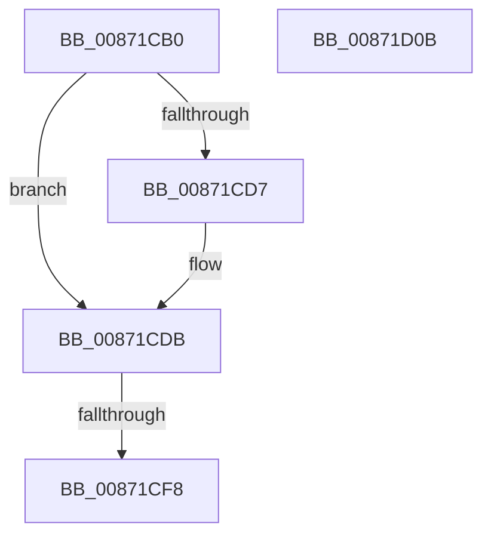

# SePrivilegedServiceAuditAlarm

- RVA: `0x00871CB0`–`0x00871D0C` (길이 `92` bytes)
- VA: `0x0000000140871CB0`
- 실행 섹션: `PAGE`
- PDB 이름 있음: `예`; PDB Function 태그: `아니요`
- unwind 정보 RVA: `0x0006C494`
- 디코드: `29`개 명령, `92/92` bytes 표시
- 미해석 바이트: `0` (있으면 어셈블리에 `.byte`로 보존)

> 이 문서는 커널 이미지의 기계어와 PDB 기호를 분석해 생성했습니다. 4번과 5번은 함수 원형과 자료형을 바이너리 사용 방식에서 추정한 C 해석이며 원본 소스 복구 결과는 아닙니다.

## 1. Dependencies

- 직접 호출 지점: **1**; 고유 호출 대상: **1**
- 직접 호출자로 확인된 함수: **5**
- RIP 상대 이미지 참조: **1**

### Outgoing calls
- `0x00871CEF` → [RtlEqualSid](../../text/40/RtlEqualSid_function_00400AD0.md) (function, `0x00400AD0`)

### Direct callers
- [ObpCreateHandle](../86/ObpCreateHandle_function_0086B950.md) at `0x0086CDB2`
- [ObpGrantAccess](../86/ObpGrantAccess_function_0086F250.md) at `0x0086F7F9`
- [ObpAdjustCreatorAccessState](ObpAdjustCreatorAccessState_function_00874650.md) at `0x008747E6`
- [RtlpNewSecurityObject](../92/RtlpNewSecurityObject_function_0092AB50.md) at `0x0092C824`
- [RtlpNewSecurityObject](../92/RtlpNewSecurityObject_function_0092AB50.md) at `0x0092CA4E`
- [PspSetQuotaLimits](../9B/PspSetQuotaLimits_function_009BA8A8.md) at `0x009BADBB`

### Static image references
- `0x00871CE5` → RVA `0x00E67D58` (`.data`; read)

## 2. Other-region calls and transfers

- 다른 실행 섹션으로 향하는 call: **1**
  - `0x00871CEF` → [RtlEqualSid](../../text/40/RtlEqualSid_function_00400AD0.md) (`PAGE` → `.text`)
- call이 아닌 외부 분기/꼬리 이동: **1**
  - `0x00871CF6` → [sub_00871D0C](Unknown_function_00871D0C.md) (`tail-transfer`)

## 3. Assembly (complete function range)

```asm
00871CB0  48 89 5C 24 10                  mov qword ptr [rsp + 0x10], rbx
00871CB5  48 89 6C 24 18                  mov qword ptr [rsp + 0x18], rbp
00871CBA  56                              push rsi
00871CBB  57                              push rdi
00871CBC  41 56                           push r14
00871CBE  48 83 EC 40                     sub rsp, 0x40
00871CC2  48 8B 02                        mov rax, qword ptr [rdx]
00871CC5  41 0F B6 E9                     movzx ebp, r9b
00871CC9  49 8B F0                        mov rsi, r8
00871CCC  48 8B DA                        mov rbx, rdx
00871CCF  4C 8B F1                        mov r14, rcx
00871CD2  48 85 C0                        test rax, rax
00871CD5  75 04                           jne 0x140871cdb
00871CD7  48 8B 42 10                     mov rax, qword ptr [rdx + 0x10]
00871CDB  48 8B 88 98 00 00 00            mov rcx, qword ptr [rax + 0x98]
00871CE2  48 8B 39                        mov rdi, qword ptr [rcx]
00871CE5  48 8B 0D 6C 60 5F 00            mov rcx, qword ptr [rip + 0x5f606c]
00871CEC  48 8B D7                        mov rdx, rdi
00871CEF  E8 DC ED B8 FF                  call 0x140400ad0
00871CF4  84 C0                           test al, al
00871CF6  74 14                           je 0x140871d0c
00871CF8  48 8B 5C 24 68                  mov rbx, qword ptr [rsp + 0x68]
00871CFD  48 8B 6C 24 70                  mov rbp, qword ptr [rsp + 0x70]
00871D02  48 83 C4 40                     add rsp, 0x40
00871D06  41 5E                           pop r14
00871D08  5F                              pop rdi
00871D09  5E                              pop rsi
00871D0A  C3                              ret
00871D0B  CC                              int3
```

## 4. C-style interpretation (structured pseudocode)

```c
__int64 __fastcall SePrivilegedServiceAuditAlarm(__int64 a1, __int64 a2, __int64 a3, unsigned __int8 a4)
{
    __int64 result;
    __int64 v_rsp;
    unsigned __int64 v_stack_p10;
    unsigned __int64 v_stack_p18;

    v_stack_p10 = v_rbx;
    v_stack_p18 = v_rbp;
    v_rsp = (v_rsp) - (64);
    result = *(unsigned __int64 *)(a2);
    if (*(unsigned __int64 *)(a2) == 0) {
        result = *(unsigned __int64 *)(a2 + 16);
    }
    result = RtlEqualSid(*(unsigned __int64 *)(v_rip + 6250604), *(unsigned __int64 *)(*(unsigned __int64 *)(result + 152)), a3, a4);
    v_rsp = (v_rsp) + (64);
    return result;
}
```

## 5. (Beta) C Style

```c
int64_t SePrivilegedServiceAuditAlarm(int64_t Arg1, void *Arg2, int64_t Arg3, uint8_t Arg4)
{
    uint8_t *arg2 = (uint8_t *)Arg2;

    int64_t result;
    int64_t local_rsp;
    uint64_t v_stack_p10;
    uint64_t v_stack_p18;

    v_stack_p10 = local_rbx;
    v_stack_p18 = local_rbp;
    local_rsp = (local_rsp) - (64);
    result = *(uint64_t *)(arg2);
    if (*(uint64_t *)(arg2) == 0) {
        result = *(uint64_t *)(arg2 + 0x10);
    }
    result = RtlEqualSid(*(uint64_t *)(v_rip + 0x5F606C), *(uint64_t *)(*(uint64_t *)(result + 0x98)), Arg3, Arg4);
    local_rsp = (local_rsp) + (64);
    return result;
}
```

### 관측된 메모리 오프셋

구조체 형식이 확인되지 않은 접근은 인자 기준의 오프셋으로만 기록했습니다.

| 기준 인자 | 오프셋 표현 | 폭 (bit) | 접근 |
|---|---:|---:|---|
| `Arg2` | `+ 0x0` | `64` | `R` |
| `Arg2` | `+ 0x10` | `64` | `R` |

## 6. Execution-region graph

[열기: 2D/3D 그래프와 함수 탐색 컨트롤 패널](../../../control-panel.html?section=page&rva=0x00871CB0&view=graph)

- 2D 그래프는 위에서 아래로 흐르고, 3D 그래프는 빈 공간을 드래그해 회전합니다. Shift+드래그는 이동, 휠은 확대·축소, 함수 노드 선택은 대상 보고서 이동입니다.

### Static fallback


