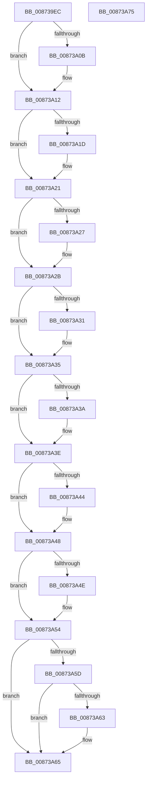

# SeQuerySecurityAccessMask

- RVA: `0x008739EC`–`0x00873A76` (길이 `138` bytes)
- VA: `0x00000001408739EC`
- 실행 섹션: `PAGE`
- PDB 이름 있음: `예`; PDB Function 태그: `아니요`
- unwind 정보 RVA: `0x00060BC4`
- 디코드: `49`개 명령, `138/138` bytes 표시
- 미해석 바이트: `0` (있으면 어셈블리에 `.byte`로 보존)

> 이 문서는 커널 이미지의 기계어와 PDB 기호를 분석해 생성했습니다. 4번과 5번은 함수 원형과 자료형을 바이너리 사용 방식에서 추정한 C 해석이며 원본 소스 복구 결과는 아닙니다.

## 1. Dependencies

- 직접 호출 지점: **1**; 고유 호출 대상: **1**
- 직접 호출자로 확인된 함수: **3**
- RIP 상대 이미지 참조: **0**

### Outgoing calls
- `0x00873A54` → [Feature_OutsideInProtection__private_IsEnabledDeviceUsageNoInline](../../text/5C/Feature_OutsideInProtection__private_IsEnabledDeviceUsageNoInline_function_005CD968.md) (function, `0x005CD968`)

### Direct callers
- [NtQuerySecurityObject](NtQuerySecurityObject_function_008737B0.md) at `0x00873888`
- [ObQuerySecurityObject](../9A/ObQuerySecurityObject_function_009A3564.md) at `0x009A358B`
- [IoCheckFunctionAccess](../A0/IoCheckFunctionAccess_function_00A04290.md) at `0x00A043A0`

### Static image references
- 디코드된 RIP-relative 메모리 참조가 없습니다.

## 2. Other-region calls and transfers

- 다른 실행 섹션으로 향하는 call: **1**
  - `0x00873A54` → [Feature_OutsideInProtection__private_IsEnabledDeviceUsageNoInline](../../text/5C/Feature_OutsideInProtection__private_IsEnabledDeviceUsageNoInline_function_005CD968.md) (`PAGE` → `.text`)
- 별도 외부 분기/꼬리 이동을 확인하지 못했습니다.

## 3. Assembly (complete function range)

```asm
008739EC  48 89 5C 24 08                  mov qword ptr [rsp + 8], rbx
008739F1  48 89 74 24 10                  mov qword ptr [rsp + 0x10], rsi
008739F6  57                              push rdi
008739F7  48 83 EC 20                     sub rsp, 0x20
008739FB  83 22 00                        and dword ptr [rdx], 0
008739FE  33 C0                           xor eax, eax
00873A00  48 8B DA                        mov rbx, rdx
00873A03  8B F9                           mov edi, ecx
00873A05  0F BA E1 10                     bt ecx, 0x10
00873A09  73 07                           jae 0x140873a12
00873A0B  B8 00 00 02 01                  mov eax, 0x1020000
00873A10  89 02                           mov dword ptr [rdx], eax
00873A12  BE 00 00 02 00                  mov esi, 0x20000
00873A17  40 F6 C7 17                     test dil, 0x17
00873A1B  74 04                           je 0x140873a21
00873A1D  0B C6                           or eax, esi
00873A1F  89 02                           mov dword ptr [rdx], eax
00873A21  40 F6 C7 20                     test dil, 0x20
00873A25  74 04                           je 0x140873a2b
00873A27  0B C6                           or eax, esi
00873A29  89 02                           mov dword ptr [rdx], eax
00873A2B  40 F6 C7 40                     test dil, 0x40
00873A2F  74 04                           je 0x140873a35
00873A31  0B C6                           or eax, esi
00873A33  89 02                           mov dword ptr [rdx], eax
00873A35  40 84 FF                        test dil, dil
00873A38  79 04                           jns 0x140873a3e
00873A3A  0B C6                           or eax, esi
00873A3C  89 02                           mov dword ptr [rdx], eax
00873A3E  0F BA E7 08                     bt edi, 8
00873A42  73 04                           jae 0x140873a48
00873A44  0B C6                           or eax, esi
00873A46  89 02                           mov dword ptr [rdx], eax
00873A48  40 F6 C7 08                     test dil, 8
00873A4C  74 06                           je 0x140873a54
00873A4E  0F BA E8 18                     bts eax, 0x18
00873A52  89 02                           mov dword ptr [rdx], eax
00873A54  E8 0F 9F D5 FF                  call 0x1405cd968
00873A59  85 C0                           test eax, eax
00873A5B  74 08                           je 0x140873a65
00873A5D  0F BA E7 09                     bt edi, 9
00873A61  73 02                           jae 0x140873a65
00873A63  09 33                           or dword ptr [rbx], esi
00873A65  48 8B 5C 24 30                  mov rbx, qword ptr [rsp + 0x30]
00873A6A  48 8B 74 24 38                  mov rsi, qword ptr [rsp + 0x38]
00873A6F  48 83 C4 20                     add rsp, 0x20
00873A73  5F                              pop rdi
00873A74  C3                              ret
00873A75  CC                              int3
```

## 4. C-style interpretation (structured pseudocode)

```c
__int64 __fastcall SeQuerySecurityAccessMask(int a1, __int64 a2)
{
    __int64 result;
    __int64 v_rsp;
    unsigned __int64 v_stack_p10;
    unsigned __int64 v_stack_p8;

    v_stack_p8 = v_rbx;
    v_stack_p10 = v_rsi;
    v_rsp = (v_rsp) - (32);
    result = 0;
    if (!(condition_is_above_or_equal)) {
        result = 0x1020000ULL;
        *(unsigned int *)(a2) = (unsigned int)(result);
    }
    if ((((unsigned __int8)((unsigned int)(a1))) & (23)) != 0) {
        result = (unsigned int)((result) | ((unsigned int)((unsigned int)(0x20000ULL))));
        *(unsigned int *)(a2) = (unsigned int)(result);
    }
    if ((((unsigned __int8)((unsigned int)(a1))) & (32)) != 0) {
        result = (unsigned int)((result) | ((unsigned int)((unsigned int)(0x20000ULL))));
        *(unsigned int *)(a2) = (unsigned int)(result);
    }
    if ((((unsigned __int8)((unsigned int)(a1))) & (64)) != 0) {
        result = (unsigned int)((result) | ((unsigned int)((unsigned int)(0x20000ULL))));
        *(unsigned int *)(a2) = (unsigned int)(result);
    }
    if (sign_flag) {
        result = (unsigned int)((result) | ((unsigned int)((unsigned int)(0x20000ULL))));
        *(unsigned int *)(a2) = (unsigned int)(result);
    }
    if (!(condition_is_above_or_equal)) {
        result = (unsigned int)((result) | ((unsigned int)((unsigned int)(0x20000ULL))));
        *(unsigned int *)(a2) = (unsigned int)(result);
    }
    if ((((unsigned __int8)((unsigned int)(a1))) & (8)) != 0) {
        *(unsigned int *)(a2) = (unsigned int)(result);
    }
    result = Feature_OutsideInProtection__private_IsEnabledDeviceUsageNoInline(a1, a2, a3, a4);
    if ((unsigned int)(result) == 0) goto loc_00873A65;
    if (!(condition_is_above_or_equal)) {
    }
    v_rsp = (v_rsp) + (32);
    return result;
}
```

## 5. (Beta) C Style

```c
int64_t SeQuerySecurityAccessMask(int32_t Arg1, void *Arg2)
{
    uint8_t *arg2 = (uint8_t *)Arg2;

    int64_t result;
    int64_t local_rsp;
    uint64_t v_stack_p10;
    uint64_t v_stack_p8;

    v_stack_p8 = local_rbx;
    v_stack_p10 = local_rsi;
    local_rsp = (local_rsp) - (32);
    result = 0;
    if (!(condition_is_above_or_equal)) {
        result = 0x1020000ULL;
        *(uint32_t *)(arg2) = (uint32_t)(result);
    }
    if ((((uint8_t)((uint32_t)(Arg1))) & (23)) != 0) {
        result = (uint32_t)((result) | ((uint32_t)((uint32_t)(0x20000ULL))));
        *(uint32_t *)(arg2) = (uint32_t)(result);
    }
    if ((((uint8_t)((uint32_t)(Arg1))) & (32)) != 0) {
        result = (uint32_t)((result) | ((uint32_t)((uint32_t)(0x20000ULL))));
        *(uint32_t *)(arg2) = (uint32_t)(result);
    }
    if ((((uint8_t)((uint32_t)(Arg1))) & (64)) != 0) {
        result = (uint32_t)((result) | ((uint32_t)((uint32_t)(0x20000ULL))));
        *(uint32_t *)(arg2) = (uint32_t)(result);
    }
    if (sign_flag) {
        result = (uint32_t)((result) | ((uint32_t)((uint32_t)(0x20000ULL))));
        *(uint32_t *)(arg2) = (uint32_t)(result);
    }
    if (!(condition_is_above_or_equal)) {
        result = (uint32_t)((result) | ((uint32_t)((uint32_t)(0x20000ULL))));
        *(uint32_t *)(arg2) = (uint32_t)(result);
    }
    if ((((uint8_t)((uint32_t)(Arg1))) & (8)) != 0) {
        *(uint32_t *)(arg2) = (uint32_t)(result);
    }
    result = Feature_OutsideInProtection__private_IsEnabledDeviceUsageNoInline(Arg1, Arg2, a3, a4);
    if ((uint32_t)(result) == 0) goto loc_00873A65;
    if (!(condition_is_above_or_equal)) {
    }
    local_rsp = (local_rsp) + (32);
    return result;
}
```

### 관측된 메모리 오프셋

구조체 형식이 확인되지 않은 접근은 인자 기준의 오프셋으로만 기록했습니다.

| 기준 인자 | 오프셋 표현 | 폭 (bit) | 접근 |
|---|---:|---:|---|
| `Arg2` | `+ 0x0` | `32` | `R/W` |
| `Arg2` | `+ 0x0` | `32` | `W` |

## 6. Execution-region graph

[열기: 2D/3D 그래프와 함수 탐색 컨트롤 패널](../../../control-panel.html?section=page&rva=0x008739EC&view=graph)

- 2D 그래프는 위에서 아래로 흐르고, 3D 그래프는 빈 공간을 드래그해 회전합니다. Shift+드래그는 이동, 휠은 확대·축소, 함수 노드 선택은 대상 보고서 이동입니다.

### Static fallback


