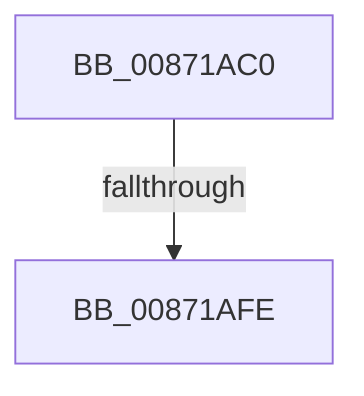

# SeSinglePrivilegeCheckEx

- RVA: `0x00871AC0`–`0x00871B01` (길이 `65` bytes)
- VA: `0x0000000140871AC0`
- 실행 섹션: `PAGE`
- PDB 이름 있음: `예`; PDB Function 태그: `아니요`
- unwind 정보 RVA: `0x0006C3FC`
- 디코드: `18`개 명령, `65/65` bytes 표시
- 미해석 바이트: `0` (있으면 어셈블리에 `.byte`로 보존)

> 이 문서는 커널 이미지의 기계어와 PDB 기호를 분석해 생성했습니다. 4번과 5번은 함수 원형과 자료형을 바이너리 사용 방식에서 추정한 C 해석이며 원본 소스 복구 결과는 아닙니다.

## 1. Dependencies

- 직접 호출 지점: **0**; 고유 호출 대상: **0**
- 직접 호출자로 확인된 함수: **4**
- RIP 상대 이미지 참조: **1**

### Outgoing calls
- 직접 디코드된 call 명령이 없습니다.

### Direct callers
- [CmpCheckOpenAccessOnKeyBody](CmpCheckOpenAccessOnKeyBody_function_00870000.md) at `0x0087065E`
- [CmpCheckOpenAccessOnKeyBody](CmpCheckOpenAccessOnKeyBody_function_00870000.md) at `0x00870681`
- [sub_008BC3C4](../8B/Unknown_function_008BC3C4.md) at `0x008BC6A1`
- [CmpSetAccessStateForBackupRestore](../94/CmpSetAccessStateForBackupRestore_function_00947D2C.md) at `0x00947D69`
- [CmpSetAccessStateForBackupRestore](../94/CmpSetAccessStateForBackupRestore_function_00947D2C.md) at `0x00947D92`
- [SepValidOwnerSubjectContext](../A3/SepValidOwnerSubjectContext_function_00A37568.md) at `0x00A37636`

### Static image references
- `0x00871ACB` → RVA `0x00E0A740` (`.data`; read)

## 2. Other-region calls and transfers

- 다른 실행 섹션으로 향하는 call: **0**
- call이 아닌 외부 분기/꼬리 이동: **1**
  - `0x00871AF8` → [sub_00871CA1](Unknown_function_00871CA1.md) (`tail-transfer`)

## 3. Assembly (complete function range)

```asm
00871AC0  4C 8B DC                        mov r11, rsp
00871AC3  53                              push rbx
00871AC4  57                              push rdi
00871AC5  41 57                           push r15
00871AC7  48 83 EC 70                     sub rsp, 0x70
00871ACB  48 8B 05 6E 8C 59 00            mov rax, qword ptr [rip + 0x598c6e]
00871AD2  48 33 C4                        xor rax, rsp
00871AD5  48 89 44 24 58                  mov qword ptr [rsp + 0x58], rax
00871ADA  BF 01 00 00 00                  mov edi, 1
00871ADF  45 33 FF                        xor r15d, r15d
00871AE2  89 7C 24 40                     mov dword ptr [rsp + 0x40], edi
00871AE6  48 8B DA                        mov rbx, rdx
00871AE9  89 7C 24 44                     mov dword ptr [rsp + 0x44], edi
00871AED  49 89 4B C0                     mov qword ptr [r11 - 0x40], rcx
00871AF1  45 89 7B C8                     mov dword ptr [r11 - 0x38], r15d
00871AF5  45 84 C0                        test r8b, r8b
00871AF8  0F 84 A3 01 00 00               je 0x140871ca1
00871AFE  48 8B 0A                        mov rcx, qword ptr [rdx]
```

## 4. C-style interpretation (structured pseudocode)

```c
__int64 __fastcall SeSinglePrivilegeCheckEx(__int64 a1, __int64 a2, unsigned __int8 a3)
{
    __int64 result;
    __int64 v_r15;
    __int64 v_rsp;
    unsigned __int64 v_stack_m30;
    unsigned int v_stack_m44;
    unsigned int v_stack_m48;

    v_rsp = (v_rsp) - (112);
    result = (*(unsigned __int64 *)(v_rip + 5868654)) ^ (v_rsp);
    v_stack_m30 = result;
    v_r15 = 0;
    v_stack_m48 = 1;
    v_stack_m44 = 1;
    *(unsigned __int64 *)(v_rsp - 64) = a1;
    *(unsigned int *)(v_rsp - 56) = 0;
    return result;
}
```

## 5. (Beta) C Style

```c
int64_t SeSinglePrivilegeCheckEx(int64_t Arg1, void *Arg2, uint8_t Arg3)
{
    uint8_t *arg2 = (uint8_t *)Arg2;

    int64_t result;
    int64_t local_r15;
    int64_t local_rsp;
    uint64_t v_stack_m30;
    uint32_t v_stack_m44;
    uint32_t v_stack_m48;

    local_rsp = (local_rsp) - (112);
    result = (*(uint64_t *)(v_rip + 0x598C6E)) ^ (local_rsp);
    v_stack_m30 = result;
    local_r15 = 0;
    v_stack_m48 = 1;
    v_stack_m44 = 1;
    *(uint64_t *)(local_rsp - 0x40) = Arg1;
    *(uint32_t *)(local_rsp - 0x38) = 0;
    return result;
}
```

### 관측된 메모리 오프셋

구조체 형식이 확인되지 않은 접근은 인자 기준의 오프셋으로만 기록했습니다.

| 기준 인자 | 오프셋 표현 | 폭 (bit) | 접근 |
|---|---:|---:|---|
| `Arg2` | `+ 0x0` | `64` | `R` |

## 6. Execution-region graph

[열기: 2D/3D 그래프와 함수 탐색 컨트롤 패널](../../../control-panel.html?section=page&rva=0x00871AC0&view=graph)

- 2D 그래프는 위에서 아래로 흐르고, 3D 그래프는 빈 공간을 드래그해 회전합니다. Shift+드래그는 이동, 휠은 확대·축소, 함수 노드 선택은 대상 보고서 이동입니다.

### Static fallback


