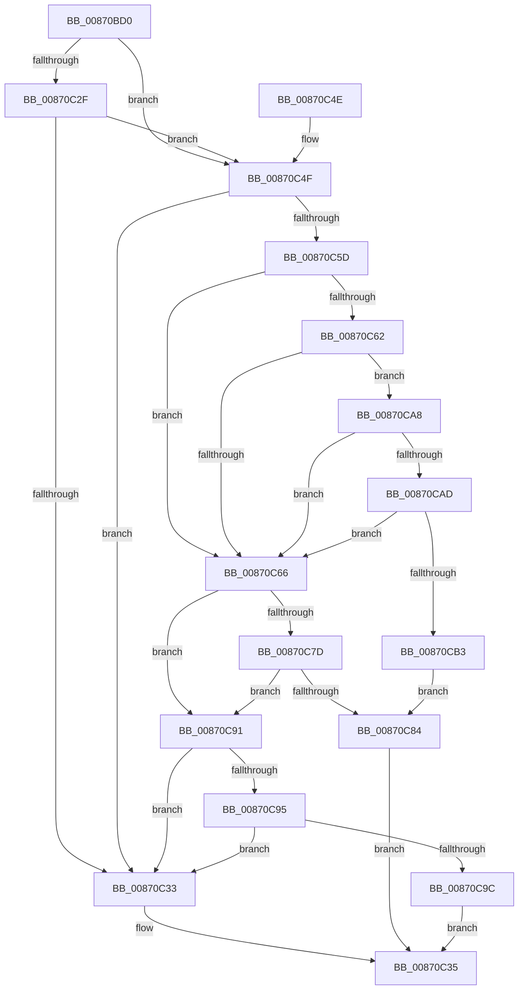

# SepAdtAuditPrivilegeUseWithContext

- RVA: `0x00870BD0`–`0x00870CB5` (길이 `229` bytes)
- VA: `0x0000000140870BD0`
- 실행 섹션: `PAGE`
- PDB 이름 있음: `예`; PDB Function 태그: `아니요`
- unwind 정보 RVA: `0x0006C360`
- 디코드: `72`개 명령, `229/229` bytes 표시
- 미해석 바이트: `0` (있으면 어셈블리에 `.byte`로 보존)

> 이 문서는 커널 이미지의 기계어와 PDB 기호를 분석해 생성했습니다. 4번과 5번은 함수 원형과 자료형을 바이너리 사용 방식에서 추정한 C 해석이며 원본 소스 복구 결과는 아닙니다.

## 1. Dependencies

- 직접 호출 지점: **4**; 고유 호출 대상: **3**
- 직접 호출자로 확인된 함수: **2**
- RIP 상대 이미지 참조: **0**

### Outgoing calls
- `0x00870C08` → [SepAdtAuditThisEventWithContext](SepAdtAuditThisEventWithContext_function_00870AC0.md) (function, `0x00870AC0`)
- `0x00870C22` → [SepAdtAuditThisEventWithContext](SepAdtAuditThisEventWithContext_function_00870AC0.md) (function, `0x00870AC0`)
- `0x00870C54` → [SepFilterPrivilegeAudits](../97/SepFilterPrivilegeAudits_function_00974F90.md) (function, `0x00974F90`)
- `0x00870C73` → [SepAdtCheckPrivilegeForSensitivity](../../text/48/SepAdtCheckPrivilegeForSensitivity_function_0048ACD8.md) (function, `0x0048ACD8`)

### Direct callers
- [sub_0086E95E](../86/Unknown_function_0086E95E.md) at `0x0086EAB8`
- [SeOpenObjectForDeleteAuditAlarmWithTransaction](../97/SeOpenObjectForDeleteAuditAlarmWithTransaction_function_00973EC0.md) at `0x00974132`

### Static image references
- 디코드된 RIP-relative 메모리 참조가 없습니다.

## 2. Other-region calls and transfers

- 다른 실행 섹션으로 향하는 call: **1**
  - `0x00870C73` → [SepAdtCheckPrivilegeForSensitivity](../../text/48/SepAdtCheckPrivilegeForSensitivity_function_0048ACD8.md) (`PAGE` → `.text`)
- 별도 외부 분기/꼬리 이동을 확인하지 못했습니다.

## 3. Assembly (complete function range)

```asm
00870BD0  48 89 5C 24 08                  mov qword ptr [rsp + 8], rbx
00870BD5  48 89 6C 24 10                  mov qword ptr [rsp + 0x10], rbp
00870BDA  48 89 74 24 18                  mov qword ptr [rsp + 0x18], rsi
00870BDF  57                              push rdi
00870BE0  41 56                           push r14
00870BE2  41 57                           push r15
00870BE4  48 83 EC 30                     sub rsp, 0x30
00870BE8  4C 8B F1                        mov r14, rcx
00870BEB  C6 44 24 20 00                  mov byte ptr [rsp + 0x20], 0
00870BF0  41 BF 83 00 00 00               mov r15d, 0x83
00870BF6  C6 44 24 21 00                  mov byte ptr [rsp + 0x21], 0
00870BFB  41 8B CF                        mov ecx, r15d
00870BFE  49 8B D9                        mov rbx, r9
00870C01  41 0F B6 F8                     movzx edi, r8b
00870C05  0F B6 F2                        movzx esi, dl
00870C08  E8 B3 FE FF FF                  call 0x140870ac0
00870C0D  44 0F B6 C7                     movzx r8d, dil
00870C11  4C 8B CB                        mov r9, rbx
00870C14  BF 84 00 00 00                  mov edi, 0x84
00870C19  40 0F B6 D6                     movzx edx, sil
00870C1D  8B CF                           mov ecx, edi
00870C1F  0F B6 E8                        movzx ebp, al
00870C22  E8 99 FE FF FF                  call 0x140870ac0
00870C27  0F B6 D8                        movzx ebx, al
00870C2A  40 84 ED                        test bpl, bpl
00870C2D  75 20                           jne 0x140870c4f
00870C2F  84 C0                           test al, al
00870C31  75 1C                           jne 0x140870c4f
00870C33  32 C0                           xor al, al
00870C35  48 8B 5C 24 50                  mov rbx, qword ptr [rsp + 0x50]
00870C3A  48 8B 6C 24 58                  mov rbp, qword ptr [rsp + 0x58]
00870C3F  48 8B 74 24 60                  mov rsi, qword ptr [rsp + 0x60]
00870C44  48 83 C4 30                     add rsp, 0x30
00870C48  41 5F                           pop r15
00870C4A  41 5E                           pop r14
00870C4C  5F                              pop rdi
00870C4D  C3                              ret
00870C4E  CC                              int3
00870C4F  49 8B D6                        mov rdx, r14
00870C52  33 C9                           xor ecx, ecx
00870C54  E8 37 43 10 00                  call 0x140974f90
00870C59  84 C0                           test al, al
00870C5B  74 D6                           je 0x140870c33
00870C5D  40 84 ED                        test bpl, bpl
00870C60  74 04                           je 0x140870c66
00870C62  84 DB                           test bl, bl
00870C64  75 42                           jne 0x140870ca8
00870C66  4C 8D 44 24 21                  lea r8, [rsp + 0x21]
00870C6B  49 8B CE                        mov rcx, r14
00870C6E  48 8D 54 24 20                  lea rdx, [rsp + 0x20]
00870C73  E8 60 A0 C1 FF                  call 0x14048acd8
00870C78  40 84 ED                        test bpl, bpl
00870C7B  74 14                           je 0x140870c91
00870C7D  80 7C 24 20 00                  cmp byte ptr [rsp + 0x20], 0
00870C82  74 0D                           je 0x140870c91
00870C84  48 8B 4C 24 70                  mov rcx, qword ptr [rsp + 0x70]
00870C89  B0 01                           mov al, 1
00870C8B  66 44 89 39                     mov word ptr [rcx], r15w
00870C8F  EB A4                           jmp 0x140870c35
00870C91  84 DB                           test bl, bl
00870C93  74 9E                           je 0x140870c33
00870C95  80 7C 24 21 00                  cmp byte ptr [rsp + 0x21], 0
00870C9A  74 97                           je 0x140870c33
00870C9C  48 8B 4C 24 70                  mov rcx, qword ptr [rsp + 0x70]
00870CA1  B0 01                           mov al, 1
00870CA3  66 89 39                        mov word ptr [rcx], di
00870CA6  EB 8D                           jmp 0x140870c35
00870CA8  4D 85 F6                        test r14, r14
00870CAB  74 B9                           je 0x140870c66
00870CAD  41 83 3E 00                     cmp dword ptr [r14], 0
00870CB1  74 B3                           je 0x140870c66
00870CB3  EB CF                           jmp 0x140870c84
```

## 4. C-style interpretation (structured pseudocode)

```c
__int64 __fastcall SepAdtAuditPrivilegeUseWithContext(__int64 a1, unsigned __int8 a2, unsigned __int8 a3, __int64 a4, __int64 a5)
{
    __int64 result;
    __int64 v_rsp;
    unsigned __int8 v_stack_m27;
    unsigned __int8 v_stack_m28;
    unsigned __int64 v_stack_p10;
    unsigned __int64 v_stack_p18;
    unsigned __int64 v_stack_p20;
    unsigned __int64 v_stack_p21;
    unsigned __int64 v_stack_p8;

    v_stack_p8 = v_rbx;
    v_stack_p10 = v_rbp;
    v_stack_p18 = v_rsi;
    v_rsp = (v_rsp) - (48);
    v_stack_m28 = 0;
    v_stack_m27 = 0;
    result = SepAdtAuditThisEventWithContext(131, a2, a3, a4);
    result = SepAdtAuditThisEventWithContext(132, a2, a3, a4);
    if ((unsigned __int8)((unsigned __int8)(result)) != 0) goto loc_00870C4F;
    if ((unsigned __int8)(result) != 0) goto loc_00870C4F;
loc_00870C33:
    result = 0;
loc_00870C35:
    v_rsp = (v_rsp) + (48);
    return result;
loc_00870C4F:
    a1 = 0;
    result = SepFilterPrivilegeAudits(a1, a1, a3, a4);
    if ((unsigned __int8)(result) == 0) goto loc_00870C33;
    if ((unsigned __int8)(v_stack_p10) == 0) goto loc_00870C66;
    if ((unsigned __int8)(v_stack_p8) != 0) goto loc_00870CA8;
loc_00870C66:
    result = SepAdtCheckPrivilegeForSensitivity(0, v_stack_p20, v_stack_p21, a4);
    if ((unsigned __int8)(v_stack_p10) == 0) goto loc_00870C91;
    if (v_stack_p20 == 0) goto loc_00870C91;
loc_00870C84:
    *(unsigned __int16 *)(a5) = 131;
    goto loc_00870C35;
loc_00870C91:
    if ((unsigned __int8)(v_stack_p8) == 0) goto loc_00870C33;
    if (v_stack_p21 == 0) goto loc_00870C33;
    *(unsigned __int16 *)(a5) = 132;
    goto loc_00870C35;
loc_00870CA8:
    if (0 == 0) goto loc_00870C66;
    if ((*(unsigned int *)(a1)) == 0) goto loc_00870C66;
    goto loc_00870C84;
}
```

## 5. (Beta) C Style

```c
int64_t SepAdtAuditPrivilegeUseWithContext(int64_t Arg1, uint8_t Arg2, uint8_t Arg3, int64_t Arg4, void *Arg5)
{
    uint8_t *arg5 = (uint8_t *)Arg5;

    int64_t result;
    int64_t local_rsp;
    uint8_t v_stack_m27;
    uint8_t v_stack_m28;
    uint64_t v_stack_p10;
    uint64_t v_stack_p18;
    uint64_t v_stack_p20;
    uint64_t v_stack_p21;
    uint64_t v_stack_p8;

    v_stack_p8 = local_rbx;
    v_stack_p10 = local_rbp;
    v_stack_p18 = local_rsi;
    local_rsp = (local_rsp) - (48);
    v_stack_m28 = 0;
    v_stack_m27 = 0;
    result = SepAdtAuditThisEventWithContext(131, Arg2, Arg3, Arg4);
    result = SepAdtAuditThisEventWithContext(132, Arg2, Arg3, Arg4);
    if ((uint8_t)((uint8_t)(result)) != 0) goto loc_00870C4F;
    if ((uint8_t)(result) != 0) goto loc_00870C4F;
loc_00870C33:
    result = 0;
loc_00870C35:
    local_rsp = (local_rsp) + (48);
    return result;
loc_00870C4F:
    Arg1 = 0;
    result = SepFilterPrivilegeAudits(Arg1, Arg1, Arg3, Arg4);
    if ((uint8_t)(result) == 0) goto loc_00870C33;
    if ((uint8_t)(v_stack_p10) == 0) goto loc_00870C66;
    if ((uint8_t)(v_stack_p8) != 0) goto loc_00870CA8;
loc_00870C66:
    result = SepAdtCheckPrivilegeForSensitivity(0, v_stack_p20, v_stack_p21, Arg4);
    if ((uint8_t)(v_stack_p10) == 0) goto loc_00870C91;
    if (v_stack_p20 == 0) goto loc_00870C91;
loc_00870C84:
    *(uint16_t *)(arg5) = 131;
    goto loc_00870C35;
loc_00870C91:
    if ((uint8_t)(v_stack_p8) == 0) goto loc_00870C33;
    if (v_stack_p21 == 0) goto loc_00870C33;
    *(uint16_t *)(arg5) = 132;
    goto loc_00870C35;
loc_00870CA8:
    if (0 == 0) goto loc_00870C66;
    if ((*(uint32_t *)(Arg1)) == 0) goto loc_00870C66;
    goto loc_00870C84;
}
```

### 관측된 메모리 오프셋

구조체 형식이 확인되지 않은 접근은 인자 기준의 오프셋으로만 기록했습니다.

| 기준 인자 | 오프셋 표현 | 폭 (bit) | 접근 |
|---|---:|---:|---|
| `Arg5` | `+ 0x0` | `16` | `W` |

## 6. Execution-region graph

[열기: 2D/3D 그래프와 함수 탐색 컨트롤 패널](../../../control-panel.html?section=page&rva=0x00870BD0&view=graph)

- 2D 그래프는 위에서 아래로 흐르고, 3D 그래프는 빈 공간을 드래그해 회전합니다. Shift+드래그는 이동, 휠은 확대·축소, 함수 노드 선택은 대상 보고서 이동입니다.

### Static fallback


