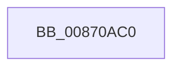

# SepAdtAuditThisEventWithContext

- RVA: `0x00870AC0`–`0x00870AEF` (길이 `47` bytes)
- VA: `0x0000000140870AC0`
- 실행 섹션: `PAGE`
- PDB 이름 있음: `예`; PDB Function 태그: `아니요`
- unwind 정보 RVA: `0x0006C2D0`
- 디코드: `14`개 명령, `47/47` bytes 표시
- 미해석 바이트: `0` (있으면 어셈블리에 `.byte`로 보존)

> 이 문서는 커널 이미지의 기계어와 PDB 기호를 분석해 생성했습니다. 4번과 5번은 함수 원형과 자료형을 바이너리 사용 방식에서 추정한 C 해석이며 원본 소스 복구 결과는 아닙니다.

## 1. Dependencies

- 직접 호출 지점: **0**; 고유 호출 대상: **0**
- 직접 호출자로 확인된 함수: **18**
- RIP 상대 이미지 참조: **0**

### Outgoing calls
- 직접 디코드된 call 명령이 없습니다.

### Direct callers
- [SeReportSecurityEventWithSubCategory](../../text/22/SeReportSecurityEventWithSubCategory_function_002248B0.md) at `0x00224B27`
- [SeAuditingAnyFileEventsWithContextEx](../../text/42/SeAuditingAnyFileEventsWithContextEx_function_0042A800.md) at `0x0042A824`
- [SeAuditingAnyFileEventsWithContextEx](../../text/42/SeAuditingAnyFileEventsWithContextEx_function_0042A800.md) at `0x0042A83A`
- [SepCommonAccessCheckEx](../../text/47/SepCommonAccessCheckEx_function_0047602C.md) at `0x0047699C`
- [SeAuditingFileEventsWithContextEx](../../text/49/SeAuditingFileEventsWithContextEx_function_00493440.md) at `0x00493482`
- [SeAuditingFileEventsWithContextEx](../../text/49/SeAuditingFileEventsWithContextEx_function_00493440.md) at `0x0049349C`
- [SeAuditingFileOrGlobalEvents](../79/SeAuditingFileOrGlobalEvents_function_0079FAD0.md) at `0x0079FB60`
- [SeAuditingFileOrGlobalEvents](../79/SeAuditingFileOrGlobalEvents_function_0079FAD0.md) at `0x0079FB77`
- [SeAuditingFileOrGlobalEvents](../79/SeAuditingFileOrGlobalEvents_function_0079FAD0.md) at `0x0079FB8E`
- [SepAdtCloseObjectAuditAlarm](../86/SepAdtCloseObjectAuditAlarm_function_0086B4E8.md) at `0x0086B568`
- [SepAdtPrivilegeObjectAuditAlarm](../86/SepAdtPrivilegeObjectAuditAlarm_function_0086E3F0.md) at `0x0086E473`
- [SepAdtPrivilegeObjectAuditAlarm](../86/SepAdtPrivilegeObjectAuditAlarm_function_0086E3F0.md) at `0x0086E48A`
- [sub_0086E95E](../86/Unknown_function_0086E95E.md) at `0x0086EB18`
- [SepAdtAuditObjectAccessWithContext](../86/SepAdtAuditObjectAccessWithContext_function_0086EEF0.md) at `0x0086EFEF`
- [SepAdtAuditPrivilegeUseWithContext](SepAdtAuditPrivilegeUseWithContext_function_00870BD0.md) at `0x00870C08`
- [SepAdtAuditPrivilegeUseWithContext](SepAdtAuditPrivilegeUseWithContext_function_00870BD0.md) at `0x00870C22`
- [SepAdtPrivilegedServiceAuditAlarm](SepAdtPrivilegedServiceAuditAlarm_function_008714F0.md) at `0x00871585`
- [SepAdtPrivilegedServiceAuditAlarm](SepAdtPrivilegedServiceAuditAlarm_function_008714F0.md) at `0x008715A0`
- [ObpCheckObjectReference](../8C/ObpCheckObjectReference_function_008C6084.md) at `0x008C61D8`
- [SepAdtOpenObjectAuditAlarm](../91/SepAdtOpenObjectAuditAlarm_function_0091F23C.md) at `0x0091F32F`
- [SeSecurityDescriptorChangedAuditAlarm](../91/SeSecurityDescriptorChangedAuditAlarm_function_0091FC5C.md) at `0x0091FD10`
- [SeSecurityDescriptorChangedAuditAlarm](../91/SeSecurityDescriptorChangedAuditAlarm_function_0091FC5C.md) at `0x0091FD3C`
- [SeTokenDefaultDaclChangedAuditAlarm](../92/SeTokenDefaultDaclChangedAuditAlarm_function_00920570.md) at `0x0092060A`
- [SepAccessCheckAndAuditAlarm](../A1/SepAccessCheckAndAuditAlarm_function_00A1AF4C.md) at `0x00A1D06C`
- [SepAccessCheckAndAuditAlarm](../A1/SepAccessCheckAndAuditAlarm_function_00A1AF4C.md) at `0x00A1D099`
- [SeAuditingHardLinkEventsWithContext](../A7/SeAuditingHardLinkEventsWithContext_function_00A787E0.md) at `0x00A78823`
- [SeOpenObjectAuditAlarmForNonObObject](../A8/SeOpenObjectAuditAlarmForNonObObject_function_00A8B680.md) at `0x00A8B6CE`

### Static image references
- 디코드된 RIP-relative 메모리 참조가 없습니다.

## 2. Other-region calls and transfers

- 다른 실행 섹션으로 향하는 call: **0**
- call이 아닌 외부 분기/꼬리 이동: **1**
  - `0x00870AE9` → [sub_00870B96](Unknown_function_00870B96.md) (`tail-transfer`)

## 3. Assembly (complete function range)

```asm
00870AC0  48 89 5C 24 20                  mov qword ptr [rsp + 0x20], rbx
00870AC5  55                              push rbp
00870AC6  56                              push rsi
00870AC7  41 56                           push r14
00870AC9  48 83 EC 50                     sub rsp, 0x50
00870ACD  0F 57 C0                        xorps xmm0, xmm0
00870AD0  4D 8B F1                        mov r14, r9
00870AD3  41 0F B6 F0                     movzx esi, r8b
00870AD7  0F B6 EA                        movzx ebp, dl
00870ADA  8B D9                           mov ebx, ecx
00870ADC  0F 11 44 24 30                  movups xmmword ptr [rsp + 0x30], xmm0
00870AE1  0F 11 44 24 40                  movups xmmword ptr [rsp + 0x40], xmm0
00870AE6  83 F9 08                        cmp ecx, 8
00870AE9  0F 86 A7 00 00 00               jbe 0x140870b96
```

## 4. C-style interpretation (structured pseudocode)

```c
void __fastcall SepAdtAuditThisEventWithContext(int a1, unsigned __int8 a2, unsigned __int8 a3, __int64 a4)
{
    __int64 v_rsp;
    unsigned __int64 v_stack_m28;
    unsigned __int64 v_stack_m38;
    unsigned __int64 v_stack_p20;

    v_stack_p20 = v_rbx;
    v_rsp = (v_rsp) - (80);
    v_stack_m38 = v_xmm0;
    v_stack_m28 = v_xmm0;
}
```

## 5. (Beta) C Style

```c
void SepAdtAuditThisEventWithContext(int32_t Arg1, uint8_t Arg2, uint8_t Arg3, int64_t Arg4)
{
    int64_t local_rsp;
    uint64_t v_stack_m28;
    uint64_t v_stack_m38;
    uint64_t v_stack_p20;

    v_stack_p20 = local_rbx;
    local_rsp = (local_rsp) - (80);
    v_stack_m38 = v_xmm0;
    v_stack_m28 = v_xmm0;
}
```

## 6. Execution-region graph

[열기: 2D/3D 그래프와 함수 탐색 컨트롤 패널](../../../control-panel.html?section=page&rva=0x00870AC0&view=graph)

- 2D 그래프는 위에서 아래로 흐르고, 3D 그래프는 빈 공간을 드래그해 회전합니다. Shift+드래그는 이동, 휠은 확대·축소, 함수 노드 선택은 대상 보고서 이동입니다.

### Static fallback


