# SepAdtPrivilegedServiceAuditAlarm

- RVA: `0x008714F0`–`0x008717D2` (길이 `738` bytes)
- VA: `0x00000001408714F0`
- 실행 섹션: `PAGE`
- PDB 이름 있음: `예`; PDB Function 태그: `아니요`
- unwind 정보 RVA: `0x0006C3B0`
- 디코드: `180`개 명령, `738/738` bytes 표시
- 미해석 바이트: `0` (있으면 어셈블리에 `.byte`로 보존)

> 이 문서는 커널 이미지의 기계어와 PDB 기호를 분석해 생성했습니다. 4번과 5번은 함수 원형과 자료형을 바이너리 사용 방식에서 추정한 C 해석이며 원본 소스 복구 결과는 아닙니다.

## 1. Dependencies

- 직접 호출 지점: **11**; 고유 호출 대상: **10**
- 직접 호출자로 확인된 함수: **8**
- RIP 상대 이미지 참조: **2**

### Outgoing calls
- `0x0087154C` → [memset](../../text/6C/memset_function_006C6C40.md) (function, `0x006C6C40`)
- `0x00871585` → [SepAdtAuditThisEventWithContext](SepAdtAuditThisEventWithContext_function_00870AC0.md) (function, `0x00870AC0`)
- `0x008715A0` → [SepAdtAuditThisEventWithContext](SepAdtAuditThisEventWithContext_function_00870AC0.md) (function, `0x00870AC0`)
- `0x008715BB` → [_security_check_cookie](../../text/6A/_security_check_cookie_function_006AC640.md) (function, `0x006AC640`)
- `0x008715E7` → [SepFilterPrivilegeAudits](../97/SepFilterPrivilegeAudits_function_00974F90.md) (function, `0x00974F90`)
- `0x00871606` → [SepAdtCheckPrivilegeForSensitivity](../../text/48/SepAdtCheckPrivilegeForSensitivity_function_0048ACD8.md) (function, `0x0048ACD8`)
- `0x00871626` → [PsGetCurrentThreadProcess](../../text/47/PsGetCurrentThreadProcess_function_0047C7E0.md) (function, `0x0047C7E0`)
- `0x0087163A` → [PsGetAllocatedFullProcessImageNameEx](../91/PsGetAllocatedFullProcessImageNameEx_function_0091D6F0.md) (function, `0x0091D6F0`)
- `0x00871651` → [ExFreePoolWithTag](../../poolcode/B8/ExFreePoolWithTag_function_00B82870.md) (function, `0x00B82870`)
- `0x00871660` → [SepAuditFailed](../86/SepAuditFailed_function_0086EE20.md) (function, `0x0086EE20`)
- `0x0087178F` → [SepAdtLogAuditRecord](../../text/22/SepAdtLogAuditRecord_function_00224B6C.md) (function, `0x00224B6C`)

### Direct callers
- [sub_00871B83](Unknown_function_00871B83.md) at `0x00871BDD`
- [sub_00871D0C](Unknown_function_00871D0C.md) at `0x00871D61`
- [sub_00871FFC](Unknown_function_00871FFC.md) at `0x00872054`
- [ObCreateObject](ObCreateObject_function_00872CB0.md) at `0x00873034`
- [ObCreateObjectEx](../89/ObCreateObjectEx_function_0089B1E0.md) at `0x0089B604`
- [NtCreateEvent](../8B/NtCreateEvent_function_008B9140.md) at `0x008B95C1`
- [NtPrivilegedServiceAuditAlarm](../97/NtPrivilegedServiceAuditAlarm_function_00974430.md) at `0x0097463A`
- [SeCheckAuditPrivilege](../97/SeCheckAuditPrivilege_function_00974E48.md) at `0x00974F5C`

### Static image references
- `0x00871517` → RVA `0x00E0A740` (`.data`; read)
- `0x00871692` → RVA `0x000013A8` (`.rdata`; read)

## 2. Other-region calls and transfers

- 다른 실행 섹션으로 향하는 call: **6**
  - `0x0087154C` → [memset](../../text/6C/memset_function_006C6C40.md) (`PAGE` → `.text`)
  - `0x008715BB` → [_security_check_cookie](../../text/6A/_security_check_cookie_function_006AC640.md) (`PAGE` → `.text`)
  - `0x00871606` → [SepAdtCheckPrivilegeForSensitivity](../../text/48/SepAdtCheckPrivilegeForSensitivity_function_0048ACD8.md) (`PAGE` → `.text`)
  - `0x00871626` → [PsGetCurrentThreadProcess](../../text/47/PsGetCurrentThreadProcess_function_0047C7E0.md) (`PAGE` → `.text`)
  - `0x00871651` → [ExFreePoolWithTag](../../poolcode/B8/ExFreePoolWithTag_function_00B82870.md) (`PAGE` → `POOLCODE`)
  - `0x0087178F` → [SepAdtLogAuditRecord](../../text/22/SepAdtLogAuditRecord_function_00224B6C.md) (`PAGE` → `.text`)
- 별도 외부 분기/꼬리 이동을 확인하지 못했습니다.

## 3. Assembly (complete function range)

```asm
008714F0  48 89 5C 24 10                  mov qword ptr [rsp + 0x10], rbx
008714F5  48 89 74 24 18                  mov qword ptr [rsp + 0x18], rsi
008714FA  48 89 7C 24 20                  mov qword ptr [rsp + 0x20], rdi
008714FF  55                              push rbp
00871500  41 54                           push r12
00871502  41 55                           push r13
00871504  41 56                           push r14
00871506  41 57                           push r15
00871508  48 8D AC 24 90 FC FF FF         lea rbp, [rsp - 0x370]
00871510  48 81 EC 70 04 00 00            sub rsp, 0x470
00871517  48 8B 05 22 92 59 00            mov rax, qword ptr [rip + 0x599222]
0087151E  48 33 C4                        xor rax, rsp
00871521  48 89 85 60 03 00 00            mov qword ptr [rbp + 0x360], rax
00871528  4C 8B A5 C8 03 00 00            mov r12, qword ptr [rbp + 0x3c8]
0087152F  48 8B F9                        mov rdi, rcx
00871532  4C 89 44 24 38                  mov qword ptr [rsp + 0x38], r8
00871537  48 8D 4C 24 40                  lea rcx, [rsp + 0x40]
0087153C  48 89 54 24 30                  mov qword ptr [rsp + 0x30], rdx
00871541  41 B8 18 04 00 00               mov r8d, 0x418
00871547  33 D2                           xor edx, edx
00871549  4D 8B E9                        mov r13, r9
0087154C  E8 EF 56 E5 FF                  call 0x1406c6c40
00871551  0F B6 B5 D0 03 00 00            movzx esi, byte ptr [rbp + 0x3d0]
00871558  41 BF 83 00 00 00               mov r15d, 0x83
0087155E  40 84 F6                        test sil, sil
00871561  48 C7 44 24 28 00 00 00 00      mov qword ptr [rsp + 0x28], 0
0087156A  4C 8B CF                        mov r9, rdi
0087156D  C6 44 24 20 00                  mov byte ptr [rsp + 0x20], 0
00871572  0F 94 C3                        sete bl
00871575  C6 44 24 21 00                  mov byte ptr [rsp + 0x21], 0
0087157A  44 0F B6 C3                     movzx r8d, bl
0087157E  40 0F B6 D6                     movzx edx, sil
00871582  41 8B CF                        mov ecx, r15d
00871585  E8 36 F5 FF FF                  call 0x140870ac0
0087158A  4C 8B CF                        mov r9, rdi
0087158D  44 0F B6 C3                     movzx r8d, bl
00871591  BF 84 00 00 00                  mov edi, 0x84
00871596  40 0F B6 D6                     movzx edx, sil
0087159A  8B CF                           mov ecx, edi
0087159C  44 0F B6 F0                     movzx r14d, al
008715A0  E8 1B F5 FF FF                  call 0x140870ac0
008715A5  0F B6 D8                        movzx ebx, al
008715A8  45 84 F6                        test r14b, r14b
008715AB  75 35                           jne 0x1408715e2
008715AD  84 C0                           test al, al
008715AF  75 31                           jne 0x1408715e2
008715B1  48 8B 8D 60 03 00 00            mov rcx, qword ptr [rbp + 0x360]
008715B8  48 33 CC                        xor rcx, rsp
008715BB  E8 80 B0 E3 FF                  call 0x1406ac640
008715C0  4C 8D 9C 24 70 04 00 00         lea r11, [rsp + 0x470]
008715C8  49 8B 5B 38                     mov rbx, qword ptr [r11 + 0x38]
008715CC  49 8B 73 40                     mov rsi, qword ptr [r11 + 0x40]
008715D0  49 8B 7B 48                     mov rdi, qword ptr [r11 + 0x48]
008715D4  49 8B E3                        mov rsp, r11
008715D7  41 5F                           pop r15
008715D9  41 5E                           pop r14
008715DB  41 5D                           pop r13
008715DD  41 5C                           pop r12
008715DF  5D                              pop rbp
008715E0  C3                              ret
008715E1  CC                              int3
008715E2  49 8B D4                        mov rdx, r12
008715E5  33 C9                           xor ecx, ecx
008715E7  E8 A4 39 10 00                  call 0x140974f90
008715EC  84 C0                           test al, al
008715EE  74 C1                           je 0x1408715b1
008715F0  45 84 F6                        test r14b, r14b
008715F3  74 04                           je 0x1408715f9
008715F5  84 DB                           test bl, bl
008715F7  75 71                           jne 0x14087166a
008715F9  4C 8D 44 24 21                  lea r8, [rsp + 0x21]
008715FE  49 8B CC                        mov rcx, r12
00871601  48 8D 54 24 20                  lea rdx, [rsp + 0x20]
00871606  E8 CD 96 C1 FF                  call 0x14048acd8
0087160B  45 84 F6                        test r14b, r14b
0087160E  74 07                           je 0x140871617
00871610  80 7C 24 20 00                  cmp byte ptr [rsp + 0x20], 0
00871615  75 0F                           jne 0x140871626
00871617  84 DB                           test bl, bl
00871619  74 96                           je 0x1408715b1
0087161B  80 7C 24 21 00                  cmp byte ptr [rsp + 0x21], 0
00871620  74 8F                           je 0x1408715b1
00871622  44 0F B7 FF                     movzx r15d, di
00871626  E8 B5 B1 C0 FF                  call 0x14047c7e0
0087162B  48 8D 54 24 28                  lea rdx, [rsp + 0x28]
00871630  48 8B C8                        mov rcx, rax
00871633  48 8B B8 D0 01 00 00            mov rdi, qword ptr [rax + 0x1d0]
0087163A  E8 B1 C0 0A 00                  call 0x14091d6f0
0087163F  8B D8                           mov ebx, eax
00871641  85 C0                           test eax, eax
00871643  79 33                           jns 0x140871678
00871645  48 8B 4C 24 28                  mov rcx, qword ptr [rsp + 0x28]
0087164A  48 85 C9                        test rcx, rcx
0087164D  74 07                           je 0x140871656
0087164F  33 D2                           xor edx, edx
00871651  E8 1A 12 31 00                  call 0x140b82870
00871656  85 DB                           test ebx, ebx
00871658  0F 89 53 FF FF FF               jns 0x1408715b1
0087165E  8B CB                           mov ecx, ebx
00871660  E8 BB D7 FF FF                  call 0x14086ee20
00871665  E9 47 FF FF FF                  jmp 0x1408715b1
0087166A  4D 85 E4                        test r12, r12
0087166D  74 8A                           je 0x1408715f9
0087166F  41 83 3C 24 00                  cmp dword ptr [r12], 0
00871674  74 83                           je 0x1408715f9
00871676  EB AE                           jmp 0x140871626
00871678  48 8B 8D C0 03 00 00            mov rcx, qword ptr [rbp + 0x3c0]
0087167F  4D 85 ED                        test r13, r13
00871682  0F 85 25 01 00 00               jne 0x1408717ad
00871688  48 8B 81 98 00 00 00            mov rax, qword ptr [rcx + 0x98]
0087168F  4C 8B 00                        mov r8, qword ptr [rax]
00871692  48 8D 15 0F FD 78 FF            lea rdx, [rip - 0x8702f1]
00871699  48 8B 41 18                     mov rax, qword ptr [rcx + 0x18]
0087169D  41 B9 08 00 00 00               mov r9d, 8
008716A3  48 8B 4C 24 30                  mov rcx, qword ptr [rsp + 0x30]
008716A8  48 85 C9                        test rcx, rcx
008716AB  C7 44 24 40 04 00 00 00         mov dword ptr [rsp + 0x40], 4
008716B3  66 44 89 7C 24 50               mov word ptr [rsp + 0x50], r15w
008716B9  48 0F 45 D1                     cmovne rdx, rcx
008716BD  C7 44 24 44 41 12 00 00         mov dword ptr [rsp + 0x44], 0x1241
008716C5  40 84 F6                        test sil, sil
008716C8  0F 85 CB 00 00 00               jne 0x140871799
008716CE  B9 10 00 00 00                  mov ecx, 0x10
008716D3  66 89 4C 24 52                  mov word ptr [rsp + 0x52], cx
008716D8  C7 44 24 58 04 00 00 00         mov dword ptr [rsp + 0x58], 4
008716E0  41 0F B6 48 01                  movzx ecx, byte ptr [r8 + 1]
008716E5  4C 89 44 24 70                  mov qword ptr [rsp + 0x70], r8
008716EA  C7 44 24 78 01 00 00 00         mov dword ptr [rsp + 0x78], 1
008716F2  48 89 55 90                     mov qword ptr [rbp - 0x70], rdx
008716F6  8D 0C 8D 08 00 00 00            lea ecx, [rcx*4 + 8]
008716FD  C7 45 98 05 00 00 00            mov dword ptr [rbp - 0x68], 5
00871704  89 4C 24 5C                     mov dword ptr [rsp + 0x5c], ecx
00871708  0F B7 0A                        movzx ecx, word ptr [rdx]
0087170B  83 C1 10                        add ecx, 0x10
0087170E  44 89 4D 9C                     mov dword ptr [rbp - 0x64], r9d
00871712  89 4C 24 7C                     mov dword ptr [rsp + 0x7c], ecx
00871716  4D 85 ED                        test r13, r13
00871719  0F 85 85 00 00 00               jne 0x1408717a4
0087171F  89 4D BC                        mov dword ptr [rbp - 0x44], ecx
00871722  48 8B 4C 24 38                  mov rcx, qword ptr [rsp + 0x38]
00871727  48 89 45 A0                     mov qword ptr [rbp - 0x60], rax
0087172B  C7 45 B8 01 00 00 00            mov dword ptr [rbp - 0x48], 1
00871732  48 89 55 D0                     mov qword ptr [rbp - 0x30], rdx
00871736  48 85 C9                        test rcx, rcx
00871739  75 7E                           jne 0x1408717b9
0087173B  4D 85 E4                        test r12, r12
0087173E  74 1D                           je 0x14087175d
00871740  41 8B 04 24                     mov eax, dword ptr [r12]
00871744  85 C0                           test eax, eax
00871746  74 15                           je 0x14087175d
00871748  8D 04 40                        lea eax, [rax + rax*2]
0087174B  44 89 4D F8                     mov dword ptr [rbp - 8], r9d
0087174F  8D 04 85 08 00 00 00            lea eax, [rax*4 + 8]
00871756  4C 89 65 10                     mov qword ptr [rbp + 0x10], r12
0087175A  89 45 FC                        mov dword ptr [rbp - 4], eax
0087175D  48 8B 4C 24 28                  mov rcx, qword ptr [rsp + 0x28]
00871762  C7 45 18 0B 00 00 00            mov dword ptr [rbp + 0x18], 0xb
00871769  44 89 4D 1C                     mov dword ptr [rbp + 0x1c], r9d
0087176D  48 89 7D 20                     mov qword ptr [rbp + 0x20], rdi
00871771  C7 45 38 02 00 00 00            mov dword ptr [rbp + 0x38], 2
00871778  0F B7 01                        movzx eax, word ptr [rcx]
0087177B  83 C0 10                        add eax, 0x10
0087177E  48 89 4D 50                     mov qword ptr [rbp + 0x50], rcx
00871782  48 8D 4C 24 40                  lea rcx, [rsp + 0x40]
00871787  89 45 3C                        mov dword ptr [rbp + 0x3c], eax
0087178A  44 89 4C 24 48                  mov dword ptr [rsp + 0x48], r9d
0087178F  E8 D8 33 9B FF                  call 0x140224b6c
00871794  E9 AC FE FF FF                  jmp 0x140871645
00871799  66 44 89 4C 24 52               mov word ptr [rsp + 0x52], r9w
0087179F  E9 34 FF FF FF                  jmp 0x1408716d8
008717A4  49 8B 45 18                     mov rax, qword ptr [r13 + 0x18]
008717A8  E9 72 FF FF FF                  jmp 0x14087171f
008717AD  49 8B 85 98 00 00 00            mov rax, qword ptr [r13 + 0x98]
008717B4  E9 D6 FE FF FF                  jmp 0x14087168f
008717B9  0F B7 01                        movzx eax, word ptr [rcx]
008717BC  83 C0 10                        add eax, 0x10
008717BF  C7 45 D8 01 00 00 00            mov dword ptr [rbp - 0x28], 1
008717C6  89 45 DC                        mov dword ptr [rbp - 0x24], eax
008717C9  48 89 4D F0                     mov qword ptr [rbp - 0x10], rcx
008717CD  E9 69 FF FF FF                  jmp 0x14087173b
```

## 4. C-style interpretation (structured pseudocode)

```c
__int64 __fastcall SepAdtPrivilegedServiceAuditAlarm(__int64 a1, __int64 a2, __int64 a3, __int64 a4, __int64 a5, __int64 a6, unsigned __int8 a7)
{
    __int64 result;
    __int64 v_rbx;
    __int64 v_rsp;
    unsigned __int64 v_stack_m28;
    unsigned __int64 v_stack_m348;
    unsigned int v_stack_m35C;
    unsigned int v_stack_m360;
    unsigned __int64 v_stack_m378;
    unsigned int v_stack_m37C;
    unsigned __int64 v_stack_m38;
    unsigned int v_stack_m380;
    unsigned __int64 v_stack_m388;
    unsigned __int64 v_stack_m398;
    unsigned int v_stack_m39C;
    unsigned int v_stack_m3A0;
    unsigned __int64 v_stack_m3A8;
    unsigned int v_stack_m3BC;
    unsigned int v_stack_m3C0;
    unsigned __int64 v_stack_m3C8;
    unsigned int v_stack_m3DC;
    unsigned int v_stack_m3E0;
    unsigned int v_stack_m3F4;
    unsigned int v_stack_m3F8;
    unsigned int v_stack_m3FC;
    unsigned __int64 v_stack_m400;
    unsigned __int64 v_stack_m408;
    unsigned int v_stack_m414;
    unsigned int v_stack_m418;
    unsigned __int16 v_stack_m41E;
    unsigned __int16 v_stack_m420;
    unsigned int v_stack_m428;
    unsigned int v_stack_m42C;
    unsigned int v_stack_m430;
    unsigned __int64 v_stack_m438;
    unsigned __int64 v_stack_m440;
    unsigned __int64 v_stack_m448;
    unsigned __int64 v_stack_m44F;
    unsigned __int64 v_stack_m450;
    unsigned __int64 v_stack_m458;
    unsigned __int64 v_stack_m460;
    unsigned __int64 v_stack_m468;
    unsigned __int64 v_stack_m470;
    unsigned __int8 v_stack_m477;
    unsigned __int8 v_stack_m478;
    unsigned __int64 v_stack_p10;
    unsigned __int64 v_stack_p18;
    unsigned __int64 v_stack_p20;

    v_stack_p10 = v_rbx;
    v_stack_p18 = v_rsi;
    v_stack_p20 = v_rdi;
    v_rsp = (v_rsp) - (0x470ULL);
    result = (*(unsigned __int64 *)(v_rip + 5870114)) ^ (v_rsp);
    v_stack_m38 = result;
    v_stack_m460 = a3;
    v_stack_m468 = a2;
    a2 = 0;
    result = memset(v_stack_m458, a2, (unsigned int)(0x418ULL), a4);
    v_stack_m470 = 0;
    v_stack_m478 = 0;
    v_rbx = (a7 == 0) ? 1 : 0;
    v_stack_m477 = 0;
    result = SepAdtAuditThisEventWithContext(131, a7, (unsigned __int8)(v_rbx), a1);
    result = SepAdtAuditThisEventWithContext(132, a7, (unsigned __int8)(v_rbx), a1);
    if ((unsigned __int8)((unsigned __int8)(result)) != 0) goto loc_008715E2;
    if ((unsigned __int8)(result) != 0) goto loc_008715E2;
loc_008715B1:
    a1 = (v_stack_m38) ^ (v_rsp);
    result = _security_check_cookie(a1, a7, (unsigned __int8)(v_rbx), a1);
    return result;
loc_008715E2:
    a1 = 0;
    result = SepFilterPrivilegeAudits(a1, a6, (unsigned __int8)(v_rbx), a1);
    if ((unsigned __int8)(result) == 0) goto loc_008715B1;
    if ((unsigned __int8)((unsigned __int8)(result)) == 0) goto loc_008715F9;
    if ((unsigned __int8)(*(unsigned __int64 *)(v_stack_m28 + 56)) != 0) goto loc_0087166A;
loc_008715F9:
    result = SepAdtCheckPrivilegeForSensitivity(a6, v_stack_m450, v_stack_m44F, a1);
    if ((unsigned __int8)((unsigned __int8)(result)) == 0) goto loc_00871617;
    if (v_stack_m450 != 0) goto loc_00871626;
loc_00871617:
    if ((unsigned __int8)(*(unsigned __int64 *)(v_stack_m28 + 56)) == 0) goto loc_008715B1;
    if (v_stack_m44F == 0) goto loc_008715B1;
loc_00871626:
    result = PsGetCurrentThreadProcess(a6, v_stack_m450, v_stack_m44F, a1);
    result = PsGetAllocatedFullProcessImageNameEx(result, v_stack_m448, v_stack_m44F, a1);
    if (!sign_flag) goto loc_00871678;
loc_00871645:
    if (v_stack_m448 != 0) {
        a2 = 0;
        result = ExFreePoolWithTag(v_stack_m448, a2, v_stack_m44F, a1);
    }
    if (!sign_flag) goto loc_008715B1;
    result = SepAuditFailed((unsigned int)((unsigned int)((unsigned int)((unsigned int)(result)))), a2, v_stack_m44F, a1);
    goto loc_008715B1;
loc_0087166A:
    if (a6 == 0) goto loc_008715F9;
    if ((*(unsigned int *)(a6)) == 0) goto loc_008715F9;
    goto loc_00871626;
loc_00871678:
    if (a4 != 0) goto loc_008717AD;
loc_0087168F:
    v_stack_m430 = 4;
    v_stack_m420 = (unsigned __int16)((unsigned __int16)(*(unsigned __int64 *)(v_stack_m28 + 72)));
    a2 = v_rip - 8848113;
    if (v_stack_m440 != 0) { a2 = v_stack_m440; }
    v_stack_m42C = 0x1241ULL;
    if ((unsigned __int8)(*(unsigned __int64 *)(v_stack_m28 + 64)) != 0) goto loc_00871799;
    v_stack_m41E = 16;
loc_008716D8:
    v_stack_m418 = 4;
    v_stack_m400 = *(unsigned __int64 *)(*(unsigned __int64 *)(a5 + 152));
    v_stack_m3F8 = 1;
    v_stack_m408 = a2;
    v_stack_m400 = 5;
    v_stack_m414 = (unsigned int)(*(unsigned __int8 *)(*(unsigned __int64 *)(*(unsigned __int64 *)(a5 + 152)) + 1) * 4 + 8);
    a1 = (unsigned int)((*(unsigned __int16 *)(a2)) + (16));
    v_stack_m3FC = 8;
    v_stack_m3F4 = (unsigned int)(a1);
    if (a4 != 0) goto loc_008717A4;
loc_0087171F:
    v_stack_m3DC = (unsigned int)(a1);
    v_stack_m3F8 = *(unsigned __int64 *)(a5 + 24);
    v_stack_m3E0 = 1;
    v_stack_m3C8 = a2;
    if (v_stack_m438 != 0) goto loc_008717B9;
loc_0087173B:
    if (a6 == 0) goto loc_0087175D;
    result = (unsigned int)(*(unsigned int *)(a6));
    if ((unsigned int)((unsigned int)(*(unsigned int *)(a6))) != 0) {
        result = (unsigned int)(*(unsigned int *)(a6)) + (unsigned int)(*(unsigned int *)(a6)) * 2;
        v_stack_m3A0 = 8;
        result = result * 4 + 8;
        v_stack_m388 = a6;
        v_stack_m39C = (unsigned int)(result);
    }
    v_stack_m380 = 11;
    v_stack_m37C = 8;
    v_stack_m378 = *(unsigned __int64 *)(result + 464);
    v_stack_m360 = 2;
    result = (unsigned int)((*(unsigned __int16 *)(v_stack_m448)) + (16));
    v_stack_m348 = v_stack_m448;
    v_stack_m35C = (unsigned int)(result);
    v_stack_m428 = 8;
    result = SepAdtLogAuditRecord(v_stack_m430, a2, *(unsigned __int64 *)(*(unsigned __int64 *)(a5 + 152)), 8);
    goto loc_00871645;
loc_00871799:
    v_stack_m41E = 8;
    goto loc_008716D8;
loc_008717A4:
    goto loc_0087171F;
loc_008717AD:
    goto loc_0087168F;
loc_008717B9:
    result = (unsigned int)((*(unsigned __int16 *)(v_stack_m430)) + (16));
    v_stack_m3C0 = 1;
    v_stack_m3BC = (unsigned int)(result);
    v_stack_m3A8 = v_stack_m430;
    goto loc_0087173B;
}
```

## 5. (Beta) C Style

```c
int64_t SepAdtPrivilegedServiceAuditAlarm(int64_t Arg1, int64_t Arg2, int64_t Arg3, int64_t Arg4, void *Arg5, int64_t Arg6, uint8_t Arg7)
{
    uint8_t *arg5 = (uint8_t *)Arg5;

    int64_t result;
    int64_t local_rbx;
    int64_t local_rsp;
    uint64_t v_stack_m28;
    uint64_t v_stack_m348;
    uint32_t v_stack_m35C;
    uint32_t v_stack_m360;
    uint64_t v_stack_m378;
    uint32_t v_stack_m37C;
    uint64_t v_stack_m38;
    uint32_t v_stack_m380;
    uint64_t v_stack_m388;
    uint64_t v_stack_m398;
    uint32_t v_stack_m39C;
    uint32_t v_stack_m3A0;
    uint64_t v_stack_m3A8;
    uint32_t v_stack_m3BC;
    uint32_t v_stack_m3C0;
    uint64_t v_stack_m3C8;
    uint32_t v_stack_m3DC;
    uint32_t v_stack_m3E0;
    uint32_t v_stack_m3F4;
    uint32_t v_stack_m3F8;
    uint32_t v_stack_m3FC;
    uint64_t v_stack_m400;
    uint64_t v_stack_m408;
    uint32_t v_stack_m414;
    uint32_t v_stack_m418;
    uint16_t v_stack_m41E;
    uint16_t v_stack_m420;
    uint32_t v_stack_m428;
    uint32_t v_stack_m42C;
    uint32_t v_stack_m430;
    uint64_t v_stack_m438;
    uint64_t v_stack_m440;
    uint64_t v_stack_m448;
    uint64_t v_stack_m44F;
    uint64_t v_stack_m450;
    uint64_t v_stack_m458;
    uint64_t v_stack_m460;
    uint64_t v_stack_m468;
    uint64_t v_stack_m470;
    uint8_t v_stack_m477;
    uint8_t v_stack_m478;
    uint64_t v_stack_p10;
    uint64_t v_stack_p18;
    uint64_t v_stack_p20;

    v_stack_p10 = local_rbx;
    v_stack_p18 = local_rsi;
    v_stack_p20 = local_rdi;
    local_rsp = (local_rsp) - (0x470ULL);
    result = (*(uint64_t *)(v_rip + 0x599222)) ^ (local_rsp);
    v_stack_m38 = result;
    v_stack_m460 = Arg3;
    v_stack_m468 = Arg2;
    Arg2 = 0;
    result = memset(v_stack_m458, Arg2, (uint32_t)(0x418ULL), Arg4);
    v_stack_m470 = 0;
    v_stack_m478 = 0;
    local_rbx = (Arg7 == 0) ? 1 : 0;
    v_stack_m477 = 0;
    result = SepAdtAuditThisEventWithContext(131, Arg7, (uint8_t)(local_rbx), Arg1);
    result = SepAdtAuditThisEventWithContext(132, Arg7, (uint8_t)(local_rbx), Arg1);
    if ((uint8_t)((uint8_t)(result)) != 0) goto loc_008715E2;
    if ((uint8_t)(result) != 0) goto loc_008715E2;
loc_008715B1:
    Arg1 = (v_stack_m38) ^ (local_rsp);
    result = _security_check_cookie(Arg1, Arg7, (uint8_t)(local_rbx), Arg1);
    return result;
loc_008715E2:
    Arg1 = 0;
    result = SepFilterPrivilegeAudits(Arg1, Arg6, (uint8_t)(local_rbx), Arg1);
    if ((uint8_t)(result) == 0) goto loc_008715B1;
    if ((uint8_t)((uint8_t)(result)) == 0) goto loc_008715F9;
    if ((uint8_t)(*(uint64_t *)(v_stack_m28 + 0x38)) != 0) goto loc_0087166A;
loc_008715F9:
    result = SepAdtCheckPrivilegeForSensitivity(Arg6, v_stack_m450, v_stack_m44F, Arg1);
    if ((uint8_t)((uint8_t)(result)) == 0) goto loc_00871617;
    if (v_stack_m450 != 0) goto loc_00871626;
loc_00871617:
    if ((uint8_t)(*(uint64_t *)(v_stack_m28 + 0x38)) == 0) goto loc_008715B1;
    if (v_stack_m44F == 0) goto loc_008715B1;
loc_00871626:
    result = PsGetCurrentThreadProcess(Arg6, v_stack_m450, v_stack_m44F, Arg1);
    result = PsGetAllocatedFullProcessImageNameEx(result, v_stack_m448, v_stack_m44F, Arg1);
    if (!sign_flag) goto loc_00871678;
loc_00871645:
    if (v_stack_m448 != 0) {
        Arg2 = 0;
        result = ExFreePoolWithTag(v_stack_m448, Arg2, v_stack_m44F, Arg1);
    }
    if (!sign_flag) goto loc_008715B1;
    result = SepAuditFailed((uint32_t)((uint32_t)((uint32_t)((uint32_t)(result)))), Arg2, v_stack_m44F, Arg1);
    goto loc_008715B1;
loc_0087166A:
    if (Arg6 == 0) goto loc_008715F9;
    if ((*(uint32_t *)(Arg6)) == 0) goto loc_008715F9;
    goto loc_00871626;
loc_00871678:
    if (Arg4 != 0) goto loc_008717AD;
loc_0087168F:
    v_stack_m430 = 4;
    v_stack_m420 = (uint16_t)((uint16_t)(*(uint64_t *)(v_stack_m28 + 0x48)));
    Arg2 = v_rip - 8848113;
    if (v_stack_m440 != 0) { Arg2 = v_stack_m440; }
    v_stack_m42C = 0x1241ULL;
    if ((uint8_t)(*(uint64_t *)(v_stack_m28 + 0x40)) != 0) goto loc_00871799;
    v_stack_m41E = 16;
loc_008716D8:
    v_stack_m418 = 4;
    v_stack_m400 = *(uint64_t *)(*(uint64_t *)(arg5 + 0x98));
    v_stack_m3F8 = 1;
    v_stack_m408 = Arg2;
    v_stack_m400 = 5;
    v_stack_m414 = (uint32_t)(*(uint8_t *)(*(uint64_t *)(*(uint64_t *)(arg5 + 0x98)) + 0x1) * 4 + 8);
    Arg1 = (uint32_t)((*(uint16_t *)(Arg2)) + (16));
    v_stack_m3FC = 8;
    v_stack_m3F4 = (uint32_t)(Arg1);
    if (Arg4 != 0) goto loc_008717A4;
loc_0087171F:
    v_stack_m3DC = (uint32_t)(Arg1);
    v_stack_m3F8 = *(uint64_t *)(arg5 + 0x18);
    v_stack_m3E0 = 1;
    v_stack_m3C8 = Arg2;
    if (v_stack_m438 != 0) goto loc_008717B9;
loc_0087173B:
    if (Arg6 == 0) goto loc_0087175D;
    result = (uint32_t)(*(uint32_t *)(Arg6));
    if ((uint32_t)((uint32_t)(*(uint32_t *)(Arg6))) != 0) {
        result = (uint32_t)(*(uint32_t *)(Arg6)) + (uint32_t)(*(uint32_t *)(Arg6)) * 2;
        v_stack_m3A0 = 8;
        result = result * 4 + 8;
        v_stack_m388 = Arg6;
        v_stack_m39C = (uint32_t)(result);
    }
    v_stack_m380 = 11;
    v_stack_m37C = 8;
    v_stack_m378 = *(uint64_t *)(result + 0x1D0);
    v_stack_m360 = 2;
    result = (uint32_t)((*(uint16_t *)(v_stack_m448)) + (16));
    v_stack_m348 = v_stack_m448;
    v_stack_m35C = (uint32_t)(result);
    v_stack_m428 = 8;
    result = SepAdtLogAuditRecord(v_stack_m430, Arg2, *(uint64_t *)(*(uint64_t *)(arg5 + 0x98)), 8);
    goto loc_00871645;
loc_00871799:
    v_stack_m41E = 8;
    goto loc_008716D8;
loc_008717A4:
    goto loc_0087171F;
loc_008717AD:
    goto loc_0087168F;
loc_008717B9:
    result = (uint32_t)((*(uint16_t *)(v_stack_m430)) + (16));
    v_stack_m3C0 = 1;
    v_stack_m3BC = (uint32_t)(result);
    v_stack_m3A8 = v_stack_m430;
    goto loc_0087173B;
}
```

### 관측된 메모리 오프셋

구조체 형식이 확인되지 않은 접근은 인자 기준의 오프셋으로만 기록했습니다.

| 기준 인자 | 오프셋 표현 | 폭 (bit) | 접근 |
|---|---:|---:|---|
| `Arg5` | `+ 0x18` | `64` | `R` |
| `Arg5` | `+ 0x98` | `64` | `R` |

## 6. Execution-region graph

[열기: 2D/3D 그래프와 함수 탐색 컨트롤 패널](../../../control-panel.html?section=page&rva=0x008714F0&view=graph)

- 2D 그래프는 위에서 아래로 흐르고, 3D 그래프는 빈 공간을 드래그해 회전합니다. Shift+드래그는 이동, 휠은 확대·축소, 함수 노드 선택은 대상 보고서 이동입니다.

### Static fallback

```mermaid
flowchart TD
  bb_008714F0[BB_008714F0]
  bb_008715AD[BB_008715AD]
  bb_008715B1[BB_008715B1]
  bb_008715E1[BB_008715E1]
  bb_008715E2[BB_008715E2]
  bb_008715F0[BB_008715F0]
  bb_008715F5[BB_008715F5]
  bb_008715F9[BB_008715F9]
  bb_00871610[BB_00871610]
  bb_00871617[BB_00871617]
  bb_0087161B[BB_0087161B]
  bb_00871622[BB_00871622]
  bb_00871626[BB_00871626]
  bb_00871645[BB_00871645]
  bb_0087164F[BB_0087164F]
  bb_00871656[BB_00871656]
  bb_0087165E[BB_0087165E]
  bb_0087166A[BB_0087166A]
  bb_0087166F[BB_0087166F]
  bb_00871676[BB_00871676]
  bb_00871678[BB_00871678]
  bb_00871688[BB_00871688]
  bb_0087168F[BB_0087168F]
  bb_008716CE[BB_008716CE]
  bb_008716D8[BB_008716D8]
  bb_0087171F[BB_0087171F]
  bb_0087173B[BB_0087173B]
  bb_00871740[BB_00871740]
  bb_00871748[BB_00871748]
  bb_0087175D[BB_0087175D]
  bb_00871799[BB_00871799]
  bb_008717A4[BB_008717A4]
  bb_008717AD[BB_008717AD]
  bb_008717B9[BB_008717B9]
  bb_008714F0 -->|branch| bb_008715E2
  bb_008714F0 -->|fallthrough| bb_008715AD
  bb_008715AD -->|branch| bb_008715E2
  bb_008715AD -->|fallthrough| bb_008715B1
  bb_008715E1 -->|flow| bb_008715E2
  bb_008715E2 -->|branch| bb_008715B1
  bb_008715E2 -->|fallthrough| bb_008715F0
  bb_008715F0 -->|branch| bb_008715F9
  bb_008715F0 -->|fallthrough| bb_008715F5
  bb_008715F5 -->|branch| bb_0087166A
  bb_008715F5 -->|fallthrough| bb_008715F9
  bb_008715F9 -->|branch| bb_00871617
  bb_008715F9 -->|fallthrough| bb_00871610
  bb_00871610 -->|branch| bb_00871626
  bb_00871610 -->|fallthrough| bb_00871617
  bb_00871617 -->|branch| bb_008715B1
  bb_00871617 -->|fallthrough| bb_0087161B
  bb_0087161B -->|branch| bb_008715B1
  bb_0087161B -->|fallthrough| bb_00871622
  bb_00871622 -->|flow| bb_00871626
  bb_00871626 -->|branch| bb_00871678
  bb_00871626 -->|fallthrough| bb_00871645
  bb_00871645 -->|branch| bb_00871656
  bb_00871645 -->|fallthrough| bb_0087164F
  bb_0087164F -->|flow| bb_00871656
  bb_00871656 -->|branch| bb_008715B1
  bb_00871656 -->|fallthrough| bb_0087165E
  bb_0087165E -->|branch| bb_008715B1
  bb_0087166A -->|branch| bb_008715F9
  bb_0087166A -->|fallthrough| bb_0087166F
  bb_0087166F -->|branch| bb_008715F9
  bb_0087166F -->|fallthrough| bb_00871676
  bb_00871676 -->|branch| bb_00871626
  bb_00871678 -->|branch| bb_008717AD
  bb_00871678 -->|fallthrough| bb_00871688
  bb_00871688 -->|flow| bb_0087168F
  bb_0087168F -->|branch| bb_00871799
  bb_0087168F -->|fallthrough| bb_008716CE
  bb_008716CE -->|flow| bb_008716D8
  bb_008716D8 -->|branch| bb_008717A4
  bb_008716D8 -->|fallthrough| bb_0087171F
  bb_0087171F -->|branch| bb_008717B9
  bb_0087171F -->|fallthrough| bb_0087173B
  bb_0087173B -->|branch| bb_0087175D
  bb_0087173B -->|fallthrough| bb_00871740
  bb_00871740 -->|branch| bb_0087175D
  bb_00871740 -->|fallthrough| bb_00871748
  bb_00871748 -->|flow| bb_0087175D
  bb_0087175D -->|branch| bb_00871645
  bb_00871799 -->|branch| bb_008716D8
  bb_008717A4 -->|branch| bb_0087171F
  bb_008717AD -->|branch| bb_0087168F
  bb_008717B9 -->|branch| bb_0087173B
```


