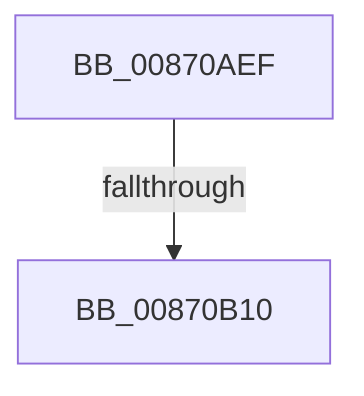

# sub_00870AEF

- RVA: `0x00870AEF`–`0x00870B15` (길이 `38` bytes)
- VA: `0x0000000140870AEF`
- 실행 섹션: `PAGE`
- PDB 이름 있음: `아니요`; PDB Function 태그: `아니요`
- unwind 정보 RVA: `0x0006C2E0`
- 디코드: `9`개 명령, `38/38` bytes 표시
- 미해석 바이트: `0` (있으면 어셈블리에 `.byte`로 보존)

> 이 문서는 커널 이미지의 기계어와 PDB 기호를 분석해 생성했습니다. 4번과 5번은 함수 원형과 자료형을 바이너리 사용 방식에서 추정한 C 해석이며 원본 소스 복구 결과는 아닙니다.

## 1. Dependencies

- 직접 호출 지점: **1**; 고유 호출 대상: **1**
- 직접 호출자로 확인된 함수: **0**
- RIP 상대 이미지 참조: **1**

### Outgoing calls
- `0x00870AF4` → [SepAuditingEnabledForSubcategory](../../text/41/SepAuditingEnabledForSubcategory_function_0041C6B0.md) (function, `0x0041C6B0`)

### Direct callers
- 이 함수 시작 RVA로 연결되는 직접 call은 확인되지 않았습니다. 간접 호출은 완전히 역산할 수 없습니다.

### Static image references
- `0x00870B00` → RVA `0x00F04BE0` (`.data`; read)

## 2. Other-region calls and transfers

- 다른 실행 섹션으로 향하는 call: **1**
  - `0x00870AF4` → [SepAuditingEnabledForSubcategory](../../text/41/SepAuditingEnabledForSubcategory_function_0041C6B0.md) (`PAGE` → `.text`)
- call이 아닌 외부 분기/꼬리 이동: **1**
  - `0x00870B0E` → [sub_00870B27](Unknown_function_00870B27.md) (`tail-transfer`)

## 3. Assembly (complete function range)

```asm
00870AEF  48 89 7C 24 78                  mov qword ptr [rsp + 0x78], rdi
00870AF4  E8 B7 BB BA FF                  call 0x14041c6b0
00870AF9  83 C3 9C                        add ebx, -0x64
00870AFC  88 44 24 70                     mov byte ptr [rsp + 0x70], al
00870B00  48 8D 0D D9 40 69 00            lea rcx, [rip + 0x6940d9]
00870B07  0F B6 F8                        movzx edi, al
00870B0A  83 3C 99 00                     cmp dword ptr [rcx + rbx*4], 0
00870B0E  75 17                           jne 0x140870b27
00870B10  48 8B 7C 24 78                  mov rdi, qword ptr [rsp + 0x78]
```

## 4. C-style interpretation (structured pseudocode)

```c
__int64 __fastcall sub_00870AEF(__int64 a1, __int64 a2, __int64 a3, __int64 a4, __int64 a5, __int64 a6, __int64 a7, __int64 a8, __int64 a9, __int64 a10, __int64 a11, __int64 a12, __int64 a13, __int64 a14, __int64 a15)
{
    __int64 result;
    __int64 v_rbx;
    unsigned __int8 v_stack_p70;
    unsigned __int64 v_stack_p78;

    v_stack_p78 = v_rdi;
    result = SepAuditingEnabledForSubcategory(a1, a2, a3, a4);
    v_rbx = (unsigned int)((v_rbx) + (-100));
    v_stack_p70 = (unsigned __int8)(result);
    return result;
}
```

## 5. (Beta) C Style

```c
int64_t sub_00870AEF(int64_t Arg1, int64_t Arg2, int64_t Arg3, int64_t Arg4, uint64_t Arg5, uint64_t Arg6, uint64_t Arg7, uint64_t Arg8, uint64_t Arg9, uint64_t Arg10, uint64_t Arg11, uint64_t Arg12, uint64_t Arg13, uint64_t Arg14, int64_t Arg15)
{
    int64_t result;
    int64_t local_rbx;
    uint8_t v_stack_p70;
    uint64_t v_stack_p78;

    v_stack_p78 = local_rdi;
    result = SepAuditingEnabledForSubcategory(Arg1, Arg2, Arg3, Arg4);
    local_rbx = (uint32_t)((local_rbx) + (-100));
    v_stack_p70 = (uint8_t)(result);
    return result;
}
```

## 6. Execution-region graph

[열기: 2D/3D 그래프와 함수 탐색 컨트롤 패널](../../../control-panel.html?section=page&rva=0x00870AEF&view=graph)

- 2D 그래프는 위에서 아래로 흐르고, 3D 그래프는 빈 공간을 드래그해 회전합니다. Shift+드래그는 이동, 휠은 확대·축소, 함수 노드 선택은 대상 보고서 이동입니다.

### Static fallback


