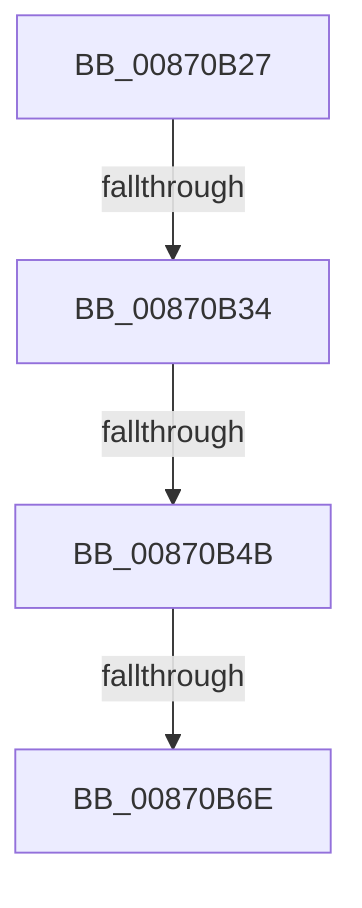

# sub_00870B27

- RVA: `0x00870B27`–`0x00870B7C` (길이 `85` bytes)
- VA: `0x0000000140870B27`
- 실행 섹션: `PAGE`
- PDB 이름 있음: `아니요`; PDB Function 태그: `아니요`
- unwind 정보 RVA: `0x0006C308`
- 디코드: `21`개 명령, `85/85` bytes 표시
- 미해석 바이트: `0` (있으면 어셈블리에 `.byte`로 보존)

> 이 문서는 커널 이미지의 기계어와 PDB 기호를 분석해 생성했습니다. 4번과 5번은 함수 원형과 자료형을 바이너리 사용 방식에서 추정한 C 해석이며 원본 소스 복구 결과는 아닙니다.

## 1. Dependencies

- 직접 호출 지점: **2**; 고유 호출 대상: **2**
- 직접 호출자로 확인된 함수: **0**
- RIP 상대 이미지 참조: **0**

### Outgoing calls
- `0x00870B3E` → [SeCaptureSubjectContext](../86/SeCaptureSubjectContext_function_0086B820.md) (function, `0x0086B820`)
- `0x00870B5F` → [SepAdtIncorporatePerUserPolicy](../79/SepAdtIncorporatePerUserPolicy_function_0079FC18.md) (function, `0x0079FC18`)

### Direct callers
- 이 함수 시작 RVA로 연결되는 직접 call은 확인되지 않았습니다. 간접 호출은 완전히 역산할 수 없습니다.

### Static image references
- 디코드된 RIP-relative 메모리 참조가 없습니다.

## 2. Other-region calls and transfers

- 다른 실행 섹션으로 향하는 call: **0**
- call이 아닌 외부 분기/꼬리 이동: **4**
  - `0x00870B32` → [sub_00870B7C](Unknown_function_00870B7C.md) (`tail-transfer`)
  - `0x00870B49` → [sub_00870B7C + 0x5](Unknown_function_00870B7C.md) (`tail-transfer`)
  - `0x00870B6C` → [sub_00870BB6](Unknown_function_00870BB6.md) (`tail-transfer`)
  - `0x00870B7A` → [sub_00870AEF + 0x21](Unknown_function_00870AEF.md) (`tail-transfer`)

## 3. Assembly (complete function range)

```asm
00870B27  4C 89 BC 24 80 00 00 00         mov qword ptr [rsp + 0x80], r15
00870B2F  4D 85 F6                        test r14, r14
00870B32  75 48                           jne 0x140870b7c
00870B34  48 8D 4C 24 30                  lea rcx, [rsp + 0x30]
00870B39  4C 8D 7C 24 30                  lea r15, [rsp + 0x30]
00870B3E  E8 DD AC FF FF                  call 0x14086b820
00870B43  4D 8B 0F                        mov r9, qword ptr [r15]
00870B46  4D 85 C9                        test r9, r9
00870B49  74 36                           je 0x140870b81
00870B4B  48 8D 44 24 70                  lea rax, [rsp + 0x70]
00870B50  44 0F B6 C6                     movzx r8d, sil
00870B54  40 0F B6 D5                     movzx edx, bpl
00870B58  48 89 44 24 20                  mov qword ptr [rsp + 0x20], rax
00870B5D  8B CB                           mov ecx, ebx
00870B5F  E8 B4 F0 F2 FF                  call 0x14079fc18
00870B64  0F B6 7C 24 70                  movzx edi, byte ptr [rsp + 0x70]
00870B69  4D 85 F6                        test r14, r14
00870B6C  74 48                           je 0x140870bb6
00870B6E  4C 8B BC 24 80 00 00 00         mov r15, qword ptr [rsp + 0x80]
00870B76  40 0F B6 C7                     movzx eax, dil
00870B7A  EB 94                           jmp 0x140870b10
```

## 4. C-style interpretation (structured pseudocode)

```c
__int64 __fastcall sub_00870B27(__int64 a1, __int64 a2, __int64 a3, __int64 a4, __int64 a5, __int64 a6, __int64 a7, __int64 a8, __int64 a9, __int64 a10, __int64 a11, __int64 a12, __int64 a13, unsigned __int8 a14, __int64 a15, __int64 a16)
{
    __int64 result;
    unsigned __int64 v_stack_p20;
    unsigned __int64 v_stack_p80;

    v_stack_p80 = v_r15;
    result = SeCaptureSubjectContext(a6, a2, a3, a4);
    v_stack_p20 = a14;
    result = SepAdtIncorporatePerUserPolicy((unsigned int)((unsigned int)(v_rbx)), (unsigned __int8)(v_rbp), (unsigned __int8)(v_rsi), *(unsigned __int64 *)(a6));
}
```

## 5. (Beta) C Style

```c
int64_t sub_00870B27(int64_t Arg1, int64_t Arg2, int64_t Arg3, int64_t Arg4, uint64_t Arg5, int64_t Arg6, uint64_t Arg7, uint64_t Arg8, uint64_t Arg9, uint64_t Arg10, uint64_t Arg11, uint64_t Arg12, uint64_t Arg13, uint8_t Arg14, uint64_t Arg15, int64_t Arg16)
{
    int64_t result;
    uint64_t v_stack_p20;
    uint64_t v_stack_p80;

    v_stack_p80 = local_r15;
    result = SeCaptureSubjectContext(Arg6, Arg2, Arg3, Arg4);
    v_stack_p20 = Arg14;
    result = SepAdtIncorporatePerUserPolicy((uint32_t)((uint32_t)(local_rbx)), (uint8_t)(local_rbp), (uint8_t)(local_rsi), *(uint64_t *)(Arg6));
}
```

## 6. Execution-region graph

[열기: 2D/3D 그래프와 함수 탐색 컨트롤 패널](../../../control-panel.html?section=page&rva=0x00870B27&view=graph)

- 2D 그래프는 위에서 아래로 흐르고, 3D 그래프는 빈 공간을 드래그해 회전합니다. Shift+드래그는 이동, 휠은 확대·축소, 함수 노드 선택은 대상 보고서 이동입니다.

### Static fallback


