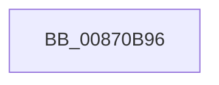

# sub_00870B96

- RVA: `0x00870B96`–`0x00870BB6` (길이 `32` bytes)
- VA: `0x0000000140870B96`
- 실행 섹션: `PAGE`
- PDB 이름 있음: `아니요`; PDB Function 태그: `아니요`
- unwind 정보 RVA: `0x0006C338`
- 디코드: `10`개 명령, `32/32` bytes 표시
- 미해석 바이트: `0` (있으면 어셈블리에 `.byte`로 보존)

> 이 문서는 커널 이미지의 기계어와 PDB 기호를 분석해 생성했습니다. 4번과 5번은 함수 원형과 자료형을 바이너리 사용 방식에서 추정한 C 해석이며 원본 소스 복구 결과는 아닙니다.

## 1. Dependencies

- 직접 호출 지점: **1**; 고유 호출 대상: **1**
- 직접 호출자로 확인된 함수: **0**
- RIP 상대 이미지 참조: **0**

### Outgoing calls
- `0x00870BAC` → [SepAdtAuditThisEventByCategoryWithContext](../9A/SepAdtAuditThisEventByCategoryWithContext_function_009A2910.md) (function, `0x009A2910`)

### Direct callers
- 이 함수 시작 RVA로 연결되는 직접 call은 확인되지 않았습니다. 간접 호출은 완전히 역산할 수 없습니다.

### Static image references
- 디코드된 RIP-relative 메모리 참조가 없습니다.

## 2. Other-region calls and transfers

- 다른 실행 섹션으로 향하는 call: **0**
- call이 아닌 외부 분기/꼬리 이동: **1**
  - `0x00870BB1` → [sub_00870B15](Unknown_function_00870B15.md) (`tail-transfer`)

## 3. Assembly (complete function range)

```asm
00870B96  33 C0                           xor eax, eax
00870B98  4D 8B C6                        mov r8, r14
00870B9B  40 84 ED                        test bpl, bpl
00870B9E  0F 95 C0                        setne al
00870BA1  8B D0                           mov edx, eax
00870BA3  83 CA 10                        or edx, 0x10
00870BA6  40 84 F6                        test sil, sil
00870BA9  0F 44 D0                        cmove edx, eax
00870BAC  E8 5F 1D 13 00                  call 0x1409a2910
00870BB1  E9 5F FF FF FF                  jmp 0x140870b15
```

## 4. C-style interpretation (structured pseudocode)

```c
__int64 __fastcall sub_00870B96(void)
{
    __int64 result;

    result = 0;
    result = ((unsigned __int8)(v_rbp) != 0) ? 1 : 0;
    a2 = (unsigned int)(((unsigned int)((unsigned int)(result))) | (16));
    if ((unsigned __int8)(v_rsi) == 0) { a2 = (unsigned int)(result); }
    result = SepAdtAuditThisEventByCategoryWithContext(a1, a2, v_r14, a4);
}
```

## 5. (Beta) C Style

```c
void sub_00870B96(void)
{
    int64_t result;

    result = 0;
    result = ((uint8_t)(local_rbp) != 0) ? 1 : 0;
    a2 = (uint32_t)(((uint32_t)((uint32_t)(result))) | (16));
    if ((uint8_t)(local_rsi) == 0) { a2 = (uint32_t)(result); }
    result = SepAdtAuditThisEventByCategoryWithContext(a1, a2, local_r14, a4);
}
```

## 6. Execution-region graph

[열기: 2D/3D 그래프와 함수 탐색 컨트롤 패널](../../../control-panel.html?section=page&rva=0x00870B96&view=graph)

- 2D 그래프는 위에서 아래로 흐르고, 3D 그래프는 빈 공간을 드래그해 회전합니다. Shift+드래그는 이동, 휠은 확대·축소, 함수 노드 선택은 대상 보고서 이동입니다.

### Static fallback


