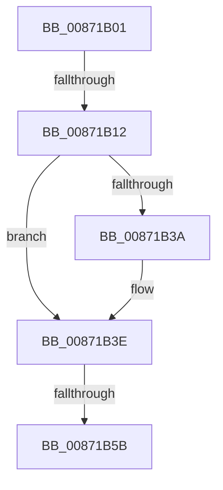

# sub_00871B01

- RVA: `0x00871B01`–`0x00871B6C` (길이 `107` bytes)
- VA: `0x0000000140871B01`
- 실행 섹션: `PAGE`
- PDB 이름 있음: `아니요`; PDB Function 태그: `아니요`
- unwind 정보 RVA: `0x0006C410`
- 디코드: `26`개 명령, `107/107` bytes 표시
- 미해석 바이트: `0` (있으면 어셈블리에 `.byte`로 보존)

> 이 문서는 커널 이미지의 기계어와 PDB 기호를 분석해 생성했습니다. 4번과 5번은 함수 원형과 자료형을 바이너리 사용 방식에서 추정한 C 해석이며 원본 소스 복구 결과는 아닙니다.

## 1. Dependencies

- 직접 호출 지점: **2**; 고유 호출 대상: **2**
- 직접 호출자로 확인된 함수: **0**
- RIP 상대 이미지 참조: **1**

### Outgoing calls
- `0x00871B26` → [SepPrivilegeCheck](../../text/40/SepPrivilegeCheck_function_0040B6B0.md) (function, `0x0040B6B0`)
- `0x00871B52` → [RtlEqualSid](../../text/40/RtlEqualSid_function_00400AD0.md) (function, `0x00400AD0`)

### Direct callers
- 이 함수 시작 RVA로 연결되는 직접 call은 확인되지 않았습니다. 간접 호출은 완전히 역산할 수 없습니다.

### Static image references
- `0x00871B45` → RVA `0x00E67D58` (`.data`; read)

## 2. Other-region calls and transfers

- 다른 실행 섹션으로 향하는 call: **2**
  - `0x00871B26` → [SepPrivilegeCheck](../../text/40/SepPrivilegeCheck_function_0040B6B0.md) (`PAGE` → `.text`)
  - `0x00871B52` → [RtlEqualSid](../../text/40/RtlEqualSid_function_00400AD0.md) (`PAGE` → `.text`)
- call이 아닌 외부 분기/꼬리 이동: **2**
  - `0x00871B0C` → [sub_00871BF0](Unknown_function_00871BF0.md) (`tail-transfer`)
  - `0x00871B59` → [sub_00871B83](Unknown_function_00871B83.md) (`tail-transfer`)

## 3. Assembly (complete function range)

```asm
00871B01  49 89 6B 18                     mov qword ptr [r11 + 0x18], rbp
00871B05  49 89 73 E0                     mov qword ptr [r11 - 0x20], rsi
00871B09  48 85 C9                        test rcx, rcx
00871B0C  0F 85 DE 00 00 00               jne 0x140871bf0
00871B12  48 8B 4A 10                     mov rcx, qword ptr [rdx + 0x10]
00871B16  44 88 44 24 20                  mov byte ptr [rsp + 0x20], r8b
00871B1B  48 8D 54 24 48                  lea rdx, [rsp + 0x48]
00871B20  44 8B C7                        mov r8d, edi
00871B23  44 8B CF                        mov r9d, edi
00871B26  E8 85 9B B9 FF                  call 0x14040b6b0
00871B2B  8B 7C 24 40                     mov edi, dword ptr [rsp + 0x40]
00871B2F  0F B6 E8                        movzx ebp, al
00871B32  48 8B 03                        mov rax, qword ptr [rbx]
00871B35  48 85 C0                        test rax, rax
00871B38  75 04                           jne 0x140871b3e
00871B3A  48 8B 43 10                     mov rax, qword ptr [rbx + 0x10]
00871B3E  48 8B 80 98 00 00 00            mov rax, qword ptr [rax + 0x98]
00871B45  48 8B 0D 0C 62 5F 00            mov rcx, qword ptr [rip + 0x5f620c]
00871B4C  48 8B 30                        mov rsi, qword ptr [rax]
00871B4F  48 8B D6                        mov rdx, rsi
00871B52  E8 79 EF B8 FF                  call 0x140400ad0
00871B57  84 C0                           test al, al
00871B59  74 28                           je 0x140871b83
00871B5B  40 0F B6 C5                     movzx eax, bpl
00871B5F  48 8B AC 24 A0 00 00 00         mov rbp, qword ptr [rsp + 0xa0]
00871B67  48 8B 74 24 68                  mov rsi, qword ptr [rsp + 0x68]
```

## 4. C-style interpretation (structured pseudocode)

```c
__int64 __fastcall sub_00871B01(__int64 a1, __int64 a2, unsigned __int8 a3, __int64 a4, __int64 a5, __int64 a6, __int64 a7, unsigned int a8, __int64 a9, __int64 a10, __int64 a11, __int64 a12, __int64 a13, __int64 a14, __int64 a15, __int64 a16, __int64 a17, __int64 a18, __int64 a19, __int64 a20)
{
    __int64 result;
    unsigned __int8 v_stack_p20;

    *(unsigned __int64 *)(v_r11 + 24) = v_rbp;
    *(unsigned __int64 *)(v_r11 - 32) = v_rsi;
    v_stack_p20 = a3;
    result = SepPrivilegeCheck(*(unsigned __int64 *)(a2 + 16), a9, (unsigned int)((unsigned int)(v_rdi)), (unsigned int)((unsigned int)(v_rdi)));
    result = *(unsigned __int64 *)(v_rbx);
    if (*(unsigned __int64 *)(v_rbx) == 0) {
        result = *(unsigned __int64 *)(v_rbx + 16);
    }
    result = RtlEqualSid(*(unsigned __int64 *)(v_rip + 6251020), *(unsigned __int64 *)(*(unsigned __int64 *)(result + 152)), (unsigned int)((unsigned int)(v_rdi)), (unsigned int)((unsigned int)(v_rdi)));
    return (unsigned __int8)((unsigned __int8)(result));
}
```

## 5. (Beta) C Style

```c
int64_t sub_00871B01(int64_t Arg1, void *Arg2, uint8_t Arg3, int64_t Arg4, uint64_t Arg5, uint64_t Arg6, uint64_t Arg7, uint32_t Arg8, int64_t Arg9, uint64_t Arg10, uint64_t Arg11, uint64_t Arg12, int64_t Arg13, uint64_t Arg14, uint64_t Arg15, uint64_t Arg16, uint64_t Arg17, uint64_t Arg18, uint64_t Arg19, int64_t Arg20)
{
    uint8_t *arg2 = (uint8_t *)Arg2;

    int64_t result;
    uint8_t v_stack_p20;

    *(uint64_t *)(local_r11 + 0x18) = local_rbp;
    *(uint64_t *)(local_r11 - 0x20) = local_rsi;
    v_stack_p20 = Arg3;
    result = SepPrivilegeCheck(*(uint64_t *)(arg2 + 0x10), Arg9, (uint32_t)((uint32_t)(local_rdi)), (uint32_t)((uint32_t)(local_rdi)));
    result = *(uint64_t *)(local_rbx);
    if (*(uint64_t *)(local_rbx) == 0) {
        result = *(uint64_t *)(local_rbx + 0x10);
    }
    result = RtlEqualSid(*(uint64_t *)(v_rip + 0x5F620C), *(uint64_t *)(*(uint64_t *)(result + 0x98)), (uint32_t)((uint32_t)(local_rdi)), (uint32_t)((uint32_t)(local_rdi)));
    return (uint8_t)((uint8_t)(result));
}
```

### 관측된 메모리 오프셋

구조체 형식이 확인되지 않은 접근은 인자 기준의 오프셋으로만 기록했습니다.

| 기준 인자 | 오프셋 표현 | 폭 (bit) | 접근 |
|---|---:|---:|---|
| `Arg2` | `+ 0x10` | `64` | `R` |

## 6. Execution-region graph

[열기: 2D/3D 그래프와 함수 탐색 컨트롤 패널](../../../control-panel.html?section=page&rva=0x00871B01&view=graph)

- 2D 그래프는 위에서 아래로 흐르고, 3D 그래프는 빈 공간을 드래그해 회전합니다. Shift+드래그는 이동, 휠은 확대·축소, 함수 노드 선택은 대상 보고서 이동입니다.

### Static fallback


