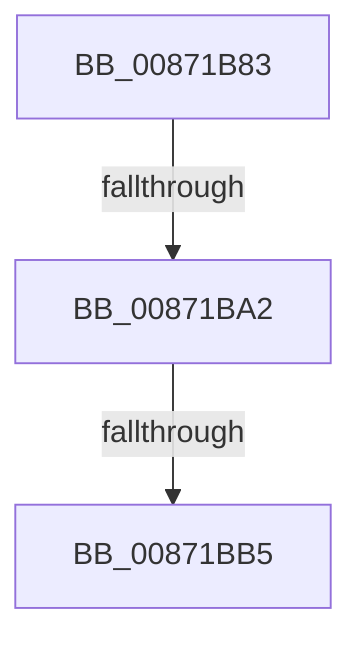

# sub_00871B83

- RVA: `0x00871B83`–`0x00871BF0` (길이 `109` bytes)
- VA: `0x0000000140871B83`
- 실행 섹션: `PAGE`
- PDB 이름 있음: `아니요`; PDB Function 태그: `아니요`
- unwind 정보 RVA: `0x0006C43C`
- 디코드: `25`개 명령, `109/109` bytes 표시
- 미해석 바이트: `0` (있으면 어셈블리에 `.byte`로 보존)

> 이 문서는 커널 이미지의 기계어와 PDB 기호를 분석해 생성했습니다. 4번과 5번은 함수 원형과 자료형을 바이너리 사용 방식에서 추정한 C 해석이며 원본 소스 복구 결과는 아닙니다.

## 1. Dependencies

- 직접 호출 지점: **3**; 고유 호출 대상: **2**
- 직접 호출자로 확인된 함수: **0**
- RIP 상대 이미지 참조: **2**

### Outgoing calls
- `0x00871B99` → [RtlEqualSid](../../text/40/RtlEqualSid_function_00400AD0.md) (function, `0x00400AD0`)
- `0x00871BAC` → [RtlEqualSid](../../text/40/RtlEqualSid_function_00400AD0.md) (function, `0x00400AD0`)
- `0x00871BDD` → [SepAdtPrivilegedServiceAuditAlarm](SepAdtPrivilegedServiceAuditAlarm_function_008714F0.md) (function, `0x008714F0`)

### Direct callers
- 이 함수 시작 RVA로 연결되는 직접 call은 확인되지 않았습니다. 간접 호출은 완전히 역산할 수 없습니다.

### Static image references
- `0x00871B8B` → RVA `0x00FD9AA0` (`PAGEDATA`; read)
- `0x00871BC2` → RVA `0x000013A8` (`.rdata`; read)

## 2. Other-region calls and transfers

- 다른 실행 섹션으로 향하는 call: **2**
  - `0x00871B99` → [RtlEqualSid](../../text/40/RtlEqualSid_function_00400AD0.md) (`PAGE` → `.text`)
  - `0x00871BAC` → [RtlEqualSid](../../text/40/RtlEqualSid_function_00400AD0.md) (`PAGE` → `.text`)
- call이 아닌 외부 분기/꼬리 이동: **3**
  - `0x00871BA0` → [sub_00871C02](Unknown_function_00871C02.md) (`tail-transfer`)
  - `0x00871BB3` → [sub_00871C02](Unknown_function_00871C02.md) (`tail-transfer`)
  - `0x00871BEB` → [sub_00871B01 + 0x5E](Unknown_function_00871B01.md) (`tail-transfer`)

## 3. Assembly (complete function range)

```asm
00871B83  4C 89 74 24 60                  mov qword ptr [rsp + 0x60], r14
00871B88  48 8B D6                        mov rdx, rsi
00871B8B  4C 8B 35 0E 7F 76 00            mov r14, qword ptr [rip + 0x767f0e]
00871B92  49 8B 8E 88 01 00 00            mov rcx, qword ptr [r14 + 0x188]
00871B99  E8 32 EF B8 FF                  call 0x140400ad0
00871B9E  84 C0                           test al, al
00871BA0  75 60                           jne 0x140871c02
00871BA2  49 8B 8E 80 01 00 00            mov rcx, qword ptr [r14 + 0x180]
00871BA9  48 8B D6                        mov rdx, rsi
00871BAC  E8 1F EF B8 FF                  call 0x140400ad0
00871BB1  84 C0                           test al, al
00871BB3  75 4D                           jne 0x140871c02
00871BB5  4C 8B 0B                        mov r9, qword ptr [rbx]
00871BB8  48 8D 44 24 40                  lea rax, [rsp + 0x40]
00871BBD  40 88 6C 24 30                  mov byte ptr [rsp + 0x30], bpl
00871BC2  48 8D 15 DF F7 78 FF            lea rdx, [rip - 0x870821]
00871BC9  48 89 44 24 28                  mov qword ptr [rsp + 0x28], rax
00871BCE  45 33 C0                        xor r8d, r8d
00871BD1  48 8B 43 10                     mov rax, qword ptr [rbx + 0x10]
00871BD5  48 8B CB                        mov rcx, rbx
00871BD8  48 89 44 24 20                  mov qword ptr [rsp + 0x20], rax
00871BDD  E8 0E F9 FF FF                  call 0x1408714f0
00871BE2  4C 8B 74 24 60                  mov r14, qword ptr [rsp + 0x60]
00871BE7  40 0F B6 C5                     movzx eax, bpl
00871BEB  E9 6F FF FF FF                  jmp 0x140871b5f
```

## 4. C-style interpretation (structured pseudocode)

```c
__int64 __fastcall sub_00871B83(__int64 a1, __int64 a2, int a3, __int64 a4, __int64 a5, __int64 a6, __int64 a7, __int64 a8, __int64 a9, __int64 a10, __int64 a11, __int64 a12)
{
    __int64 result;
    unsigned __int64 v_stack_p20;
    unsigned __int64 v_stack_p28;
    unsigned __int8 v_stack_p30;
    unsigned __int64 v_stack_p60;

    v_stack_p60 = v_r14;
    result = RtlEqualSid(*(unsigned __int64 *)(*(unsigned __int64 *)(v_rip + 7765774) + 392), v_rsi, a3, a4);
    result = RtlEqualSid(*(unsigned __int64 *)(*(unsigned __int64 *)(v_rip + 7765774) + 384), v_rsi, a3, a4);
    v_stack_p30 = (unsigned __int8)(v_rbp);
    v_stack_p28 = a8;
    a3 = 0;
    v_stack_p20 = *(unsigned __int64 *)(v_rbx + 16);
    result = SepAdtPrivilegedServiceAuditAlarm(v_rbx, v_rip - 8849441, a3, *(unsigned __int64 *)(v_rbx));
}
```

## 5. (Beta) C Style

```c
int64_t sub_00871B83(int64_t Arg1, int64_t Arg2, int32_t Arg3, int64_t Arg4, uint64_t Arg5, uint64_t Arg6, uint64_t Arg7, int64_t Arg8, uint64_t Arg9, uint64_t Arg10, uint64_t Arg11, int64_t Arg12)
{
    int64_t result;
    uint64_t v_stack_p20;
    uint64_t v_stack_p28;
    uint8_t v_stack_p30;
    uint64_t v_stack_p60;

    v_stack_p60 = local_r14;
    result = RtlEqualSid(*(uint64_t *)(*(uint64_t *)(v_rip + 0x767F0E) + 0x188), local_rsi, Arg3, Arg4);
    result = RtlEqualSid(*(uint64_t *)(*(uint64_t *)(v_rip + 0x767F0E) + 0x180), local_rsi, Arg3, Arg4);
    v_stack_p30 = (uint8_t)(local_rbp);
    v_stack_p28 = Arg8;
    Arg3 = 0;
    v_stack_p20 = *(uint64_t *)(local_rbx + 0x10);
    result = SepAdtPrivilegedServiceAuditAlarm(local_rbx, v_rip - 8849441, Arg3, *(uint64_t *)(local_rbx));
}
```

## 6. Execution-region graph

[열기: 2D/3D 그래프와 함수 탐색 컨트롤 패널](../../../control-panel.html?section=page&rva=0x00871B83&view=graph)

- 2D 그래프는 위에서 아래로 흐르고, 3D 그래프는 빈 공간을 드래그해 회전합니다. Shift+드래그는 이동, 휠은 확대·축소, 함수 노드 선택은 대상 보고서 이동입니다.

### Static fallback


