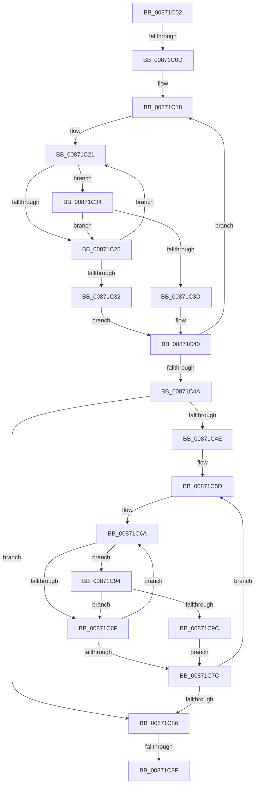

# sub_00871C02

- RVA: `0x00871C02`–`0x00871CA1` (길이 `159` bytes)
- VA: `0x0000000140871C02`
- 실행 섹션: `PAGE`
- PDB 이름 있음: `아니요`; PDB Function 태그: `아니요`
- unwind 정보 RVA: `0x0006C468`
- 디코드: `48`개 명령, `159/159` bytes 표시
- 미해석 바이트: `0` (있으면 어셈블리에 `.byte`로 보존)

> 이 문서는 커널 이미지의 기계어와 PDB 기호를 분석해 생성했습니다. 4번과 5번은 함수 원형과 자료형을 바이너리 사용 방식에서 추정한 C 해석이며 원본 소스 복구 결과는 아닙니다.

## 1. Dependencies

- 직접 호출 지점: **0**; 고유 호출 대상: **0**
- 직접 호출자로 확인된 함수: **0**
- RIP 상대 이미지 참조: **2**

### Outgoing calls
- 직접 디코드된 call 명령이 없습니다.

### Direct callers
- 이 함수 시작 RVA로 연결되는 직접 call은 확인되지 않았습니다. 간접 호출은 완전히 역산할 수 없습니다.

### Static image references
- `0x00871C02` → RVA `0x00FD8238` (`PAGEDATA`; read)
- `0x00871C56` → RVA `0x00B4BE28` (`SepServicesFilterPrivileges`; read)

## 2. Other-region calls and transfers

- 다른 실행 섹션으로 향하는 call: **0**
- call이 아닌 외부 분기/꼬리 이동: **3**
  - `0x00871C0B` → [sub_00871B83 + 0x5F](Unknown_function_00871B83.md) (`tail-transfer`)
  - `0x00871C89` → [sub_00871B83 + 0x5F](Unknown_function_00871B83.md) (`tail-transfer`)
  - `0x00871C8F` → [sub_00871B83 + 0x32](Unknown_function_00871B83.md) (`tail-transfer`)

## 3. Assembly (complete function range)

```asm
00871C02  4C 8B 15 2F 66 76 00            mov r10, qword ptr [rip + 0x76662f]
00871C09  85 FF                           test edi, edi
00871C0B  74 D5                           je 0x140871be2
00871C0D  4D 8B 1A                        mov r11, qword ptr [r10]
00871C10  4C 8D 44 24 48                  lea r8, [rsp + 0x48]
00871C15  44 8B CF                        mov r9d, edi
00871C18  41 8B 10                        mov edx, dword ptr [r8]
00871C1B  49 8B CA                        mov rcx, r10
00871C1E  49 8B C3                        mov rax, r11
00871C21  3B 10                           cmp edx, dword ptr [rax]
00871C23  74 0F                           je 0x140871c34
00871C25  48 8B 41 08                     mov rax, qword ptr [rcx + 8]
00871C29  48 83 C1 08                     add rcx, 8
00871C2D  48 85 C0                        test rax, rax
00871C30  75 EF                           jne 0x140871c21
00871C32  EB 0C                           jmp 0x140871c40
00871C34  8B 40 04                        mov eax, dword ptr [rax + 4]
00871C37  41 39 40 04                     cmp dword ptr [r8 + 4], eax
00871C3B  75 E8                           jne 0x140871c25
00871C3D  41 FF C7                        inc r15d
00871C40  49 83 C0 0C                     add r8, 0xc
00871C44  49 83 E9 01                     sub r9, 1
00871C48  75 CE                           jne 0x140871c18
00871C4A  85 FF                           test edi, edi
00871C4C  74 38                           je 0x140871c86
00871C4E  48 8D 4C 24 48                  lea rcx, [rsp + 0x48]
00871C53  44 8B C7                        mov r8d, edi
00871C56  4C 8D 15 CB A1 2D 00            lea r10, [rip + 0x2da1cb]
00871C5D  44 8B 09                        mov r9d, dword ptr [rcx]
00871C60  49 8B D2                        mov rdx, r10
00871C63  48 8B 05 BE A1 2D 00            mov rax, qword ptr [rip + 0x2da1be]
00871C6A  44 3B 08                        cmp r9d, dword ptr [rax]
00871C6D  74 25                           je 0x140871c94
00871C6F  48 8B 42 08                     mov rax, qword ptr [rdx + 8]
00871C73  48 83 C2 08                     add rdx, 8
00871C77  48 85 C0                        test rax, rax
00871C7A  75 EE                           jne 0x140871c6a
00871C7C  48 83 C1 0C                     add rcx, 0xc
00871C80  49 83 E8 01                     sub r8, 1
00871C84  75 D7                           jne 0x140871c5d
00871C86  44 3B FF                        cmp r15d, edi
00871C89  0F 84 53 FF FF FF               je 0x140871be2
00871C8F  E9 21 FF FF FF                  jmp 0x140871bb5
00871C94  8B 40 04                        mov eax, dword ptr [rax + 4]
00871C97  39 41 04                        cmp dword ptr [rcx + 4], eax
00871C9A  75 D3                           jne 0x140871c6f
00871C9C  41 FF C7                        inc r15d
00871C9F  EB DB                           jmp 0x140871c7c
```

## 4. C-style interpretation (structured pseudocode)

```c
__int64 __fastcall sub_00871C02(__int64 a1, __int64 a2, __int64 a3, __int64 a4, __int64 a5, __int64 a6, __int64 a7, __int64 a8, __int64 a9)
{
    __int64 v_r15;

loc_00871C18:
loc_00871C21:
    if (((unsigned int)((unsigned int)(*(unsigned int *)(a9)))) == (*(unsigned int *)(*(unsigned __int64 *)(*(unsigned __int64 *)(v_rip + 7759407))))) goto loc_00871C34;
loc_00871C25:
    a1 = (*(unsigned __int64 *)(v_rip + 7759407)) + (8);
    if (*(unsigned __int64 *)(*(unsigned __int64 *)(v_rip + 7759407) + 8) != 0) goto loc_00871C21;
    goto loc_00871C40;
loc_00871C34:
    if ((*(unsigned int *)(a9 + 4)) != ((unsigned int)((unsigned int)(*(unsigned int *)(*(unsigned __int64 *)(*(unsigned __int64 *)(v_rip + 7759407) + 8) + 4))))) goto loc_00871C25;
    v_r15 = (unsigned int)((v_r15) + 1);
loc_00871C40:
    a3 = (a9) + (12);
    a4 = ((unsigned int)((unsigned int)(v_rdi))) - (1);
    if (condition_is_not_equal) goto loc_00871C18;
    if ((unsigned int)(v_rdi) == 0) goto loc_00871C86;
loc_00871C5D:
loc_00871C6A:
    if (((unsigned int)((unsigned int)(*(unsigned int *)(a9)))) == (*(unsigned int *)(*(unsigned __int64 *)(v_rip + 2990526)))) goto loc_00871C94;
loc_00871C6F:
    a2 = (v_rip + 2990539) + (8);
    if (*(unsigned __int64 *)(v_rip + 2990539 + 8) != 0) goto loc_00871C6A;
loc_00871C7C:
    a1 = (a9) + (12);
    a3 = ((unsigned int)((unsigned int)(v_rdi))) - (1);
    if (condition_is_not_equal) goto loc_00871C5D;
loc_00871C86:
loc_00871C94:
    if ((*(unsigned int *)(a1 + 4)) != ((unsigned int)((unsigned int)(*(unsigned int *)(*(unsigned __int64 *)(v_rip + 2990539 + 8) + 4))))) goto loc_00871C6F;
    v_r15 = (unsigned int)((v_r15) + 1);
    goto loc_00871C7C;
}
```

## 5. (Beta) C Style

```c
int64_t sub_00871C02(int64_t Arg1, int64_t Arg2, int64_t Arg3, int64_t Arg4, uint64_t Arg5, uint64_t Arg6, uint64_t Arg7, uint64_t Arg8, int64_t Arg9)
{
    int64_t local_r15;

loc_00871C18:
loc_00871C21:
    if (((uint32_t)((uint32_t)(*(uint32_t *)(Arg9)))) == (*(uint32_t *)(*(uint64_t *)(*(uint64_t *)(v_rip + 0x76662F))))) goto loc_00871C34;
loc_00871C25:
    Arg1 = (*(uint64_t *)(v_rip + 0x76662F)) + (8);
    if (*(uint64_t *)(*(uint64_t *)(v_rip + 0x76662F) + 0x8) != 0) goto loc_00871C21;
    goto loc_00871C40;
loc_00871C34:
    if ((*(uint32_t *)(Arg9 + 0x4)) != ((uint32_t)((uint32_t)(*(uint32_t *)(*(uint64_t *)(*(uint64_t *)(v_rip + 0x76662F) + 0x8) + 0x4))))) goto loc_00871C25;
    local_r15 = (uint32_t)((local_r15) + 1);
loc_00871C40:
    Arg3 = (Arg9) + (12);
    Arg4 = ((uint32_t)((uint32_t)(local_rdi))) - (1);
    if (condition_is_not_equal) goto loc_00871C18;
    if ((uint32_t)(local_rdi) == 0) goto loc_00871C86;
loc_00871C5D:
loc_00871C6A:
    if (((uint32_t)((uint32_t)(*(uint32_t *)(Arg9)))) == (*(uint32_t *)(*(uint64_t *)(v_rip + 0x2DA1BE)))) goto loc_00871C94;
loc_00871C6F:
    Arg2 = (v_rip + 2990539) + (8);
    if (*(uint64_t *)(v_rip + 0x2DA1CB + 0x8) != 0) goto loc_00871C6A;
loc_00871C7C:
    Arg1 = (Arg9) + (12);
    Arg3 = ((uint32_t)((uint32_t)(local_rdi))) - (1);
    if (condition_is_not_equal) goto loc_00871C5D;
loc_00871C86:
loc_00871C94:
    if ((*(uint32_t *)(Arg1 + 0x4)) != ((uint32_t)((uint32_t)(*(uint32_t *)(*(uint64_t *)(v_rip + 0x2DA1CB + 0x8) + 0x4))))) goto loc_00871C6F;
    local_r15 = (uint32_t)((local_r15) + 1);
    goto loc_00871C7C;
}
```

## 6. Execution-region graph

[열기: 2D/3D 그래프와 함수 탐색 컨트롤 패널](../../../control-panel.html?section=page&rva=0x00871C02&view=graph)

- 2D 그래프는 위에서 아래로 흐르고, 3D 그래프는 빈 공간을 드래그해 회전합니다. Shift+드래그는 이동, 휠은 확대·축소, 함수 노드 선택은 대상 보고서 이동입니다.

### Static fallback


