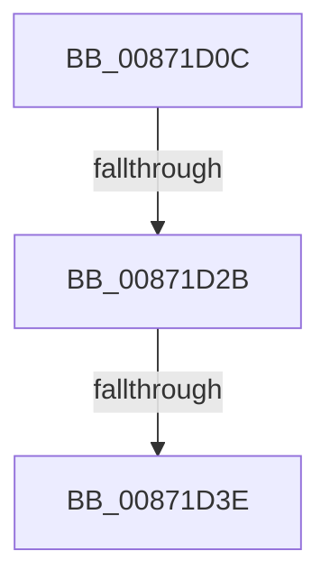

# sub_00871D0C

- RVA: `0x00871D0C`–`0x00871D6D` (길이 `97` bytes)
- VA: `0x0000000140871D0C`
- 실행 섹션: `PAGE`
- PDB 이름 있음: `아니요`; PDB Function 태그: `아니요`
- unwind 정보 RVA: `0x0006C4AC`
- 디코드: `23`개 명령, `97/97` bytes 표시
- 미해석 바이트: `0` (있으면 어셈블리에 `.byte`로 보존)

> 이 문서는 커널 이미지의 기계어와 PDB 기호를 분석해 생성했습니다. 4번과 5번은 함수 원형과 자료형을 바이너리 사용 방식에서 추정한 C 해석이며 원본 소스 복구 결과는 아닙니다.

## 1. Dependencies

- 직접 호출 지점: **3**; 고유 호출 대상: **2**
- 직접 호출자로 확인된 함수: **0**
- RIP 상대 이미지 참조: **2**

### Outgoing calls
- `0x00871D22` → [RtlEqualSid](../../text/40/RtlEqualSid_function_00400AD0.md) (function, `0x00400AD0`)
- `0x00871D35` → [RtlEqualSid](../../text/40/RtlEqualSid_function_00400AD0.md) (function, `0x00400AD0`)
- `0x00871D61` → [SepAdtPrivilegedServiceAuditAlarm](SepAdtPrivilegedServiceAuditAlarm_function_008714F0.md) (function, `0x008714F0`)

### Direct callers
- 이 함수 시작 RVA로 연결되는 직접 call은 확인되지 않았습니다. 간접 호출은 완전히 역산할 수 없습니다.

### Static image references
- `0x00871D14` → RVA `0x00FD9AA0` (`PAGEDATA`; read)
- `0x00871D42` → RVA `0x000013A8` (`.rdata`; read)

## 2. Other-region calls and transfers

- 다른 실행 섹션으로 향하는 call: **2**
  - `0x00871D22` → [RtlEqualSid](../../text/40/RtlEqualSid_function_00400AD0.md) (`PAGE` → `.text`)
  - `0x00871D35` → [RtlEqualSid](../../text/40/RtlEqualSid_function_00400AD0.md) (`PAGE` → `.text`)
- call이 아닌 외부 분기/꼬리 이동: **3**
  - `0x00871D29` → [sub_00871D6D](Unknown_function_00871D6D.md) (`tail-transfer`)
  - `0x00871D3C` → [sub_00871D6D](Unknown_function_00871D6D.md) (`tail-transfer`)
  - `0x00871D6B` → [SePrivilegedServiceAuditAlarm + 0x48](SePrivilegedServiceAuditAlarm_function_00871CB0.md) (`tail-transfer`)

## 3. Assembly (complete function range)

```asm
00871D0C  4C 89 7C 24 60                  mov qword ptr [rsp + 0x60], r15
00871D11  48 8B D7                        mov rdx, rdi
00871D14  4C 8B 3D 85 7D 76 00            mov r15, qword ptr [rip + 0x767d85]
00871D1B  49 8B 8F 88 01 00 00            mov rcx, qword ptr [r15 + 0x188]
00871D22  E8 A9 ED B8 FF                  call 0x140400ad0
00871D27  84 C0                           test al, al
00871D29  75 42                           jne 0x140871d6d
00871D2B  49 8B 8F 80 01 00 00            mov rcx, qword ptr [r15 + 0x180]
00871D32  48 8B D7                        mov rdx, rdi
00871D35  E8 96 ED B8 FF                  call 0x140400ad0
00871D3A  84 C0                           test al, al
00871D3C  75 2F                           jne 0x140871d6d
00871D3E  48 8B 43 10                     mov rax, qword ptr [rbx + 0x10]
00871D42  48 8D 15 5F F6 78 FF            lea rdx, [rip - 0x8709a1]
00871D49  4C 8B 0B                        mov r9, qword ptr [rbx]
00871D4C  4D 8B C6                        mov r8, r14
00871D4F  40 88 6C 24 30                  mov byte ptr [rsp + 0x30], bpl
00871D54  48 8B CB                        mov rcx, rbx
00871D57  48 89 74 24 28                  mov qword ptr [rsp + 0x28], rsi
00871D5C  48 89 44 24 20                  mov qword ptr [rsp + 0x20], rax
00871D61  E8 8A F7 FF FF                  call 0x1408714f0
00871D66  4C 8B 7C 24 60                  mov r15, qword ptr [rsp + 0x60]
00871D6B  EB 8B                           jmp 0x140871cf8
```

## 4. C-style interpretation (structured pseudocode)

```c
__int64 __fastcall sub_00871D0C(__int64 a1, __int64 a2, __int64 a3, __int64 a4, __int64 a5, __int64 a6, __int64 a7, __int64 a8, __int64 a9, __int64 a10, __int64 a11, __int64 a12)
{
    __int64 result;
    unsigned __int64 v_stack_p20;
    unsigned __int64 v_stack_p28;
    unsigned __int8 v_stack_p30;
    unsigned __int64 v_stack_p60;

    v_stack_p60 = v_r15;
    result = RtlEqualSid(*(unsigned __int64 *)(*(unsigned __int64 *)(v_rip + 7765381) + 392), v_rdi, a3, a4);
    result = RtlEqualSid(*(unsigned __int64 *)(*(unsigned __int64 *)(v_rip + 7765381) + 384), v_rdi, a3, a4);
    v_stack_p30 = (unsigned __int8)(v_rbp);
    v_stack_p28 = v_rsi;
    v_stack_p20 = *(unsigned __int64 *)(v_rbx + 16);
    result = SepAdtPrivilegedServiceAuditAlarm(v_rbx, v_rip - 8849825, v_r14, *(unsigned __int64 *)(v_rbx));
}
```

## 5. (Beta) C Style

```c
int64_t sub_00871D0C(int64_t Arg1, int64_t Arg2, int64_t Arg3, int64_t Arg4, uint64_t Arg5, uint64_t Arg6, uint64_t Arg7, uint64_t Arg8, uint64_t Arg9, uint64_t Arg10, uint64_t Arg11, int64_t Arg12)
{
    int64_t result;
    uint64_t v_stack_p20;
    uint64_t v_stack_p28;
    uint8_t v_stack_p30;
    uint64_t v_stack_p60;

    v_stack_p60 = local_r15;
    result = RtlEqualSid(*(uint64_t *)(*(uint64_t *)(v_rip + 0x767D85) + 0x188), local_rdi, Arg3, Arg4);
    result = RtlEqualSid(*(uint64_t *)(*(uint64_t *)(v_rip + 0x767D85) + 0x180), local_rdi, Arg3, Arg4);
    v_stack_p30 = (uint8_t)(local_rbp);
    v_stack_p28 = local_rsi;
    v_stack_p20 = *(uint64_t *)(local_rbx + 0x10);
    result = SepAdtPrivilegedServiceAuditAlarm(local_rbx, v_rip - 8849825, local_r14, *(uint64_t *)(local_rbx));
}
```

## 6. Execution-region graph

[열기: 2D/3D 그래프와 함수 탐색 컨트롤 패널](../../../control-panel.html?section=page&rva=0x00871D0C&view=graph)

- 2D 그래프는 위에서 아래로 흐르고, 3D 그래프는 빈 공간을 드래그해 회전합니다. Shift+드래그는 이동, 휠은 확대·축소, 함수 노드 선택은 대상 보고서 이동입니다.

### Static fallback


