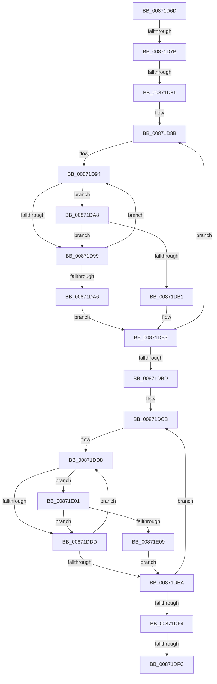

# sub_00871D6D

- RVA: `0x00871D6D`–`0x00871E0D` (길이 `160` bytes)
- VA: `0x0000000140871D6D`
- 실행 섹션: `PAGE`
- PDB 이름 있음: `아니요`; PDB Function 태그: `아니요`
- unwind 정보 RVA: `0x0006C4C0`
- 디코드: `50`개 명령, `160/160` bytes 표시
- 미해석 바이트: `0` (있으면 어셈블리에 `.byte`로 보존)

> 이 문서는 커널 이미지의 기계어와 PDB 기호를 분석해 생성했습니다. 4번과 5번은 함수 원형과 자료형을 바이너리 사용 방식에서 추정한 C 해석이며 원본 소스 복구 결과는 아닙니다.

## 1. Dependencies

- 직접 호출 지점: **0**; 고유 호출 대상: **0**
- 직접 호출자로 확인된 함수: **0**
- RIP 상대 이미지 참조: **2**

### Outgoing calls
- 직접 디코드된 call 명령이 없습니다.

### Direct callers
- 이 함수 시작 RVA로 연결되는 직접 call은 확인되지 않았습니다. 간접 호출은 완전히 역산할 수 없습니다.

### Static image references
- `0x00871D6D` → RVA `0x00FD8238` (`PAGEDATA`; read)
- `0x00871DC4` → RVA `0x00B4BE28` (`SepServicesFilterPrivileges`; read)

## 2. Other-region calls and transfers

- 다른 실행 섹션으로 향하는 call: **0**
- call이 아닌 외부 분기/꼬리 이동: **4**
  - `0x00871D79` → [sub_00871D0C + 0x5A](Unknown_function_00871D0C.md) (`tail-transfer`)
  - `0x00871D7F` → [sub_00871D0C + 0x5A](Unknown_function_00871D0C.md) (`tail-transfer`)
  - `0x00871DF6` → [sub_00871D0C + 0x5A](Unknown_function_00871D0C.md) (`tail-transfer`)
  - `0x00871DFC` → [sub_00871D0C + 0x32](Unknown_function_00871D0C.md) (`tail-transfer`)

## 3. Assembly (complete function range)

```asm
00871D6D  4C 8B 05 C4 64 76 00            mov r8, qword ptr [rip + 0x7664c4]
00871D74  33 D2                           xor edx, edx
00871D76  48 85 F6                        test rsi, rsi
00871D79  74 EB                           je 0x140871d66
00871D7B  8B 06                           mov eax, dword ptr [rsi]
00871D7D  85 C0                           test eax, eax
00871D7F  74 E5                           je 0x140871d66
00871D81  49 8B 38                        mov rdi, qword ptr [r8]
00871D84  4C 8D 56 08                     lea r10, [rsi + 8]
00871D88  44 8B D8                        mov r11d, eax
00871D8B  45 8B 0A                        mov r9d, dword ptr [r10]
00871D8E  49 8B C8                        mov rcx, r8
00871D91  48 8B C7                        mov rax, rdi
00871D94  44 3B 08                        cmp r9d, dword ptr [rax]
00871D97  74 0F                           je 0x140871da8
00871D99  48 8B 41 08                     mov rax, qword ptr [rcx + 8]
00871D9D  48 83 C1 08                     add rcx, 8
00871DA1  48 85 C0                        test rax, rax
00871DA4  75 EE                           jne 0x140871d94
00871DA6  EB 0B                           jmp 0x140871db3
00871DA8  8B 40 04                        mov eax, dword ptr [rax + 4]
00871DAB  41 39 42 04                     cmp dword ptr [r10 + 4], eax
00871DAF  75 E8                           jne 0x140871d99
00871DB1  FF C2                           inc edx
00871DB3  49 83 C2 0C                     add r10, 0xc
00871DB7  49 83 EB 01                     sub r11, 1
00871DBB  75 CE                           jne 0x140871d8b
00871DBD  44 8B 0E                        mov r9d, dword ptr [rsi]
00871DC0  48 8D 4E 08                     lea rcx, [rsi + 8]
00871DC4  4C 8D 1D 5D A0 2D 00            lea r11, [rip + 0x2da05d]
00871DCB  44 8B 11                        mov r10d, dword ptr [rcx]
00871DCE  4D 8B C3                        mov r8, r11
00871DD1  48 8B 05 50 A0 2D 00            mov rax, qword ptr [rip + 0x2da050]
00871DD8  44 3B 10                        cmp r10d, dword ptr [rax]
00871DDB  74 24                           je 0x140871e01
00871DDD  49 8B 40 08                     mov rax, qword ptr [r8 + 8]
00871DE1  49 83 C0 08                     add r8, 8
00871DE5  48 85 C0                        test rax, rax
00871DE8  75 EE                           jne 0x140871dd8
00871DEA  48 83 C1 0C                     add rcx, 0xc
00871DEE  49 83 E9 01                     sub r9, 1
00871DF2  75 D7                           jne 0x140871dcb
00871DF4  3B 16                           cmp edx, dword ptr [rsi]
00871DF6  0F 84 6A FF FF FF               je 0x140871d66
00871DFC  E9 3D FF FF FF                  jmp 0x140871d3e
00871E01  8B 40 04                        mov eax, dword ptr [rax + 4]
00871E04  39 41 04                        cmp dword ptr [rcx + 4], eax
00871E07  75 D4                           jne 0x140871ddd
00871E09  FF C2                           inc edx
00871E0B  EB DD                           jmp 0x140871dea
```

## 4. C-style interpretation (structured pseudocode)

```c
__int64 __fastcall sub_00871D6D(__int64 a1, int a2)
{
    __int64 v_r10;
    __int64 v_r11;

    a2 = 0;
loc_00871D8B:
loc_00871D94:
    if (((unsigned int)((unsigned int)(*(unsigned int *)(v_rsi + 8)))) == (*(unsigned int *)(*(unsigned __int64 *)(*(unsigned __int64 *)(v_rip + 7759044))))) goto loc_00871DA8;
loc_00871D99:
    a1 = (*(unsigned __int64 *)(v_rip + 7759044)) + (8);
    if (*(unsigned __int64 *)(*(unsigned __int64 *)(v_rip + 7759044) + 8) != 0) goto loc_00871D94;
    goto loc_00871DB3;
loc_00871DA8:
    if ((*(unsigned int *)(v_rsi + 8 + 4)) != ((unsigned int)((unsigned int)(*(unsigned int *)(*(unsigned __int64 *)(*(unsigned __int64 *)(v_rip + 7759044) + 8) + 4))))) goto loc_00871D99;
    a2 = (unsigned int)((a2) + 1);
loc_00871DB3:
    v_r10 = (v_rsi + 8) + (12);
    v_r11 = ((unsigned int)((unsigned int)((unsigned int)(*(unsigned int *)(v_rsi))))) - (1);
    if (condition_is_not_equal) goto loc_00871D8B;
loc_00871DCB:
loc_00871DD8:
    if (((unsigned int)((unsigned int)(*(unsigned int *)(v_rsi + 8)))) == (*(unsigned int *)(*(unsigned __int64 *)(v_rip + 2990160)))) goto loc_00871E01;
loc_00871DDD:
    a3 = (v_rip + 2990173) + (8);
    if (*(unsigned __int64 *)(v_rip + 2990173 + 8) != 0) goto loc_00871DD8;
loc_00871DEA:
    a1 = (v_rsi + 8) + (12);
    a4 = ((unsigned int)(*(unsigned int *)(v_rsi))) - (1);
    if (condition_is_not_equal) goto loc_00871DCB;
loc_00871E01:
    if ((*(unsigned int *)(a1 + 4)) != ((unsigned int)((unsigned int)(*(unsigned int *)(*(unsigned __int64 *)(v_rip + 2990173 + 8) + 4))))) goto loc_00871DDD;
    a2 = (unsigned int)((a2) + 1);
    goto loc_00871DEA;
}
```

## 5. (Beta) C Style

```c
int64_t sub_00871D6D(int64_t Arg1, int32_t Arg2)
{
    int64_t local_r10;
    int64_t local_r11;

    Arg2 = 0;
loc_00871D8B:
loc_00871D94:
    if (((uint32_t)((uint32_t)(*(uint32_t *)(local_rsi + 0x8)))) == (*(uint32_t *)(*(uint64_t *)(*(uint64_t *)(v_rip + 0x7664C4))))) goto loc_00871DA8;
loc_00871D99:
    Arg1 = (*(uint64_t *)(v_rip + 0x7664C4)) + (8);
    if (*(uint64_t *)(*(uint64_t *)(v_rip + 0x7664C4) + 0x8) != 0) goto loc_00871D94;
    goto loc_00871DB3;
loc_00871DA8:
    if ((*(uint32_t *)(local_rsi + 0x8 + 0x4)) != ((uint32_t)((uint32_t)(*(uint32_t *)(*(uint64_t *)(*(uint64_t *)(v_rip + 0x7664C4) + 0x8) + 0x4))))) goto loc_00871D99;
    Arg2 = (uint32_t)((Arg2) + 1);
loc_00871DB3:
    local_r10 = (local_rsi + 8) + (12);
    local_r11 = ((uint32_t)((uint32_t)((uint32_t)(*(uint32_t *)(local_rsi))))) - (1);
    if (condition_is_not_equal) goto loc_00871D8B;
loc_00871DCB:
loc_00871DD8:
    if (((uint32_t)((uint32_t)(*(uint32_t *)(local_rsi + 0x8)))) == (*(uint32_t *)(*(uint64_t *)(v_rip + 0x2DA050)))) goto loc_00871E01;
loc_00871DDD:
    a3 = (v_rip + 2990173) + (8);
    if (*(uint64_t *)(v_rip + 0x2DA05D + 0x8) != 0) goto loc_00871DD8;
loc_00871DEA:
    Arg1 = (local_rsi + 8) + (12);
    a4 = ((uint32_t)(*(uint32_t *)(local_rsi))) - (1);
    if (condition_is_not_equal) goto loc_00871DCB;
loc_00871E01:
    if ((*(uint32_t *)(Arg1 + 0x4)) != ((uint32_t)((uint32_t)(*(uint32_t *)(*(uint64_t *)(v_rip + 0x2DA05D + 0x8) + 0x4))))) goto loc_00871DDD;
    Arg2 = (uint32_t)((Arg2) + 1);
    goto loc_00871DEA;
}
```

## 6. Execution-region graph

[열기: 2D/3D 그래프와 함수 탐색 컨트롤 패널](../../../control-panel.html?section=page&rva=0x00871D6D&view=graph)

- 2D 그래프는 위에서 아래로 흐르고, 3D 그래프는 빈 공간을 드래그해 회전합니다. Shift+드래그는 이동, 휠은 확대·축소, 함수 노드 선택은 대상 보고서 이동입니다.

### Static fallback


