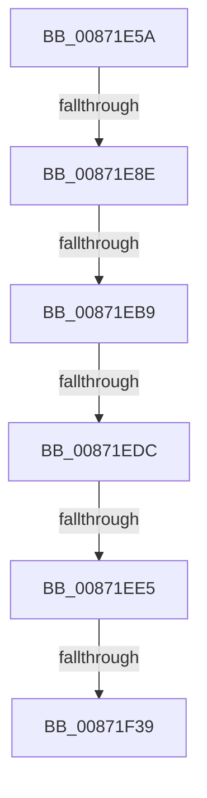

# sub_00871E5A

- RVA: `0x00871E5A`–`0x00871F5E` (길이 `260` bytes)
- VA: `0x0000000140871E5A`
- 실행 섹션: `PAGE`
- PDB 이름 있음: `아니요`; PDB Function 태그: `아니요`
- unwind 정보 RVA: `0x0006C510`
- 디코드: `57`개 명령, `260/260` bytes 표시
- 미해석 바이트: `0` (있으면 어셈블리에 `.byte`로 보존)

> 이 문서는 커널 이미지의 기계어와 PDB 기호를 분석해 생성했습니다. 4번과 5번은 함수 원형과 자료형을 바이너리 사용 방식에서 추정한 C 해석이며 원본 소스 복구 결과는 아닙니다.

## 1. Dependencies

- 직접 호출 지점: **3**; 고유 호출 대상: **3**
- 직접 호출자로 확인된 함수: **0**
- RIP 상대 이미지 참조: **2**

### Outgoing calls
- `0x00871EA0` → [PsReferencePrimaryTokenWithTag](../../text/20/PsReferencePrimaryTokenWithTag_function_0020FF80.md) (function, `0x0020FF80`)
- `0x00871EFA` → [SepPrivilegeCheck](../../text/40/SepPrivilegeCheck_function_0040B6B0.md) (function, `0x0040B6B0`)
- `0x00871F2C` → [RtlEqualSid](../../text/40/RtlEqualSid_function_00400AD0.md) (function, `0x00400AD0`)

### Direct callers
- 이 함수 시작 RVA로 연결되는 직접 call은 확인되지 않았습니다. 간접 호출은 완전히 역산할 수 없습니다.

### Static image references
- `0x00871EA5` → RVA `0x00FD8010` (`PAGEDATA`; read)
- `0x00871F22` → RVA `0x00E67D58` (`.data`; read)

## 2. Other-region calls and transfers

- 다른 실행 섹션으로 향하는 call: **3**
  - `0x00871EA0` → [PsReferencePrimaryTokenWithTag](../../text/20/PsReferencePrimaryTokenWithTag_function_0020FF80.md) (`PAGE` → `.text`)
  - `0x00871EFA` → [SepPrivilegeCheck](../../text/40/SepPrivilegeCheck_function_0040B6B0.md) (`PAGE` → `.text`)
  - `0x00871F2C` → [RtlEqualSid](../../text/40/RtlEqualSid_function_00400AD0.md) (`PAGE` → `.text`)
- call이 아닌 외부 분기/꼬리 이동: **6**
  - `0x00871E88` → [sub_00871FFC + 0x6A](Unknown_function_00871FFC.md) (`tail-transfer`)
  - `0x00871EB3` → [sub_008721FB](Unknown_function_008721FB.md) (`tail-transfer`)
  - `0x00871ED6` → [sub_008720DF + 0xAE](Unknown_function_008720DF.md) (`tail-transfer`)
  - `0x00871EDF` → [sub_00871FFC + 0xC3](Unknown_function_00871FFC.md) (`tail-transfer`)
  - `0x00871F33` → [sub_00871FFC](Unknown_function_00871FFC.md) (`tail-transfer`)
  - `0x00871F58` → [sub_008721A8](Unknown_function_008721A8.md) (`tail-transfer`)

## 3. Assembly (complete function range)

```asm
00871E5A  4D 89 63 20                     mov qword ptr [r11 + 0x20], r12
00871E5E  44 0F B6 E2                     movzx r12d, dl
00871E62  4D 89 6B E8                     mov qword ptr [r11 - 0x18], r13
00871E66  4D 89 73 E0                     mov qword ptr [r11 - 0x20], r14
00871E6A  4C 8B B7 B8 00 00 00            mov r14, qword ptr [rdi + 0xb8]
00871E71  4D 89 7B D8                     mov qword ptr [r11 - 0x28], r15
00871E75  49 8B 86 D0 01 00 00            mov rax, qword ptr [r14 + 0x1d0]
00871E7C  48 89 45 0F                     mov qword ptr [rbp + 0xf], rax
00871E80  8B 87 A0 05 00 00               mov eax, dword ptr [rdi + 0x5a0]
00871E86  A8 08                           test al, 8
00871E88  0F 85 D8 01 00 00               jne 0x140872066
00871E8E  45 33 FF                        xor r15d, r15d
00871E91  41 8B F7                        mov esi, r15d
00871E94  BA 53 65 53 75                  mov edx, 0x75536553
00871E99  48 89 75 F7                     mov qword ptr [rbp - 9], rsi
00871E9D  49 8B CE                        mov rcx, r14
00871EA0  E8 DB E0 99 FF                  call 0x14020ff80
00871EA5  83 3D 64 61 76 00 00            cmp dword ptr [rip + 0x766164], 0
00871EAC  48 8B F0                        mov rsi, rax
00871EAF  48 89 45 07                     mov qword ptr [rbp + 7], rax
00871EB3  0F 85 42 03 00 00               jne 0x1408721fb
00871EB9  48 8B 7D F7                     mov rdi, qword ptr [rbp - 9]
00871EBD  48 89 5D 1F                     mov qword ptr [rbp + 0x1f], rbx
00871EC1  41 BE 01 00 00 00               mov r14d, 1
00871EC7  44 89 75 17                     mov dword ptr [rbp + 0x17], r14d
00871ECB  44 89 75 1B                     mov dword ptr [rbp + 0x1b], r14d
00871ECF  44 89 7D 27                     mov dword ptr [rbp + 0x27], r15d
00871ED3  45 84 E4                        test r12b, r12b
00871ED6  0F 84 B1 02 00 00               je 0x14087218d
00871EDC  48 85 FF                        test rdi, rdi
00871EDF  0F 85 DA 01 00 00               jne 0x1408720bf
00871EE5  48 8B FE                        mov rdi, rsi
00871EE8  45 8B CE                        mov r9d, r14d
00871EEB  44 88 64 24 20                  mov byte ptr [rsp + 0x20], r12b
00871EF0  45 8B C6                        mov r8d, r14d
00871EF3  48 8D 55 1F                     lea rdx, [rbp + 0x1f]
00871EF7  48 8B CF                        mov rcx, rdi
00871EFA  E8 B1 97 B9 FF                  call 0x14040b6b0
00871EFF  48 8B 75 07                     mov rsi, qword ptr [rbp + 7]
00871F03  0F B6 D8                        movzx ebx, al
00871F06  48 8B 7D F7                     mov rdi, qword ptr [rbp - 9]
00871F0A  44 8B 75 17                     mov r14d, dword ptr [rbp + 0x17]
00871F0E  48 85 FF                        test rdi, rdi
00871F11  48 8B CE                        mov rcx, rsi
00871F14  48 0F 45 CF                     cmovne rcx, rdi
00871F18  48 8B 89 98 00 00 00            mov rcx, qword ptr [rcx + 0x98]
00871F1F  4C 8B 21                        mov r12, qword ptr [rcx]
00871F22  48 8B 0D 2F 5E 5F 00            mov rcx, qword ptr [rip + 0x5f5e2f]
00871F29  49 8B D4                        mov rdx, r12
00871F2C  E8 9F EB B8 FF                  call 0x140400ad0
00871F31  84 C0                           test al, al
00871F33  0F 84 C3 00 00 00               je 0x140871ffc
00871F39  83 3D D0 60 76 00 00            cmp dword ptr [rip + 0x7660d0], 0
00871F40  4C 8B B4 24 88 00 00 00         mov r14, qword ptr [rsp + 0x88]
00871F48  4C 8B AC 24 90 00 00 00         mov r13, qword ptr [rsp + 0x90]
00871F50  4C 8B A4 24 C8 00 00 00         mov r12, qword ptr [rsp + 0xc8]
00871F58  0F 85 4A 02 00 00               jne 0x1408721a8
```

## 4. C-style interpretation (structured pseudocode)

```c
__int64 __fastcall sub_00871E5A(__int64 a1, unsigned __int8 a2, __int64 a3, __int64 a4, __int64 a5, __int64 a6, __int64 a7, __int64 a8, __int64 a9, __int64 a10, __int64 a11, __int64 a12, __int64 a13, __int64 a14, __int64 a15, __int64 a16, __int64 a17, __int64 a18, __int64 a19, __int64 a20, __int64 a21, __int64 a22, __int64 a23, __int64 a24, __int64 a25)
{
    __int64 result;
    __int64 v_r15;
    unsigned __int8 v_stack_p20;

    *(unsigned __int64 *)(v_r11 + 32) = v_r12;
    *(unsigned __int64 *)(v_r11 - 24) = v_r13;
    *(unsigned __int64 *)(v_r11 - 32) = v_r14;
    *(unsigned __int64 *)(v_r11 - 40) = v_r15;
    *(unsigned __int64 *)(v_rbp + 15) = *(unsigned __int64 *)(*(unsigned __int64 *)(v_rdi + 184) + 464);
    v_r15 = 0;
    *(unsigned __int64 *)(v_rbp - 9) = 0;
    result = PsReferencePrimaryTokenWithTag(*(unsigned __int64 *)(v_rdi + 184), (unsigned int)(0x75536553ULL), a3, a4);
    *(unsigned __int64 *)(v_rbp + 7) = result;
    *(unsigned __int64 *)(v_rbp + 31) = v_rbx;
    *(unsigned int *)(v_rbp + 23) = 1;
    *(unsigned int *)(v_rbp + 27) = 1;
    *(unsigned int *)(v_rbp + 39) = 0;
    v_stack_p20 = a2;
    result = SepPrivilegeCheck(result, v_rbp + 31, 1, 1);
    a1 = *(unsigned __int64 *)(v_rbp + 7);
    if (*(unsigned __int64 *)(v_rbp - 9) != 0) { a1 = *(unsigned __int64 *)(v_rbp - 9); }
    result = RtlEqualSid(*(unsigned __int64 *)(v_rip + 6250031), *(unsigned __int64 *)(*(unsigned __int64 *)(a1 + 152)), 1, 1);
}
```

## 5. (Beta) C Style

```c
int64_t sub_00871E5A(int64_t Arg1, uint8_t Arg2, int64_t Arg3, int64_t Arg4, uint64_t Arg5, uint64_t Arg6, uint64_t Arg7, uint64_t Arg8, uint64_t Arg9, uint64_t Arg10, uint64_t Arg11, uint64_t Arg12, uint64_t Arg13, uint64_t Arg14, uint64_t Arg15, uint64_t Arg16, int64_t Arg17, int64_t Arg18, uint64_t Arg19, uint64_t Arg20, uint64_t Arg21, uint64_t Arg22, uint64_t Arg23, uint64_t Arg24, int64_t Arg25)
{
    int64_t result;
    int64_t local_r15;
    uint8_t v_stack_p20;

    *(uint64_t *)(local_r11 + 0x20) = local_r12;
    *(uint64_t *)(local_r11 - 0x18) = local_r13;
    *(uint64_t *)(local_r11 - 0x20) = local_r14;
    *(uint64_t *)(local_r11 - 0x28) = local_r15;
    *(uint64_t *)(local_rbp + 0xF) = *(uint64_t *)(*(uint64_t *)(local_rdi + 0xB8) + 0x1D0);
    local_r15 = 0;
    *(uint64_t *)(local_rbp - 0x9) = 0;
    result = PsReferencePrimaryTokenWithTag(*(uint64_t *)(local_rdi + 0xB8), (uint32_t)(0x75536553ULL), Arg3, Arg4);
    *(uint64_t *)(local_rbp + 0x7) = result;
    *(uint64_t *)(local_rbp + 0x1F) = local_rbx;
    *(uint32_t *)(local_rbp + 0x17) = 1;
    *(uint32_t *)(local_rbp + 0x1B) = 1;
    *(uint32_t *)(local_rbp + 0x27) = 0;
    v_stack_p20 = Arg2;
    result = SepPrivilegeCheck(result, local_rbp + 31, 1, 1);
    Arg1 = *(uint64_t *)(local_rbp + 0x7);
    if (*(uint64_t *)(local_rbp - 0x9) != 0) { Arg1 = *(uint64_t *)(local_rbp - 0x9); }
    result = RtlEqualSid(*(uint64_t *)(v_rip + 0x5F5E2F), *(uint64_t *)(*(uint64_t *)(Arg1 + 0x98)), 1, 1);
}
```

## 6. Execution-region graph

[열기: 2D/3D 그래프와 함수 탐색 컨트롤 패널](../../../control-panel.html?section=page&rva=0x00871E5A&view=graph)

- 2D 그래프는 위에서 아래로 흐르고, 3D 그래프는 빈 공간을 드래그해 회전합니다. Shift+드래그는 이동, 휠은 확대·축소, 함수 노드 선택은 대상 보고서 이동입니다.

### Static fallback


