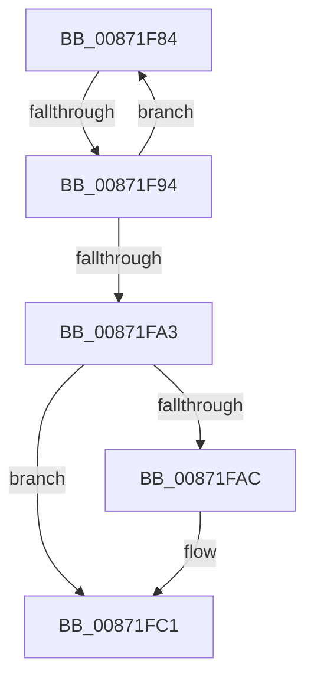

# sub_00871F84

- RVA: `0x00871F84`–`0x00871FE2` (길이 `94` bytes)
- VA: `0x0000000140871F84`
- 실행 섹션: `PAGE`
- PDB 이름 있음: `아니요`; PDB Function 태그: `아니요`
- unwind 정보 RVA: `0x0006C544`
- 디코드: `20`개 명령, `94/94` bytes 표시
- 미해석 바이트: `0` (있으면 어셈블리에 `.byte`로 보존)

> 이 문서는 커널 이미지의 기계어와 PDB 기호를 분석해 생성했습니다. 4번과 5번은 함수 원형과 자료형을 바이너리 사용 방식에서 추정한 C 해석이며 원본 소스 복구 결과는 아닙니다.

## 1. Dependencies

- 직접 호출 지점: **1**; 고유 호출 대상: **1**
- 직접 호출자로 확인된 함수: **0**
- RIP 상대 이미지 참조: **1**

### Outgoing calls
- `0x00871FBC` → [ObpPushStackInfo](../../text/21/ObpPushStackInfo_function_002109E4.md) (function, `0x002109E4`)

### Direct callers
- 이 함수 시작 RVA로 연결되는 직접 call은 확인되지 않았습니다. 간접 호출은 완전히 역산할 수 없습니다.

### Static image references
- `0x00871FA3` → RVA `0x00FC5010` (`ALMOSTRO`; read)

## 2. Other-region calls and transfers

- 다른 실행 섹션으로 향하는 call: **1**
  - `0x00871FBC` → [ObpPushStackInfo](../../text/21/ObpPushStackInfo_function_002109E4.md) (`PAGE` → `.text`)
- call이 아닌 외부 분기/꼬리 이동: **2**
  - `0x00871F8E` → [sub_00872196](Unknown_function_00872196.md) (`tail-transfer`)
  - `0x00871FDC` → [sub_008720D0](Unknown_function_008720D0.md) (`tail-transfer`)

## 3. Assembly (complete function range)

```asm
00871F84  48 8B C8                        mov rcx, rax
00871F87  48 33 CE                        xor rcx, rsi
00871F8A  48 83 F9 0F                     cmp rcx, 0xf
00871F8E  0F 83 02 02 00 00               jae 0x140872196
00871F94  48 8D 48 01                     lea rcx, [rax + 1]
00871F98  F0 48 0F B1 8A 48 02 00 00      lock cmpxchg qword ptr [rdx + 0x248], rcx
00871FA1  75 E1                           jne 0x140871f84
00871FA3  83 3D 66 30 75 00 00            cmp dword ptr [rip + 0x753066], 0
00871FAA  74 15                           je 0x140871fc1
00871FAC  33 D2                           xor edx, edx
00871FAE  48 8D 4E D0                     lea rcx, [rsi - 0x30]
00871FB2  41 B9 53 65 53 75               mov r9d, 0x75536553
00871FB8  44 8D 42 01                     lea r8d, [rdx + 1]
00871FBC  E8 23 EA 99 FF                  call 0x1402109e4
00871FC1  48 8B 4D F7                     mov rcx, qword ptr [rbp - 9]
00871FC5  48 8B B4 24 B8 00 00 00         mov rsi, qword ptr [rsp + 0xb8]
00871FCD  4C 89 7D 07                     mov qword ptr [rbp + 7], r15
00871FD1  4C 8B BC 24 80 00 00 00         mov r15, qword ptr [rsp + 0x80]
00871FD9  48 85 C9                        test rcx, rcx
00871FDC  0F 85 EE 00 00 00               jne 0x1408720d0
```

## 4. C-style interpretation (structured pseudocode)

```c
__int64 __fastcall sub_00871F84(__int64 a1, __int64 a2, __int64 a3, __int64 a4, __int64 a5, __int64 a6, __int64 a7, __int64 a8, __int64 a9, __int64 a10, __int64 a11, __int64 a12, __int64 a13, __int64 a14, __int64 a15, __int64 a16, __int64 a17, __int64 a18, __int64 a19, __int64 a20, __int64 a21, __int64 a22, __int64 a23)
{
    __int64 result;

    a1 = (result) ^ (v_rsi);
    if (a1 != 15) goto loc_00871F84;
    if ((*(unsigned int *)(v_rip + 7680102)) != 0) {
        a2 = 0;
        a1 = v_rsi - 48;
        a4 = 0x75536553ULL;
        a3 = a2 + 1;
        result = ObpPushStackInfo(a1, a2, a3, a4);
    }
    *(unsigned __int64 *)(v_rbp + 7) = v_r15;
}
```

## 5. (Beta) C Style

```c
int64_t sub_00871F84(int64_t Arg1, void *Arg2, int64_t Arg3, int64_t Arg4, uint64_t Arg5, uint64_t Arg6, uint64_t Arg7, uint64_t Arg8, uint64_t Arg9, uint64_t Arg10, uint64_t Arg11, uint64_t Arg12, uint64_t Arg13, uint64_t Arg14, uint64_t Arg15, int64_t Arg16, uint64_t Arg17, uint64_t Arg18, uint64_t Arg19, uint64_t Arg20, uint64_t Arg21, uint64_t Arg22, int64_t Arg23)
{
    uint8_t *arg2 = (uint8_t *)Arg2;

    int64_t result;

    Arg1 = (result) ^ (local_rsi);
    if (Arg1 != 15) goto loc_00871F84;
    if ((*(uint32_t *)(v_rip + 0x753066)) != 0) {
        Arg2 = 0;
        Arg1 = local_rsi - 48;
        Arg4 = 0x75536553ULL;
        Arg3 = Arg2 + 1;
        result = ObpPushStackInfo(Arg1, Arg2, Arg3, Arg4);
    }
    *(uint64_t *)(local_rbp + 0x7) = local_r15;
}
```

### 관측된 메모리 오프셋

구조체 형식이 확인되지 않은 접근은 인자 기준의 오프셋으로만 기록했습니다.

| 기준 인자 | 오프셋 표현 | 폭 (bit) | 접근 |
|---|---:|---:|---|
| `Arg2` | `+ 0x248` | `64` | `R` |

## 6. Execution-region graph

[열기: 2D/3D 그래프와 함수 탐색 컨트롤 패널](../../../control-panel.html?section=page&rva=0x00871F84&view=graph)

- 2D 그래프는 위에서 아래로 흐르고, 3D 그래프는 빈 공간을 드래그해 회전합니다. Shift+드래그는 이동, 휠은 확대·축소, 함수 노드 선택은 대상 보고서 이동입니다.

### Static fallback


