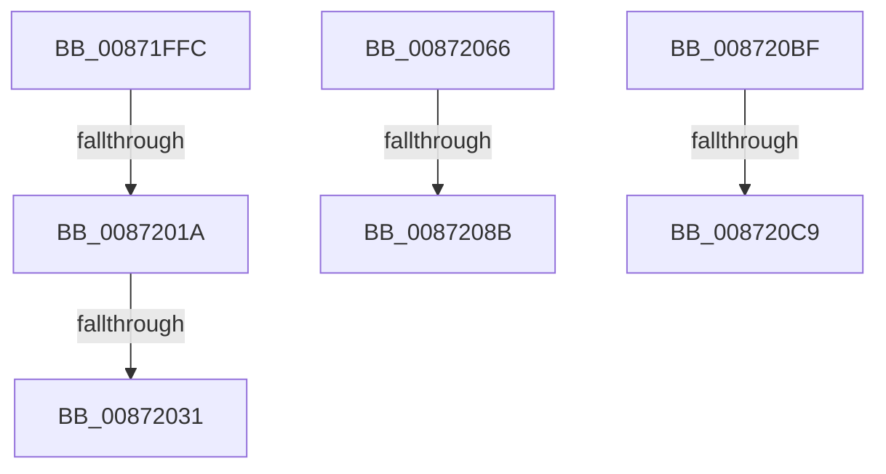

# sub_00871FFC

- RVA: `0x00871FFC`–`0x008720D0` (길이 `212` bytes)
- VA: `0x0000000140871FFC`
- 실행 섹션: `PAGE`
- PDB 이름 있음: `아니요`; PDB Function 태그: `아니요`
- unwind 정보 RVA: `0x0006C56C`
- 디코드: `47`개 명령, `212/212` bytes 표시
- 미해석 바이트: `0` (있으면 어셈블리에 `.byte`로 보존)

> 이 문서는 커널 이미지의 기계어와 PDB 기호를 분석해 생성했습니다. 4번과 5번은 함수 원형과 자료형을 바이너리 사용 방식에서 추정한 C 해석이며 원본 소스 복구 결과는 아닙니다.

## 1. Dependencies

- 직접 호출 지점: **6**; 고유 호출 대상: **5**
- 직접 호출자로 확인된 함수: **0**
- RIP 상대 이미지 참조: **2**

### Outgoing calls
- `0x0087200D` → [RtlEqualSid](../../text/40/RtlEqualSid_function_00400AD0.md) (function, `0x00400AD0`)
- `0x00872024` → [RtlEqualSid](../../text/40/RtlEqualSid_function_00400AD0.md) (function, `0x00400AD0`)
- `0x00872054` → [SepAdtPrivilegedServiceAuditAlarm](SepAdtPrivilegedServiceAuditAlarm_function_008714F0.md) (function, `0x008714F0`)
- `0x00872075` → [PspLockThreadSecurityShared](../../text/3C/PspLockThreadSecurityShared_function_003C4720.md) (function, `0x003C4720`)
- `0x0087209E` → [ObfReferenceObjectWithTag](../../text/21/ObfReferenceObjectWithTag_function_00210710.md) (function, `0x00210710`)
- `0x008720B5` → [PspUnlockThreadSecurityShared](../../text/3C/PspUnlockThreadSecurityShared_function_003C2E40.md) (function, `0x003C2E40`)

### Direct callers
- 이 함수 시작 RVA로 연결되는 직접 call은 확인되지 않았습니다. 간접 호출은 완전히 역산할 수 없습니다.

### Static image references
- `0x00871FFC` → RVA `0x00FD9AA0` (`PAGEDATA`; read)
- `0x0087203E` → RVA `0x000013A8` (`.rdata`; read)

## 2. Other-region calls and transfers

- 다른 실행 섹션으로 향하는 call: **5**
  - `0x0087200D` → [RtlEqualSid](../../text/40/RtlEqualSid_function_00400AD0.md) (`PAGE` → `.text`)
  - `0x00872024` → [RtlEqualSid](../../text/40/RtlEqualSid_function_00400AD0.md) (`PAGE` → `.text`)
  - `0x00872075` → [PspLockThreadSecurityShared](../../text/3C/PspLockThreadSecurityShared_function_003C4720.md) (`PAGE` → `.text`)
  - `0x0087209E` → [ObfReferenceObjectWithTag](../../text/21/ObfReferenceObjectWithTag_function_00210710.md) (`PAGE` → `.text`)
  - `0x008720B5` → [PspUnlockThreadSecurityShared](../../text/3C/PspUnlockThreadSecurityShared_function_003C2E40.md) (`PAGE` → `.text`)
- call이 아닌 외부 분기/꼬리 이동: **7**
  - `0x00872014` → [sub_008720DF](Unknown_function_008720DF.md) (`tail-transfer`)
  - `0x0087202B` → [sub_008720DF](Unknown_function_008720DF.md) (`tail-transfer`)
  - `0x00872061` → [sub_00871E5A + 0xDF](Unknown_function_00871E5A.md) (`tail-transfer`)
  - `0x00872085` → [sub_008720DF + 0xA6](Unknown_function_008720DF.md) (`tail-transfer`)
  - `0x008720BA` → [sub_00871E5A + 0x3A](Unknown_function_00871E5A.md) (`tail-transfer`)
  - `0x008720C3` → [sub_00871E5A + 0x8E](Unknown_function_00871E5A.md) (`tail-transfer`)
  - `0x008720CB` → [sub_00871E5A + 0xB4](Unknown_function_00871E5A.md) (`tail-transfer`)

## 3. Assembly (complete function range)

```asm
00871FFC  4C 8B 2D 9D 7A 76 00            mov r13, qword ptr [rip + 0x767a9d]
00872003  49 8B D4                        mov rdx, r12
00872006  49 8B 8D 88 01 00 00            mov rcx, qword ptr [r13 + 0x188]
0087200D  E8 BE EA B8 FF                  call 0x140400ad0
00872012  84 C0                           test al, al
00872014  0F 85 C5 00 00 00               jne 0x1408720df
0087201A  49 8B 8D 80 01 00 00            mov rcx, qword ptr [r13 + 0x180]
00872021  49 8B D4                        mov rdx, r12
00872024  E8 A7 EA B8 FF                  call 0x140400ad0
00872029  84 C0                           test al, al
0087202B  0F 85 AE 00 00 00               jne 0x1408720df
00872031  48 8D 45 17                     lea rax, [rbp + 0x17]
00872035  88 5C 24 30                     mov byte ptr [rsp + 0x30], bl
00872039  48 89 44 24 28                  mov qword ptr [rsp + 0x28], rax
0087203E  48 8D 15 63 F3 78 FF            lea rdx, [rip - 0x870c9d]
00872045  4C 8B CF                        mov r9, rdi
00872048  48 89 74 24 20                  mov qword ptr [rsp + 0x20], rsi
0087204D  45 33 C0                        xor r8d, r8d
00872050  48 8D 4D F7                     lea rcx, [rbp - 9]
00872054  E8 97 F4 FF FF                  call 0x1408714f0
00872059  48 8B 75 07                     mov rsi, qword ptr [rbp + 7]
0087205D  48 8B 7D F7                     mov rdi, qword ptr [rbp - 9]
00872061  E9 D3 FE FF FF                  jmp 0x140871f39
00872066  65 4C 8B 2C 25 88 01 00 00      mov r13, qword ptr gs:[0x188]
0087206F  48 8B CF                        mov rcx, rdi
00872072  49 8B D5                        mov rdx, r13
00872075  E8 A6 26 B5 FF                  call 0x1403c4720
0087207A  8B 87 A0 05 00 00               mov eax, dword ptr [rdi + 0x5a0]
00872080  45 33 FF                        xor r15d, r15d
00872083  A8 08                           test al, 8
00872085  0F 84 FA 00 00 00               je 0x140872185
0087208B  48 8B B7 38 05 00 00            mov rsi, qword ptr [rdi + 0x538]
00872092  BA 53 65 53 75                  mov edx, 0x75536553
00872097  48 83 E6 F8                     and rsi, 0xfffffffffffffff8
0087209B  48 8B CE                        mov rcx, rsi
0087209E  E8 6D E6 99 FF                  call 0x140210710
008720A3  8B 87 38 05 00 00               mov eax, dword ptr [rdi + 0x538]
008720A9  83 E0 03                        and eax, 3
008720AC  89 45 FF                        mov dword ptr [rbp - 1], eax
008720AF  49 8B D5                        mov rdx, r13
008720B2  48 8B CF                        mov rcx, rdi
008720B5  E8 86 0D B5 FF                  call 0x1403c2e40
008720BA  E9 D5 FD FF FF                  jmp 0x140871e94
008720BF  83 7D FF 02                     cmp dword ptr [rbp - 1], 2
008720C3  0F 8D 1F FE FF FF               jge 0x140871ee8
008720C9  32 DB                           xor bl, bl
008720CB  E9 3E FE FF FF                  jmp 0x140871f0e
```

## 4. C-style interpretation (structured pseudocode)

```c
__int64 __fastcall sub_00871FFC(__int64 a1, __int64 a2, int a3)
{
    __int64 result;
    unsigned __int64 v_stack_p20;
    unsigned __int64 v_stack_p28;
    unsigned __int8 v_stack_p30;

    result = RtlEqualSid(*(unsigned __int64 *)(*(unsigned __int64 *)(v_rip + 7764637) + 392), v_r12, a3, a4);
    result = RtlEqualSid(*(unsigned __int64 *)(*(unsigned __int64 *)(v_rip + 7764637) + 384), v_r12, a3, a4);
    v_stack_p30 = (unsigned __int8)(v_rbx);
    v_stack_p28 = v_rbp + 23;
    v_stack_p20 = v_rsi;
    a3 = 0;
    result = SepAdtPrivilegedServiceAuditAlarm(v_rbp - 9, v_rip - 8850589, a3, v_rdi);
}
```

## 5. (Beta) C Style

```c
int64_t sub_00871FFC(int64_t Arg1, int64_t Arg2, int32_t Arg3)
{
    int64_t result;
    uint64_t v_stack_p20;
    uint64_t v_stack_p28;
    uint8_t v_stack_p30;

    result = RtlEqualSid(*(uint64_t *)(*(uint64_t *)(v_rip + 0x767A9D) + 0x188), local_r12, Arg3, a4);
    result = RtlEqualSid(*(uint64_t *)(*(uint64_t *)(v_rip + 0x767A9D) + 0x180), local_r12, Arg3, a4);
    v_stack_p30 = (uint8_t)(local_rbx);
    v_stack_p28 = local_rbp + 23;
    v_stack_p20 = local_rsi;
    Arg3 = 0;
    result = SepAdtPrivilegedServiceAuditAlarm(local_rbp - 9, v_rip - 8850589, Arg3, local_rdi);
}
```

## 6. Execution-region graph

[열기: 2D/3D 그래프와 함수 탐색 컨트롤 패널](../../../control-panel.html?section=page&rva=0x00871FFC&view=graph)

- 2D 그래프는 위에서 아래로 흐르고, 3D 그래프는 빈 공간을 드래그해 회전합니다. Shift+드래그는 이동, 휠은 확대·축소, 함수 노드 선택은 대상 보고서 이동입니다.

### Static fallback


