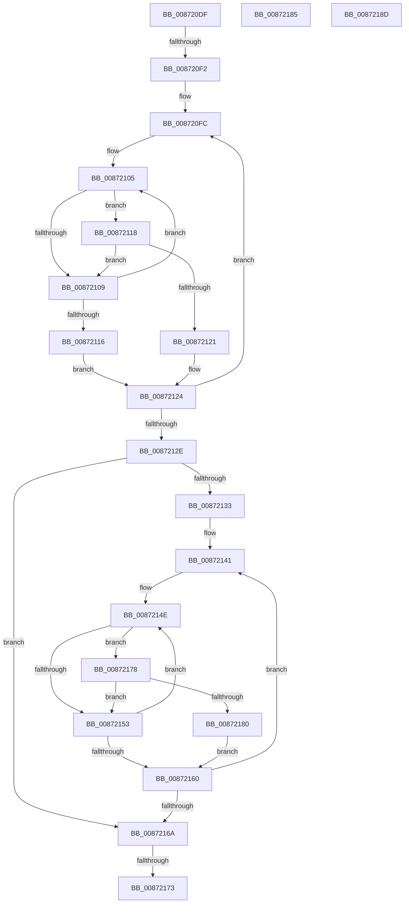

# sub_008720DF

- RVA: `0x008720DF`–`0x00872196` (길이 `183` bytes)
- VA: `0x00000001408720DF`
- 실행 섹션: `PAGE`
- PDB 이름 있음: `아니요`; PDB Function 태그: `아니요`
- unwind 정보 RVA: `0x0006C5A4`
- 디코드: `53`개 명령, `183/183` bytes 표시
- 미해석 바이트: `0` (있으면 어셈블리에 `.byte`로 보존)

> 이 문서는 커널 이미지의 기계어와 PDB 기호를 분석해 생성했습니다. 4번과 5번은 함수 원형과 자료형을 바이너리 사용 방식에서 추정한 C 해석이며 원본 소스 복구 결과는 아닙니다.

## 1. Dependencies

- 직접 호출 지점: **0**; 고유 호출 대상: **0**
- 직접 호출자로 확인된 함수: **0**
- RIP 상대 이미지 참조: **2**

### Outgoing calls
- 직접 디코드된 call 명령이 없습니다.

### Direct callers
- 이 함수 시작 RVA로 연결되는 직접 call은 확인되지 않았습니다. 간접 호출은 완전히 역산할 수 없습니다.

### Static image references
- `0x008720DF` → RVA `0x00FD8238` (`PAGEDATA`; read)
- `0x0087213A` → RVA `0x00B4BE28` (`SepServicesFilterPrivileges`; read)

## 2. Other-region calls and transfers

- 다른 실행 섹션으로 향하는 call: **0**
- call이 아닌 외부 분기/꼬리 이동: **5**
  - `0x008720EC` → [sub_00871E5A + 0xDF](Unknown_function_00871E5A.md) (`tail-transfer`)
  - `0x0087216D` → [sub_00871E5A + 0xDF](Unknown_function_00871E5A.md) (`tail-transfer`)
  - `0x00872173` → [sub_00871FFC + 0x35](Unknown_function_00871FFC.md) (`tail-transfer`)
  - `0x00872188` → [sub_00871FFC + 0xB3](Unknown_function_00871FFC.md) (`tail-transfer`)
  - `0x00872191` → [sub_00871E5A + 0xDF](Unknown_function_00871E5A.md) (`tail-transfer`)

## 3. Assembly (complete function range)

```asm
008720DF  4C 8B 1D 52 61 76 00            mov r11, qword ptr [rip + 0x766152]
008720E6  45 8B D7                        mov r10d, r15d
008720E9  45 85 F6                        test r14d, r14d
008720EC  0F 84 47 FE FF FF               je 0x140871f39
008720F2  4D 8B 23                        mov r12, qword ptr [r11]
008720F5  4C 8D 45 1F                     lea r8, [rbp + 0x1f]
008720F9  45 8B CE                        mov r9d, r14d
008720FC  41 8B 10                        mov edx, dword ptr [r8]
008720FF  49 8B CB                        mov rcx, r11
00872102  49 8B C4                        mov rax, r12
00872105  3B 10                           cmp edx, dword ptr [rax]
00872107  74 0F                           je 0x140872118
00872109  48 8B 41 08                     mov rax, qword ptr [rcx + 8]
0087210D  48 83 C1 08                     add rcx, 8
00872111  48 85 C0                        test rax, rax
00872114  75 EF                           jne 0x140872105
00872116  EB 0C                           jmp 0x140872124
00872118  8B 40 04                        mov eax, dword ptr [rax + 4]
0087211B  41 39 40 04                     cmp dword ptr [r8 + 4], eax
0087211F  75 E8                           jne 0x140872109
00872121  41 FF C2                        inc r10d
00872124  49 83 C0 0C                     add r8, 0xc
00872128  49 83 E9 01                     sub r9, 1
0087212C  75 CE                           jne 0x1408720fc
0087212E  45 85 F6                        test r14d, r14d
00872131  74 37                           je 0x14087216a
00872133  48 8D 4D 1F                     lea rcx, [rbp + 0x1f]
00872137  45 8B C6                        mov r8d, r14d
0087213A  4C 8D 1D E7 9C 2D 00            lea r11, [rip + 0x2d9ce7]
00872141  44 8B 09                        mov r9d, dword ptr [rcx]
00872144  49 8B D3                        mov rdx, r11
00872147  48 8B 05 DA 9C 2D 00            mov rax, qword ptr [rip + 0x2d9cda]
0087214E  44 3B 08                        cmp r9d, dword ptr [rax]
00872151  74 25                           je 0x140872178
00872153  48 8B 42 08                     mov rax, qword ptr [rdx + 8]
00872157  48 83 C2 08                     add rdx, 8
0087215B  48 85 C0                        test rax, rax
0087215E  75 EE                           jne 0x14087214e
00872160  48 83 C1 0C                     add rcx, 0xc
00872164  49 83 E8 01                     sub r8, 1
00872168  75 D7                           jne 0x140872141
0087216A  45 3B D6                        cmp r10d, r14d
0087216D  0F 84 C6 FD FF FF               je 0x140871f39
00872173  E9 B9 FE FF FF                  jmp 0x140872031
00872178  8B 40 04                        mov eax, dword ptr [rax + 4]
0087217B  39 41 04                        cmp dword ptr [rcx + 4], eax
0087217E  75 D3                           jne 0x140872153
00872180  41 FF C2                        inc r10d
00872183  EB DB                           jmp 0x140872160
00872185  49 8B F7                        mov rsi, r15
00872188  E9 22 FF FF FF                  jmp 0x1408720af
0087218D  41 0F B6 DE                     movzx ebx, r14b
00872191  E9 A3 FD FF FF                  jmp 0x140871f39
```

## 4. C-style interpretation (structured pseudocode)

```c
__int64 __fastcall sub_008720DF(void)
{
    __int64 v_r10;

loc_008720FC:
loc_00872105:
    if (((unsigned int)((unsigned int)(*(unsigned int *)(v_rbp + 31)))) == (*(unsigned int *)(*(unsigned __int64 *)(*(unsigned __int64 *)(v_rip + 7758162))))) goto loc_00872118;
loc_00872109:
    a1 = (*(unsigned __int64 *)(v_rip + 7758162)) + (8);
    if (*(unsigned __int64 *)(*(unsigned __int64 *)(v_rip + 7758162) + 8) != 0) goto loc_00872105;
    goto loc_00872124;
loc_00872118:
    if ((*(unsigned int *)(v_rbp + 31 + 4)) != ((unsigned int)((unsigned int)(*(unsigned int *)(*(unsigned __int64 *)(*(unsigned __int64 *)(v_rip + 7758162) + 8) + 4))))) goto loc_00872109;
    v_r10 = (unsigned int)(((unsigned int)((unsigned int)(v_r15))) + 1);
loc_00872124:
    a3 = (v_rbp + 31) + (12);
    a4 = ((unsigned int)((unsigned int)(v_r14))) - (1);
    if (condition_is_not_equal) goto loc_008720FC;
    if ((unsigned int)(v_r14) == 0) goto loc_0087216A;
loc_00872141:
loc_0087214E:
    if (((unsigned int)((unsigned int)(*(unsigned int *)(v_rbp + 31)))) == (*(unsigned int *)(*(unsigned __int64 *)(v_rip + 2989274)))) goto loc_00872178;
loc_00872153:
    a2 = (v_rip + 2989287) + (8);
    if (*(unsigned __int64 *)(v_rip + 2989287 + 8) != 0) goto loc_0087214E;
loc_00872160:
    a1 = (v_rbp + 31) + (12);
    a3 = ((unsigned int)((unsigned int)(v_r14))) - (1);
    if (condition_is_not_equal) goto loc_00872141;
loc_0087216A:
loc_00872178:
    if ((*(unsigned int *)(a1 + 4)) != ((unsigned int)((unsigned int)(*(unsigned int *)(*(unsigned __int64 *)(v_rip + 2989287 + 8) + 4))))) goto loc_00872153;
    v_r10 = (unsigned int)((v_r10) + 1);
    goto loc_00872160;
}
```

## 5. (Beta) C Style

```c
void sub_008720DF(void)
{
    int64_t local_r10;

loc_008720FC:
loc_00872105:
    if (((uint32_t)((uint32_t)(*(uint32_t *)(local_rbp + 0x1F)))) == (*(uint32_t *)(*(uint64_t *)(*(uint64_t *)(v_rip + 0x766152))))) goto loc_00872118;
loc_00872109:
    a1 = (*(uint64_t *)(v_rip + 0x766152)) + (8);
    if (*(uint64_t *)(*(uint64_t *)(v_rip + 0x766152) + 0x8) != 0) goto loc_00872105;
    goto loc_00872124;
loc_00872118:
    if ((*(uint32_t *)(local_rbp + 0x1F + 0x4)) != ((uint32_t)((uint32_t)(*(uint32_t *)(*(uint64_t *)(*(uint64_t *)(v_rip + 0x766152) + 0x8) + 0x4))))) goto loc_00872109;
    local_r10 = (uint32_t)(((uint32_t)((uint32_t)(local_r15))) + 1);
loc_00872124:
    a3 = (local_rbp + 31) + (12);
    a4 = ((uint32_t)((uint32_t)(local_r14))) - (1);
    if (condition_is_not_equal) goto loc_008720FC;
    if ((uint32_t)(local_r14) == 0) goto loc_0087216A;
loc_00872141:
loc_0087214E:
    if (((uint32_t)((uint32_t)(*(uint32_t *)(local_rbp + 0x1F)))) == (*(uint32_t *)(*(uint64_t *)(v_rip + 0x2D9CDA)))) goto loc_00872178;
loc_00872153:
    a2 = (v_rip + 2989287) + (8);
    if (*(uint64_t *)(v_rip + 0x2D9CE7 + 0x8) != 0) goto loc_0087214E;
loc_00872160:
    a1 = (local_rbp + 31) + (12);
    a3 = ((uint32_t)((uint32_t)(local_r14))) - (1);
    if (condition_is_not_equal) goto loc_00872141;
loc_0087216A:
loc_00872178:
    if ((*(uint32_t *)(a1 + 0x4)) != ((uint32_t)((uint32_t)(*(uint32_t *)(*(uint64_t *)(v_rip + 0x2D9CE7 + 0x8) + 0x4))))) goto loc_00872153;
    local_r10 = (uint32_t)((local_r10) + 1);
    goto loc_00872160;
}
```

## 6. Execution-region graph

[열기: 2D/3D 그래프와 함수 탐색 컨트롤 패널](../../../control-panel.html?section=page&rva=0x008720DF&view=graph)

- 2D 그래프는 위에서 아래로 흐르고, 3D 그래프는 빈 공간을 드래그해 회전합니다. Shift+드래그는 이동, 휠은 확대·축소, 함수 노드 선택은 대상 보고서 이동입니다.

### Static fallback


