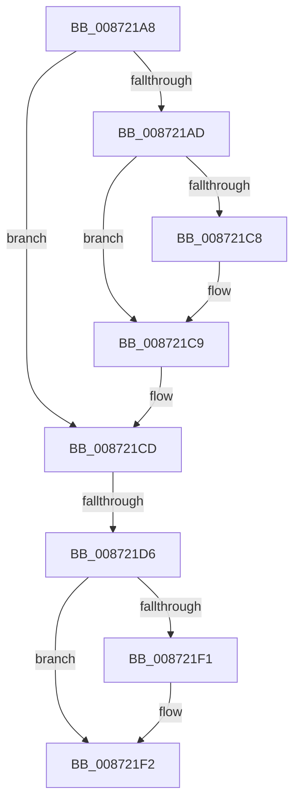

# sub_008721A8

- RVA: `0x008721A8`–`0x008721FB` (길이 `83` bytes)
- VA: `0x00000001408721A8`
- 실행 섹션: `PAGE`
- PDB 이름 있음: `아니요`; PDB Function 태그: `아니요`
- unwind 정보 RVA: `0x0006C5E4`
- 디코드: `19`개 명령, `83/83` bytes 표시
- 미해석 바이트: `0` (있으면 어셈블리에 `.byte`로 보존)

> 이 문서는 커널 이미지의 기계어와 PDB 기호를 분석해 생성했습니다. 4번과 5번은 함수 원형과 자료형을 바이너리 사용 방식에서 추정한 C 해석이며 원본 소스 복구 결과는 아닙니다.

## 1. Dependencies

- 직접 호출 지점: **0**; 고유 호출 대상: **0**
- 직접 호출자로 확인된 함수: **0**
- RIP 상대 이미지 참조: **1**

### Outgoing calls
- 직접 디코드된 call 명령이 없습니다.

### Direct callers
- 이 함수 시작 RVA로 연결되는 직접 call은 확인되지 않았습니다. 간접 호출은 완전히 역산할 수 없습니다.

### Static image references
- `0x008721BF` → RVA `0x00E67B90` (`.data`; read)

## 2. Other-region calls and transfers

- 다른 실행 섹션으로 향하는 call: **0**
- call이 아닌 외부 분기/꼬리 이동: **2**
  - `0x008721D0` → [sub_00871F5E](Unknown_function_00871F5E.md) (`tail-transfer`)
  - `0x008721F6` → [sub_00871F5E](Unknown_function_00871F5E.md) (`tail-transfer`)

## 3. Assembly (complete function range)

```asm
008721A8  48 85 F6                        test rsi, rsi
008721AB  74 20                           je 0x1408721cd
008721AD  48 8B 86 78 04 00 00            mov rax, qword ptr [rsi + 0x478]
008721B4  F0 FF 88 1C 01 00 00            lock dec dword ptr [rax + 0x11c]
008721BB  48 8B 75 07                     mov rsi, qword ptr [rbp + 7]
008721BF  48 3B 35 CA 59 5F 00            cmp rsi, qword ptr [rip + 0x5f59ca]
008721C6  75 01                           jne 0x1408721c9
008721C8  CC                              int3
008721C9  48 8B 7D F7                     mov rdi, qword ptr [rbp - 9]
008721CD  48 85 FF                        test rdi, rdi
008721D0  0F 84 88 FD FF FF               je 0x140871f5e
008721D6  48 8B 87 78 04 00 00            mov rax, qword ptr [rdi + 0x478]
008721DD  F0 FF 88 1C 01 00 00            lock dec dword ptr [rax + 0x11c]
008721E4  48 8B 05 A5 59 5F 00            mov rax, qword ptr [rip + 0x5f59a5]
008721EB  48 39 45 F7                     cmp qword ptr [rbp - 9], rax
008721EF  75 01                           jne 0x1408721f2
008721F1  CC                              int3
008721F2  48 8B 75 07                     mov rsi, qword ptr [rbp + 7]
008721F6  E9 63 FD FF FF                  jmp 0x140871f5e
```

## 4. C-style interpretation (structured pseudocode)

```c
__int64 __fastcall sub_008721A8(void)
{
    if (v_rsi == 0) goto loc_008721CD;
    if ((*(unsigned __int64 *)(v_rbp + 7)) == (*(unsigned __int64 *)(v_rip + 6248906))) {
    }
loc_008721CD:
    if ((*(unsigned __int64 *)(v_rbp - 9)) == (*(unsigned __int64 *)(v_rip + 6248869))) {
    }
}
```

## 5. (Beta) C Style

```c
void sub_008721A8(void)
{
    if (local_rsi == 0) goto loc_008721CD;
    if ((*(uint64_t *)(local_rbp + 0x7)) == (*(uint64_t *)(v_rip + 0x5F59CA))) {
    }
loc_008721CD:
    if ((*(uint64_t *)(local_rbp - 0x9)) == (*(uint64_t *)(v_rip + 0x5F59A5))) {
    }
}
```

## 6. Execution-region graph

[열기: 2D/3D 그래프와 함수 탐색 컨트롤 패널](../../../control-panel.html?section=page&rva=0x008721A8&view=graph)

- 2D 그래프는 위에서 아래로 흐르고, 3D 그래프는 빈 공간을 드래그해 회전합니다. Shift+드래그는 이동, 휠은 확대·축소, 함수 노드 선택은 대상 보고서 이동입니다.

### Static fallback


