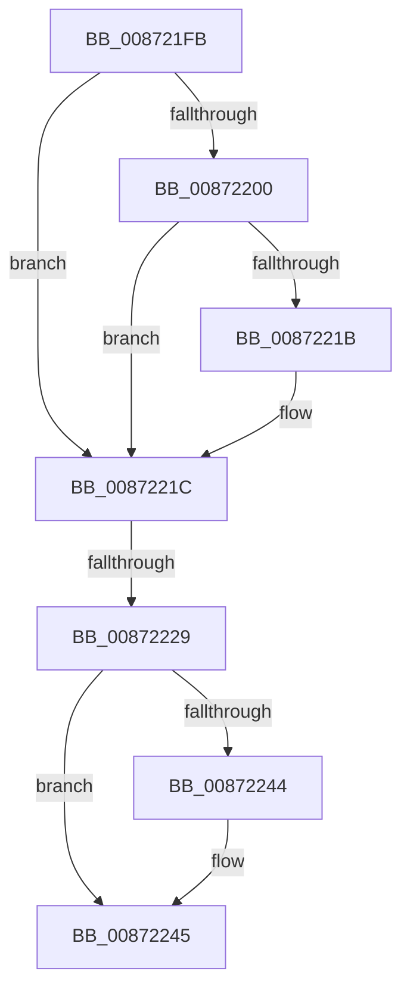

# sub_008721FB

- RVA: `0x008721FB`–`0x0087224E` (길이 `83` bytes)
- VA: `0x00000001408721FB`
- 실행 섹션: `PAGE`
- PDB 이름 있음: `아니요`; PDB Function 태그: `아니요`
- unwind 정보 RVA: `0x0006C600`
- 디코드: `19`개 명령, `83/83` bytes 표시
- 미해석 바이트: `0` (있으면 어셈블리에 `.byte`로 보존)

> 이 문서는 커널 이미지의 기계어와 PDB 기호를 분석해 생성했습니다. 4번과 5번은 함수 원형과 자료형을 바이너리 사용 방식에서 추정한 C 해석이며 원본 소스 복구 결과는 아닙니다.

## 1. Dependencies

- 직접 호출 지점: **0**; 고유 호출 대상: **0**
- 직접 호출자로 확인된 함수: **0**
- RIP 상대 이미지 참조: **1**

### Outgoing calls
- 직접 디코드된 call 명령이 없습니다.

### Direct callers
- 이 함수 시작 RVA로 연결되는 직접 call은 확인되지 않았습니다. 간접 호출은 완전히 역산할 수 없습니다.

### Static image references
- `0x00872212` → RVA `0x00E67B90` (`.data`; read)

## 2. Other-region calls and transfers

- 다른 실행 섹션으로 향하는 call: **0**
- call이 아닌 외부 분기/꼬리 이동: **2**
  - `0x00872223` → [sub_00871E5A + 0x63](Unknown_function_00871E5A.md) (`tail-transfer`)
  - `0x00872249` → [sub_00871E5A + 0x63](Unknown_function_00871E5A.md) (`tail-transfer`)

## 3. Assembly (complete function range)

```asm
008721FB  48 85 C0                        test rax, rax
008721FE  74 1C                           je 0x14087221c
00872200  48 8B 80 78 04 00 00            mov rax, qword ptr [rax + 0x478]
00872207  F0 FF 80 1C 01 00 00            lock inc dword ptr [rax + 0x11c]
0087220E  48 8B 75 07                     mov rsi, qword ptr [rbp + 7]
00872212  48 3B 35 77 59 5F 00            cmp rsi, qword ptr [rip + 0x5f5977]
00872219  75 01                           jne 0x14087221c
0087221B  CC                              int3
0087221C  48 8B 7D F7                     mov rdi, qword ptr [rbp - 9]
00872220  48 85 FF                        test rdi, rdi
00872223  0F 84 94 FC FF FF               je 0x140871ebd
00872229  48 8B 87 78 04 00 00            mov rax, qword ptr [rdi + 0x478]
00872230  F0 FF 80 1C 01 00 00            lock inc dword ptr [rax + 0x11c]
00872237  48 8B 7D F7                     mov rdi, qword ptr [rbp - 9]
0087223B  48 3B 3D 4E 59 5F 00            cmp rdi, qword ptr [rip + 0x5f594e]
00872242  75 01                           jne 0x140872245
00872244  CC                              int3
00872245  48 8B 75 07                     mov rsi, qword ptr [rbp + 7]
00872249  E9 6F FC FF FF                  jmp 0x140871ebd
```

## 4. C-style interpretation (structured pseudocode)

```c
__int64 __fastcall sub_008721FB(void)
{
    if (result == 0) goto loc_0087221C;
    if ((*(unsigned __int64 *)(v_rbp + 7)) == (*(unsigned __int64 *)(v_rip + 6248823))) {
    }
    if ((*(unsigned __int64 *)(v_rbp - 9)) == (*(unsigned __int64 *)(v_rip + 6248782))) {
    }
}
```

## 5. (Beta) C Style

```c
void sub_008721FB(void)
{
    if (result == 0) goto loc_0087221C;
    if ((*(uint64_t *)(local_rbp + 0x7)) == (*(uint64_t *)(v_rip + 0x5F5977))) {
    }
    if ((*(uint64_t *)(local_rbp - 0x9)) == (*(uint64_t *)(v_rip + 0x5F594E))) {
    }
}
```

## 6. Execution-region graph

[열기: 2D/3D 그래프와 함수 탐색 컨트롤 패널](../../../control-panel.html?section=page&rva=0x008721FB&view=graph)

- 2D 그래프는 위에서 아래로 흐르고, 3D 그래프는 빈 공간을 드래그해 회전합니다. Shift+드래그는 이동, 휠은 확대·축소, 함수 노드 선택은 대상 보고서 이동입니다.

### Static fallback


