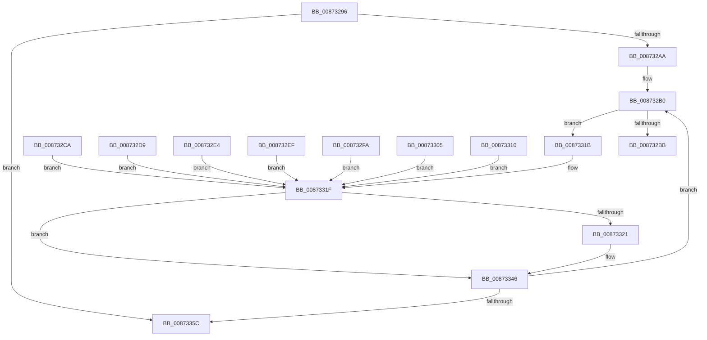

# sub_00873296

- RVA: `0x00873296`–`0x00873361` (길이 `203` bytes)
- VA: `0x0000000140873296`
- 실행 섹션: `PAGE`
- PDB 이름 있음: `아니요`; PDB Function 태그: `아니요`
- unwind 정보 RVA: `0x0006C6B4`
- 디코드: `70`개 명령, `203/203` bytes 표시
- 미해석 바이트: `0` (있으면 어셈블리에 `.byte`로 보존)

> 이 문서는 커널 이미지의 기계어와 PDB 기호를 분석해 생성했습니다. 4번과 5번은 함수 원형과 자료형을 바이너리 사용 방식에서 추정한 C 해석이며 원본 소스 복구 결과는 아닙니다.

## 1. Dependencies

- 직접 호출 지점: **1**; 고유 호출 대상: **1**
- 직접 호출자로 확인된 함수: **0**
- RIP 상대 이미지 참조: **0**

### Outgoing calls
- `0x0087332C` → [memcpy](../../text/6C/memcpy_function_006C6840.md) (function, `0x006C6840`)

### Direct callers
- 이 함수 시작 RVA로 연결되는 직접 call은 확인되지 않았습니다. 간접 호출은 완전히 역산할 수 없습니다.

### Static image references
- 디코드된 RIP-relative 메모리 참조가 없습니다.

## 2. Other-region calls and transfers

- 다른 실행 섹션으로 향하는 call: **1**
  - `0x0087332C` → [memcpy](../../text/6C/memcpy_function_006C6840.md) (`PAGE` → `.text`)
- 별도 외부 분기/꼬리 이동을 확인하지 못했습니다.

## 3. Assembly (complete function range)

```asm
00873296  48 89 6C 24 40                  mov qword ptr [rsp + 0x40], rbp
0087329B  49 8D 6E 08                     lea rbp, [r14 + 8]
0087329F  66 41 3B 77 04                  cmp si, word ptr [r15 + 4]
008732A4  0F 83 B2 00 00 00               jae 0x14087335c
008732AA  66 0F 1F 44 00 00               nop word ptr [rax + rax]
008732B0  0F B6 03                        movzx eax, byte ptr [rbx]
008732B3  83 C0 FE                        add eax, -2
008732B6  83 F8 15                        cmp eax, 0x15
008732B9  77 60                           ja 0x14087331b
008732BB  48 98                           cdqe
008732BD  41 8B 8C 84 D4 33 87 00         mov ecx, dword ptr [r12 + rax*4 + 0x8733d4]
008732C5  49 03 CC                        add rcx, r12
008732C8  FF E1                           jmp rcx
008732CA  CC                              int3
008732CB  CC                              int3
008732CC  CC                              int3
008732CD  CC                              int3
008732CE  8B C7                           mov eax, edi
008732D0  C1 E8 03                        shr eax, 3
008732D3  24 01                           and al, 1
008732D5  84 C0                           test al, al
008732D7  EB 46                           jmp 0x14087331f
008732D9  8B C7                           mov eax, edi
008732DB  C1 E8 05                        shr eax, 5
008732DE  24 01                           and al, 1
008732E0  84 C0                           test al, al
008732E2  EB 3B                           jmp 0x14087331f
008732E4  8B C7                           mov eax, edi
008732E6  C1 E8 06                        shr eax, 6
008732E9  24 01                           and al, 1
008732EB  84 C0                           test al, al
008732ED  EB 30                           jmp 0x14087331f
008732EF  8B C7                           mov eax, edi
008732F1  C1 E8 04                        shr eax, 4
008732F4  24 01                           and al, 1
008732F6  84 C0                           test al, al
008732F8  EB 25                           jmp 0x14087331f
008732FA  8B C7                           mov eax, edi
008732FC  C1 E8 07                        shr eax, 7
008732FF  24 01                           and al, 1
00873301  84 C0                           test al, al
00873303  EB 1A                           jmp 0x14087331f
00873305  8B C7                           mov eax, edi
00873307  C1 E8 08                        shr eax, 8
0087330A  24 01                           and al, 1
0087330C  84 C0                           test al, al
0087330E  EB 0F                           jmp 0x14087331f
00873310  8B C7                           mov eax, edi
00873312  C1 E8 09                        shr eax, 9
00873315  24 01                           and al, 1
00873317  84 C0                           test al, al
00873319  EB 04                           jmp 0x14087331f
0087331B  40 F6 C7 08                     test dil, 8
0087331F  74 25                           je 0x140873346
00873321  44 0F B7 43 02                  movzx r8d, word ptr [rbx + 2]
00873326  48 8B D3                        mov rdx, rbx
00873329  48 8B CD                        mov rcx, rbp
0087332C  E8 0F 35 E5 FF                  call 0x1406c6840
00873331  66 41 FF 46 04                  inc word ptr [r14 + 4]
00873336  0F B7 43 02                     movzx eax, word ptr [rbx + 2]
0087333A  66 41 01 46 02                  add word ptr [r14 + 2], ax
0087333F  0F B7 43 02                     movzx eax, word ptr [rbx + 2]
00873343  48 03 E8                        add rbp, rax
00873346  0F B7 43 02                     movzx eax, word ptr [rbx + 2]
0087334A  FF C6                           inc esi
0087334C  48 03 D8                        add rbx, rax
0087334F  41 0F B7 47 04                  movzx eax, word ptr [r15 + 4]
00873354  3B F0                           cmp esi, eax
00873356  0F 82 54 FF FF FF               jb 0x1408732b0
0087335C  48 8B 6C 24 40                  mov rbp, qword ptr [rsp + 0x40]
```

## 4. C-style interpretation (structured pseudocode)

```c
__int64 __fastcall sub_00873296(__int64 a1, __int64 a2, __int64 a3, __int64 a4, __int64 a5, __int64 a6, __int64 a7, __int64 a8)
{
    __int64 result;
    __int64 v_rbp;
    __int64 v_rbx;
    __int64 v_rsi;
    unsigned __int64 v_stack_p40;

    v_stack_p40 = v_rbp;
    if (((unsigned __int16)(v_rsi)) >= (*(unsigned __int16 *)(v_r15 + 4))) goto loc_0087335C;
loc_008732B0:
    result = (unsigned int)((*(unsigned __int8 *)(v_rbx)) + (-2));
    if (((unsigned int)(result)) > 21) goto loc_0087331B;
    a1 = ((unsigned int)(*(unsigned int *)(v_r12 + result * 4 + 8860628))) + (v_r12);
loc_0087331B:
loc_0087331F:
    v_rbp = v_r14 + 8;
    if ((((unsigned __int8)(v_rdi)) & (8)) != 0) {
        a3 = *(unsigned __int16 *)(v_rbx + 2);
        a2 = v_rbx;
        a1 = v_r14 + 8;
        result = memcpy(a1, a2, a3, a4);
        result = *(unsigned __int16 *)(v_rbx + 2);
        result = *(unsigned __int16 *)(v_rbx + 2);
        v_rbp = (v_r14 + 8) + (result);
    }
    v_rsi = (unsigned int)((v_rsi) + 1);
    v_rbx = (v_rbx) + (*(unsigned __int16 *)(v_rbx + 2));
    if (((unsigned int)(v_rsi)) < ((unsigned int)(*(unsigned __int16 *)(v_r15 + 4)))) goto loc_008732B0;
loc_0087335C:
    return *(unsigned __int16 *)(v_r15 + 4);
}
```

## 5. (Beta) C Style

```c
int64_t sub_00873296(int64_t Arg1, int64_t Arg2, int64_t Arg3, int64_t Arg4, uint64_t Arg5, uint64_t Arg6, uint64_t Arg7, int64_t Arg8)
{
    int64_t result;
    int64_t local_rbp;
    int64_t local_rbx;
    int64_t local_rsi;
    uint64_t v_stack_p40;

    v_stack_p40 = local_rbp;
    if (((uint16_t)(local_rsi)) >= (*(uint16_t *)(local_r15 + 0x4))) goto loc_0087335C;
loc_008732B0:
    result = (uint32_t)((*(uint8_t *)(local_rbx)) + (-2));
    if (((uint32_t)(result)) > 21) goto loc_0087331B;
    Arg1 = ((uint32_t)(*(uint32_t *)(local_r12 + result * 4 + 0x8733D4))) + (local_r12);
loc_0087331B:
loc_0087331F:
    local_rbp = local_r14 + 8;
    if ((((uint8_t)(local_rdi)) & (8)) != 0) {
        Arg3 = *(uint16_t *)(local_rbx + 0x2);
        Arg2 = local_rbx;
        Arg1 = local_r14 + 8;
        result = memcpy(Arg1, Arg2, Arg3, Arg4);
        result = *(uint16_t *)(local_rbx + 0x2);
        result = *(uint16_t *)(local_rbx + 0x2);
        local_rbp = (local_r14 + 8) + (result);
    }
    local_rsi = (uint32_t)((local_rsi) + 1);
    local_rbx = (local_rbx) + (*(uint16_t *)(local_rbx + 0x2));
    if (((uint32_t)(local_rsi)) < ((uint32_t)(*(uint16_t *)(local_r15 + 0x4)))) goto loc_008732B0;
loc_0087335C:
    return *(uint16_t *)(local_r15 + 0x4);
}
```

## 6. Execution-region graph

[열기: 2D/3D 그래프와 함수 탐색 컨트롤 패널](../../../control-panel.html?section=page&rva=0x00873296&view=graph)

- 2D 그래프는 위에서 아래로 흐르고, 3D 그래프는 빈 공간을 드래그해 회전합니다. Shift+드래그는 이동, 휠은 확대·축소, 함수 노드 선택은 대상 보고서 이동입니다.

### Static fallback


