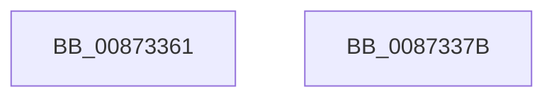

# sub_00873361

- RVA: `0x00873361`–`0x0087342C` (길이 `203` bytes)
- VA: `0x0000000140873361`
- 실행 섹션: `PAGE`
- PDB 이름 있음: `아니요`; PDB Function 태그: `아니요`
- unwind 정보 RVA: `0x0006C6C8`
- 디코드: `59`개 명령, `203/203` bytes 표시
- 미해석 바이트: `2` (있으면 어셈블리에 `.byte`로 보존)

> 이 문서는 커널 이미지의 기계어와 PDB 기호를 분석해 생성했습니다. 4번과 5번은 함수 원형과 자료형을 바이너리 사용 방식에서 추정한 C 해석이며 원본 소스 복구 결과는 아닙니다.

## 1. Dependencies

- 직접 호출 지점: **0**; 고유 호출 대상: **0**
- 직접 호출자로 확인된 함수: **0**
- RIP 상대 이미지 참조: **0**

### Outgoing calls
- 직접 디코드된 call 명령이 없습니다.

### Direct callers
- 이 함수 시작 RVA로 연결되는 직접 call은 확인되지 않았습니다. 간접 호출은 완전히 역산할 수 없습니다.

### Static image references
- 디코드된 RIP-relative 메모리 참조가 없습니다.

## 2. Other-region calls and transfers

- 다른 실행 섹션으로 향하는 call: **0**
- 별도 외부 분기/꼬리 이동을 확인하지 못했습니다.

## 3. Assembly (complete function range)

```asm
00873361  48 8B 5C 24 48                  mov rbx, qword ptr [rsp + 0x48]
00873366  48 8B 74 24 50                  mov rsi, qword ptr [rsp + 0x50]
0087336B  48 8B 7C 24 58                  mov rdi, qword ptr [rsp + 0x58]
00873370  48 83 C4 20                     add rsp, 0x20
00873374  41 5F                           pop r15
00873376  41 5E                           pop r14
00873378  41 5C                           pop r12
0087337A  C3                              ret
0087337B  CC                              int3
0087337C  5A                              pop rdx
0087337D  32 87 00 5A 32 87               xor al, byte ptr [rdi - 0x78cda600]
00873383  00 5A 32                        add byte ptr [rdx + 0x32], bl
00873386  87 00                           xchg dword ptr [rax], eax
00873388  5A                              pop rdx
00873389  32 87 00 5A 32 87               xor al, byte ptr [rdi - 0x78cda600]
0087338F  00 5A 32                        add byte ptr [rdx + 0x32], bl
00873392  87 00                           xchg dword ptr [rax], eax
00873394  5A                              pop rdx
00873395  32 87 00 5A 32 87               xor al, byte ptr [rdi - 0x78cda600]
0087339B  00 5A 32                        add byte ptr [rdx + 0x32], bl
0087339E  87 00                           xchg dword ptr [rax], eax
008733A0  5A                              pop rdx
008733A1  32 87 00 5A 32 87               xor al, byte ptr [rdi - 0x78cda600]
008733A7  00 5A 32                        add byte ptr [rdx + 0x32], bl
008733AA  87 00                           xchg dword ptr [rax], eax
008733AC  5A                              pop rdx
008733AD  32 87 00 5A 32 87               xor al, byte ptr [rdi - 0x78cda600]
008733B3  00 5A 32                        add byte ptr [rdx + 0x32], bl
008733B6  87 00                           xchg dword ptr [rax], eax
008733B8  3D 32 87 00 31                  cmp eax, 0x31008732
008733BD  32 87 00 37 32 87               xor al, byte ptr [rdi - 0x78cdc900]
008733C3  00 43 32                        add byte ptr [rbx + 0x32], al
008733C6  87 00                           xchg dword ptr [rax], eax
008733C8  4A 32 87 00 52 32 87            xor al, byte ptr [rdi - 0x78cdae00]
008733CF  00 52 32                        add byte ptr [rdx + 0x32], dl
008733D2  87 00                           xchg dword ptr [rax], eax
008733D4  CE                              .byte 0xce
008733D5  32 87 00 CE 32 87               xor al, byte ptr [rdi - 0x78cd3200]
008733DB  00 1B                           add byte ptr [rbx], bl
008733DD  33 87 00 1B 33 87               xor eax, dword ptr [rdi - 0x78cce500]
008733E3  00 1B                           add byte ptr [rbx], bl
008733E5  33 87 00 CE 32 87               xor eax, dword ptr [rdi - 0x78cd3200]
008733EB  00 CE                           add dh, cl
008733ED  32 87 00 1B 33 87               xor al, byte ptr [rdi - 0x78cce500]
008733F3  00 1B                           add byte ptr [rbx], bl
008733F5  33 87 00 1B 33 87               xor eax, dword ptr [rdi - 0x78cce500]
008733FB  00 1B                           add byte ptr [rbx], bl
008733FD  33 87 00 CE 32 87               xor eax, dword ptr [rdi - 0x78cd3200]
00873403  00 CE                           add dh, cl
00873405  32 87 00 CE 32 87               xor al, byte ptr [rdi - 0x78cd3200]
0087340B  00 CE                           add dh, cl
0087340D  32 87 00 EF 32 87               xor al, byte ptr [rdi - 0x78cd1100]
00873413  00 D9                           add cl, bl
00873415  32 87 00 E4 32 87               xor al, byte ptr [rdi - 0x78cd1c00]
0087341B  00 FA                           add dl, bh
0087341D  32 87 00 05 33 87               xor al, byte ptr [rdi - 0x78ccfb00]
00873423  00 10                           add byte ptr [rax], dl
00873425  33 87 00 10 33 87               xor eax, dword ptr [rdi - 0x78ccf000]
0087342B  00                              .byte 0x00
```

## 4. C-style interpretation (structured pseudocode)

```c
__int64 __fastcall sub_00873361(unsigned __int8 a1, __int64 a2, __int64 a3, __int64 a4, __int64 a5, __int64 a6, __int64 a7, __int64 a8, __int64 a9, __int64 a10, __int64 a11)
{
    __int64 v_rsp;

    v_rsp = (v_rsp) + (32);
    return result;
}
```

## 5. (Beta) C Style

```c
int64_t sub_00873361(uint8_t Arg1, int64_t Arg2, int64_t Arg3, int64_t Arg4, uint64_t Arg5, uint64_t Arg6, uint64_t Arg7, uint64_t Arg8, int64_t Arg9, int64_t Arg10, int64_t Arg11)
{
    int64_t local_rsp;

    local_rsp = (local_rsp) + (32);
    return result;
}
```

## 6. Execution-region graph

[열기: 2D/3D 그래프와 함수 탐색 컨트롤 패널](../../../control-panel.html?section=page&rva=0x00873361&view=graph)

- 2D 그래프는 위에서 아래로 흐르고, 3D 그래프는 빈 공간을 드래그해 회전합니다. Shift+드래그는 이동, 휠은 확대·축소, 함수 노드 선택은 대상 보고서 이동입니다.

### Static fallback


