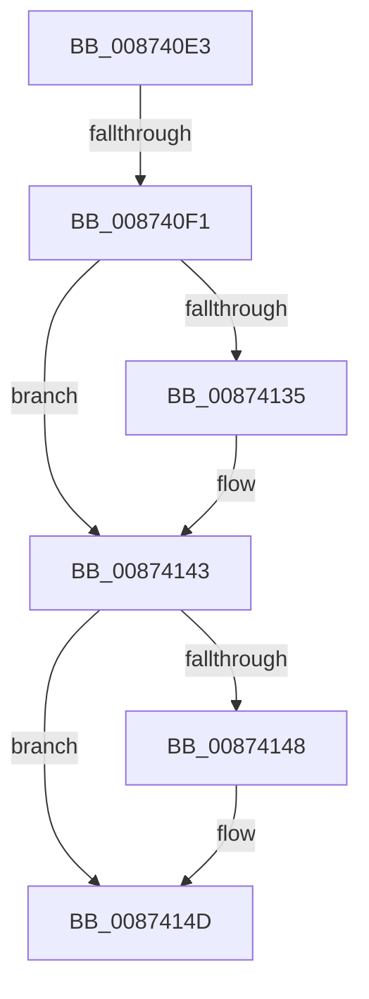

# sub_008740E3

- RVA: `0x008740E3`–`0x00874165` (길이 `130` bytes)
- VA: `0x00000001408740E3`
- 실행 섹션: `PAGE`
- PDB 이름 있음: `아니요`; PDB Function 태그: `아니요`
- unwind 정보 RVA: `0x0006C7DC`
- 디코드: `33`개 명령, `130/130` bytes 표시
- 미해석 바이트: `0` (있으면 어셈블리에 `.byte`로 보존)

> 이 문서는 커널 이미지의 기계어와 PDB 기호를 분석해 생성했습니다. 4번과 5번은 함수 원형과 자료형을 바이너리 사용 방식에서 추정한 C 해석이며 원본 소스 복구 결과는 아닙니다.

## 1. Dependencies

- 직접 호출 지점: **2**; 고유 호출 대상: **2**
- 직접 호출자로 확인된 함수: **0**
- RIP 상대 이미지 참조: **1**

### Outgoing calls
- `0x00874124` → [KeAbPreAcquire](../../text/21/KeAbPreAcquire_function_00210230.md) (function, `0x00210230`)
- `0x0087413E` → [ExfAcquirePushLockExclusiveEx](../../text/20/ExfAcquirePushLockExclusiveEx_function_0020FC90.md) (function, `0x0020FC90`)

### Direct callers
- 이 함수 시작 RVA로 연결되는 직접 call은 확인되지 않았습니다. 간접 호출은 완전히 역산할 수 없습니다.

### Static image references
- `0x00874105` → RVA `0x00FD0EC0` (`CACHEALI`; read)

## 2. Other-region calls and transfers

- 다른 실행 섹션으로 향하는 call: **2**
  - `0x00874124` → [KeAbPreAcquire](../../text/21/KeAbPreAcquire_function_00210230.md) (`PAGE` → `.text`)
  - `0x0087413E` → [ExfAcquirePushLockExclusiveEx](../../text/20/ExfAcquirePushLockExclusiveEx_function_0020FC90.md) (`PAGE` → `.text`)
- call이 아닌 외부 분기/꼬리 이동: **2**
  - `0x008740EB` → [sub_00874208](Unknown_function_00874208.md) (`tail-transfer`)
  - `0x00874163` → [sub_008741C8 + 0x7](Unknown_function_008741C8.md) (`tail-transfer`)

## 3. Assembly (complete function range)

```asm
008740E3  4C 89 7C 24 58                  mov qword ptr [rsp + 0x58], r15
008740E8  48 85 C9                        test rcx, rcx
008740EB  0F 85 17 01 00 00               jne 0x140874208
008740F1  8B 43 10                        mov eax, dword ptr [rbx + 0x10]
008740F4  45 33 C0                        xor r8d, r8d
008740F7  65 4C 8B 24 25 88 01 00 00      mov r12, qword ptr gs:[0x188]
00874100  33 D2                           xor edx, edx
00874102  0F B6 E8                        movzx ebp, al
00874105  48 8D 05 B4 CD 75 00            lea rax, [rip + 0x75cdb4]
0087410C  48 C1 E5 04                     shl rbp, 4
00874110  48 03 E8                        add rbp, rax
00874113  66 41 FF 8C 24 E4 01 00 00      dec word ptr [r12 + 0x1e4]
0087411C  48 8B CD                        mov rcx, rbp
0087411F  90                              nop
00874120  4C 8D 75 08                     lea r14, [rbp + 8]
00874124  E8 07 C1 99 FF                  call 0x140210230
00874129  F0 48 0F BA 6D 00 00            lock bts qword ptr [rbp], 0
00874130  4C 8B F8                        mov r15, rax
00874133  73 0E                           jae 0x140874143
00874135  4C 8B C5                        mov r8, rbp
00874138  48 8B D0                        mov rdx, rax
0087413B  48 8B CD                        mov rcx, rbp
0087413E  E8 4D BB 99 FF                  call 0x14020fc90
00874143  4D 85 FF                        test r15, r15
00874146  74 05                           je 0x14087414d
00874148  41 C6 47 0A 01                  mov byte ptr [r15 + 0xa], 1
0087414D  F7 DE                           neg esi
0087414F  48 63 C6                        movsxd rax, esi
00874152  F0 48 0F C1 43 08               lock xadd qword ptr [rbx + 8], rax
00874158  4C 8B 7C 24 58                  mov r15, qword ptr [rsp + 0x58]
0087415D  48 2B C7                        sub rax, rdi
00874160  48 85 C0                        test rax, rax
00874163  7F 6A                           jg 0x1408741cf
```

## 4. C-style interpretation (structured pseudocode)

```c
__int64 __fastcall sub_008740E3(__int64 a1, int a2, int a3, __int64 a4, __int64 a5, __int64 a6, __int64 a7, __int64 a8, __int64 a9, __int64 a10, __int64 a11)
{
    __int64 result;
    __int64 v_rbp;
    __int64 v_rsi;
    unsigned __int64 v_stack_p58;

    v_stack_p58 = v_r15;
    a3 = 0;
    a2 = 0;
    v_rbp = ((unsigned __int8)((unsigned int)(*(unsigned int *)(v_rbx + 16)))) << (4);
    v_rbp = (v_rbp) + (v_rip + 7720372);
    result = KeAbPreAcquire(v_rbp, a2, a3, a4);
    if (!(condition_is_above_or_equal)) {
        a3 = v_rbp;
        a2 = result;
        a1 = v_rbp;
        result = ExfAcquirePushLockExclusiveEx(a1, a2, a3, a4);
    }
    if (result != 0) {
        *(unsigned __int8 *)(result + 10) = 1;
    }
    v_rsi = (unsigned int)(-(v_rsi));
    result = ((int)((unsigned int)(v_rsi))) - (v_rdi);
}
```

## 5. (Beta) C Style

```c
int64_t sub_008740E3(int64_t Arg1, int32_t Arg2, int32_t Arg3, int64_t Arg4, uint64_t Arg5, uint64_t Arg6, uint64_t Arg7, uint64_t Arg8, uint64_t Arg9, uint64_t Arg10, int64_t Arg11)
{
    int64_t result;
    int64_t local_rbp;
    int64_t local_rsi;
    uint64_t v_stack_p58;

    v_stack_p58 = local_r15;
    Arg3 = 0;
    Arg2 = 0;
    local_rbp = ((uint8_t)((uint32_t)(*(uint32_t *)(local_rbx + 0x10)))) << (4);
    local_rbp = (local_rbp) + (v_rip + 7720372);
    result = KeAbPreAcquire(local_rbp, Arg2, Arg3, Arg4);
    if (!(condition_is_above_or_equal)) {
        Arg3 = local_rbp;
        Arg2 = result;
        Arg1 = local_rbp;
        result = ExfAcquirePushLockExclusiveEx(Arg1, Arg2, Arg3, Arg4);
    }
    if (result != 0) {
        *(uint8_t *)(result + 0xA) = 1;
    }
    local_rsi = (uint32_t)(-(local_rsi));
    result = ((int32_t)((uint32_t)(local_rsi))) - (local_rdi);
}
```

## 6. Execution-region graph

[열기: 2D/3D 그래프와 함수 탐색 컨트롤 패널](../../../control-panel.html?section=page&rva=0x008740E3&view=graph)

- 2D 그래프는 위에서 아래로 흐르고, 3D 그래프는 빈 공간을 드래그해 회전합니다. Shift+드래그는 이동, 휠은 확대·축소, 함수 노드 선택은 대상 보고서 이동입니다.

### Static fallback


