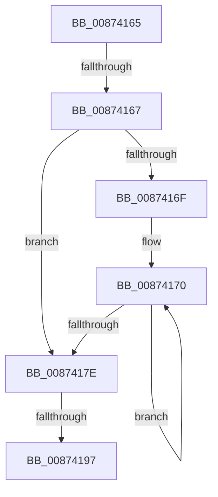

# sub_00874165

- RVA: `0x00874165`–`0x008741C8` (길이 `99` bytes)
- VA: `0x0000000140874165`
- 실행 섹션: `PAGE`
- PDB 이름 있음: `아니요`; PDB Function 태그: `아니요`
- unwind 정보 RVA: `0x0006C7F0`
- 디코드: `28`개 명령, `99/99` bytes 표시
- 미해석 바이트: `0` (있으면 어셈블리에 `.byte`로 보존)

> 이 문서는 커널 이미지의 기계어와 PDB 기호를 분석해 생성했습니다. 4번과 5번은 함수 원형과 자료형을 바이너리 사용 방식에서 추정한 C 해석이며 원본 소스 복구 결과는 아닙니다.

## 1. Dependencies

- 직접 호출 지점: **3**; 고유 호출 대상: **3**
- 직접 호출자로 확인된 함수: **0**
- RIP 상대 이미지 참조: **0**

### Outgoing calls
- `0x0087419A` → [KeAbPostRelease](../../text/2E/KeAbPostRelease_function_002E1600.md) (function, `0x002E1600`)
- `0x008741A2` → [KeLeaveCriticalRegionThread](../../text/25/KeLeaveCriticalRegionThread_function_0025EFF0.md) (function, `0x0025EFF0`)
- `0x008741AF` → [ExFreePoolWithTag](../../poolcode/B8/ExFreePoolWithTag_function_00B82870.md) (function, `0x00B82870`)

### Direct callers
- 이 함수 시작 RVA로 연결되는 직접 call은 확인되지 않았습니다. 간접 호출은 완전히 역산할 수 없습니다.

### Static image references
- 디코드된 RIP-relative 메모리 참조가 없습니다.

## 2. Other-region calls and transfers

- 다른 실행 섹션으로 향하는 call: **3**
  - `0x0087419A` → [KeAbPostRelease](../../text/2E/KeAbPostRelease_function_002E1600.md) (`PAGE` → `.text`)
  - `0x008741A2` → [KeLeaveCriticalRegionThread](../../text/25/KeLeaveCriticalRegionThread_function_0025EFF0.md) (`PAGE` → `.text`)
  - `0x008741AF` → [ExFreePoolWithTag](../../poolcode/B8/ExFreePoolWithTag_function_00B82870.md) (`PAGE` → `POOLCODE`)
- call이 아닌 외부 분기/꼬리 이동: **3**
  - `0x00874165` → [sub_008741C8](Unknown_function_008741C8.md) (`tail-transfer`)
  - `0x00874195` → [sub_008741C8 + 0x2C](Unknown_function_008741C8.md) (`tail-transfer`)
  - `0x008741C3` → [ObDereferenceSecurityDescriptor + 0x2B](ObDereferenceSecurityDescriptor_function_008740A0.md) (`tail-transfer`)

## 3. Assembly (complete function range)

```asm
00874165  75 61                           jne 0x1408741c8
00874167  49 8B 0E                        mov rcx, qword ptr [r14]
0087416A  48 3B CB                        cmp rcx, rbx
0087416D  74 0F                           je 0x14087417e
0087416F  90                              nop
00874170  48 8B 01                        mov rax, qword ptr [rcx]
00874173  4C 8B F1                        mov r14, rcx
00874176  48 8B C8                        mov rcx, rax
00874179  48 3B C3                        cmp rax, rbx
0087417C  75 F2                           jne 0x140874170
0087417E  48 8B 03                        mov rax, qword ptr [rbx]
00874181  49 89 06                        mov qword ptr [r14], rax
00874184  48 C7 C0 FF FF FF FF            mov rax, 0xffffffffffffffff
0087418B  F0 48 0F C1 45 00               lock xadd qword ptr [rbp], rax
00874191  24 06                           and al, 6
00874193  3C 02                           cmp al, 2
00874195  74 5D                           je 0x1408741f4
00874197  48 8B CD                        mov rcx, rbp
0087419A  E8 61 D4 A6 FF                  call 0x1402e1600
0087419F  49 8B CC                        mov rcx, r12
008741A2  E8 49 AE 9E FF                  call 0x14025eff0
008741A7  BA 4F 62 53 63                  mov edx, 0x6353624f
008741AC  48 8B CB                        mov rcx, rbx
008741AF  E8 BC E6 30 00                  call 0x140b82870
008741B4  4C 8B 64 24 48                  mov r12, qword ptr [rsp + 0x48]
008741B9  48 8B 6C 24 40                  mov rbp, qword ptr [rsp + 0x40]
008741BE  4C 8B 74 24 50                  mov r14, qword ptr [rsp + 0x50]
008741C3  E9 03 FF FF FF                  jmp 0x1408740cb
```

## 4. C-style interpretation (structured pseudocode)

```c
__int64 __fastcall sub_00874165(__int64 a1, __int64 a2, __int64 a3, __int64 a4, __int64 a5, __int64 a6, __int64 a7, __int64 a8, __int64 a9, __int64 a10)
{
    __int64 result;

    if ((*(unsigned __int64 *)(v_r14)) == v_rbx) goto loc_0087417E;
loc_00874170:
    if ((*(unsigned __int64 *)(*(unsigned __int64 *)(v_r14))) != v_rbx) goto loc_00874170;
loc_0087417E:
    *(unsigned __int64 *)(*(unsigned __int64 *)(v_r14)) = *(unsigned __int64 *)(v_rbx);
    result = (unsigned __int8)((-1) & (6));
    result = KeAbPostRelease(v_rbp, a2, a3, a4);
    result = KeLeaveCriticalRegionThread(v_r12, a2, a3, a4);
    result = ExFreePoolWithTag(v_rbx, (unsigned int)(0x6353624FULL), a3, a4);
}
```

## 5. (Beta) C Style

```c
int64_t sub_00874165(int64_t Arg1, int64_t Arg2, int64_t Arg3, int64_t Arg4, uint64_t Arg5, uint64_t Arg6, uint64_t Arg7, int64_t Arg8, int64_t Arg9, int64_t Arg10)
{
    int64_t result;

    if ((*(uint64_t *)(local_r14)) == local_rbx) goto loc_0087417E;
loc_00874170:
    if ((*(uint64_t *)(*(uint64_t *)(local_r14))) != local_rbx) goto loc_00874170;
loc_0087417E:
    *(uint64_t *)(*(uint64_t *)(local_r14)) = *(uint64_t *)(local_rbx);
    result = (uint8_t)((-1) & (6));
    result = KeAbPostRelease(local_rbp, Arg2, Arg3, Arg4);
    result = KeLeaveCriticalRegionThread(local_r12, Arg2, Arg3, Arg4);
    result = ExFreePoolWithTag(local_rbx, (uint32_t)(0x6353624FULL), Arg3, Arg4);
}
```

## 6. Execution-region graph

[열기: 2D/3D 그래프와 함수 탐색 컨트롤 패널](../../../control-panel.html?section=page&rva=0x00874165&view=graph)

- 2D 그래프는 위에서 아래로 흐르고, 3D 그래프는 빈 공간을 드래그해 회전합니다. Shift+드래그는 이동, 휠은 확대·축소, 함수 노드 선택은 대상 보고서 이동입니다.

### Static fallback


