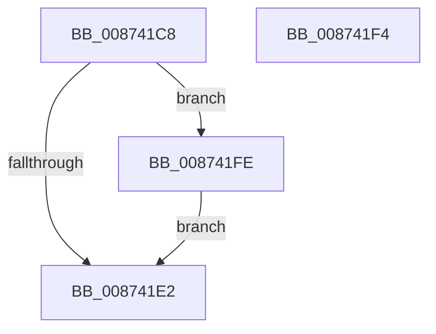

# sub_008741C8

- RVA: `0x008741C8`–`0x00874208` (길이 `64` bytes)
- VA: `0x00000001408741C8`
- 실행 섹션: `PAGE`
- PDB 이름 있음: `아니요`; PDB Function 태그: `아니요`
- unwind 정보 RVA: `0x0006C800`
- 디코드: `18`개 명령, `64/64` bytes 표시
- 미해석 바이트: `0` (있으면 어셈블리에 `.byte`로 보존)

> 이 문서는 커널 이미지의 기계어와 PDB 기호를 분석해 생성했습니다. 4번과 5번은 함수 원형과 자료형을 바이너리 사용 방식에서 추정한 C 해석이며 원본 소스 복구 결과는 아닙니다.

## 1. Dependencies

- 직접 호출 지점: **4**; 고유 호출 대상: **3**
- 직접 호출자로 확인된 함수: **0**
- RIP 상대 이미지 참조: **0**

### Outgoing calls
- `0x008741E5` → [KeAbPostRelease](../../text/2E/KeAbPostRelease_function_002E1600.md) (function, `0x002E1600`)
- `0x008741ED` → [KeLeaveCriticalRegionThread](../../text/25/KeLeaveCriticalRegionThread_function_0025EFF0.md) (function, `0x0025EFF0`)
- `0x008741F7` → [ExfTryToWakePushLock](../../text/26/ExfTryToWakePushLock_function_00265DD0.md) (function, `0x00265DD0`)
- `0x00874201` → [ExfTryToWakePushLock](../../text/26/ExfTryToWakePushLock_function_00265DD0.md) (function, `0x00265DD0`)

### Direct callers
- 이 함수 시작 RVA로 연결되는 직접 call은 확인되지 않았습니다. 간접 호출은 완전히 역산할 수 없습니다.

### Static image references
- 디코드된 RIP-relative 메모리 참조가 없습니다.

## 2. Other-region calls and transfers

- 다른 실행 섹션으로 향하는 call: **4**
  - `0x008741E5` → [KeAbPostRelease](../../text/2E/KeAbPostRelease_function_002E1600.md) (`PAGE` → `.text`)
  - `0x008741ED` → [KeLeaveCriticalRegionThread](../../text/25/KeLeaveCriticalRegionThread_function_0025EFF0.md) (`PAGE` → `.text`)
  - `0x008741F7` → [ExfTryToWakePushLock](../../text/26/ExfTryToWakePushLock_function_00265DD0.md) (`PAGE` → `.text`)
  - `0x00874201` → [ExfTryToWakePushLock](../../text/26/ExfTryToWakePushLock_function_00265DD0.md) (`PAGE` → `.text`)
- call이 아닌 외부 분기/꼬리 이동: **2**
  - `0x008741F2` → [sub_00874165 + 0x4F](Unknown_function_00874165.md) (`tail-transfer`)
  - `0x008741FC` → [sub_00874165 + 0x32](Unknown_function_00874165.md) (`tail-transfer`)

## 3. Assembly (complete function range)

```asm
008741C8  B9 0E 00 00 00                  mov ecx, 0xe
008741CD  CD 29                           int 0x29
008741CF  48 C7 C0 FF FF FF FF            mov rax, 0xffffffffffffffff
008741D6  F0 48 0F C1 45 00               lock xadd qword ptr [rbp], rax
008741DC  24 06                           and al, 6
008741DE  3C 02                           cmp al, 2
008741E0  74 1C                           je 0x1408741fe
008741E2  48 8B CD                        mov rcx, rbp
008741E5  E8 16 D4 A6 FF                  call 0x1402e1600
008741EA  49 8B CC                        mov rcx, r12
008741ED  E8 FE AD 9E FF                  call 0x14025eff0
008741F2  EB C0                           jmp 0x1408741b4
008741F4  48 8B CD                        mov rcx, rbp
008741F7  E8 D4 1B 9F FF                  call 0x140265dd0
008741FC  EB 99                           jmp 0x140874197
008741FE  48 8B CD                        mov rcx, rbp
00874201  E8 CA 1B 9F FF                  call 0x140265dd0
00874206  EB DA                           jmp 0x1408741e2
```

## 4. C-style interpretation (structured pseudocode)

```c
__int64 __fastcall sub_008741C8(void)
{
    __int64 result;

    result = (unsigned __int8)((-1) & (6));
    if (((unsigned __int8)(result)) == 2) goto loc_008741FE;
loc_008741E2:
    result = KeAbPostRelease(v_rbp, a2, a3, a4);
    result = KeLeaveCriticalRegionThread(v_r12, a2, a3, a4);
loc_008741FE:
    result = ExfTryToWakePushLock(v_rbp, a2, a3, a4);
    goto loc_008741E2;
}
```

## 5. (Beta) C Style

```c
void sub_008741C8(void)
{
    int64_t result;

    result = (uint8_t)((-1) & (6));
    if (((uint8_t)(result)) == 2) goto loc_008741FE;
loc_008741E2:
    result = KeAbPostRelease(local_rbp, a2, a3, a4);
    result = KeLeaveCriticalRegionThread(local_r12, a2, a3, a4);
loc_008741FE:
    result = ExfTryToWakePushLock(local_rbp, a2, a3, a4);
    goto loc_008741E2;
}
```

## 6. Execution-region graph

[열기: 2D/3D 그래프와 함수 탐색 컨트롤 패널](../../../control-panel.html?section=page&rva=0x008741C8&view=graph)

- 2D 그래프는 위에서 아래로 흐르고, 3D 그래프는 빈 공간을 드래그해 회전합니다. Shift+드래그는 이동, 휠은 확대·축소, 함수 노드 선택은 대상 보고서 이동입니다.

### Static fallback


