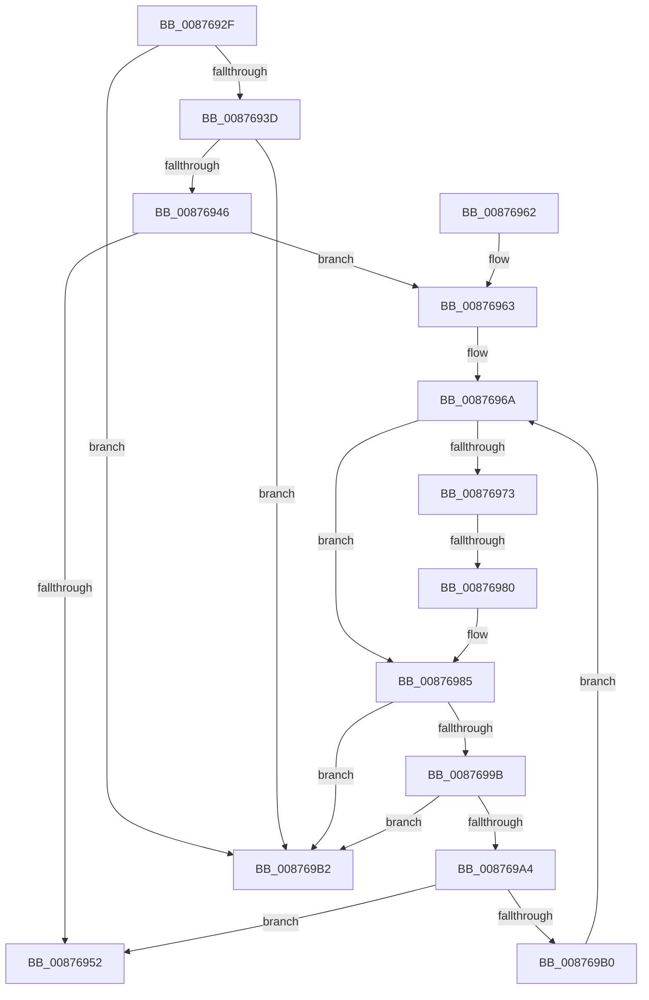

# sub_0087692F

- RVA: `0x0087692F`–`0x008769B9` (길이 `138` bytes)
- VA: `0x000000014087692F`
- 실행 섹션: `PAGE`
- PDB 이름 있음: `아니요`; PDB Function 태그: `아니요`
- unwind 정보 RVA: `0x0006CA80`
- 디코드: `42`개 명령, `138/138` bytes 표시
- 미해석 바이트: `0` (있으면 어셈블리에 `.byte`로 보존)

> 이 문서는 커널 이미지의 기계어와 PDB 기호를 분석해 생성했습니다. 4번과 5번은 함수 원형과 자료형을 바이너리 사용 방식에서 추정한 C 해석이며 원본 소스 복구 결과는 아닙니다.

## 1. Dependencies

- 직접 호출 지점: **2**; 고유 호출 대상: **2**
- 직접 호출자로 확인된 함수: **0**
- RIP 상대 이미지 참조: **1**

### Outgoing calls
- `0x00876980` → [VrpOriginalKeyNameParameterCleanup](../../text/47/VrpOriginalKeyNameParameterCleanup_function_00479060.md) (function, `0x00479060`)
- `0x0087698D` → [CmpFreePoolWithTag](../../text/44/CmpFreePoolWithTag_function_004489E0.md) (function, `0x004489E0`)

### Direct callers
- 이 함수 시작 RVA로 연결되는 직접 call은 확인되지 않았습니다. 간접 호출은 완전히 역산할 수 없습니다.

### Static image references
- `0x00876963` → RVA `0x00479060` (`VrpOriginalKeyNameParameterCleanup`; read)

## 2. Other-region calls and transfers

- 다른 실행 섹션으로 향하는 call: **2**
  - `0x00876980` → [VrpOriginalKeyNameParameterCleanup](../../text/47/VrpOriginalKeyNameParameterCleanup_function_00479060.md) (`PAGE` → `.text`)
  - `0x0087698D` → [CmpFreePoolWithTag](../../text/44/CmpFreePoolWithTag_function_004489E0.md) (`PAGE` → `.text`)
- call이 아닌 외부 분기/꼬리 이동: **1**
  - `0x0087697E` → [sub_008769E3](Unknown_function_008769E3.md) (`tail-transfer`)

## 3. Assembly (complete function range)

```asm
0087692F  48 89 74 24 30                  mov qword ptr [rsp + 0x30], rsi
00876934  48 8B 3B                        mov rdi, qword ptr [rbx]
00876937  48 39 5F 08                     cmp qword ptr [rdi + 8], rbx
0087693B  75 75                           jne 0x1408769b2
0087693D  48 8B 07                        mov rax, qword ptr [rdi]
00876940  48 39 78 08                     cmp qword ptr [rax + 8], rdi
00876944  75 6C                           jne 0x1408769b2
00876946  48 89 03                        mov qword ptr [rbx], rax
00876949  48 89 58 08                     mov qword ptr [rax + 8], rbx
0087694D  48 3B FB                        cmp rdi, rbx
00876950  75 11                           jne 0x140876963
00876952  48 8B 74 24 30                  mov rsi, qword ptr [rsp + 0x30]
00876957  48 8B 5C 24 38                  mov rbx, qword ptr [rsp + 0x38]
0087695C  48 83 C4 20                     add rsp, 0x20
00876960  5F                              pop rdi
00876961  C3                              ret
00876962  CC                              int3
00876963  48 8D 35 F6 26 C0 FF            lea rsi, [rip - 0x3fd90a]
0087696A  48 8B 47 20                     mov rax, qword ptr [rdi + 0x20]
0087696E  48 85 C0                        test rax, rax
00876971  74 12                           je 0x140876985
00876973  48 8D 57 30                     lea rdx, [rdi + 0x30]
00876977  48 8D 4F 10                     lea rcx, [rdi + 0x10]
0087697B  48 3B C6                        cmp rax, rsi
0087697E  75 63                           jne 0x1408769e3
00876980  E8 DB 26 C0 FF                  call 0x140479060
00876985  BA 43 4D 45 50                  mov edx, 0x50454d43
0087698A  48 8B CF                        mov rcx, rdi
0087698D  E8 4E 20 BD FF                  call 0x1404489e0
00876992  48 8B 3B                        mov rdi, qword ptr [rbx]
00876995  48 39 5F 08                     cmp qword ptr [rdi + 8], rbx
00876999  75 17                           jne 0x1408769b2
0087699B  48 8B 07                        mov rax, qword ptr [rdi]
0087699E  48 39 78 08                     cmp qword ptr [rax + 8], rdi
008769A2  75 0E                           jne 0x1408769b2
008769A4  48 89 03                        mov qword ptr [rbx], rax
008769A7  48 89 58 08                     mov qword ptr [rax + 8], rbx
008769AB  48 3B FB                        cmp rdi, rbx
008769AE  74 A2                           je 0x140876952
008769B0  EB B8                           jmp 0x14087696a
008769B2  B9 03 00 00 00                  mov ecx, 3
008769B7  CD 29                           int 0x29
```

## 4. C-style interpretation (structured pseudocode)

```c
__int64 __fastcall sub_0087692F(__int64 a1, __int64 a2, __int64 a3, __int64 a4, __int64 a5, __int64 a6, __int64 a7)
{
    __int64 result;
    __int64 v_rsp;
    unsigned __int64 v_stack_p30;

    v_stack_p30 = v_rsi;
    if ((*(unsigned __int64 *)(*(unsigned __int64 *)(v_rbx) + 8)) != v_rbx) goto loc_008769B2;
    if ((*(unsigned __int64 *)(*(unsigned __int64 *)(*(unsigned __int64 *)(v_rbx)) + 8)) != (*(unsigned __int64 *)(v_rbx))) goto loc_008769B2;
    *(unsigned __int64 *)(v_rbx) = *(unsigned __int64 *)(*(unsigned __int64 *)(v_rbx));
    *(unsigned __int64 *)(*(unsigned __int64 *)(*(unsigned __int64 *)(v_rbx)) + 8) = v_rbx;
    if ((*(unsigned __int64 *)(v_rbx)) != v_rbx) goto loc_00876963;
loc_00876952:
    v_rsp = (v_rsp) + (32);
    return *(unsigned __int64 *)(*(unsigned __int64 *)(v_rbx));
loc_00876963:
loc_0087696A:
    if (*(unsigned __int64 *)(*(unsigned __int64 *)(v_rbx) + 32) == 0) goto loc_00876985;
    result = VrpOriginalKeyNameParameterCleanup(*(unsigned __int64 *)(v_rbx) + 16, *(unsigned __int64 *)(v_rbx) + 48, a3, a4);
loc_00876985:
    result = CmpFreePoolWithTag(*(unsigned __int64 *)(v_rbx), (unsigned int)(0x50454D43ULL), a3, a4);
    if ((*(unsigned __int64 *)(*(unsigned __int64 *)(a7) + 8)) != a7) goto loc_008769B2;
    if ((*(unsigned __int64 *)(*(unsigned __int64 *)(*(unsigned __int64 *)(a7)) + 8)) != (*(unsigned __int64 *)(a7))) goto loc_008769B2;
    *(unsigned __int64 *)(a7) = *(unsigned __int64 *)(*(unsigned __int64 *)(a7));
    *(unsigned __int64 *)(*(unsigned __int64 *)(*(unsigned __int64 *)(a7)) + 8) = a7;
    if ((*(unsigned __int64 *)(a7)) == a7) goto loc_00876952;
    goto loc_0087696A;
loc_008769B2:
    return *(unsigned __int64 *)(*(unsigned __int64 *)(a7));
}
```

## 5. (Beta) C Style

```c
int64_t sub_0087692F(int64_t Arg1, int64_t Arg2, int64_t Arg3, int64_t Arg4, uint64_t Arg5, int64_t Arg6, int64_t Arg7)
{
    int64_t result;
    int64_t local_rsp;
    uint64_t v_stack_p30;

    v_stack_p30 = local_rsi;
    if ((*(uint64_t *)(*(uint64_t *)(local_rbx) + 0x8)) != local_rbx) goto loc_008769B2;
    if ((*(uint64_t *)(*(uint64_t *)(*(uint64_t *)(local_rbx)) + 0x8)) != (*(uint64_t *)(local_rbx))) goto loc_008769B2;
    *(uint64_t *)(local_rbx) = *(uint64_t *)(*(uint64_t *)(local_rbx));
    *(uint64_t *)(*(uint64_t *)(*(uint64_t *)(local_rbx)) + 0x8) = local_rbx;
    if ((*(uint64_t *)(local_rbx)) != local_rbx) goto loc_00876963;
loc_00876952:
    local_rsp = (local_rsp) + (32);
    return *(uint64_t *)(*(uint64_t *)(local_rbx));
loc_00876963:
loc_0087696A:
    if (*(uint64_t *)(*(uint64_t *)(local_rbx) + 0x20) == 0) goto loc_00876985;
    result = VrpOriginalKeyNameParameterCleanup(*(uint64_t *)(local_rbx) + 16, *(uint64_t *)(local_rbx) + 48, Arg3, Arg4);
loc_00876985:
    result = CmpFreePoolWithTag(*(uint64_t *)(local_rbx), (uint32_t)(0x50454D43ULL), Arg3, Arg4);
    if ((*(uint64_t *)(*(uint64_t *)(Arg7) + 0x8)) != Arg7) goto loc_008769B2;
    if ((*(uint64_t *)(*(uint64_t *)(*(uint64_t *)(Arg7)) + 0x8)) != (*(uint64_t *)(Arg7))) goto loc_008769B2;
    *(uint64_t *)(Arg7) = *(uint64_t *)(*(uint64_t *)(Arg7));
    *(uint64_t *)(*(uint64_t *)(*(uint64_t *)(Arg7)) + 0x8) = Arg7;
    if ((*(uint64_t *)(Arg7)) == Arg7) goto loc_00876952;
    goto loc_0087696A;
loc_008769B2:
    return *(uint64_t *)(*(uint64_t *)(Arg7));
}
```

## 6. Execution-region graph

[열기: 2D/3D 그래프와 함수 탐색 컨트롤 패널](../../../control-panel.html?section=page&rva=0x0087692F&view=graph)

- 2D 그래프는 위에서 아래로 흐르고, 3D 그래프는 빈 공간을 드래그해 회전합니다. Shift+드래그는 이동, 휠은 확대·축소, 함수 노드 선택은 대상 보고서 이동입니다.

### Static fallback


