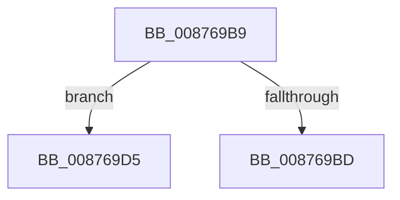

# sub_008769B9

- RVA: `0x008769B9`–`0x008769E3` (길이 `42` bytes)
- VA: `0x00000001408769B9`
- 실행 섹션: `PAGE`
- PDB 이름 있음: `아니요`; PDB Function 태그: `아니요`
- unwind 정보 RVA: `0x0006CA98`
- 디코드: `10`개 명령, `42/42` bytes 표시
- 미해석 바이트: `0` (있으면 어셈블리에 `.byte`로 보존)

> 이 문서는 커널 이미지의 기계어와 PDB 기호를 분석해 생성했습니다. 4번과 5번은 함수 원형과 자료형을 바이너리 사용 방식에서 추정한 C 해석이며 원본 소스 복구 결과는 아닙니다.

## 1. Dependencies

- 직접 호출 지점: **4**; 고유 호출 대상: **3**
- 직접 호출자로 확인된 함수: **0**
- RIP 상대 이미지 참조: **0**

### Outgoing calls
- `0x008769BD` → [CmpLockRegistry](../../pagecmrc/BC/CmpLockRegistry_function_00BC9B34.md) (function, `0x00BC9B34`)
- `0x008769C6` → [CmpDereferenceKeyControlBlock](../85/CmpDereferenceKeyControlBlock_function_00851310.md) (function, `0x00851310`)
- `0x008769CB` → [CmpUnlockRegistry](../../pagecmrc/BC/CmpUnlockRegistry_function_00BC9A84.md) (function, `0x00BC9A84`)
- `0x008769D9` → [CmpDereferenceKeyControlBlock](../85/CmpDereferenceKeyControlBlock_function_00851310.md) (function, `0x00851310`)

### Direct callers
- 이 함수 시작 RVA로 연결되는 직접 call은 확인되지 않았습니다. 간접 호출은 완전히 역산할 수 없습니다.

### Static image references
- 디코드된 RIP-relative 메모리 참조가 없습니다.

## 2. Other-region calls and transfers

- 다른 실행 섹션으로 향하는 call: **2**
  - `0x008769BD` → [CmpLockRegistry](../../pagecmrc/BC/CmpLockRegistry_function_00BC9B34.md) (`PAGE` → `PAGECMRC`)
  - `0x008769CB` → [CmpUnlockRegistry](../../pagecmrc/BC/CmpUnlockRegistry_function_00BC9A84.md) (`PAGE` → `PAGECMRC`)
- call이 아닌 외부 분기/꼬리 이동: **2**
  - `0x008769D0` → [CmpCleanupParseContext + 0x18](CmpCleanupParseContext_function_00876910.md) (`tail-transfer`)
  - `0x008769DE` → [CmpCleanupParseContext + 0x18](CmpCleanupParseContext_function_00876910.md) (`tail-transfer`)

## 3. Assembly (complete function range)

```asm
008769B9  84 D2                           test dl, dl
008769BB  75 18                           jne 0x1408769d5
008769BD  E8 72 31 35 00                  call 0x140bc9b34
008769C2  48 8B 4B 58                     mov rcx, qword ptr [rbx + 0x58]
008769C6  E8 45 A9 FD FF                  call 0x140851310
008769CB  E8 B4 30 35 00                  call 0x140bc9a84
008769D0  E9 53 FF FF FF                  jmp 0x140876928
008769D5  48 8B 49 58                     mov rcx, qword ptr [rcx + 0x58]
008769D9  E8 32 A9 FD FF                  call 0x140851310
008769DE  E9 45 FF FF FF                  jmp 0x140876928
```

## 4. C-style interpretation (structured pseudocode)

```c
__int64 __fastcall sub_008769B9(__int64 a1, unsigned __int8 a2)
{
    __int64 result;

    if (a2 != 0) goto loc_008769D5;
    result = CmpLockRegistry(a1, a2, a3, a4);
    result = CmpDereferenceKeyControlBlock(*(unsigned __int64 *)(v_rbx + 88), a2, a3, a4);
    result = CmpUnlockRegistry(*(unsigned __int64 *)(v_rbx + 88), a2, a3, a4);
loc_008769D5:
    result = CmpDereferenceKeyControlBlock(*(unsigned __int64 *)(*(unsigned __int64 *)(v_rbx + 88) + 88), a2, a3, a4);
}
```

## 5. (Beta) C Style

```c
int64_t sub_008769B9(void *Arg1, uint8_t Arg2)
{
    uint8_t *arg1 = (uint8_t *)Arg1;

    int64_t result;

    if (Arg2 != 0) goto loc_008769D5;
    result = CmpLockRegistry(Arg1, Arg2, a3, a4);
    result = CmpDereferenceKeyControlBlock(*(uint64_t *)(local_rbx + 0x58), Arg2, a3, a4);
    result = CmpUnlockRegistry(*(uint64_t *)(local_rbx + 0x58), Arg2, a3, a4);
loc_008769D5:
    result = CmpDereferenceKeyControlBlock(*(uint64_t *)(*(uint64_t *)(local_rbx + 0x58) + 0x58), Arg2, a3, a4);
}
```

### 관측된 메모리 오프셋

구조체 형식이 확인되지 않은 접근은 인자 기준의 오프셋으로만 기록했습니다.

| 기준 인자 | 오프셋 표현 | 폭 (bit) | 접근 |
|---|---:|---:|---|
| `Arg1` | `+ 0x58` | `64` | `R` |

## 6. Execution-region graph

[열기: 2D/3D 그래프와 함수 탐색 컨트롤 패널](../../../control-panel.html?section=page&rva=0x008769B9&view=graph)

- 2D 그래프는 위에서 아래로 흐르고, 3D 그래프는 빈 공간을 드래그해 회전합니다. Shift+드래그는 이동, 휠은 확대·축소, 함수 노드 선택은 대상 보고서 이동입니다.

### Static fallback


