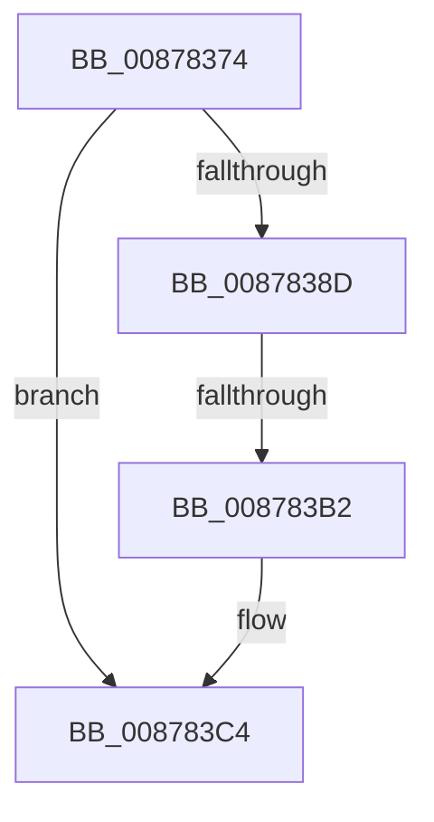

# sub_00878374

- RVA: `0x00878374`–`0x008783D6` (길이 `98` bytes)
- VA: `0x0000000140878374`
- 실행 섹션: `PAGE`
- PDB 이름 있음: `아니요`; PDB Function 태그: `아니요`
- unwind 정보 RVA: `0x0006CC10`
- 디코드: `23`개 명령, `98/98` bytes 표시
- 미해석 바이트: `0` (있으면 어셈블리에 `.byte`로 보존)

> 이 문서는 커널 이미지의 기계어와 PDB 기호를 분석해 생성했습니다. 4번과 5번은 함수 원형과 자료형을 바이너리 사용 방식에서 추정한 C 해석이며 원본 소스 복구 결과는 아닙니다.

## 1. Dependencies

- 직접 호출 지점: **5**; 고유 호출 대상: **5**
- 직접 호출자로 확인된 함수: **0**
- RIP 상대 이미지 참조: **1**

### Outgoing calls
- `0x00878378` → [CmpAttachToRegistryProcess](../../pagecmrc/BC/CmpAttachToRegistryProcess_function_00BC98E0.md) (function, `0x00BC98E0`)
- `0x00878380` → [CmpConstructName](../85/CmpConstructName_function_00856BE0.md) (function, `0x00856BE0`)
- `0x008783B2` → [EtwpTraceRegistry](../86/EtwpTraceRegistry_function_00862980.md) (function, `0x00862980`)
- `0x008783BF` → [CmpFreePoolWithTag](../../text/44/CmpFreePoolWithTag_function_004489E0.md) (function, `0x004489E0`)
- `0x008783C9` → [CmpDetachFromRegistryProcess](../../pagecmrc/BC/CmpDetachFromRegistryProcess_function_00BC9920.md) (function, `0x00BC9920`)

### Direct callers
- 이 함수 시작 RVA로 연결되는 직접 call은 확인되지 않았습니다. 간접 호출은 완전히 역산할 수 없습니다.

### Static image references
- `0x0087838D` → RVA `0x00862980` (`EtwpTraceRegistry`; read)

## 2. Other-region calls and transfers

- 다른 실행 섹션으로 향하는 call: **3**
  - `0x00878378` → [CmpAttachToRegistryProcess](../../pagecmrc/BC/CmpAttachToRegistryProcess_function_00BC98E0.md) (`PAGE` → `PAGECMRC`)
  - `0x008783BF` → [CmpFreePoolWithTag](../../text/44/CmpFreePoolWithTag_function_004489E0.md) (`PAGE` → `.text`)
  - `0x008783C9` → [CmpDetachFromRegistryProcess](../../pagecmrc/BC/CmpDetachFromRegistryProcess_function_00BC9920.md) (`PAGE` → `PAGECMRC`)
- call이 아닌 외부 분기/꼬리 이동: **1**
  - `0x008783B0` → [sub_008783F2](Unknown_function_008783F2.md) (`tail-transfer`)

## 3. Assembly (complete function range)

```asm
00878374  49 89 5B 18                     mov qword ptr [r11 + 0x18], rbx
00878378  E8 63 15 35 00                  call 0x140bc98e0
0087837D  48 8B CF                        mov rcx, rdi
00878380  E8 5B E8 FD FF                  call 0x140856be0
00878385  48 8B D8                        mov rbx, rax
00878388  48 85 C0                        test rax, rax
0087838B  74 37                           je 0x1408783c4
0087838D  48 8D 05 EC A5 FE FF            lea rax, [rip - 0x15a14]
00878394  48 89 5C 24 28                  mov qword ptr [rsp + 0x28], rbx
00878399  45 33 C9                        xor r9d, r9d
0087839C  48 89 7C 24 20                  mov qword ptr [rsp + 0x20], rdi
008783A1  45 33 C0                        xor r8d, r8d
008783A4  48 8D 54 24 40                  lea rdx, [rsp + 0x40]
008783A9  40 0F B6 CD                     movzx ecx, bpl
008783AD  48 3B F0                        cmp rsi, rax
008783B0  75 40                           jne 0x1408783f2
008783B2  E8 C9 A5 FE FF                  call 0x140862980
008783B7  BA 43 4D 4E 62                  mov edx, 0x624e4d43
008783BC  48 8B CB                        mov rcx, rbx
008783BF  E8 1C 06 BD FF                  call 0x1404489e0
008783C4  48 8D 4C 24 60                  lea rcx, [rsp + 0x60]
008783C9  E8 52 15 35 00                  call 0x140bc9920
008783CE  48 8B 9C 24 D0 00 00 00         mov rbx, qword ptr [rsp + 0xd0]
```

## 4. C-style interpretation (structured pseudocode)

```c
__int64 __fastcall sub_00878374(__int64 a1, __int64 a2, int a3, int a4, __int64 a5, __int64 a6, __int64 a7, __int64 a8, __int64 a9, __int64 a10, __int64 a11, __int64 a12, __int64 a13, __int64 a14, __int64 a15, __int64 a16, __int64 a17, __int64 a18, __int64 a19, __int64 a20, __int64 a21, __int64 a22, __int64 a23, __int64 a24, __int64 a25, __int64 a26)
{
    __int64 result;
    unsigned __int64 v_stack_p20;
    unsigned __int64 v_stack_p28;

    *(unsigned __int64 *)(v_r11 + 24) = v_rbx;
    result = CmpAttachToRegistryProcess(a1, a2, a3, a4);
    result = CmpConstructName(v_rdi, a2, a3, a4);
    if (result == 0) goto loc_008783C4;
    v_stack_p28 = result;
    a4 = 0;
    v_stack_p20 = v_rdi;
    a3 = 0;
    result = EtwpTraceRegistry((unsigned __int8)(v_rbp), a8, a3, a4);
    result = CmpFreePoolWithTag(result, (unsigned int)(0x624E4D43ULL), a3, a4);
loc_008783C4:
    result = CmpDetachFromRegistryProcess(a12, (unsigned int)(0x624E4D43ULL), a3, a4);
    return result;
}
```

## 5. (Beta) C Style

```c
int64_t sub_00878374(int64_t Arg1, int64_t Arg2, int32_t Arg3, int32_t Arg4, uint64_t Arg5, uint64_t Arg6, uint64_t Arg7, int64_t Arg8, uint64_t Arg9, uint64_t Arg10, uint64_t Arg11, int64_t Arg12, uint64_t Arg13, uint64_t Arg14, uint64_t Arg15, uint64_t Arg16, uint64_t Arg17, uint64_t Arg18, uint64_t Arg19, uint64_t Arg20, uint64_t Arg21, uint64_t Arg22, uint64_t Arg23, uint64_t Arg24, uint64_t Arg25, int64_t Arg26)
{
    int64_t result;
    uint64_t v_stack_p20;
    uint64_t v_stack_p28;

    *(uint64_t *)(local_r11 + 0x18) = local_rbx;
    result = CmpAttachToRegistryProcess(Arg1, Arg2, Arg3, Arg4);
    result = CmpConstructName(local_rdi, Arg2, Arg3, Arg4);
    if (result == 0) goto loc_008783C4;
    v_stack_p28 = result;
    Arg4 = 0;
    v_stack_p20 = local_rdi;
    Arg3 = 0;
    result = EtwpTraceRegistry((uint8_t)(local_rbp), Arg8, Arg3, Arg4);
    result = CmpFreePoolWithTag(result, (uint32_t)(0x624E4D43ULL), Arg3, Arg4);
loc_008783C4:
    result = CmpDetachFromRegistryProcess(Arg12, (uint32_t)(0x624E4D43ULL), Arg3, Arg4);
    return result;
}
```

## 6. Execution-region graph

[열기: 2D/3D 그래프와 함수 탐색 컨트롤 패널](../../../control-panel.html?section=page&rva=0x00878374&view=graph)

- 2D 그래프는 위에서 아래로 흐르고, 3D 그래프는 빈 공간을 드래그해 회전합니다. Shift+드래그는 이동, 휠은 확대·축소, 함수 노드 선택은 대상 보고서 이동입니다.

### Static fallback


