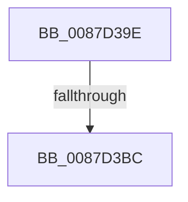

# sub_0087D39E

- RVA: `0x0087D39E`–`0x0087D3C9` (길이 `43` bytes)
- VA: `0x000000014087D39E`
- 실행 섹션: `PAGE`
- PDB 이름 있음: `아니요`; PDB Function 태그: `아니요`
- unwind 정보 RVA: `0x0007BEBC`
- 디코드: `10`개 명령, `43/43` bytes 표시
- 미해석 바이트: `0` (있으면 어셈블리에 `.byte`로 보존)

> 이 문서는 커널 이미지의 기계어와 PDB 기호를 분석해 생성했습니다. 4번과 5번은 함수 원형과 자료형을 바이너리 사용 방식에서 추정한 C 해석이며 원본 소스 복구 결과는 아닙니다.

## 1. Dependencies

- 직접 호출 지점: **1**; 고유 호출 대상: **1**
- 직접 호출자로 확인된 함수: **0**
- RIP 상대 이미지 참조: **0**

### Outgoing calls
- `0x0087D3BF` → [KeAbPostRelease](../../text/2E/KeAbPostRelease_function_002E1600.md) (function, `0x002E1600`)

### Direct callers
- 이 함수 시작 RVA로 연결되는 직접 call은 확인되지 않았습니다. 간접 호출은 완전히 역산할 수 없습니다.

### Static image references
- 디코드된 RIP-relative 메모리 참조가 없습니다.

## 2. Other-region calls and transfers

- 다른 실행 섹션으로 향하는 call: **1**
  - `0x0087D3BF` → [KeAbPostRelease](../../text/2E/KeAbPostRelease_function_002E1600.md) (`PAGE` → `.text`)
- call이 아닌 외부 분기/꼬리 이동: **1**
  - `0x0087D3BA` → [sub_0087D3F2](Unknown_function_0087D3F2.md) (`tail-transfer`)

## 3. Assembly (complete function range)

```asm
0087D39E  48 89 7C 24 30                  mov qword ptr [rsp + 0x30], rdi
0087D3A3  48 C7 C0 FF FF FF FF            mov rax, 0xffffffffffffffff
0087D3AA  48 8D B9 F0 04 00 00            lea rdi, [rcx + 0x4f0]
0087D3B1  F0 48 0F C1 07                  lock xadd qword ptr [rdi], rax
0087D3B6  24 06                           and al, 6
0087D3B8  3C 02                           cmp al, 2
0087D3BA  74 36                           je 0x14087d3f2
0087D3BC  48 8B CF                        mov rcx, rdi
0087D3BF  E8 3C 42 A6 FF                  call 0x1402e1600
0087D3C4  48 8B 7C 24 30                  mov rdi, qword ptr [rsp + 0x30]
```

## 4. C-style interpretation (structured pseudocode)

```c
__int64 __fastcall sub_0087D39E(__int64 a1, __int64 a2, __int64 a3, __int64 a4, __int64 a5, __int64 a6)
{
    __int64 result;
    unsigned __int64 v_stack_p30;

    v_stack_p30 = v_rdi;
    result = (unsigned __int8)((-1) & (6));
    result = KeAbPostRelease(a1 + 1264, a2, a3, a4);
    return result;
}
```

## 5. (Beta) C Style

```c
int64_t sub_0087D39E(void *Arg1, int64_t Arg2, int64_t Arg3, int64_t Arg4, uint64_t Arg5, int64_t Arg6)
{
    uint8_t *arg1 = (uint8_t *)Arg1;

    int64_t result;
    uint64_t v_stack_p30;

    v_stack_p30 = local_rdi;
    result = (uint8_t)((-1) & (6));
    result = KeAbPostRelease(Arg1 + 1264, Arg2, Arg3, Arg4);
    return result;
}
```

### 관측된 메모리 오프셋

구조체 형식이 확인되지 않은 접근은 인자 기준의 오프셋으로만 기록했습니다.

| 기준 인자 | 오프셋 표현 | 폭 (bit) | 접근 |
|---|---:|---:|---|
| `Arg1` | `+ 0x0` | `64` | `R/W` |
| `Arg1` | `+ 0x4F0` | `64` | `R` |

## 6. Execution-region graph

[열기: 2D/3D 그래프와 함수 탐색 컨트롤 패널](../../../control-panel.html?section=page&rva=0x0087D39E&view=graph)

- 2D 그래프는 위에서 아래로 흐르고, 3D 그래프는 빈 공간을 드래그해 회전합니다. Shift+드래그는 이동, 휠은 확대·축소, 함수 노드 선택은 대상 보고서 이동입니다.

### Static fallback


