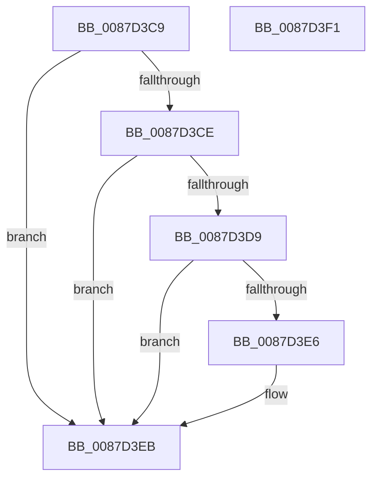

# sub_0087D3C9

- RVA: `0x0087D3C9`–`0x0087D3F2` (길이 `41` bytes)
- VA: `0x000000014087D3C9`
- 실행 섹션: `PAGE`
- PDB 이름 있음: `아니요`; PDB Function 태그: `아니요`
- unwind 정보 RVA: `0x0007BED0`
- 디코드: `14`개 명령, `41/41` bytes 표시
- 미해석 바이트: `0` (있으면 어셈블리에 `.byte`로 보존)

> 이 문서는 커널 이미지의 기계어와 PDB 기호를 분석해 생성했습니다. 4번과 5번은 함수 원형과 자료형을 바이너리 사용 방식에서 추정한 C 해석이며 원본 소스 복구 결과는 아닙니다.

## 1. Dependencies

- 직접 호출 지점: **1**; 고유 호출 대상: **1**
- 직접 호출자로 확인된 함수: **0**
- RIP 상대 이미지 참조: **0**

### Outgoing calls
- `0x0087D3E6` → [KiCheckForKernelApcDelivery](../../text/2E/KiCheckForKernelApcDelivery_function_002E2C80.md) (function, `0x002E2C80`)

### Direct callers
- 이 함수 시작 RVA로 연결되는 직접 call은 확인되지 않았습니다. 간접 호출은 완전히 역산할 수 없습니다.

### Static image references
- 디코드된 RIP-relative 메모리 참조가 없습니다.

## 2. Other-region calls and transfers

- 다른 실행 섹션으로 향하는 call: **1**
  - `0x0087D3E6` → [KiCheckForKernelApcDelivery](../../text/2E/KiCheckForKernelApcDelivery_function_002E2C80.md) (`PAGE` → `.text`)
- 별도 외부 분기/꼬리 이동을 확인하지 못했습니다.

## 3. Assembly (complete function range)

```asm
0087D3C9  48 85 DB                        test rbx, rbx
0087D3CC  74 1D                           je 0x14087d3eb
0087D3CE  90                              nop
0087D3CF  66 83 83 E6 01 00 00 01         add word ptr [rbx + 0x1e6], 1
0087D3D7  75 12                           jne 0x14087d3eb
0087D3D9  48 81 C3 98 00 00 00            add rbx, 0x98
0087D3E0  90                              nop
0087D3E1  48 39 1B                        cmp qword ptr [rbx], rbx
0087D3E4  74 05                           je 0x14087d3eb
0087D3E6  E8 95 58 A6 FF                  call 0x1402e2c80
0087D3EB  48 83 C4 20                     add rsp, 0x20
0087D3EF  5B                              pop rbx
0087D3F0  C3                              ret
0087D3F1  CC                              int3
```

## 4. C-style interpretation (structured pseudocode)

```c
__int64 __fastcall sub_0087D3C9(void)
{
    __int64 result;
    __int64 v_rbx;
    __int64 v_rsp;

    if (v_rbx == 0) goto loc_0087D3EB;
    if (v_rbx != 0) goto loc_0087D3EB;
    v_rbx = (v_rbx) + (152);
    if ((*(unsigned __int64 *)(v_rbx)) != v_rbx) {
        result = KiCheckForKernelApcDelivery(a1, a2, a3, a4);
    }
    v_rsp = (v_rsp) + (32);
    return result;
}
```

## 5. (Beta) C Style

```c
void sub_0087D3C9(void)
{
    int64_t result;
    int64_t local_rbx;
    int64_t local_rsp;

    if (local_rbx == 0) goto loc_0087D3EB;
    if (local_rbx != 0) goto loc_0087D3EB;
    local_rbx = (local_rbx) + (152);
    if ((*(uint64_t *)(local_rbx)) != local_rbx) {
        result = KiCheckForKernelApcDelivery(a1, a2, a3, a4);
    }
    local_rsp = (local_rsp) + (32);
    return result;
}
```

## 6. Execution-region graph

[열기: 2D/3D 그래프와 함수 탐색 컨트롤 패널](../../../control-panel.html?section=page&rva=0x0087D3C9&view=graph)

- 2D 그래프는 위에서 아래로 흐르고, 3D 그래프는 빈 공간을 드래그해 회전합니다. Shift+드래그는 이동, 휠은 확대·축소, 함수 노드 선택은 대상 보고서 이동입니다.

### Static fallback


