# sub_0087F08B

- RVA: `0x0087F08B`–`0x0087F2B2` (길이 `551` bytes)
- VA: `0x000000014087F08B`
- 실행 섹션: `PAGE`
- PDB 이름 있음: `아니요`; PDB Function 태그: `아니요`
- unwind 정보 RVA: `0x0007C118`
- 디코드: `120`개 명령, `551/551` bytes 표시
- 미해석 바이트: `0` (있으면 어셈블리에 `.byte`로 보존)

> 이 문서는 커널 이미지의 기계어와 PDB 기호를 분석해 생성했습니다. 4번과 5번은 함수 원형과 자료형을 바이너리 사용 방식에서 추정한 C 해석이며 원본 소스 복구 결과는 아닙니다.

## 1. Dependencies

- 직접 호출 지점: **5**; 고유 호출 대상: **3**
- 직접 호출자로 확인된 함수: **0**
- RIP 상대 이미지 참조: **0**

### Outgoing calls
- `0x0087F0D1` → [KeAbPreAcquire](../../text/21/KeAbPreAcquire_function_00210230.md) (function, `0x00210230`)
- `0x0087F0EA` → [ExfAcquirePushLockExclusiveEx](../../text/20/ExfAcquirePushLockExclusiveEx_function_0020FC90.md) (function, `0x0020FC90`)
- `0x0087F159` → [KeAbPreAcquire](../../text/21/KeAbPreAcquire_function_00210230.md) (function, `0x00210230`)
- `0x0087F17E` → [ExfAcquirePushLockExclusiveEx](../../text/20/ExfAcquirePushLockExclusiveEx_function_0020FC90.md) (function, `0x0020FC90`)
- `0x0087F24F` → [KeAbPostRelease](../../text/2E/KeAbPostRelease_function_002E1600.md) (function, `0x002E1600`)

### Direct callers
- 이 함수 시작 RVA로 연결되는 직접 call은 확인되지 않았습니다. 간접 호출은 완전히 역산할 수 없습니다.

### Static image references
- 디코드된 RIP-relative 메모리 참조가 없습니다.

## 2. Other-region calls and transfers

- 다른 실행 섹션으로 향하는 call: **5**
  - `0x0087F0D1` → [KeAbPreAcquire](../../text/21/KeAbPreAcquire_function_00210230.md) (`PAGE` → `.text`)
  - `0x0087F0EA` → [ExfAcquirePushLockExclusiveEx](../../text/20/ExfAcquirePushLockExclusiveEx_function_0020FC90.md) (`PAGE` → `.text`)
  - `0x0087F159` → [KeAbPreAcquire](../../text/21/KeAbPreAcquire_function_00210230.md) (`PAGE` → `.text`)
  - `0x0087F17E` → [ExfAcquirePushLockExclusiveEx](../../text/20/ExfAcquirePushLockExclusiveEx_function_0020FC90.md) (`PAGE` → `.text`)
  - `0x0087F24F` → [KeAbPostRelease](../../text/2E/KeAbPostRelease_function_002E1600.md) (`PAGE` → `.text`)
- call이 아닌 외부 분기/꼬리 이동: **12**
  - `0x0087F109` → [sub_0087F483](Unknown_function_0087F483.md) (`tail-transfer`)
  - `0x0087F1B3` → [sub_0087F31F + 0x79](Unknown_function_0087F31F.md) (`tail-transfer`)
  - `0x0087F1BC` → [sub_0087F483 + 0xDD](Unknown_function_0087F483.md) (`tail-transfer`)
  - `0x0087F1DD` → [sub_0087F483 + 0x18](Unknown_function_0087F483.md) (`tail-transfer`)
  - `0x0087F1E6` → [sub_0087F31F + 0xEF](Unknown_function_0087F31F.md) (`tail-transfer`)
  - `0x0087F1EE` → [sub_0087F31F + 0x105](Unknown_function_0087F31F.md) (`tail-transfer`)
  - `0x0087F20A` → [sub_0087F31F + 0xAC](Unknown_function_0087F31F.md) (`tail-transfer`)
  - `0x0087F242` → [sub_0087F46B](Unknown_function_0087F46B.md) (`tail-transfer`)
  - `0x0087F260` → [sub_0087F31F + 0x4B](Unknown_function_0087F31F.md) (`tail-transfer`)
  - `0x0087F294` → [sub_0087F31F](Unknown_function_0087F31F.md) (`tail-transfer`)
  - `0x0087F2A2` → [sub_0087F483 + 0x9B](Unknown_function_0087F483.md) (`tail-transfer`)
  - `0x0087F2B0` → [sub_0087F2B2 + 0x21](Unknown_function_0087F2B2.md) (`tail-transfer`)

## 3. Assembly (complete function range)

```asm
0087F08B  4D 89 6B D0                     mov qword ptr [r11 - 0x30], r13
0087F08F  48 8B 88 20 05 00 00            mov rcx, qword ptr [rax + 0x520]
0087F096  48 89 4C 24 30                  mov qword ptr [rsp + 0x30], rcx
0087F09B  48 8B 5C 24 30                  mov rbx, qword ptr [rsp + 0x30]
0087F0A0  4D 89 73 C8                     mov qword ptr [r11 - 0x38], r14
0087F0A4  48 89 6C 24 40                  mov qword ptr [rsp + 0x40], rbp
0087F0A9  48 89 54 24 28                  mov qword ptr [rsp + 0x28], rdx
0087F0AE  89 54 24 20                     mov dword ptr [rsp + 0x20], edx
0087F0B2  48 85 ED                        test rbp, rbp
0087F0B5  74 08                           je 0x14087f0bf
0087F0B7  66 FF 8D E6 01 00 00            dec word ptr [rbp + 0x1e6]
0087F0BE  90                              nop
0087F0BF  48 85 DB                        test rbx, rbx
0087F0C2  74 3C                           je 0x14087f100
0087F0C4  48 81 C3 F0 04 00 00            add rbx, 0x4f0
0087F0CB  45 33 C0                        xor r8d, r8d
0087F0CE  48 8B CB                        mov rcx, rbx
0087F0D1  E8 5A 11 99 FF                  call 0x140210230
0087F0D6  F0 48 0F BA 2B 00               lock bts qword ptr [rbx], 0
0087F0DC  48 8B F8                        mov rdi, rax
0087F0DF  73 0E                           jae 0x14087f0ef
0087F0E1  4C 8B C3                        mov r8, rbx
0087F0E4  48 8B D0                        mov rdx, rax
0087F0E7  48 8B CB                        mov rcx, rbx
0087F0EA  E8 A1 0B 99 FF                  call 0x14020fc90
0087F0EF  4C 8B 8C 24 A8 00 00 00         mov r9, qword ptr [rsp + 0xa8]
0087F0F7  48 85 FF                        test rdi, rdi
0087F0FA  74 04                           je 0x14087f100
0087F0FC  40 88 77 0A                     mov byte ptr [rdi + 0xa], sil
0087F100  4C 8B 74 24 30                  mov r14, qword ptr [rsp + 0x30]
0087F105  41 F6 C7 04                     test r15b, 4
0087F109  0F 85 74 03 00 00               jne 0x14087f483
0087F10F  4D 8B AC 24 78 02 00 00         mov r13, qword ptr [r12 + 0x278]
0087F117  4C 89 6C 24 38                  mov qword ptr [rsp + 0x38], r13
0087F11C  49 8B FD                        mov rdi, r13
0087F11F  48 C7 C3 FF FF FF FF            mov rbx, 0xffffffffffffffff
0087F126  4D 3B E9                        cmp r13, r9
0087F129  0F 84 79 01 00 00               je 0x14087f2a8
0087F12F  8B AC 24 90 00 00 00            mov ebp, dword ptr [rsp + 0x90]
0087F136  44 8D 5B 02                     lea r11d, [rbx + 2]
0087F13A  41 BA 00 02 00 00               mov r10d, 0x200
0087F140  45 33 ED                        xor r13d, r13d
0087F143  4C 89 6C 24 30                  mov qword ptr [rsp + 0x30], r13
0087F148  49 3B FE                        cmp rdi, r14
0087F14B  74 50                           je 0x14087f19d
0087F14D  45 33 C0                        xor r8d, r8d
0087F150  48 8D 8F F0 04 00 00            lea rcx, [rdi + 0x4f0]
0087F157  33 D2                           xor edx, edx
0087F159  E8 D2 10 99 FF                  call 0x140210230
0087F15E  F0 48 0F BA AF F0 04 00 00 00   lock bts qword ptr [rdi + 0x4f0], 0
0087F168  4C 8B E8                        mov r13, rax
0087F16B  73 16                           jae 0x14087f183
0087F16D  4C 8D 87 F0 04 00 00            lea r8, [rdi + 0x4f0]
0087F174  48 8B D0                        mov rdx, rax
0087F177  48 8D 8F F0 04 00 00            lea rcx, [rdi + 0x4f0]
0087F17E  E8 0D 0B 99 FF                  call 0x14020fc90
0087F183  41 BA 00 02 00 00               mov r10d, 0x200
0087F189  41 BB 01 00 00 00               mov r11d, 1
0087F18F  4D 85 ED                        test r13, r13
0087F192  74 04                           je 0x14087f198
0087F194  45 88 5D 0A                     mov byte ptr [r13 + 0xa], r11b
0087F198  4C 8B 6C 24 30                  mov r13, qword ptr [rsp + 0x30]
0087F19D  4C 8B 8C 24 98 00 00 00         mov r9, qword ptr [rsp + 0x98]
0087F1A5  48 8B 87 B8 04 00 00            mov rax, qword ptr [rdi + 0x4b8]
0087F1AC  4E 8D 3C 08                     lea r15, [rax + r9]
0087F1B0  4D 85 C9                        test r9, r9
0087F1B3  0F 8E DF 01 00 00               jle 0x14087f398
0087F1B9  4C 3B F8                        cmp r15, rax
0087F1BC  0F 82 9E 03 00 00               jb 0x14087f560
0087F1C2  4C 8B 87 20 06 00 00            mov r8, qword ptr [rdi + 0x620]
0087F1C9  33 C9                           xor ecx, ecx
0087F1CB  8B 87 00 01 00 00               mov eax, dword ptr [rdi + 0x100]
0087F1D1  4D 03 C7                        add r8, r15
0087F1D4  4C 89 44 24 30                  mov qword ptr [rsp + 0x30], r8
0087F1D9  0F BA E0 15                     bt eax, 0x15
0087F1DD  0F 82 B8 02 00 00               jb 0x14087f49b
0087F1E3  41 85 C2                        test r10d, eax
0087F1E6  0F 85 22 02 00 00               jne 0x14087f40e
0087F1EC  85 C9                           test ecx, ecx
0087F1EE  0F 85 30 02 00 00               jne 0x14087f424
0087F1F4  40 84 F6                        test sil, sil
0087F1F7  74 17                           je 0x14087f210
0087F1F9  4C 89 BF B8 04 00 00            mov qword ptr [rdi + 0x4b8], r15
0087F200  48 8B 8F C0 04 00 00            mov rcx, qword ptr [rdi + 0x4c0]
0087F207  48 85 C9                        test rcx, rcx
0087F20A  0F 85 BB 01 00 00               jne 0x14087f3cb
0087F210  4D 85 C9                        test r9, r9
0087F213  7E 18                           jle 0x14087f22d
0087F215  4C 3B BF D0 02 00 00            cmp r15, qword ptr [rdi + 0x2d0]
0087F21C  76 07                           jbe 0x14087f225
0087F21E  4C 89 BF D0 02 00 00            mov qword ptr [rdi + 0x2d0], r15
0087F225  4D 8B AC 24 D8 03 00 00         mov r13, qword ptr [r12 + 0x3d8]
0087F22D  49 3B FE                        cmp rdi, r14
0087F230  74 22                           je 0x14087f254
0087F232  48 8B C3                        mov rax, rbx
0087F235  F0 48 0F C1 87 F0 04 00 00      lock xadd qword ptr [rdi + 0x4f0], rax
0087F23E  24 06                           and al, 6
0087F240  3C 02                           cmp al, 2
0087F242  0F 84 23 02 00 00               je 0x14087f46b
0087F248  48 8D 8F F0 04 00 00            lea rcx, [rdi + 0x4f0]
0087F24F  E8 AC 23 A6 FF                  call 0x1402e1600
0087F254  4D 85 ED                        test r13, r13
0087F257  74 0D                           je 0x14087f266
0087F259  4C 3B AF C8 02 00 00            cmp r13, qword ptr [rdi + 0x2c8]
0087F260  0F 87 04 01 00 00               ja 0x14087f36a
0087F266  48 8B 54 24 28                  mov rdx, qword ptr [rsp + 0x28]
0087F26B  48 8B BF 18 05 00 00            mov rdi, qword ptr [rdi + 0x518]
0087F272  41 BA 00 02 00 00               mov r10d, 0x200
0087F278  41 BB 01 00 00 00               mov r11d, 1
0087F27E  48 3B BC 24 A8 00 00 00         cmp rdi, qword ptr [rsp + 0xa8]
0087F286  0F 85 B4 FE FF FF               jne 0x14087f140
0087F28C  48 8B 6C 24 40                  mov rbp, qword ptr [rsp + 0x40]
0087F291  40 84 F6                        test sil, sil
0087F294  0F 85 85 00 00 00               jne 0x14087f31f
0087F29A  4C 8B 6C 24 38                  mov r13, qword ptr [rsp + 0x38]
0087F29F  4C 3B EA                        cmp r13, rdx
0087F2A2  0F 85 76 02 00 00               jne 0x14087f51e
0087F2A8  4C 8B 6C 24 58                  mov r13, qword ptr [rsp + 0x58]
0087F2AD  4D 85 F6                        test r14, r14
0087F2B0  74 21                           je 0x14087f2d3
```

## 4. C-style interpretation (structured pseudocode)

```c
__int64 __fastcall sub_0087F08B(__int64 a1, __int64 a2, int a3, __int64 a4, __int64 a5, __int64 a6, __int64 a7, __int64 a8, __int64 a9, __int64 a10, __int64 a11, __int64 a12, __int64 a13, __int64 a14, __int64 a15, __int64 a16, __int64 a17, unsigned int a18, __int64 a19, __int64 a20, __int64 a21)
{
    __int64 result;
    __int64 v_r13;
    __int64 v_rbx;
    unsigned int v_stack_p20;
    unsigned __int64 v_stack_p28;
    unsigned __int64 v_stack_p30;
    unsigned __int64 v_stack_p38;
    unsigned __int64 v_stack_p40;

    *(unsigned __int64 *)(v_r11 - 48) = v_r13;
    v_stack_p30 = *(unsigned __int64 *)(result + 1312);
    *(unsigned __int64 *)(v_r11 - 56) = v_r14;
    v_stack_p40 = v_rbp;
    v_stack_p28 = a2;
    v_stack_p20 = (unsigned int)(a2);
    if (v_rbp != 0) {
    }
    if (a6 == 0) goto loc_0087F100;
    v_rbx = (a6) + (0x4F0ULL);
    a3 = 0;
    result = KeAbPreAcquire(v_rbx, a2, a3, a4);
    if (!(condition_is_above_or_equal)) {
        a3 = v_rbx;
        a2 = result;
        a1 = v_rbx;
        result = ExfAcquirePushLockExclusiveEx(a1, a2, a3, a4);
    }
    if (result != 0) {
        *(unsigned __int8 *)(result + 10) = (unsigned __int8)(v_rsi);
    }
    v_stack_p38 = *(unsigned __int64 *)(v_r12 + 632);
    if ((*(unsigned __int64 *)(v_r12 + 632)) == a21) goto loc_0087F2A8;
loc_0087F140:
    v_r13 = 0;
    v_stack_p30 = 0;
    if ((*(unsigned __int64 *)(v_r12 + 632)) == a6) goto loc_0087F19D;
    a3 = 0;
    a2 = 0;
    result = KeAbPreAcquire(*(unsigned __int64 *)(v_r12 + 632) + 1264, a2, a3, a21);
    if (!(condition_is_above_or_equal)) {
        a3 = *(unsigned __int64 *)(v_r12 + 632) + 1264;
        a2 = result;
        a1 = *(unsigned __int64 *)(v_r12 + 632) + 1264;
        result = ExfAcquirePushLockExclusiveEx(a1, a2, a3, a21);
    }
    if (result != 0) {
        *(unsigned __int8 *)(result + 10) = 1;
    }
loc_0087F19D:
    a1 = 0;
    a3 = (*(unsigned __int64 *)(*(unsigned __int64 *)(v_r12 + 632) + 1568)) + (*(unsigned __int64 *)(*(unsigned __int64 *)(v_r12 + 632) + 1208) + a19 * 1);
    v_stack_p30 = a3;
    if ((unsigned __int8)(v_rsi) == 0) goto loc_0087F210;
    *(unsigned __int64 *)(*(unsigned __int64 *)(v_r12 + 632) + 1208) = *(unsigned __int64 *)(*(unsigned __int64 *)(v_r12 + 632) + 1208) + a19 * 1;
loc_0087F210:
    if (condition_is_less_or_equal) goto loc_0087F22D;
    if ((*(unsigned __int64 *)(*(unsigned __int64 *)(v_r12 + 632) + 1208) + a19 * 1) >= = (*(unsigned __int64 *)(*(unsigned __int64 *)(v_r12 + 632) + 720))) {
        *(unsigned __int64 *)(*(unsigned __int64 *)(v_r12 + 632) + 720) = *(unsigned __int64 *)(*(unsigned __int64 *)(v_r12 + 632) + 1208) + a19 * 1;
    }
loc_0087F22D:
    if ((*(unsigned __int64 *)(v_r12 + 632)) == a6) goto loc_0087F254;
    result = (unsigned __int8)((-1) & (6));
    result = KeAbPostRelease(*(unsigned __int64 *)(v_r12 + 632) + 1264, a2, a3, a19);
loc_0087F254:
    if (*(unsigned __int64 *)(v_r12 + 984) == 0) goto loc_0087F266;
loc_0087F266:
    if ((*(unsigned __int64 *)(*(unsigned __int64 *)(v_r12 + 632) + 1304)) != a21) goto loc_0087F140;
loc_0087F2A8:
}
```

## 5. (Beta) C Style

```c
int64_t sub_0087F08B(int64_t Arg1, int64_t Arg2, int32_t Arg3, int64_t Arg4, int64_t Arg5, int64_t Arg6, int64_t Arg7, int64_t Arg8, uint64_t Arg9, uint64_t Arg10, int64_t Arg11, uint64_t Arg12, uint64_t Arg13, uint64_t Arg14, uint64_t Arg15, uint64_t Arg16, uint64_t Arg17, uint32_t Arg18, int64_t Arg19, uint64_t Arg20, int64_t Arg21)
{
    int64_t result;
    int64_t local_r13;
    int64_t local_rbx;
    uint32_t v_stack_p20;
    uint64_t v_stack_p28;
    uint64_t v_stack_p30;
    uint64_t v_stack_p38;
    uint64_t v_stack_p40;

    *(uint64_t *)(local_r11 - 0x30) = local_r13;
    v_stack_p30 = *(uint64_t *)(result + 0x520);
    *(uint64_t *)(local_r11 - 0x38) = local_r14;
    v_stack_p40 = local_rbp;
    v_stack_p28 = Arg2;
    v_stack_p20 = (uint32_t)(Arg2);
    if (local_rbp != 0) {
    }
    if (Arg6 == 0) goto loc_0087F100;
    local_rbx = (Arg6) + (0x4F0ULL);
    Arg3 = 0;
    result = KeAbPreAcquire(local_rbx, Arg2, Arg3, Arg4);
    if (!(condition_is_above_or_equal)) {
        Arg3 = local_rbx;
        Arg2 = result;
        Arg1 = local_rbx;
        result = ExfAcquirePushLockExclusiveEx(Arg1, Arg2, Arg3, Arg4);
    }
    if (result != 0) {
        *(uint8_t *)(result + 0xA) = (uint8_t)(local_rsi);
    }
    v_stack_p38 = *(uint64_t *)(local_r12 + 0x278);
    if ((*(uint64_t *)(local_r12 + 0x278)) == Arg21) goto loc_0087F2A8;
loc_0087F140:
    local_r13 = 0;
    v_stack_p30 = 0;
    if ((*(uint64_t *)(local_r12 + 0x278)) == Arg6) goto loc_0087F19D;
    Arg3 = 0;
    Arg2 = 0;
    result = KeAbPreAcquire(*(uint64_t *)(local_r12 + 0x278) + 1264, Arg2, Arg3, Arg21);
    if (!(condition_is_above_or_equal)) {
        Arg3 = *(uint64_t *)(local_r12 + 0x278) + 1264;
        Arg2 = result;
        Arg1 = *(uint64_t *)(local_r12 + 0x278) + 1264;
        result = ExfAcquirePushLockExclusiveEx(Arg1, Arg2, Arg3, Arg21);
    }
    if (result != 0) {
        *(uint8_t *)(result + 0xA) = 1;
    }
loc_0087F19D:
    Arg1 = 0;
    Arg3 = (*(uint64_t *)(*(uint64_t *)(local_r12 + 0x278) + 0x620)) + (*(uint64_t *)(*(uint64_t *)(local_r12 + 0x278) + 0x4B8) + Arg19 * 1);
    v_stack_p30 = Arg3;
    if ((uint8_t)(local_rsi) == 0) goto loc_0087F210;
    *(uint64_t *)(*(uint64_t *)(local_r12 + 0x278) + 0x4B8) = *(uint64_t *)(*(uint64_t *)(local_r12 + 0x278) + 0x4B8) + Arg19 * 1;
loc_0087F210:
    if (condition_is_less_or_equal) goto loc_0087F22D;
    if ((*(uint64_t *)(*(uint64_t *)(local_r12 + 0x278) + 0x4B8) + Arg19 * 1) >= = (*(uint64_t *)(*(uint64_t *)(local_r12 + 0x278) + 0x2D0))) {
        *(uint64_t *)(*(uint64_t *)(local_r12 + 0x278) + 0x2D0) = *(uint64_t *)(*(uint64_t *)(local_r12 + 0x278) + 0x4B8) + Arg19 * 1;
    }
loc_0087F22D:
    if ((*(uint64_t *)(local_r12 + 0x278)) == Arg6) goto loc_0087F254;
    result = (uint8_t)((-1) & (6));
    result = KeAbPostRelease(*(uint64_t *)(local_r12 + 0x278) + 1264, Arg2, Arg3, Arg19);
loc_0087F254:
    if (*(uint64_t *)(local_r12 + 0x3D8) == 0) goto loc_0087F266;
loc_0087F266:
    if ((*(uint64_t *)(*(uint64_t *)(local_r12 + 0x278) + 0x518)) != Arg21) goto loc_0087F140;
loc_0087F2A8:
}
```

## 6. Execution-region graph

[열기: 2D/3D 그래프와 함수 탐색 컨트롤 패널](../../../control-panel.html?section=page&rva=0x0087F08B&view=graph)

- 2D 그래프는 위에서 아래로 흐르고, 3D 그래프는 빈 공간을 드래그해 회전합니다. Shift+드래그는 이동, 휠은 확대·축소, 함수 노드 선택은 대상 보고서 이동입니다.

### Static fallback

```mermaid
flowchart TD
  bb_0087F08B[BB_0087F08B]
  bb_0087F0B7[BB_0087F0B7]
  bb_0087F0BF[BB_0087F0BF]
  bb_0087F0C4[BB_0087F0C4]
  bb_0087F0E1[BB_0087F0E1]
  bb_0087F0EF[BB_0087F0EF]
  bb_0087F0FC[BB_0087F0FC]
  bb_0087F100[BB_0087F100]
  bb_0087F10F[BB_0087F10F]
  bb_0087F12F[BB_0087F12F]
  bb_0087F140[BB_0087F140]
  bb_0087F14D[BB_0087F14D]
  bb_0087F16D[BB_0087F16D]
  bb_0087F183[BB_0087F183]
  bb_0087F194[BB_0087F194]
  bb_0087F198[BB_0087F198]
  bb_0087F19D[BB_0087F19D]
  bb_0087F1B9[BB_0087F1B9]
  bb_0087F1C2[BB_0087F1C2]
  bb_0087F1E3[BB_0087F1E3]
  bb_0087F1EC[BB_0087F1EC]
  bb_0087F1F4[BB_0087F1F4]
  bb_0087F1F9[BB_0087F1F9]
  bb_0087F210[BB_0087F210]
  bb_0087F215[BB_0087F215]
  bb_0087F21E[BB_0087F21E]
  bb_0087F225[BB_0087F225]
  bb_0087F22D[BB_0087F22D]
  bb_0087F232[BB_0087F232]
  bb_0087F248[BB_0087F248]
  bb_0087F254[BB_0087F254]
  bb_0087F259[BB_0087F259]
  bb_0087F266[BB_0087F266]
  bb_0087F28C[BB_0087F28C]
  bb_0087F29A[BB_0087F29A]
  bb_0087F2A8[BB_0087F2A8]
  bb_0087F08B -->|branch| bb_0087F0BF
  bb_0087F08B -->|fallthrough| bb_0087F0B7
  bb_0087F0B7 -->|flow| bb_0087F0BF
  bb_0087F0BF -->|branch| bb_0087F100
  bb_0087F0BF -->|fallthrough| bb_0087F0C4
  bb_0087F0C4 -->|branch| bb_0087F0EF
  bb_0087F0C4 -->|fallthrough| bb_0087F0E1
  bb_0087F0E1 -->|flow| bb_0087F0EF
  bb_0087F0EF -->|branch| bb_0087F100
  bb_0087F0EF -->|fallthrough| bb_0087F0FC
  bb_0087F0FC -->|flow| bb_0087F100
  bb_0087F100 -->|fallthrough| bb_0087F10F
  bb_0087F10F -->|branch| bb_0087F2A8
  bb_0087F10F -->|fallthrough| bb_0087F12F
  bb_0087F12F -->|flow| bb_0087F140
  bb_0087F140 -->|branch| bb_0087F19D
  bb_0087F140 -->|fallthrough| bb_0087F14D
  bb_0087F14D -->|branch| bb_0087F183
  bb_0087F14D -->|fallthrough| bb_0087F16D
  bb_0087F16D -->|flow| bb_0087F183
  bb_0087F183 -->|branch| bb_0087F198
  bb_0087F183 -->|fallthrough| bb_0087F194
  bb_0087F194 -->|flow| bb_0087F198
  bb_0087F198 -->|flow| bb_0087F19D
  bb_0087F19D -->|fallthrough| bb_0087F1B9
  bb_0087F1B9 -->|fallthrough| bb_0087F1C2
  bb_0087F1C2 -->|fallthrough| bb_0087F1E3
  bb_0087F1E3 -->|fallthrough| bb_0087F1EC
  bb_0087F1EC -->|fallthrough| bb_0087F1F4
  bb_0087F1F4 -->|branch| bb_0087F210
  bb_0087F1F4 -->|fallthrough| bb_0087F1F9
  bb_0087F1F9 -->|fallthrough| bb_0087F210
  bb_0087F210 -->|branch| bb_0087F22D
  bb_0087F210 -->|fallthrough| bb_0087F215
  bb_0087F215 -->|branch| bb_0087F225
  bb_0087F215 -->|fallthrough| bb_0087F21E
  bb_0087F21E -->|flow| bb_0087F225
  bb_0087F225 -->|flow| bb_0087F22D
  bb_0087F22D -->|branch| bb_0087F254
  bb_0087F22D -->|fallthrough| bb_0087F232
  bb_0087F232 -->|fallthrough| bb_0087F248
  bb_0087F248 -->|flow| bb_0087F254
  bb_0087F254 -->|branch| bb_0087F266
  bb_0087F254 -->|fallthrough| bb_0087F259
  bb_0087F259 -->|fallthrough| bb_0087F266
  bb_0087F266 -->|branch| bb_0087F140
  bb_0087F266 -->|fallthrough| bb_0087F28C
  bb_0087F28C -->|fallthrough| bb_0087F29A
  bb_0087F29A -->|fallthrough| bb_0087F2A8
```


