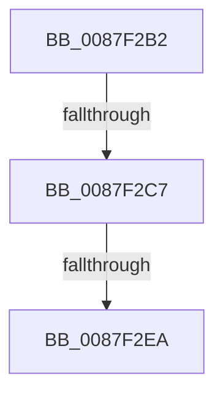

# sub_0087F2B2

- RVA: `0x0087F2B2`–`0x0087F2EB` (길이 `57` bytes)
- VA: `0x000000014087F2B2`
- 실행 섹션: `PAGE`
- PDB 이름 있음: `아니요`; PDB Function 태그: `아니요`
- unwind 정보 RVA: `0x0007C130`
- 디코드: `12`개 명령, `57/57` bytes 표시
- 미해석 바이트: `0` (있으면 어셈블리에 `.byte`로 보존)

> 이 문서는 커널 이미지의 기계어와 PDB 기호를 분석해 생성했습니다. 4번과 5번은 함수 원형과 자료형을 바이너리 사용 방식에서 추정한 C 해석이며 원본 소스 복구 결과는 아닙니다.

## 1. Dependencies

- 직접 호출 지점: **1**; 고유 호출 대상: **1**
- 직접 호출자로 확인된 함수: **0**
- RIP 상대 이미지 참조: **0**

### Outgoing calls
- `0x0087F2CE` → [KeAbPostRelease](../../text/2E/KeAbPostRelease_function_002E1600.md) (function, `0x002E1600`)

### Direct callers
- 이 함수 시작 RVA로 연결되는 직접 call은 확인되지 않았습니다. 간접 호출은 완전히 역산할 수 없습니다.

### Static image references
- 디코드된 RIP-relative 메모리 참조가 없습니다.

## 2. Other-region calls and transfers

- 다른 실행 섹션으로 향하는 call: **1**
  - `0x0087F2CE` → [KeAbPostRelease](../../text/2E/KeAbPostRelease_function_002E1600.md) (`PAGE` → `.text`)
- call이 아닌 외부 분기/꼬리 이동: **2**
  - `0x0087F2C1` → [sub_0087F45A](Unknown_function_0087F45A.md) (`tail-transfer`)
  - `0x0087F2E8` → [sub_0087F2EB + 0x1C](Unknown_function_0087F2EB.md) (`tail-transfer`)

## 3. Assembly (complete function range)

```asm
0087F2B2  F0 49 0F C1 9E F0 04 00 00      lock xadd qword ptr [r14 + 0x4f0], rbx
0087F2BB  80 E3 06                        and bl, 6
0087F2BE  80 FB 02                        cmp bl, 2
0087F2C1  0F 84 93 01 00 00               je 0x14087f45a
0087F2C7  49 8D 8E F0 04 00 00            lea rcx, [r14 + 0x4f0]
0087F2CE  E8 2D 23 A6 FF                  call 0x1402e1600
0087F2D3  4C 8B 74 24 50                  mov r14, qword ptr [rsp + 0x50]
0087F2D8  48 8B 7C 24 60                  mov rdi, qword ptr [rsp + 0x60]
0087F2DD  48 8B 9C 24 A0 00 00 00         mov rbx, qword ptr [rsp + 0xa0]
0087F2E5  48 85 ED                        test rbp, rbp
0087F2E8  74 1D                           je 0x14087f307
0087F2EA  90                              nop
```

## 4. C-style interpretation (structured pseudocode)

```c
__int64 __fastcall sub_0087F2B2(__int64 a1, __int64 a2, __int64 a3, __int64 a4, __int64 a5, __int64 a6, __int64 a7, __int64 a8, __int64 a9, __int64 a10, __int64 a11, __int64 a12, __int64 a13, __int64 a14, __int64 a15, __int64 a16, __int64 a17, __int64 a18, __int64 a19, __int64 a20)
{
    __int64 result;
    __int64 v_rbx;

    v_rbx = (unsigned __int8)((v_rbx) & (6));
    result = KeAbPostRelease(v_r14 + 1264, a2, a3, a4);
    return result;
}
```

## 5. (Beta) C Style

```c
int64_t sub_0087F2B2(int64_t Arg1, int64_t Arg2, int64_t Arg3, int64_t Arg4, uint64_t Arg5, uint64_t Arg6, uint64_t Arg7, uint64_t Arg8, uint64_t Arg9, int64_t Arg10, uint64_t Arg11, int64_t Arg12, uint64_t Arg13, uint64_t Arg14, uint64_t Arg15, uint64_t Arg16, uint64_t Arg17, uint64_t Arg18, uint64_t Arg19, int64_t Arg20)
{
    int64_t result;
    int64_t local_rbx;

    local_rbx = (uint8_t)((local_rbx) & (6));
    result = KeAbPostRelease(local_r14 + 1264, Arg2, Arg3, Arg4);
    return result;
}
```

## 6. Execution-region graph

[열기: 2D/3D 그래프와 함수 탐색 컨트롤 패널](../../../control-panel.html?section=page&rva=0x0087F2B2&view=graph)

- 2D 그래프는 위에서 아래로 흐르고, 3D 그래프는 빈 공간을 드래그해 회전합니다. Shift+드래그는 이동, 휠은 확대·축소, 함수 노드 선택은 대상 보고서 이동입니다.

### Static fallback


