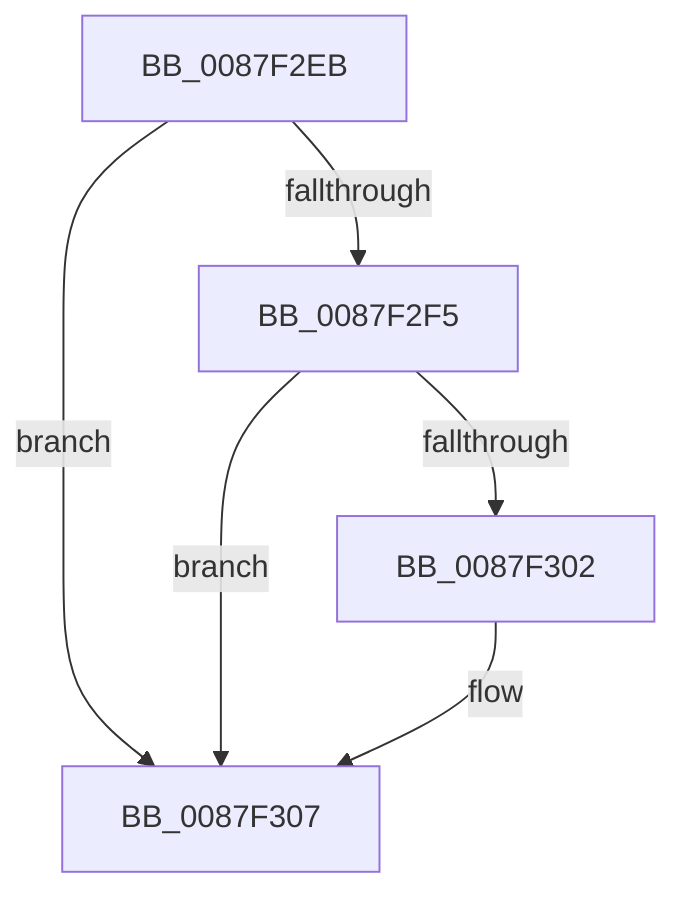

# sub_0087F2EB

- RVA: `0x0087F2EB`–`0x0087F315` (길이 `42` bytes)
- VA: `0x000000014087F2EB`
- 실행 섹션: `PAGE`
- PDB 이름 있음: `아니요`; PDB Function 태그: `아니요`
- unwind 정보 RVA: `0x0007C144`
- 디코드: `10`개 명령, `42/42` bytes 표시
- 미해석 바이트: `0` (있으면 어셈블리에 `.byte`로 보존)

> 이 문서는 커널 이미지의 기계어와 PDB 기호를 분석해 생성했습니다. 4번과 5번은 함수 원형과 자료형을 바이너리 사용 방식에서 추정한 C 해석이며 원본 소스 복구 결과는 아닙니다.

## 1. Dependencies

- 직접 호출 지점: **1**; 고유 호출 대상: **1**
- 직접 호출자로 확인된 함수: **0**
- RIP 상대 이미지 참조: **0**

### Outgoing calls
- `0x0087F302` → [KiCheckForKernelApcDelivery](../../text/2E/KiCheckForKernelApcDelivery_function_002E2C80.md) (function, `0x002E2C80`)

### Direct callers
- 이 함수 시작 RVA로 연결되는 직접 call은 확인되지 않았습니다. 간접 호출은 완전히 역산할 수 없습니다.

### Static image references
- 디코드된 RIP-relative 메모리 참조가 없습니다.

## 2. Other-region calls and transfers

- 다른 실행 섹션으로 향하는 call: **1**
  - `0x0087F302` → [KiCheckForKernelApcDelivery](../../text/2E/KiCheckForKernelApcDelivery_function_002E2C80.md) (`PAGE` → `.text`)
- 별도 외부 분기/꼬리 이동을 확인하지 못했습니다.

## 3. Assembly (complete function range)

```asm
0087F2EB  66 83 85 E6 01 00 00 01         add word ptr [rbp + 0x1e6], 1
0087F2F3  75 12                           jne 0x14087f307
0087F2F5  48 8D 8D 98 00 00 00            lea rcx, [rbp + 0x98]
0087F2FC  90                              nop
0087F2FD  48 39 09                        cmp qword ptr [rcx], rcx
0087F300  74 05                           je 0x14087f307
0087F302  E8 79 39 A6 FF                  call 0x1402e2c80
0087F307  48 8B 6C 24 70                  mov rbp, qword ptr [rsp + 0x70]
0087F30C  40 0F B6 C6                     movzx eax, sil
0087F310  48 8B 74 24 68                  mov rsi, qword ptr [rsp + 0x68]
```

## 4. C-style interpretation (structured pseudocode)

```c
__int64 __fastcall sub_0087F2EB(__int64 a1, __int64 a2, __int64 a3, __int64 a4, __int64 a5, __int64 a6, __int64 a7, __int64 a8, __int64 a9, __int64 a10, __int64 a11, __int64 a12, __int64 a13, __int64 a14)
{
    __int64 result;

    if (condition_is_not_equal) goto loc_0087F307;
    if ((*(unsigned __int64 *)(v_rbp + 152)) != (v_rbp + 152)) {
        result = KiCheckForKernelApcDelivery(v_rbp + 152, a2, a3, a4);
    }
    return (unsigned __int8)(v_rsi);
}
```

## 5. (Beta) C Style

```c
int64_t sub_0087F2EB(int64_t Arg1, int64_t Arg2, int64_t Arg3, int64_t Arg4, uint64_t Arg5, uint64_t Arg6, uint64_t Arg7, uint64_t Arg8, uint64_t Arg9, uint64_t Arg10, uint64_t Arg11, uint64_t Arg12, int64_t Arg13, int64_t Arg14)
{
    int64_t result;

    if (condition_is_not_equal) goto loc_0087F307;
    if ((*(uint64_t *)(local_rbp + 0x98)) != (local_rbp + 152)) {
        result = KiCheckForKernelApcDelivery(local_rbp + 152, Arg2, Arg3, Arg4);
    }
    return (uint8_t)(local_rsi);
}
```

## 6. Execution-region graph

[열기: 2D/3D 그래프와 함수 탐색 컨트롤 패널](../../../control-panel.html?section=page&rva=0x0087F2EB&view=graph)

- 2D 그래프는 위에서 아래로 흐르고, 3D 그래프는 빈 공간을 드래그해 회전합니다. Shift+드래그는 이동, 휠은 확대·축소, 함수 노드 선택은 대상 보고서 이동입니다.

### Static fallback


