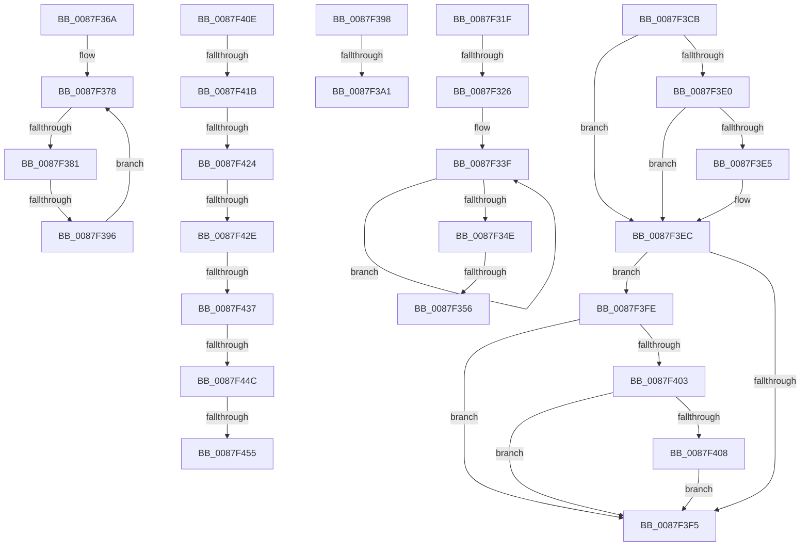

# sub_0087F31F

- RVA: `0x0087F31F`–`0x0087F45A` (길이 `315` bytes)
- VA: `0x000000014087F31F`
- 실행 섹션: `PAGE`
- PDB 이름 있음: `아니요`; PDB Function 태그: `아니요`
- unwind 정보 RVA: `0x0007C170`
- 디코드: `74`개 명령, `315/315` bytes 표시
- 미해석 바이트: `0` (있으면 어셈블리에 `.byte`로 보존)

> 이 문서는 커널 이미지의 기계어와 PDB 기호를 분석해 생성했습니다. 4번과 5번은 함수 원형과 자료형을 바이너리 사용 방식에서 추정한 C 해석이며 원본 소스 복구 결과는 아닙니다.

## 1. Dependencies

- 직접 호출 지점: **2**; 고유 호출 대상: **2**
- 직접 호출자로 확인된 함수: **0**
- RIP 상대 이미지 참조: **2**

### Outgoing calls
- `0x0087F360` → [ExQueueWorkItem](../../text/2F/ExQueueWorkItem_function_002F9520.md) (function, `0x002F9520`)
- `0x0087F3AA` → [PspUnlockJobMemoryLimitsExclusive](PspUnlockJobMemoryLimitsExclusive_function_0087D390.md) (function, `0x0087D390`)

### Direct callers
- 이 함수 시작 RVA로 연결되는 직접 call은 확인되지 않았습니다. 간접 호출은 완전히 역산할 수 없습니다.

### Static image references
- `0x0087F332` → RVA `0x00F065E8` (`.data`; read)
- `0x0087F359` → RVA `0x00F06600` (`.data`; read)

## 2. Other-region calls and transfers

- 다른 실행 섹션으로 향하는 call: **1**
  - `0x0087F360` → [ExQueueWorkItem](../../text/2F/ExQueueWorkItem_function_002F9520.md) (`PAGE` → `.text`)
- call이 아닌 외부 분기/꼬리 이동: **15**
  - `0x0087F324` → [sub_0087F08B + 0x21D](Unknown_function_0087F08B.md) (`tail-transfer`)
  - `0x0087F350` → [sub_0087F08B + 0x21D](Unknown_function_0087F08B.md) (`tail-transfer`)
  - `0x0087F365` → [sub_0087F08B + 0x21D](Unknown_function_0087F08B.md) (`tail-transfer`)
  - `0x0087F37B` → [sub_0087F08B + 0x1DB](Unknown_function_0087F08B.md) (`tail-transfer`)
  - `0x0087F390` → [sub_0087F08B + 0x1DB](Unknown_function_0087F08B.md) (`tail-transfer`)
  - `0x0087F39B` → [sub_0087F08B + 0x137](Unknown_function_0087F08B.md) (`tail-transfer`)
  - `0x0087F3C6` → [sub_0087F08B + 0x1E0](Unknown_function_0087F08B.md) (`tail-transfer`)
  - `0x0087F3F9` → [sub_0087F08B + 0x185](Unknown_function_0087F08B.md) (`tail-transfer`)
  - `0x0087F415` → [sub_0087F08B + 0x161](Unknown_function_0087F08B.md) (`tail-transfer`)
  - `0x0087F41E` → [sub_0087F08B + 0x161](Unknown_function_0087F08B.md) (`tail-transfer`)
  - `0x0087F428` → [sub_0087F483 + 0x31](Unknown_function_0087F483.md) (`tail-transfer`)
  - `0x0087F431` → [sub_0087F483 + 0x38](Unknown_function_0087F483.md) (`tail-transfer`)
  - `0x0087F44A` → [sub_0087F483 + 0x42](Unknown_function_0087F483.md) (`tail-transfer`)
  - `0x0087F44F` → [sub_0087F08B + 0x175](Unknown_function_0087F08B.md) (`tail-transfer`)
  - `0x0087F455` → [sub_0087F08B + 0x185](Unknown_function_0087F08B.md) (`tail-transfer`)

## 3. Assembly (complete function range)

```asm
0087F31F  83 7C 24 20 00                  cmp dword ptr [rsp + 0x20], 0
0087F324  74 82                           je 0x14087f2a8
0087F326  F0 41 81 8E 10 06 00 00 00 00 10 00  lock or dword ptr [r14 + 0x610], 0x100000
0087F332  0F 0D 0D AF 72 68 00            prefetchw byte ptr [rip + 0x6872af]
0087F339  8B 05 A9 72 68 00               mov eax, dword ptr [rip + 0x6872a9]
0087F33F  8B C8                           mov ecx, eax
0087F341  83 C9 06                        or ecx, 6
0087F344  F0 0F B1 0D 9C 72 68 00         lock cmpxchg dword ptr [rip + 0x68729c], ecx
0087F34C  75 F1                           jne 0x14087f33f
0087F34E  A8 04                           test al, 4
0087F350  0F 85 52 FF FF FF               jne 0x14087f2a8
0087F356  41 8B D3                        mov edx, r11d
0087F359  48 8D 0D A0 72 68 00            lea rcx, [rip + 0x6872a0]
0087F360  E8 BB A1 A7 FF                  call 0x1402f9520
0087F365  E9 3E FF FF FF                  jmp 0x14087f2a8
0087F36A  0F 0D 8F C8 02 00 00            prefetchw byte ptr [rdi + 0x2c8]
0087F371  48 8B 87 C8 02 00 00            mov rax, qword ptr [rdi + 0x2c8]
0087F378  4C 3B E8                        cmp r13, rax
0087F37B  0F 86 E5 FE FF FF               jbe 0x14087f266
0087F381  48 8B C8                        mov rcx, rax
0087F384  F0 4C 0F B1 AF C8 02 00 00      lock cmpxchg qword ptr [rdi + 0x2c8], r13
0087F38D  48 3B C1                        cmp rax, rcx
0087F390  0F 84 D0 FE FF FF               je 0x14087f266
0087F396  EB E0                           jmp 0x14087f378
0087F398  4C 3B F8                        cmp r15, rax
0087F39B  0F 86 21 FE FF FF               jbe 0x14087f1c2
0087F3A1  45 33 C0                        xor r8d, r8d
0087F3A4  49 8B D6                        mov rdx, r14
0087F3A7  48 8B CF                        mov rcx, rdi
0087F3AA  E8 E1 DF FF FF                  call 0x14087d390
0087F3AF  40 84 F6                        test sil, sil
0087F3B2  48 8B C7                        mov rax, rdi
0087F3B5  48 0F 44 44 24 28               cmove rax, qword ptr [rsp + 0x28]
0087F3BB  40 32 F6                        xor sil, sil
0087F3BE  48 8B D0                        mov rdx, rax
0087F3C1  48 89 44 24 28                  mov qword ptr [rsp + 0x28], rax
0087F3C6  E9 A0 FE FF FF                  jmp 0x14087f26b
0087F3CB  F7 01 00 00 20 00               test dword ptr [rcx], 0x200000
0087F3D1  48 8B 51 28                     mov rdx, qword ptr [rcx + 0x28]
0087F3D5  4D 0F 44 C7                     cmove r8, r15
0087F3D9  33 C0                           xor eax, eax
0087F3DB  48 85 D2                        test rdx, rdx
0087F3DE  74 0C                           je 0x14087f3ec
0087F3E0  4D 85 C9                        test r9, r9
0087F3E3  7E 07                           jle 0x14087f3ec
0087F3E5  4C 3B C2                        cmp r8, rdx
0087F3E8  41 0F 47 C2                     cmova eax, r10d
0087F3EC  48 8B 51 20                     mov rdx, qword ptr [rcx + 0x20]
0087F3F0  48 85 D2                        test rdx, rdx
0087F3F3  75 09                           jne 0x14087f3fe
0087F3F5  09 44 24 20                     or dword ptr [rsp + 0x20], eax
0087F3F9  E9 12 FE FF FF                  jmp 0x14087f210
0087F3FE  4D 85 C9                        test r9, r9
0087F401  7F F2                           jg 0x14087f3f5
0087F403  4C 3B C2                        cmp r8, rdx
0087F406  73 ED                           jae 0x14087f3f5
0087F408  0F BA E8 0F                     bts eax, 0xf
0087F40C  EB E7                           jmp 0x14087f3f5
0087F40E  4C 3B BF B8 02 00 00            cmp r15, qword ptr [rdi + 0x2b8]
0087F415  0F 86 D1 FD FF FF               jbe 0x14087f1ec
0087F41B  4D 85 C9                        test r9, r9
0087F41E  0F 8E C8 FD FF FF               jle 0x14087f1ec
0087F424  40 F6 C5 01                     test bpl, 1
0087F428  0F 85 86 00 00 00               jne 0x14087f4b4
0087F42E  40 84 F6                        test sil, sil
0087F431  0F 84 84 00 00 00               je 0x14087f4bb
0087F437  48 8B CF                        mov rcx, rdi
0087F43A  40 32 F6                        xor sil, sil
0087F43D  48 83 BF 28 02 00 00 00         cmp qword ptr [rdi + 0x228], 0
0087F445  48 89 4C 24 28                  mov qword ptr [rsp + 0x28], rcx
0087F44A  75 79                           jne 0x14087f4c5
0087F44C  40 84 F6                        test sil, sil
0087F44F  0F 85 AB FD FF FF               jne 0x14087f200
0087F455  E9 B6 FD FF FF                  jmp 0x14087f210
```

## 4. C-style interpretation (structured pseudocode)

```c
__int64 __fastcall sub_0087F31F(__int64 a1, __int64 a2, int a3, __int64 a4)
{
    __int64 result;
    unsigned int v_stack_p20;
    unsigned __int64 v_stack_p28;

loc_0087F33F:
    a1 = (unsigned int)(((unsigned int)((unsigned int)((unsigned int)(*(unsigned int *)(v_rip + 6845097))))) | (6));
    if (condition_is_not_equal) goto loc_0087F33F;
    result = ExQueueWorkItem(v_rip + 6845088, (unsigned int)((unsigned int)(v_r11)), a3, a4);
}
```

## 5. (Beta) C Style

```c
int64_t sub_0087F31F(int64_t Arg1, int64_t Arg2, int32_t Arg3, int64_t Arg4)
{
    int64_t result;
    uint32_t v_stack_p20;
    uint64_t v_stack_p28;

loc_0087F33F:
    Arg1 = (uint32_t)(((uint32_t)((uint32_t)((uint32_t)(*(uint32_t *)(v_rip + 0x6872A9))))) | (6));
    if (condition_is_not_equal) goto loc_0087F33F;
    result = ExQueueWorkItem(v_rip + 6845088, (uint32_t)((uint32_t)(local_r11)), Arg3, Arg4);
}
```

## 6. Execution-region graph

[열기: 2D/3D 그래프와 함수 탐색 컨트롤 패널](../../../control-panel.html?section=page&rva=0x0087F31F&view=graph)

- 2D 그래프는 위에서 아래로 흐르고, 3D 그래프는 빈 공간을 드래그해 회전합니다. Shift+드래그는 이동, 휠은 확대·축소, 함수 노드 선택은 대상 보고서 이동입니다.

### Static fallback


